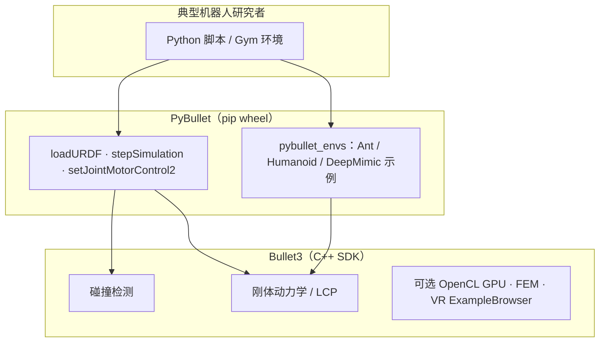

# PyBullet

**PyBullet** 把 **[Bullet3](https://github.com/bulletphysics/bullet3)** C++ 物理 SDK 封装为 **Python API**（`pip install pybullet`），是机器人 RL 领域最常见的 **轻量级入门仿真器** 之一：几分钟内即可加载 URDF、设置重力、在循环里读状态、写电机指令。官方主页与案例索引见 [pybullet.org](https://pybullet.org/wordpress/)。

## 一句话定义

用 Python 直接 `loadURDF` + `stepSimulation` 跑通 **状态–动作–奖励–物理转移** 闭环，而不必先搭 ROS 或 GPU 仿真农场。

## 英文缩写速查

| 缩写 | 英文全称 | 简要说明 |
|------|----------|----------|
| URDF | Unified Robot Description Format | PyBullet 默认机器人模型格式 |
| RL | Reinforcement Learning | 常与 PyBullet 联用做策略学习 |
| PD | Proportional–Derivative | `POSITION_CONTROL` / `VELOCITY_CONTROL` 底层跟踪 |
| GUI | Graphical User Interface | `p.connect(p.GUI)` 可视化调试 |
| LCP | Linear Complementarity Problem | Bullet 刚体接触常用 hard-contact 求解框架 |
| FEM | Finite Element Method | Bullet3 可选可变形体仿真（相对 RL 主线较少用） |
| Sim2Real | Simulation to Real | 仿真策略迁移到真机 |
| MDP | Markov Decision Process | 状态–动作–转移–奖励形式化 |
| DR | Domain Randomization | 域随机化 |
| FM | Foundation Model | 大模型/基础模型增强迁移 |

## 与 Bullet3 的分层

- **选 PyBullet**：教学、快速原型、与 NumPy / SB3 集成、笔记本无 GPU 农场。
- **选裸 Bullet3 C++**：游戏引擎插件、VR 沙盒、需深度改物理管线或 ExampleBrowser 调试；机器人 RL **仍建议 PyBullet**（官方 README 亦如此）。

## 为什么重要

- **教学与最小闭环**：在进 Isaac Lab / MuJoCo 大规模训练前，用 KUKA 臂定点、倒立摆等 **几十行脚本** 把 MDP 五元组与仿真步进对齐（见 [具身 RL 最小闭环](../concepts/embodied-rl-minimal-closed-loop.md)）。
- **历史生态**：[motion_imitation](./motion-imitation-quadruped.md)（四足模仿动物，RSS 2020）、早期 DeepMimic 复现、[gym-pybullet-drones](./gym-pybullet-drones.md)（四旋翼 RL）均建立于 PyBullet；官方站亦索引 Assistive Gym、[Habitat-Sim](./habitat-sim.md) Bullet 集成（conda `withbullet`）等。
- **依赖轻**：官方提供预编译 manylinux wheel，可直接在 Colab 使用；适合课程与算法 ablation。

## 核心原理：核心能力与 API

官方 Quickstart 的架构说明：PyBullet 是**客户端–服务器**式 API——脚本（客户端）发命令，物理服务器返回状态。内置服务器有 `DIRECT`（无图形，同进程，适合无 GPU 云机）与 `GUI`（OpenGL 窗口）；`SHARED_MEMORY` / UDP / TCP 可连别的进程或远程机器。默认后端是 CPU 上的 Bullet 2.x，刚体、降维坐标多体与可变形体由统一的 LCP 约束求解器处理，正向动力学用 Articulated Body Algorithm。

| 能力 | API 直觉 |
|------|----------|
| 加载场景 | `loadURDF("plane.urdf")`、机器人 `loadURDF(...)` |
| 物理步进 | `stepSimulation()` 推进一个仿真 tick（默认 1/240 s；服务器默认不自动步进，除非开 `setRealTimeSimulation`） |
| 读状态 | `getLinkState` / `getJointState` → 末端位姿、关节角 |
| 写动作 | `setJointMotorControl2`（`POSITION_CONTROL` 实为位置–速度 PD、`VELOCITY_CONTROL`、`TORQUE_CONTROL`、`PD_CONTROL`） |
| 可视化 | `p.connect(p.GUI)` 或 `DIRECT` 无头 |
| 共享内存 / VR | `p.connect(p.SHARED_MEMORY)` 对接 Bullet VR 沙盒 |
| 内置 Gym 环境 | `pybullet_envs`：Ant、Humanoid、DeepMimic 等（随 bullet3 仓示例） |

## 工程实践

1. **力矩控制要先关默认电机：** 每个转动 / 移动关节默认带速度电机，做力矩控制须先 `setJointMotorControl2(..., VELOCITY_CONTROL, force=0)`；`TORQUE_CONTROL` 只在显式 `stepSimulation` 时生效。官方 FAQ 的建议是先从位置或速度控制起步，力矩控制要花更多功夫才可靠。
2. **时间步与控制频率：** 默认 1/240 s；若想要 60 Hz 控制频率，需要每个控制周期调用 4 次 `stepSimulation`（算术推论，非文档原话），或用 `setTimeStep` 调整。
3. **阻尼与速度钳制：** PyBullet 默认施加线 / 角阻尼，速度上限钳制为 100；做高速或需无阻尼动力学时用 `changeDynamics` 把阻尼置 0。
4. **无头训练：** `p.connect(p.DIRECT)`；仍可用软件渲染的 `getCameraImage`。
5. **内置 Gym 环境：** `pip install pybullet` 同时装 `pybullet_envs` 与 `pybullet_data`，`import pybullet_envs` 后自动注册，含 Ant / Hopper / Humanoid / Walker2D / HalfCheetah / 倒立摆、Minitaur、MIT Racecar、Kuka 抓取，以及 DeepMimic 的 Backflip / Walk 重实现；文档注明 Kuka 环境当时存在训练问题，DeepMimic 示例需要 TensorFlow 1.x。
6. **读状态的坑：** `getLinkState` 返回的是**连杆质心**的世界位姿（四元数 [x,y,z,w]），要连杆坐标系需要再用返回的局部惯性系偏移换算。

## 局限与选型

| 场景 | PyBullet | 更常选 |
|------|----------|--------|
| RL 入门、机械臂 reach 教学 | ✅ 足够 | — |
| 四旋翼 RL 基准 | ✅ [gym-pybullet-drones](./gym-pybullet-drones.md) | Flightmare / Isaac |
| 人形万环境并行 PPO | ⚠️ 慢 | [Isaac Lab](./isaac-gym-isaac-lab.md) |
| 精细接触 / 足端力可信 | ⚠️ 官方文档称刚体由统一 LCP 约束求解器处理（见 [接触互补](../formalizations/contact-complementarity.md)）；相对 MuJoCo 的精度差异为社区经验判断（推测，未在本次入库中对比实测） | [MuJoCo](./mujoco.md) |
| sim2real 精细接触操作 | ❌ 不宜唯一真理源 | MuJoCo + 系统辨识 |
| 可微 / 百万步/秒 rollout | ⚠️ 非主线 | MuJoCo MJX、TDS 等可微栈 |

更多局限（来自官方文档与 README）：

- 默认后端是 CPU 上的 Bullet 2.x；Bullet 3.x 的 OpenCL GPU 路径被描述为实验性，需高端独显，且官方 README 称 OpenCL CPU 设备不可用。
- bullet3 GitHub 的 issue 区因被支持类问题淹没而关闭，提问去 PyBullet 论坛。
- 文档中的一些示例依赖 TensorFlow 1.x 与旧版 Gym，现代环境下需自行适配。

## 关联页面

- [具身 RL 最小闭环](../concepts/embodied-rl-minimal-closed-loop.md) — KUKA 定点任务与 MDP 要素对照
- [motion_imitation](./motion-imitation-quadruped.md) — 四足 PyBullet 模仿标杆
- [gym-pybullet-drones](./gym-pybullet-drones.md) — 四旋翼 Gymnasium 环境
- [Reinforcement Learning](../methods/reinforcement-learning.md)
- [MuJoCo vs Isaac Sim](../comparisons/mujoco-vs-isaac-sim.md)
- [接触互补形式化](../formalizations/contact-complementarity.md)

- 列表实体：[AwesomeSim2Real](../entities/awesome-sim2real.md)
- 技术地图：[AwesomeSim2Real 技术地图](../overview/lc-awesome-sim2real-technology-map.md)
- 方法/任务：[sim2real.md](../concepts/sim2real.md)、[locomotion.md](../tasks/locomotion.md)

- [igibson](./igibson.md)
- [sim-platforms-decade-technology-map](../overview/sim-platforms-decade-technology-map.md)
- [manipulation](../tasks/manipulation.md)

## 参考来源

- [Bullet3 Physics SDK](../../sources/repos/bullet3.md) — 官方 C++ 仓、`pybullet_envs` 与构建说明
- [PyBullet 官方网站](../../sources/sites/pybullet-org.md) — 案例索引、Colab、论坛入口
- [深蓝具身智能：跑通具身控制最小闭环](../../sources/blogs/wechat_shenlan_rl_embodied_minimal_closed_loop.md) — KUKA 教学案例
- [PyBullet Quickstart Guide](https://docs.google.com/document/d/10sXEhzFRSnvFcl3XxNGhnD4N2SedqwdAvK3dsihxVUA/edit) — 官方 API 教程（以文档为准）
- [bulletphysics/bullet3](https://github.com/bulletphysics/bullet3) · [pybullet.org](https://pybullet.org/wordpress/)

- [`sources/papers/lc_awesome_sim2real_noarxiv_099_pybullet-real-time-physics-simulation.md`](../../sources/papers/lc_awesome_sim2real_noarxiv_099_pybullet-real-time-physics-simulation.md) — 本条目策展摘录
- [`sources/papers/lc_awesome_sim2real_catalog.md`](../../sources/papers/lc_awesome_sim2real_catalog.md) — 列表总表
- [`sources/repos/awesome-sim2real.md`](../../sources/repos/awesome-sim2real.md)
- 论文：<https://pybullet.org/wordpress/>

- [habitat-sim](../../sources/repos/habitat-sim.md)

- [wechat_shenlan_sim_platforms_top8_decade](../../sources/blogs/wechat_shenlan_sim_platforms_top8_decade.md)

## 推荐继续阅读

- [PyBullet Quickstart Guide](https://docs.google.com/document/d/10sXEhzFRSnvFcl3XxNGhnD4N2SedqwdAvK3dsihxVUA/edit) — URDF、控制模式与传感器
- [Google Colab PyBullet + SB3 示例](https://pybullet.org/wordpress/) — 站点链出的在线训练入口
- [motion_imitation 项目页](https://github.com/google-research/motion_imitation) — 四足模仿动物官方实现

- [AwesomeSim2Real 仓库](https://github.com/LongchaoDa/AwesomeSim2Real)
