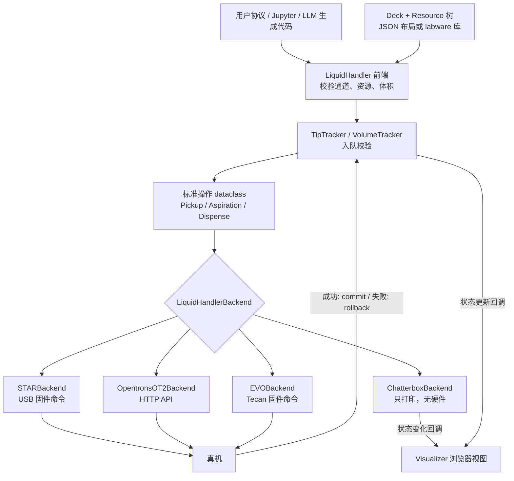
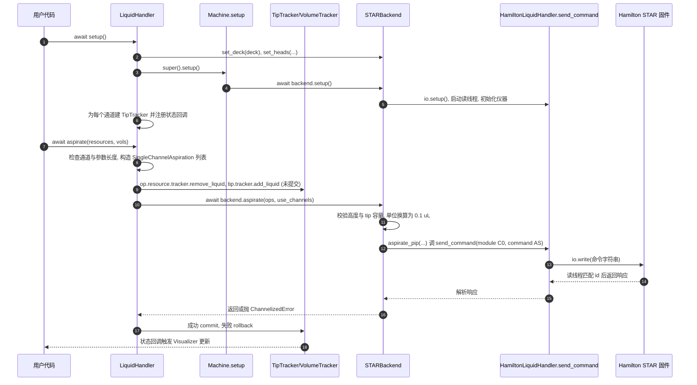

# PyLabRobot

**PyLabRobot（PLR）** 是 MIT Media Lab（Esvelt 组）等人开发的开源 Python 库（[文档](https://docs.pylabrobot.org/stable/)、[GitHub](https://github.com/PyLabRobot/pylabrobot)、[Device 论文](https://doi.org/10.1016/j.device.2023.100111)）。本页把论文、官方文档、受支持机器清单、可视化器指南与仓库源码合并为一个节点。

> 读源状态：论文只通读了 bioRxiv 预印本 v1（Device 正式版因站点 403 未取到）；官方文档只读了首页、Supported Machines、Visualizer、Installation 四页，其余页面未读，故 `status: draft`。

## 一句话定义

**PyLabRobot 是一套硬件与操作系统无关的纯 Python 实验室自动化 SDK：同一个 `LiquidHandler` 接口 + 一个按机型实现的 Backend + 一棵 `Resource` 甲板资源树，就能用同样的协议代码驱动不同品牌的液体处理机、读板器等设备。**

## 英文缩写速查

| 缩写 | 英文全称 | 简要说明 |
|------|----------|----------|
| PLR | PyLabRobot | 本项目简称 |
| LH | LiquidHandler | 接口层液体处理前端类 |
| ABC | Abstract Base Class | 所有同类 backend 继承的抽象基类 |
| STAR | Hamilton Microlab STAR | Hamilton 液体处理机型号，固件命令经 USB |
| EVO | Tecan Freedom EVO | Tecan 液体处理机型号 |
| OT-2 | Opentrons OT-2 | 经 HTTP API 控制的液体处理机 |
| CoRe 96 | Compressed O-ring Expansion 96 head | Hamilton 的 96 通道头，对应 `*96` 方法 |
| LLD | Liquid Level Detection | 液面检测，STAR backend 的参数之一 |
| PLR-RLP | PLR Resource Locator Program | 论文中的位置标定 / 路径示教工具 |

## 为什么重要

- 液体处理机通常被厂商专有软件绑定，协议难以在不同机型间迁移；论文的出发点正是这一点（引言，作者表述）。
- Python + `async/await` 使协议可以接入科学计算与机器学习生态，也便于让 LLM 生成控制代码（论文 §LLM Assistant、Discussion）。
- 文档首页自称 "SDK for Automated & Autonomous Laboratories"，是"自驱动实验室"的底层执行层候选。与 [WetRobo](paper-wetrobo.md)、[SAIGEN](paper-saigen.md)、[Agentic Aptamer Sandbox](paper-agentic-aptamer-sandbox.md) 这类上层智能体工作互补：它们解决"决策与规划"，PLR 解决"落到哪台设备上怎么动"（关系为本页的归纳，未逐篇核对这些页是否实际使用 PLR）。

## 核心机制：硬件无关的抽象层

论文把系统分为**接口层**与**执行层**（Fig.1）：

| 概念 | 真实类 / 模块 | 作用 |
|------|---------------|------|
| 机器（Machine） | `legacy/machines/machine.py` 的 `Machine` | `setup()` / `stop()` 生命周期，`need_setup_finished` 检查 |
| 前端 | `LiquidHandler(Resource, Machine)` | 校验、拼装操作、管理 tracker、转调 backend |
| 后端（Backend） | `LiquidHandlerBackend` 的子类 | 把标准操作译成固件串或 HTTP 请求 |
| 资源（Resource） | `Deck`、`Carrier`、`Plate`、`TipRack`、`Container`、`Well` | 有根树，位置为相对父节点的偏移（论文 Fig.2） |
| 方法（标准操作） | `Pickup` / `Drop` / `SingleChannelAspiration` / `SingleChannelDispense` 及 96 通道变体 | 前端与后端之间的 dataclass，可序列化为 JSON（Fig.3） |

要点（均出自论文 §Results 与 Methods）：

- **后端职责最小化：** 只需实现 pick_up_tips / drop_tips / aspirate / dispense（及 96 与资源搬运），`transfer`、`discard_tips`、`return_tips` 等组合操作在 `LiquidHandler` 层完成（Table 2）。
- **tracker 事务：** tip tracker 与 volume tracker 在命令发出前校验，入队、执行、全成功则提交，否则回滚；这样能在硬件动作前拦下"没有 tip""体积不足"之类错误，并支撑 `return_tips`。
- **甲板命名函数化：** 协议用 "bacteria lagoons" 这类功能名引用资源，换机器只需换 deck 布局（论文 §Deck Layout）。
- **HEAD 的新变化（仓库核对）：** `pylabrobot.liquid_handling` 与 `pylabrobot.machines` 现为转发到 `pylabrobot.legacy` 的弃用入口；Hamilton STAR 另有 v1 风格的 `hamilton/star/driver/master.py`（`STARDriver`，"一个 driver、功能挂在其下"，见 `hamilton/star/design.md`）。文档的机器表以 v0 / v1 标注驱动代，v0 驱动在 `pylabrobot.legacy`，"正在迁移"。

## 流程总览

图依据：论文 Fig.1、§Monitoring；源码 `legacy/liquid_handling/liquid_handler.py`、`backends/`。

## 支持的液体处理机清单

来自官方 Supported Machines 页（抓取日 2026-11-07，页面为动态表，随版本变化）。支持程度定义：WIP < Basic < Mostly < Full（Full 指 ≥90% 能力且有文档）；v0 / v1 为驱动代。

| 厂商 | 型号 | 文档标注的支持程度 | 驱动代 |
|------|------|------|------|
| Hamilton | STAR（含 STARlet 子型号） | Full | v0 |
| Hamilton | Vantage | Mostly | v0 |
| Hamilton | Nimbus | Mostly | v0 |
| Hamilton | Prep | WIP | 表中未标 |
| Opentrons | OT-2 | Mostly | v1 |
| Opentrons | Flex | Basic | v1 |
| Tecan | EVO | Basic | v0 |

与论文对照：论文 §Methods 只描述 STAR、EVO、Opentrons 三个 backend，并称 STAR 在 Windows / macOS / Raspberry Pi OS 验证，EVO 在 Windows / macOS 验证；README 的当前口径是 STAR、Vantage、EVO、OT-2。除液体处理机外，同表还列有读板器、离心机、热循环仪、机械臂、天平等数十种设备，不在此逐条展开（清单见 [官方文档归档](../../sources/sites/pylabrobot_docs.md)）。

## 可视化器与模拟后端

- **论文版（2023）：** 浏览器模拟器由 `SimulatorBackend`（`WebsocketBackend` 子类）驱动，另有托管版 simulator.pylabrobot.org 和图形化 labware 布局编辑器（Fig.5）。该类名在当前仓库 HEAD 的 `.py` 中检索不到，**以现行文档与源码为准**。
- **现行版：** `pylabrobot.visualizer.Visualizer(resource=lh)`；`await vis.setup()` 后在 `127.0.0.1:2121` 起 websocket、`127.0.0.1:1337` 起文件服务；它订阅资源的 assign / unassign 与 state 更新回调并推送给浏览器（`visualizer.py`）。
- **无硬件模拟：** 用 `LiquidHandlerChatterboxBackend`（只打印操作）即可；须 `set_tip_tracking(True)`、`set_volume_tracking(True)`，页面才显示 tip 有无，孔的不透明度对应装满比例（官方 Visualizer 指南）。
- 也可与真机并用来观察 PLR 内部的资源与 tracker 状态。注意：这是"状态镜像"而非物理仿真，不模拟液体动力学或碰撞（推测，基于文档只描述 tracker 状态显示）。

## 源码运行时序图

静态阅读、未运行。入口为 `LiquidHandler.setup` 与 `aspirate`，后端以 Hamilton STAR 为例（USB 固件命令）。

关键复现路径：`LiquidHandler.aspirate`（`legacy/liquid_handling/liquid_handler.py`）→ `STARBackend.aspirate` → `aspirate_pip` → `HamiltonLiquidHandler.send_command`（`backends/hamilton/base.py`）。换成 `OpentronsOT2Backend` 时，第 8–9 步变为经 Opentrons HTTP run API 的 `aspirate_in_place` 与移动调用；换成 `LiquidHandlerChatterboxBackend` 则只打印表格。

## 实验与评测

论文没有定量对比表，验证方式是"单元测试 + 应用演示"（摘要、Methods）：

| 项 | 内容（出处） |
|----|------|
| 单元测试 | 执行层测试断言用户输入生成一致的机器级命令，无需硬件（Methods） |
| 跨平台 | STAR：Windows、macOS、Raspberry Pi OS；EVO：Windows、macOS（Methods） |
| 跨品牌 labware | Hamilton 的 resources 用在 Opentrons 上，反之亦然（Methods > Labware Libraries） |
| 演示 1 | Art Studio：Opentrons 上以水彩打印用户的 12×8 图案（§Applications） |
| 演示 2 | Game of Life：以结晶紫染色孔作内存并经读板器读出（§Applications） |
| 工具 | PLR-RLP 标定与路径示教，可键盘 / GUI / 游戏手柄操作（§Applications） |
| LLM | GPT-3.5 加示例代码把自然语言转成 PLR 代码，Table 3 给 4 条示例，未报成功率 |
| 社区 | 论坛 "20+ posts per day"（作者表述） |

## 结论

**PLR 的价值在于一套可被他人扩展的统一接口与资源模型，而不是某项性能指标。**

- 采用时看三件事：目标机型的支持程度（上表）、驱动代（v0 legacy 还是 v1）、是否需要 USB / HTTP 等可选依赖。
- 后端职责小、组合操作放前端，是新增机型的低成本路径；追踪器事务让错误在上机前暴露。
- 论文中"LLM 自动写协议"只是 GPT-3.5 的示例展示，没有可靠性数据；用于自动化实验时需自行加入验证与人工审核（推测）。
- 论文与仓库已有出入（模拟器类、支持机型、v0 / v1 重构），引用具体行为时以文档与源码为准。

## 与自驱动实验室 / 智能体的关系

- 论文 Discussion：模块化结构使 LLM 智能体可"自主设计并执行实验"，并引用闭环机器学习与机器人平台的既有工作；这是作者展望，论文自身没有智能体闭环实验。
- 工程上，PLR 提供原子、可交互、可序列化（JSON）的操作层，适合作为智能体的工具调用层；Visualizer / Chatterbox 提供执行前的无硬件试跑。
- 与具身机器人库的类比（推测）：`LiquidHandler` + Backend 近似"统一接口 + 驱动"的分层，与 [仿真三层](../concepts/robot-simulation-three-layers.md) 讨论的思路相通，但对象是移液而非机器人运动控制。

## 工程实践

1. 安装：Python ≥ 3.10，`pip install pylabrobot`；真机另装 extras，如 `pip install "pylabrobot[usb]"`（STAR / EVO 固件 USB）、`[opentrons]`、`[serial]`（官方 Installation）。
2. 先无硬件试跑：`LiquidHandler(backend=LiquidHandlerChatterboxBackend(), deck=STARLetDeck())` → `await lh.setup()`，再建 `Visualizer(resource=lh)` 并 `await vis.setup()`，浏览器打开 1337 端口。
3. 搭甲板：`lh.deck.assign_child_resource(...)` 或 `Deck.load_from_json_file(...)`；`tip_rack.fill()`、`set_well_volumes()` 设初始状态；开启 tip / volume tracking。
4. 换真机只换 backend 与 deck：`STARBackend()` / `OpentronsOT2Backend(host=...)` / `EVOBackend()`（README 示例）。
5. 先确认机型在支持表中的程度，WIP / Basic 机型缺的命令需自行确认。
6. 开放状态核查：MIT 许可、代码与文档公开、PyPI 发布；论文预印本为 CC-BY 4.0。仓库 HEAD 版本为 `1.0.0b1`（测试版），API 在 legacy 迁移期可能变动。

## 局限

- 论文自述：部分开发仍需物理机器人；信任依赖制造商与同行评审（Methods > Code simulation）。
- 论文无移液精度等定量评测；LLM 示例只是演示（本次通读未见表）。
- 文档自身尚有 TODO 页（如 Liquid Handling 总览页写 "TODO: remove this page"，Visualizer 页的真机连接小节为 TODO）。
- 机器表中多个型号为 WIP 或 Basic；大量 Mettler Toledo 天平型号几乎全为 WIP。
- 本页读源不完整：Device 正式版、文档站其余页面、STAR 固件命令实现全貌均未读，故保持 draft。

## 关联页面

- [机器人仿真三层](../concepts/robot-simulation-three-layers.md)
- [WetRobo](paper-wetrobo.md)
- [SAIGEN](paper-saigen.md)
- [Agentic Aptamer Sandbox](paper-agentic-aptamer-sandbox.md)
- [google-grounding-ai-agents-wet-labs](./google-grounding-ai-agents-wet-labs.md) — Google Research 博客：湿实验自主化的三条研究线（接地到机器人 / 适配体闭环 / 蛋白结合剂）
- [paper-verid-semantic-representation-lab-self-play](./paper-verid-semantic-representation-lab-self-play.md) — VERID：自动化实验室的语义表示与智能体自博弈（Google）

## 参考来源

- [论文归档（bioRxiv v1 / Device）](../../sources/papers/pylabrobot_device_2023.md)
- [官方文档归档](../../sources/sites/pylabrobot_docs.md)
- [仓库归档](../../sources/repos/pylabrobot.md)

## 推荐继续阅读

- [PyLabRobot 官方文档](https://docs.pylabrobot.org/stable/)
- [Supported Machines](https://docs.pylabrobot.org/stable/user_guide/machines.html)
- [Using the Visualizer](https://docs.pylabrobot.org/stable/user_guide/machine-agnostic-features/using-the-visualizer.html)
- [论坛 discuss.pylabrobot.org](https://discuss.pylabrobot.org)
