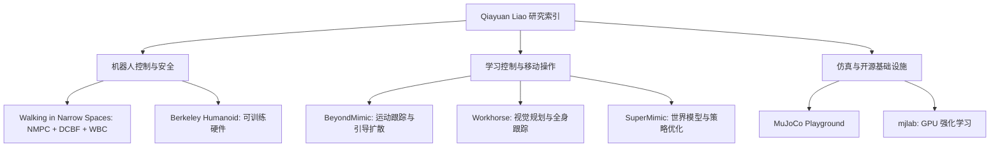

# Qiayuan Liao｜人形机器人全身控制与开源研究

## 一句话定义

**Qiayuan Liao** 的[个人主页](https://qiayuanl.github.io/)是其人形机器人研究与软件的**导航入口**，涉及四足安全优化控制、人形硬件、运动跟踪、视觉全身移动操作及 GPU 强化学习，不是一个统一运行的算法或代码仓库。主页自述其在加州大学伯克利分校攻读博士，导师为 Koushil Sreenath 与 Pieter Abbeel；曾在 Boston Dynamics 参与 E-Atlas 强化学习控制工作。

## 英文缩写速查

| 缩写 | 英文全称 | 简要说明 |
|---|---|---|
| RL | Reinforcement Learning | 人形运动跟踪与控制策略的训练方式 |
| WBC | Whole-Body Control | 根据优化或跟踪目标协调全身运动与接触 |
| NMPC | Nonlinear Model Predictive Control | 四足避障工作中的滚动优化控制 |
| DCBF | Discrete Control Barrier Function | 用于窄空间安全约束的离散控制障碍函数 |
| GPU | Graphics Processing Unit | mjlab 与相关仿真训练的并行计算硬件 |

## 为什么重要

这组工作展示了**从安全约束控制、机器人本体设计，到数据驱动的全身策略学习**的不同研究路径。对复现者而言，最有价值的是区分“已经有公开训练入口的工具”“已归档的历史实现”和“仍仅发布论文/演示的系统”，避免错误拼接互不兼容的项目。

## 核心原理：研究脉络与独立方向

| 方向 | 项目 / 论文 | 经一手来源核验的关键定位 |
|---|---|---|
| 安全优化控制 | [Walking in Narrow Spaces（IROS 2023）](https://arxiv.org/abs/2212.14199v3) | 四足机器人用多面体几何、对偶距离约束及指数 DCBF 结合 NMPC / WBC，减少球形近似在窄空间的保守性 |
| 面向学习的硬件 | [Berkeley Humanoid（ICRA 2025）](./open-source-humanoid-hardware.md) | 简化本体动力学与仿真复杂度，强调抗摔性、可训练性和 Sim2Real |
| 动作跟踪到生成控制 | [BeyondMimic（Science Robotics 2026）](../methods/beyondmimic.md) | 高动态人体运动跟踪，再将运动技能用于带测试时引导的扩散策略 |
| 视觉移动操作 | [Workhorse](./workhorse-humanoid-loco-manipulation.md) | 人类示教中提取躯干、双腕、双脚目标；视觉规划器输出片段，全身跟踪器跟随目标 |
| 世界模型加速学习 | [SuperMimic（CoRL 2026 Oral）](./paper-supermimic.md) | 以学得的可微世界模型支持人形运动跟踪策略优化，不反传原始物理模拟器 |
| 仿真与训练基础设施 | [MuJoCo Playground](./mujoco-playground.md)、[mjlab](./mjlab.md) | GPU 并行 MuJoCo 仿真；mjlab 将 Isaac Lab 风格的 manager API 与 MuJoCo Warp 结合 |

### 流程总览：按研究问题阅读（非单个项目运行时数据流）

图仅表达**主页可验证的研究主题归类**，不表示上述论文依次运行或共用模型、数据集、训练代码。

## 工程实践：如何选择代码入口

| 目标 | 可核对入口 | 状态与注意事项 |
|---|---|---|
| 当前 G1 速度/运动跟踪训练 | [mjlab 官方 README](https://github.com/mujocolab/mjlab) | 公开且持续开发；示例分别使用 `uv run train Mjlab-Velocity-Flat-Unitree-G1`、`uv run train Mjlab-Tracking-Flat-Unitree-G1`，后者需准备 motion registry |
| 阅读 BeyondMimic 旧版训练管线 | [whole_body_tracking](https://github.com/HybridRobotics/whole_body_tracking) | GitHub 已归档、README 标注 retired；有 `scripts/csv_to_npz.py`、`scripts/rsl_rl/train.py`、`scripts/rsl_rl/play.py`，README 指向 mjlab 的 tracking task |
| NMPC + WBC 系统参考 | [legged_control](./legged-control-ocs2.md) | 个人主页标注 retired；GitHub **未**设置 archived 标志，不代表仍维护 |
| 开源可制作人形硬件 | [Berkeley Humanoid Lite](./berkeley-humanoid-lite.md) | 独立公开仓库；不可和 ICRA 2025 的 Berkeley Humanoid 论文/源码等同 |
| 四足窄空间安全控制 | [论文附属仓库](https://github.com/HybridRobotics/quadruped_nmpc_dcbf_duality) | README 有 `cbf_duality`、`legged_control` 子目录及 ROS/Gazebo 启动命令，单独阅读其论文与构建依赖 |

### 源码运行时序图

**不适用（本页是研究者/多个独立项目的导航实体，而不是一个软件项目）。** 不把不同项目的 README 命令编造成统一的运行时序。具体训练/控制序列应查看相应的 [SuperMimic](./paper-supermimic.md)、[BeyondMimic](../methods/beyondmimic.md) 和 [mjlab](./mjlab.md) 节点与官方实现。

## 局限与风险

- **主页存在可核对的错误：** “Walking in Narrow Spaces”在个人主页上复用了 Berkeley Humanoid 的作者列表；实际论文作者是 Qiayuan Liao、Zhongyu Li、Akshay Thirugnanam、Jun Zeng、Koushil Sreenath。其“Webpage”按钮也误指向 Berkeley Humanoid 网站。以 [arXiv:2212.14199v3](https://arxiv.org/abs/2212.14199v3) 为准。
- **Berkeley Humanoid 旧代码入口失效：** 主页链接的 `qiayuanl/isaac_berkeley_humanoid` 本次查询返回 404，不能因此判定其代码仍可获取。
- **不能把所有论文等同于完整开源：** [Workhorse 官方项目页](https://hybridrobotics.github.io/workhorse/) 明示代码尚未发布；SuperMimic 的相关研究团队实现、第三方复现与论文完整资产也要逐一划清边界。
- **项目维护状态不同：** `whole_body_tracking` 已归档、`legged_control` 是主页标注 retired、`mjlab` 仍公开开发中。这些状态不代表工程兼容性，也不保证能复现实验表格。
- 本页通读的是**主页原文和有针对性的官方 README**；不把一次人物索引 ingest 说成通读六篇论文，论文机制和实验细节请到各自节点核实。

## 关联页面

- [SuperMimic](./paper-supermimic.md) · [Workhorse](./workhorse-humanoid-loco-manipulation.md) · [BeyondMimic](../methods/beyondmimic.md)
- [mjlab](./mjlab.md) · [MuJoCo Playground](./mujoco-playground.md) · [Berkeley Humanoid Lite](./berkeley-humanoid-lite.md)
- [全身控制](../concepts/whole-body-control.md) · [强化学习](../methods/reinforcement-learning.md)

## 参考来源

- [Qiayuan Liao 主页全文与链接核验归档](../../sources/sites/qiayuan-liao-homepage.md)（2026-11-11，记录阅读范围、来源勘误与源码开放边界）。
- [Walking in Narrow Spaces 原论文](https://arxiv.org/abs/2212.14199v3)；[开源仓库 README](https://github.com/HybridRobotics/quadruped_nmpc_dcbf_duality)。
- [Workhorse 官方页面](https://hybridrobotics.github.io/workhorse/)；[SuperMimic 官方页面](https://supermimic.github.io/)；[whole_body_tracking README](https://github.com/HybridRobotics/whole_body_tracking)；[mjlab README](https://github.com/mujocolab/mjlab)。

## 推荐继续阅读

- [个人主页](https://qiayuanl.github.io/) — 全部研究项目和软件入口。
- [mjlab 官方训练文档](https://mujocolab.github.io/mjlab/) — 当前可复现的 GPU 强化学习框架。
