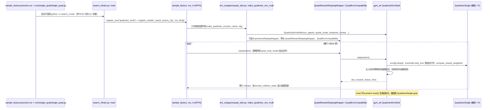

---

type: entity
tags: [repo, reinforcement-learning, swarm, gym, quadcopter, multi-agent, mit]
status: complete
updated: 2026-09-25
related:
  - ../overview/multirotor-simulation-planning-control-stack.md
  - ./gym-pybullet-drones.md
  - ./crazyswarm2.md
sources:
  - ../../sources/repos/quad_swarm_rl.md
summary: "quad-swarm-rl 提供 OpenAI Gym 兼容的多四旋翼环境，用于群体强化学习（编队、避碰、协同任务）的原型实验。"
---

# quad-swarm-rl

**quad-swarm-rl**（[Zhehui-Huang/quad-swarm-rl](https://github.com/Zhehui-Huang/quad-swarm-rl)）是 **多四旋翼 Gym 环境** 的轻量实现，面向 **MARL / swarm RL** 快速试验。

## 英文缩写速查

| 缩写 | 英文全称 | 简要说明 |
|------|----------|----------|
| RL | Reinforcement Learning | 通过与环境交互最大化长期回报来学习策略的范式 |

## 为什么重要

- 与 [gym-pybullet-drones](./gym-pybullet-drones.md) **功能重叠但社区更小**，适合作为 **第二实现** 对照观测/动作/reward 设计。
- 真机 swarm 部署应看 [Crazyswarm2](./crazyswarm2.md) 等 **真机编排** 栈，而非仅 Gym 仿真。

## 核心结构/机制

- 多 quad 同场景并行步进  
- Gym 风格 `reset` / `step`  
- 用于编队、避碰、协同追踪等 MARL 任务原型  

## 常见误区或局限

- **局限：维护与文档** — Stars 与 issue 活跃度低于 UTIAS 环境；生产研究优先 gym-pybullet-drones。
- **局限：无 PX4 耦合** — 纯仿真 RL，上真机需完整迁移管线。

## 源码运行时序图

入口：`python -m sample_factory.launcher.run --run=swarm_rl.runs.single_quad.single_quad ...`（`train.sh`）；runner 脚本拼出 `python -m swarm_rl.train --env=quadrotor_multi --algo=APPO ...`（参数见 `swarm_rl/runs/single_quad/baseline.py`）。评估入口：`python -m swarm_rl.enjoy`。

图依据：Zhehui-Huang/quad-swarm-rl@e18d692，读过 `README.md`、`setup.py`、`train.sh`、`swarm_rl/train.py`、`swarm_rl/enjoy.py`（仅入口）、`swarm_rl/env_wrappers/quad_utils.py`、`reward_shaping.py`（step 片段）、`swarm_rl/runs/single_quad/{single_quad,baseline}.py`、`gym_art/quadrotor_multi/quadrotor_multi.py`（reset/step 片段）、`quadrotor_single.py`（_step 片段）。`sample_factory` 内部（第三方）、神经网络结构细节、渲染与 sim2real 未读，未画。

## 参考来源

- [sources/repos/quad_swarm_rl.md](../../sources/repos/quad_swarm_rl.md)
- [Zhehui-Huang/quad-swarm-rl](https://github.com/Zhehui-Huang/quad-swarm-rl)
- 源码核对（2026-11-02）：Zhehui-Huang/quad-swarm-rl@e18d692，读过 README.md、setup.py、train.sh、swarm_rl/train.py、enjoy.py、env_wrappers/quad_utils.py、reward_shaping.py、runs/single_quad/*.py、gym_art/quadrotor_multi/quadrotor_multi.py、quadrotor_single.py（片段）；时序图依据以上文件，未运行代码。

## 关联页面

- [多旋翼栈总览](../overview/multirotor-simulation-planning-control-stack.md)
- [gym-pybullet-drones](./gym-pybullet-drones.md)
- [Crazyswarm2](./crazyswarm2.md)

## 推荐继续阅读

- [gym-pybullet-drones 文档](https://utiasdsl.github.io/gym-pybullet-drones/) — 更完整的四旋翼 RL 基准
