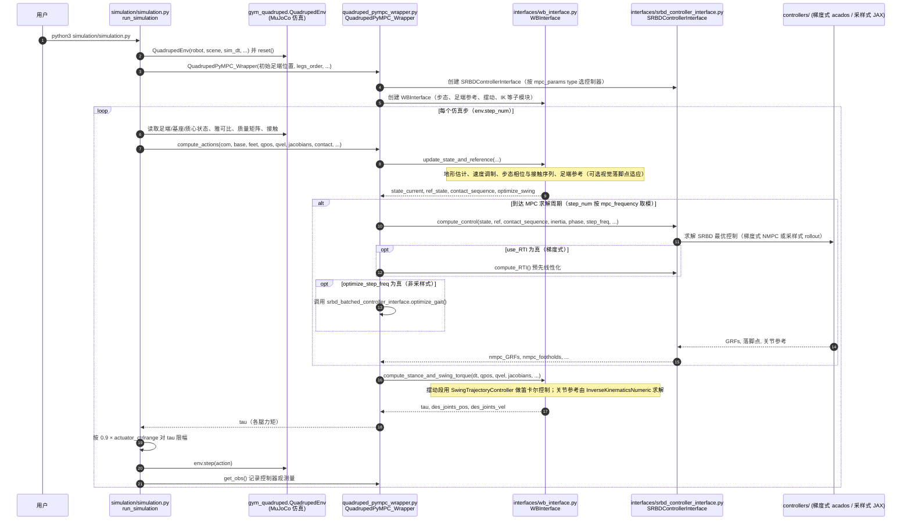

# Quadruped-PyMPC

**Quadruped-PyMPC**（[GitHub](https://github.com/iit-DLSLab/Quadruped-PyMPC)）来自 [古月居转载的四足机器人开源项目综述](https://mp.weixin.qq.com/s/pRGoPm41qYCNyHPWR6Dl6A)，属「优化控制（MPC / WBC）」组。

## 一句话定义

**Quadruped-PyMPC（IIT DLS Lab）是基于单刚体模型、用 Python 写的 MPC：梯度式（acados）与采样式（JAX）两种实现，已在真机测试并兼容 MuJoCo。**

## 英文缩写速查

| 缩写 | 英文全称 | 简要说明 |
|------|----------|----------|
| MPC | Model Predictive Control | 模型预测控制 |
| SRBD | Single Rigid Body Dynamics | 单刚体动力学 |
| RTI | Real-Time Iteration | 实时迭代 |

## 为什么重要

- 综述把它放在「优化控制（MPC / WBC）」这条技术路线下，作为可读源码的参照项目；横向对比见 [四足机器人开源项目技术地图：从极简运动学到研究级硬件（36 个 GitHub 项目）](../overview/quadruped-open-source-projects-technology-map.md)。
- 文中星标：446（文章表述，入库日未复核）。

## 核心信息

| 项 | 内容 |
|----|------|
| **仓库** | [iit-DLSLab/Quadruped-PyMPC](https://github.com/iit-DLSLab/Quadruped-PyMPC) |
| **最近提交** | 2026-10-15 |
| **可达性** | `git ls-remote` 可达（2026-11-01） |
| **文章归类** | 优化控制（MPC / WBC） |

## 文章说法核对

- **文章：** 文章称它提供基于 Python 的 MPC 与 WBC 实现，用 acados 求解器，适合学习。
- **README / 核查：** README：梯度式 MPC 在 i7-13700H 上计算不到 5 ms，可选积分器、足端力平滑、落脚点优化、实时迭代等；采样式 MPC 在 NVIDIA 4050 mobile GPU 上 10000 并行 rollout 不到 2 ms。
- **差异与保留：** 文章说 WBC 实现；README 前段只见 MPC 两种实现，WBC 未在已读段落出现，未核实。

## 源码运行时序图

入口：`python3 simulation/simulation.py`（`__main__` 读取 `quadruped_pympc/config.py` 后调用 `run_simulation`；MuJoCo 环境来自外部依赖 `gym_quadruped`）

图依据：iit-DLSLab/Quadruped-PyMPC@c46cb9a，实际读过 `README.md`、`README_install.md`、`simulation/simulation.py`、`quadruped_pympc/config.py`（前段）、`quadruped_pympc/quadruped_pympc_wrapper.py`、`quadruped_pympc/interfaces/srbd_controller_interface.py`、`quadruped_pympc/interfaces/wb_interface.py`；未运行代码。

## 关联页面

- [model-predictive-control](../methods/model-predictive-control.md)
- [nonlinear-model-predictive-control](../methods/nonlinear-model-predictive-control.md)
- [acados](../entities/acados.md)
- [mppi](../methods/mppi.md)
- [locomotion](../tasks/locomotion.md)
- [quadruped-open-source-projects-technology-map](../overview/quadruped-open-source-projects-technology-map.md)

## 参考来源

- [quadruped_pympc.md](../../sources/repos/quadruped_pympc.md)
- [wechat_guyueju_quadruped_opensource_deep_dive_2026-11-01.md](../../sources/blogs/wechat_guyueju_quadruped_opensource_deep_dive_2026-11-01.md)
- [原文（微信公众号）](https://mp.weixin.qq.com/s/pRGoPm41qYCNyHPWR6Dl6A)
- 源码核对（2026-11-02）：iit-DLSLab/Quadruped-PyMPC@c46cb9a，读过 README.md、README_install.md、simulation/simulation.py、quadruped_pympc/config.py（前段）、quadruped_pympc/quadruped_pympc_wrapper.py、quadruped_pympc/interfaces/srbd_controller_interface.py、quadruped_pympc/interfaces/wb_interface.py；时序图依据以上文件，未运行代码。
