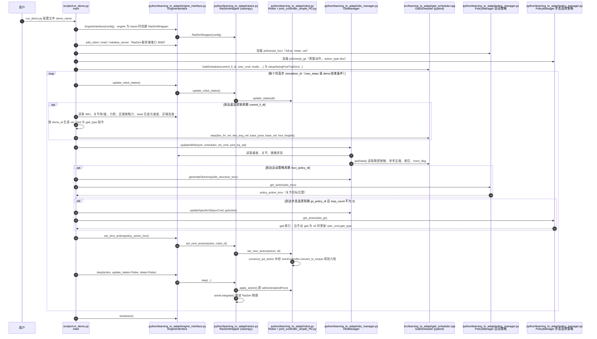

# 四足机器人（Quadruped Robot）

## 一句话定义

四足机器人是以四条腿与环境形成间歇接触的腿足平台，侧重崎岖地形移动与户外部署，常与强化学习 locomotion、Sim2Real 及分层导航结合。

## 英文缩写速查

| 缩写 | 英文全称 | 简要说明 |
|------|----------|----------|
| Quadruped | Quadruped Robot | 四足平台，静态稳定裕度通常大于双足 |
| RL | Reinforcement Learning | 四足 loco 并行仿真训练成熟 |
| PD | Proportional–Derivative | 策略输出经 PD 转关节力矩 |
| Sim2Real | Simulation to Real | 四足零样本迁移案例丰富 |
| WBC | Whole-Body Control | 四足亦可用全身/质心级协调 |

## 核心特征

1. **支撑域更大**：四足站立时通常可将投影支撑多变更为三角形或四边形支撑，同等尺度下较双足 **更易满足静态或拟静态稳定**，对底层平衡控制的容错相对友好（仍需处理打滑、柔性地形与动态步态）。
2. **任务侧重 locomotion**：主流产品 narrative 以移动、巡检、测绘为主；末端操作能力通常弱于强调双臂的人形平台（例外：加装机械臂的「移动操作」配置）。
3. **高频控制与感知**：优秀产品往往在 **500Hz–1000Hz** 级关节闭环与 **LiDAR / 深度 / IMU** 融合上下功夫，工业场景还对防护等级与可靠性（MTBF）敏感。
4. **仿真训练范式成熟**：大量工作沿用 **并行仿真 + 域随机化 + 特权信息蒸馏** 的路线，把神经网络策略迁移到真机；这与本库中 [Sim2Real](../concepts/sim2real.md)、[Legged Gym](./legged-gym.md) 一脉相承。敏捷评测侧可对照 [Barkour 基准与开源机体](./paper-barkour-quadruped-agility-benchmark.md)（障碍课 + Menagerie MJCF + 开源硬件栈）。

## 主流平台速览

| 平台 | 组织 | 典型定位 | 本库延伸阅读 |
|------|------|-----------|----------------|
| **Spot** | Boston Dynamics | 工业巡检与商业化四足标杆 | [Boston Dynamics](./boston-dynamics.md)；研究侧见 [NeBula 探索](./paper-autonomous-spot-nebula-exploration.md)、[RL Sim2Real 论文](./paper-spot-rl-distributional-sim2real.md)、[Isaac Lab 教程级部署](./nvidia-isaac-lab-spot-locomotion-sim2real.md)、[控制专利栈](./patent-boston-dynamics-legged-control-stack.md) |
| **ANYmal** | ANYbotics / ETH | 高端工业与顶尖学术 RL 载体 | [ANYmal](./anymal.md) |
| **Go2 / B2** | Unitree | 科研与量产带宽大、生态活跃 | [Unitree](./unitree.md) |
| **Mini Cheetah** | MIT Biomimetic Robotics Lab | 学术高动态 / Convex MPC 与 RL 教材平台（**部分开源**） | [MIT Mini Cheetah](./mit-mini-cheetah.md) |
| **aibo** | Sony | 家用陪伴四足；低噪行走见 [QuietWalk RL](./paper-learning-quiet-walking-aibo.md) | [Learning Quiet Walking](./paper-learning-quiet-walking-aibo.md) |

更多品牌索引见 [市面知名机器人平台纵览](../overview/notable-commercial-robot-platforms.md)。

## 与人形机器人的区别

两者同属腿足机器人，但默认约束不同：

- **稳定性**：四足在多数站姿下更易利用多腿支撑；人形双足支撑面窄、重心高，对动态平衡与上身协调要求更苛刻。人形侧的系统梳理见 [人形机器人](./humanoid-robot.md)。
- **任务边界**：四足以移动与场景穿越为主流卖点；人形更常承接 **操作 + 全身协调（loco-manipulation）** 的产品叙事。
- **硬件与成本曲线**：四足在相近动态性能下往往可比人形更早做到 **户外批量部署与巡检闭环**，但加装双臂操作臂后系统复杂度会显著上升。

## 核心挑战

1. **地形与接触不确定性**：碎石、湿滑、台阶边缘会导致接触力学突变，需要稳健步态与估计。
2. **Sim2Real**：执行器模型、关节间隙与地面摩擦的仿真误差仍会磨损策略迁移效果。
3. **续航与热管理**：长时间巡检需权衡功率、电池与算力占用。
4. **结构化环境中的机动**：窄通道、限高与三维障碍需要分层策略或全身姿态协调；参见 [HiPAN](../methods/hipan.md)。

## 相关工具链与生态

- **系统学习路线**：[四足控制学习策展](./quadruped-control-curriculum.md)（URDF → SysID → PPO/DR → Sim2Real → 导航闭环；基于 [MATRiX](./matrix-simulation-platform.md)）
- **仿真与 RL 范式**：[Legged Gym](./legged-gym.md)、[MuJoCo](./mujoco.md)、[Isaac Gym / Isaac Lab](./isaac-gym-isaac-lab.md)、[MATRiX](./matrix-simulation-platform.md)
- **多步态 bio-inspired RL**：[Learning to Adapt（Nature MI 2025）](./paper-learning-to-adapt-bio-inspired-quadruped-gait.md)（RaiSim + [ihcr/learning_to_adapt](https://github.com/ihcr/learning_to_adapt)）
- **马拉松级能效（Nature 2026）**：[RAIBO2](./paper-raibo2-marathon-energy-efficient-quadruped.md) — 单次充电 **42.195 km**，**CoT 0.25**（KAIST RaiLab / RaiSim 训练栈）
- **离散地形最小感知**：[足底 ToF + RL（ETH RSL, arXiv:2606.31912）](./paper-discrete-terrain-minimal-proximity-sensing.md)（踏石/沟/平衡木，无相机 LiDAR）
- **Stanford 开源四足**：[Stanford Doggo / Pupper](./stanford-doggo-and-pupper.md)（含 **Pupper v3** 文档站、RL/VLM 与 CS 123）；**早期模型控制**见 [easy_quadruped](./easy-quadruped.md)（MuJoCo Trot 闭环，与 v3 monorepo 不同栈）
- **任务扩展**：[Hybrid Locomotion](../tasks/hybrid-locomotion.md)（轮腿、步态切换等多模式）
- **总任务入口**：[Locomotion](../tasks/locomotion.md)

## 源码运行时序图

入口：`python3 src/learning_to_adapt/scripts/run_demo.py /configs/loco_bio_gs_unified.yaml <demo_name>`（`scripts/run_demo.py`；需先 colcon 编译并 source `install/setup.bash`，并在另一终端启动 RaiSim 可视化）

图依据：ihcr/learning_to_adapt@2066cbc，实际读过 `README.md`、`scripts/run_demo.py`、`python/learning_to_adapt/engine_interface.py`（前段）、`python/learning_to_adapt/raisim.py`（step / update_robot_states / set_next_action 段）、`python/learning_to_adapt/robot.py`（set_next_action / apply_action 段）、`python/learning_to_adapt/policy_manager.py`（构造与 get_action 签名）、`python/learning_to_adapt/obs_manager.py`（updateAllObs）、`src/learning_to_adapt/gait_scheduler.cpp`（构造与 step 签名）；未读 `srcpy/` 绑定实现的细节，未运行代码。

## 为什么重要

四足是目前 RL locomotion 从仿真走向真机、再走向商业巡检最成熟的一类平台：并行仿真训练、零样本迁移案例多，且能与人形平台共享方法栈，是检验腿足算法的主要载体。

## 核心原理

典型四足 RL 链路（以 Spot 低层部署为例，据 [arXiv:2504.17857](https://arxiv.org/abs/2504.17857)）：策略 50 Hz 输出关节位置偏置，经 PD 律 τ = kp(σa·a + qd − q) − kd·q̇ 转为力矩（该文 kp=60、kd=1.5、σa=0.2，200 Hz 施加）；训练用 Isaac Lab + PPO，地形/摩擦/质量/初始状态随机化；Sim2Real 缺口则通过关节摩擦、力矩-速度限幅、通信延迟（该文以 5 ms 动作缓冲建模）与观测噪声建模来缩小，并用 Wasserstein 距离 / MMD 度量仿真与真机数据分布差异、以 CMA-ES 搜索参数。

## 工程实践

- 执行器建模往往比换算法更关键：该文报告优化后最高速度由 3.8 m/s 提升到 5.2 m/s（默认控制器最快 1.6 m/s）。
- 部署侧：板载算力（如 Jetson Orin）运行 ONNX 策略，经低层 API 发送关节设定；真机采数 → 优化仿真参数 → 重训，一次迭代即可见效。
- 指令范围、奖励（足端空中时间、冲击、打滑惩罚）与随机化项需随平台调整（推断：其他四足同理，参数需自行标定）。

## 局限

- 上述数字来自单一平台（Spot）单篇工作，不可直接外推到其他四足。
- 该文仍未建模电源功率分配限制，摆动腿回收阶段存在残余误差；视觉感知未纳入。
- 本页其余内容（平台速览、挑战）为综述性归纳，未逐一做原文通读。

## 继续阅读

- [Spot RL Sim2Real 论文页](./paper-spot-rl-distributional-sim2real.md)、[Legged Gym](./legged-gym.md)、[四足控制学习策展](./quadruped-control-curriculum.md)、[Sim2Real](../concepts/sim2real.md)

## 关联页面

- [人形机器人](./humanoid-robot.md)
- [Boston Dynamics](./boston-dynamics.md)
- [Autonomous Spot / NeBula](./paper-autonomous-spot-nebula-exploration.md)
- [Spot RL Sim2Real](./paper-spot-rl-distributional-sim2real.md)
- [BD 足式控制专利栈](./patent-boston-dynamics-legged-control-stack.md)
- [ANYmal](./anymal.md)
- [Unitree](./unitree.md)
- [Legged Gym](./legged-gym.md)
- [Locomotion 任务](../tasks/locomotion.md)
- [腿式机器人进展/挑战/机遇综述](./paper-legged-robots-advances-challenges.md) — Science Robotics 2026 五柱盘点（含四足）
- [HiPAN（四足分层导航）](../methods/hipan.md)
- [Barkour（敏捷评测与开源四足）](./paper-barkour-quadruped-agility-benchmark.md)
- [离散地形最小感知（足底 ToF）](./paper-discrete-terrain-minimal-proximity-sensing.md)
- [市面知名机器人平台纵览](../overview/notable-commercial-robot-platforms.md)
- [Sim2Real](../concepts/sim2real.md)
- [四足控制学习策展](./quadruped-control-curriculum.md)
- [MATRiX 仿真平台](./matrix-simulation-platform.md)
- [RoamerX 导航栈](./roamerx-navigation.md)
- [Learning Quiet Walking（aibo 低噪）](./paper-learning-quiet-walking-aibo.md) — 家用四足脚步降噪 RL（ICRA 2025）

## 关联页面

- [MIT Mini Cheetah](./mit-mini-cheetah.md) — 学术高动态小四足实验床

## 参考来源

- [notable-commercial-robot-platforms](../../sources/repos/notable-commercial-robot-platforms.md)
- [locomotion_rl](../../sources/papers/locomotion_rl.md)
- [Autonomous Spot 论文摘录（arXiv:2010.09259）](../../sources/papers/autonomous_spot_arxiv_2010_09259.md)
- [Spot RL 论文摘录（arXiv:2504.17857）](../../sources/papers/spot_rl_distributional_sim2real_arxiv_2504_17857.md)
- [Boston Dynamics 足式专利摘录](../../sources/patents/boston_dynamics_legged_robot_patents.md)
- 源码核对（2026-11-02）：ihcr/learning_to_adapt@2066cbc，读过 README.md、scripts/run_demo.py、python/learning_to_adapt/engine_interface.py（前段）、python/learning_to_adapt/raisim.py、python/learning_to_adapt/robot.py、python/learning_to_adapt/policy_manager.py、python/learning_to_adapt/obs_manager.py、src/learning_to_adapt/gait_scheduler.cpp；时序图依据以上文件，未运行代码。
