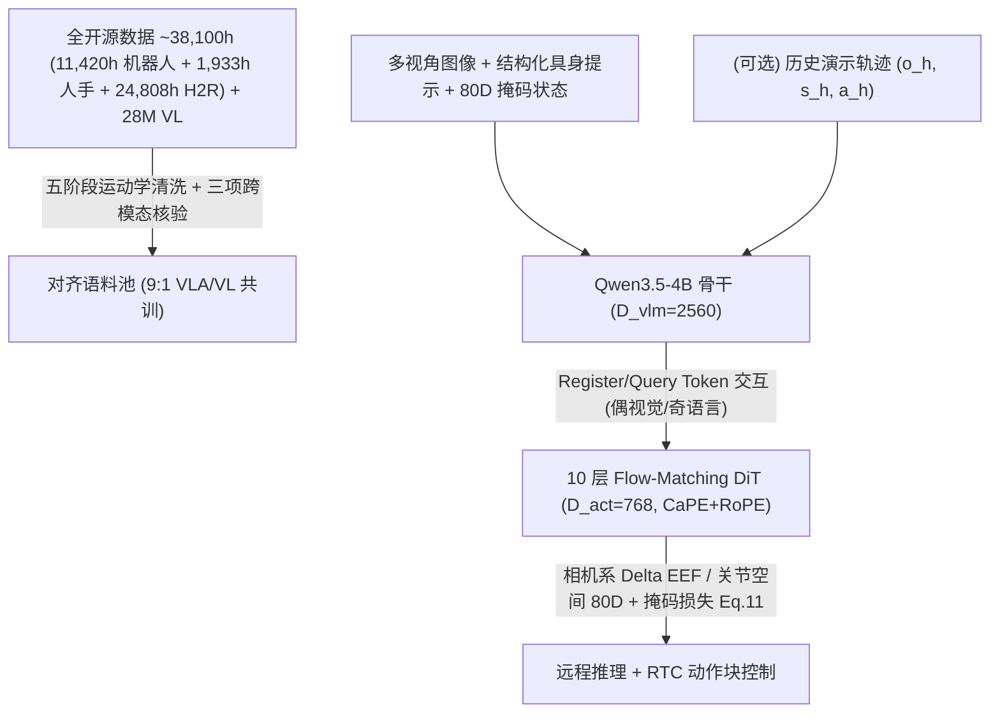

# Qwen-RobotManip（对齐驱动的可扩展操作基础模型）

## 一句话定义

**Qwen-RobotManip**（[arXiv:2606.17846](https://arxiv.org/abs/2606.17846)，项目页 [Qwen-RobotManip](https://qwenlm.github.io/Qwen-RobotManip/)，Qwen Team）是一套以 **“跨载体对齐解锁全开源数据规模效应”** 为核心理念的通用机械臂操作基础模型：在 **Qwen3.5-4B** VLM 主干上耦合 **Flow-Matching DiT** 动作专家，通过 **80 维统一状态动作空间**、**相机坐标系 EEF 表示 + 相机位姿编码（CaPE）**、**结构化具身提示** 与 **五阶段跨模态数据精炼管线**，仅使用全开源多本体轨迹（11,420 h）、第一视角人手操作视频（1,933 h）及 **24,808 h H2R 合成重定向数据**（总计 **~38,100 小时**）实现强泛化跨构型操作与 Unified-mode 上下文自适应。

## 英文缩写速查

| 缩写 | 英文全称 | 简要说明 |
| --- | --- | --- |
| DiT | Diffusion Transformer | 扩散变换器动作专家，本模型采用 10 层流匹配（Flow-Matching）DiT 输出动作块 |
| CaPE | Camera Pose Encoding | 相机位姿注意力编码，使多相机跨台架场景的几何注意对世界坐标系原点不变 |
| H2R | Human-to-Robot | 人手第一视角操作轨迹经运动学重定向、修复与遮挡合成转换为双臂机械臂数据 |
| EEF | End-Effector | 机械臂末端执行器；报告将增量统一至当前相机局部系而非固定基座系 |
| RTC | Real-Time Chunking | 实时动作分块，在远程异步推理中平顺衔接新旧动作块延迟 |

## 为什么重要

多源异构操作数据集（OXE、DROID、AgiBotWorld、RoboMIND、RH20T 等）长期存在两大工程梗阻：其一，不同构型、不同标定系和噪声标签混训时，模型容量被消耗在死记特定台架坐标系和异常跳变轨迹中，导致“数据越多、泛化越差”甚至微调期间失去原始语言跟随（VLA 退化为纯 VA）；其二，高质量跨本体真机轨迹仍然稀缺。Qwen-RobotManip 系统证明：无需依赖私域遥操采集，仅凭严苛的物理/运动学对齐、全开源机器人与 2.48 万小时 H2R 合成数据配比、以及面向相机系的几何统一表征，就能彻底打破跨构型负迁移瓶颈并在真实桌面榜单 RoboChallenge Table30-v1 上超越一众闭源大规模混合训练策略。

## 核心原理

### 1. 统一 80 维状态-动作空间与相机系三维对齐

- **80D 规范槽位与掩码损失（Eq. 11）**：每个时间步对齐编码 `2 × 29D` 双臂槽位（单臂含 7 关节 + 9 EEF [状态用 3D 位置 + 6D 旋转，动作用 3D 平移 + 3D 旋转向量] + 1 夹爪 + 12 灵巧手自由度）外加 `22` 个预留位；单臂及夹爪载体通过每样本逐维二值掩码 `m_{i,t,j}` 仅对有效维归一化求和，杜绝空维零填充干扰。
- **相机系 Delta EEF（Eq. 5）+ CaPE + AdaZeroRMSNorm**：不再将末端变化量绑定到易变的基座/世界坐标，而是统一投影到当前相机局部坐标系，并在动作专家注意力层加入 32/64 维头的 **相机位姿编码（CaPE）** 与 32 维 RoPE（使世界原点自然抵消）；再用 `AdaZeroRMSNorm` 注入 `eef_type` 与 `has_camera_params` 条件信号。
- **结构化具身提示与上下文适应**：显式输入本体类型、末端构型与控制帧率（训练期 15% 随机字段屏蔽，防过拟合）；支持 **Unified-mode In-Context Policy Adaptation**，以随机动作块采样构造示范序列 `(o_h, s_h, a_h)` 避免“直接复制上一步动作”的捷径失效。

### 2. ~38,100 小时全开源数据与五阶段清洗 + H2R 重定向

- **全开源多源构成**：真实与仿真机器人 **11,420 小时**（覆盖 OXE ~600h、AgiBotWorld-Beta ~2,400h、RoboMIND 1.0/2.0 ~1,400h、Galaxea ~500h、RoboCOIN ~430h、DROID ~500h、RH20T ~1,100h、RDT-1B 29h、InternData-A1 >3,600h 等），结合 **1,933 小时**第一视角人类手部操作（EgoDex 732h、VITRA 247h、EgoVerse 954h），以及重定向至 15 种双臂机械臂构型的 **24,808 小时 H2R 合成轨迹**（SAM3 分割 + ProPainter 修复背景 + Savitzky-Golay/高斯 SLERP 平滑 + MuJoCo `mink` IK 求解 + Depth Anything v3 深度遮挡重绘 + 分源降采样）。
- **严苛质检筛查**：运动学五步检验（突变、趋势滞后相关性——一次性淘汰了 81% 的低质 RoboMIND UR 数据、`[q01, q99]` 极值剔除、Pinocchio FK 校核 TCP 与参考系、+x 前向对齐）加三项跨模态校核（Qwen3.6-Plus ECoT 语义对齐、URDF 投影 vs 微调 SAM3 IoU、静帧模糊过滤），再混入 28M VL 共训数据以 **9:1** 比例联合训练 `L = L_FM + 0.1 * L_VLM`。

### 3. 主干耦合策略与推理机制

模型采用 **Qwen3.5-4B** 与 **10 层 Flow-Matching DiT**（`D_act=768`，12 注意力头，交替对 VLM 末层视觉/语言 token 做交叉注意，配合可学习 Register/Query tokens 在 Table 19 消融中达 87.5 优于直接逐层复用 KV 缓存的 86.4）；训练采样 `t ~ Beta(1, 1.5)`，每步重复采样 `K_repeat=8`；标准版推理仅需 **4 步 Euler 积分**（Context 变体用 **10 步** 以免动作抖动），并在真机运行中挂载异步远程推理与 **RTC（Real-Time Chunking）** 动作平滑衔接。

## 实验与评测

基于技术报告 Table 3–19（对比 $\pi_{0.5}$、StarVLA、GR00T-N1.7、RLDX-1、DM0 等主流基础模型）：

| 评测基准 | 衡量维度 | Qwen-RobotManip | 对比基线表现 | 核心结论 |
| --- | --- | --- | --- | --- |
| **LIBERO / RoboTwin Easy & Hard** | 仿真 IID 多任务平均 | **99.1**（Context 99.2）/ **93.4 & 92.5** | Context 达 **93.7 / 94.0** | 同分布基准接近饱和上限 |
| **LIBERO-Plus / RoboTwin-C2R Hard** | 视觉、视角与结构 OOD | **89.0**（Context 91.4）/ **62.6**（Context 69.4） | $\pi_{0.5}$ 为 84.4 / 47.9 | 在未见视角与跨构型条件拉大优势 |
| **RoboCasa365 / EBench** | 长视野厨房组合与新指令 | **35.9** 总分 / **45.6% SR (60 分)** | RLDX-1 33.2，$\pi_{0.5}$ 16.9 / 27.1% | 组合式未见任务（14.9）与语言融合优势显著 |
| **RoboTwin-IF / RoboTwin-XE** | 多指令遵循 / 跨构型零样本 | **72.2** / **23.9 EEF**（ARX-X5 42.9） | $\pi_{0.5}$ 为 49.6 / 7.5，GR00T-N1.7 16.6 | 跨机械臂零样本迁徙能力为对比基线 3 倍+ |
| **真机 CobotMagic ALOHA & ARX** | 真实双臂 ID/OOD 与跨构型 | ALOHA ID **88.6%** / OOD **87.5%**；ARX **55.0%** | $\pi_{0.5}$ 仅 42.9%/37.5%；去 UnifiedEEF 掉至 **12.5%** | 消融直接证实 UnifiedEEF + UnifiedSpace 决定迁移成败 |
| **RoboChallenge Table30-v1** | 真机泛化全榜评测 | **45% SR / 59.83 分**（全榜 Generalist #1） | DM0 37% / 48.43；$\pi_{0.5}$ 17.67% / 31.27 | 双臂 8 任务 **40.0%**，抓放 12 任务 **63.3%** |

此外在后训练微调（Post-Training）中发现：混入 **10% VL 语料 + 75% 辅助 VLA 数据** 可防止专任务微调导致指令跟随崩溃（`RoboTwin-IF` 保持 **75.8%**；反之若缺乏 UnifiedEEF 对齐则会掉至 **0.0%**）。

## 结论

1. **一句话总判**：Qwen-RobotManip 以实验实证了 **“对齐先行、开源缩放”**——在相机系三维投影、80D 掩码标准槽位与五步物理清洗护航下，纯开源多载体加 H2R 数据足以为通用操作带来显著 OOD 与跨载体跃迁。
2. **相机系对齐是跨本体零样本的核心开关**：真机 ARX 迁移实验从 `55.0%` 跌落到 `12.5%`（去 UnifiedEEF）与 `7.5%`（去 UnifiedSpace），说明未对齐基座增量下的表征强行混训会直接破坏迁移能力。
3. **混合后训练防御灾难性遗忘**：对 VLA 做单任务微调时保留 10% VL 与主体辅助操作数据，是守住指令理解和长程抗干扰边界的关键实践。
4. **H2R 规模化的双刃剑**：2.48 万小时 H2R 对双臂与泛化贡献突出，但单靠 2D/伪深度合成仍缺乏手-物接触微力觉信号，在密集插装与接触主导精细作业中存在天然上限。

## 源码运行时序图

**不适用**：经核查官方 GitHub 仓库 `QwenLM/Qwen-RobotManip` 目录（仅包含 `README.md` 与 `assets/` 多媒体文件），并对照官方 README 原文声明 *"There is currently no plan to release the model weights for Qwen-RobotManip or Qwen-RobotNav"*，当前尚未开源模型权重、训练管线或异步 RTC 推理代码，因此无法从真实源码入口提取模块运行时序。

## 工程实践

1. **多源数据清洗优先于盲目堆量**：报告清洗管线曾因时间相关性异常和坐标跳变一次性淘汰 RoboMIND UR 数据高达 **81%**，并按源核验 FK 与 TCP 朝向。复现多本体混训时，引入未校验 FK 方向与时延标定错位的数据集是导致负迁移的最大诱因。
2. **Register/Query Token 优于直接复用全层 KV Cache**：消融结果提示以少数可学习 Register/Query tokens 做 VLM 末层交替交叉注意（Visual/Language 奇偶分层）不仅显存可控，且最终控制成功率（87.5 vs 86.4）高于整层 KV 直连专家模型。
3. **Context 步数与远程延迟权衡**：启用 In-Context 历史示范上下文可提升复杂泛化（如 RoboTwin-C2R Hard 从 62.6 升至 69.4），但推理 Euler 积分步数需从 4 步增至 10 步防止抖动，配合远程 GPU 服务器运行须搭配 RTC 动作过渡窗口。

## 常见误区与局限

- **误区 1：误以为技术报告已开源权重或推理服务**：目前仅公开论文技术报告与项目展示，社区暂不可直接拉取 Checkpoint 复现实机效果。
- **误区 2：误把 `2610.41880` 当作唯一公开索引号**：官方 GitHub README BibTeX 与 PDF 正式归档编号为 `arXiv:2606.17846`（v1，2026-06-16）。
- **核心局限**：(1) Context 版本开局零填充示范块引发轻微起步停顿（hesitation）；(2) 缺少真机力觉/触觉闭环输入与高频连续反应反馈，在超精密机械对准插装任务上仍受 8–10 Hz chunk 延迟约束。

## 关联页面

- [视觉-语言-动作模型（VLA）](../methods/vla.md) — 大规模视觉语言主干向连续动作生成的通用方法体系
- [StarVLA（统一视觉-语言-动作基础设施）](../methods/star-vla.md) — 技术报告直接评测对照的 VLA 训练基线
- [机器人操作（Manipulation）](../tasks/manipulation.md) — 桌面泛化抓放与多步工具操作核心任务
- [双臂协同操作（Bimanual Manipulation）](../tasks/bimanual-manipulation.md) — 80D 双臂槽位与 H2R 15 种双臂构型迁移对应的核心任务
- [具身策略流匹配（Flow-Matching Embodied Policy）](../concepts/flow-matching-embodied-policy.md) — 本模型 10 层 DiT 动作专家的连续生成理论基础
- [跨本体策略表征对齐（Foundation Policy Alignment）](../formalizations/foundation-policy-alignment.md) — 相机系变换、80D 动作空间与 CaPE 位置编码的形式化依据
- [样本外泛化（Out-of-Distribution Generalization）](../concepts/out-of-distribution-generalization.md) — LIBERO-Plus、RoboTwin-C2R 与真机未知场景衡量标准
- [机器人上下文学习（Robot In-Context Learning）](../concepts/robot-in-context-learning.md) — Unified-mode 示范上下文自适应范式对照
- [Qwen-RobotSuite（通义具身机器人模型全景）](./qwen-robot-suite.md) — 同系操作、导航与世界模型三大分支总体架构
- [Qwen-RobotNav](./qwen-robot-nav.md) — 同系列智能体视觉导航基础模型
- [Qwen-RobotWorld](./qwen-robot-world.md) — 同系列具身世界模型分支

## 参考来源

- 论文通读归档：[Qwen-RobotManip 技术报告全文归档](../../sources/papers/qwen_robot_manip_arxiv_2610_41880.md)（arXiv:2606.17846 / 集合索引 `2610.41880` 全文核对）
- 仓库源码归档：[QwenLM/Qwen-RobotManip 开源状态核查](../../sources/repos/qwen_robot_manip.md)
- 协同摘要归档：[Qwen-RobotManip 资讯梳理](../../sources/blogs/qwen_robot_manip.md) | [Qwen-RobotSuite 综述](../../sources/blogs/qwen_robot_suite.md)
- 原始来源：https://arxiv.org/abs/2606.17846 | https://qwenlm.github.io/Qwen-RobotManip/ | https://github.com/QwenLM/Qwen-RobotManip

## 推荐继续阅读

- [Qwen-RobotSuite（通义具身机器人模型全景）](./qwen-robot-suite.md) — 宏观对比通义实验室操作、导航与世界模型的训练数据与工程定位。
- [跨本体策略表征对齐](../formalizations/foundation-policy-alignment.md) — 深入查看相机系参考框架如何从源头消除跨台架几何歧义。
