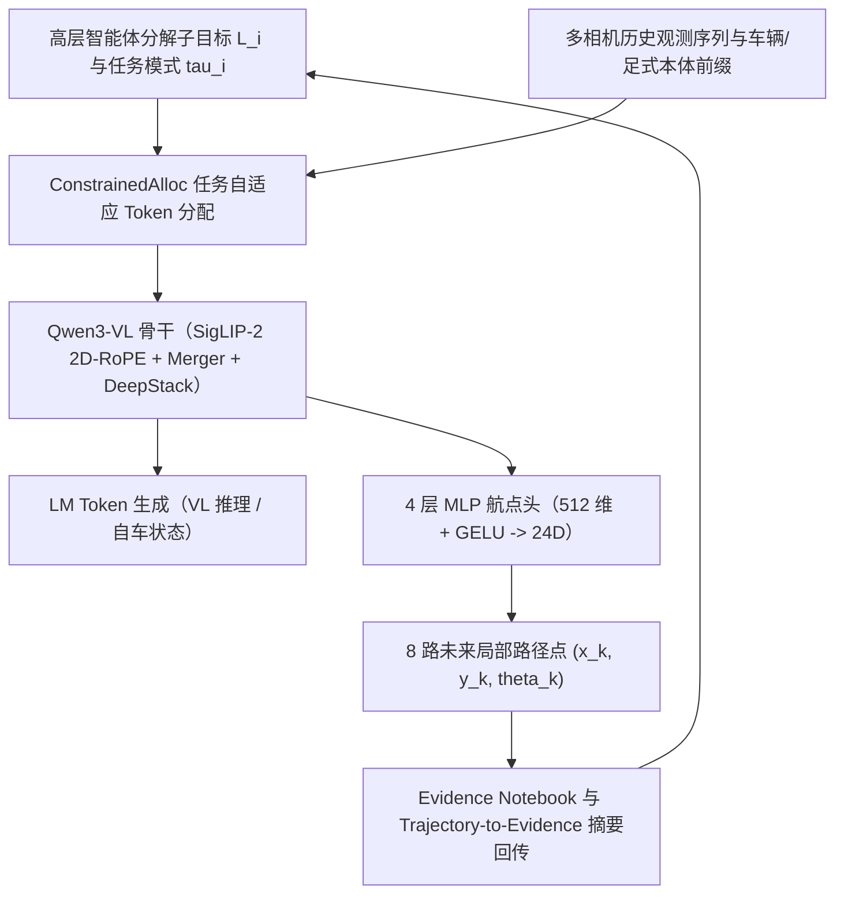

# Qwen-RobotNav（面向智能体系统的可扩展导航基础模型）

## 一句话定义

**Qwen-RobotNav**（[arXiv:2606.18112](https://arxiv.org/abs/2606.18112)，项目页 [Qwen-RobotNav](https://qwenlm.github.io/Qwen-RobotNav/)，Qwen Team）将多域导航重构为 **上下文预算与多视角观测调度问题**：以 **Qwen3-VL**（4B / 8B）加 **4 层 MLP 航点头** 输出 8 个局部路径点，在 **15.6M 多模态导航与推理样本** 上随机化 **四轴可控观测参数** 与 **任务模式标签**，以单套权重统一视觉语言导航、点导航、物体导航、视觉追踪及闭环自动驾驶，并直接作为上层大模型智能体的可调用导航工具。

## 英文缩写速查

| 缩写 | 英文全称 | 简要说明 |
| --- | --- | --- |
| VLN-CE | Vision-Language Navigation in Continuous Environments | 连续物理环境下的视觉-语言导航基准（如 R2R、RxR） |
| ObjNav | Object-Goal Navigation | 按开放词汇物体类别在未知室内环境中搜寻目标的任务 |
| EQA | Embodied Question Answering | 需要自主探索收集物理证据后再作答的具身问答任务 |
| PDMS | Predictive Driver Model Score | NAVSIM 闭环自动驾驶轨迹规划综合评测得分 |
| STT | Single-Target Tracking | EVT-Bench 单目标持续追踪协议，要求低碰撞并保持安全跟随距离 |
| TRT | TensorRT | NVIDIA 推理加速引擎；本工作在 Jetson Thor 上采用 FP8 + TRT 实现低抖动边缘部署 |

## 为什么重要

现有导航基础模型普遍面临两个结构性矛盾：其一，不同导航任务对时空记忆的要求截然相反——长程 VLN 需要回溯数分钟前的地标，动态目标追踪只看重最近数帧的高清前视，而环视自动驾驶需要兼顾多相机几何冗余。采用固定帧率与固定分辨率裁剪的“统一模型”往往顾此失彼。其二，端到端低延迟策略缺乏长程显式推理与任务分解能力，而纯靠通用 VLM 逐步输出离散坐标又无法满足 5 Hz 以上真机连续闭环控制。Qwen-RobotNav 通过把视觉上下文策略参数化为可编程接口 `nav_qwennav(L_i, tau_i, Phi_i)`，首次让低层连续航点模型与上层推理智能体（如 `Qwen3.6-Plus`，早期博客预览曾称 `Qwen3.7-Plus`）在单回合探索中动态协调记忆分配与任务模式切换。

## 核心原理

### 1. 感知-航点双分支架构与混合训练目标

模型基于 **Qwen3-VL**（提供 4B 与 8B 参数规格）：视觉编码器采用支持动态分辨率与 `2D-RoPE` 的 **SigLIP-2 ViT**，经 `s_m^2` 两层 MLP Merger 空间压缩并利用 **DeepStack** 注入浅层细节特征；前导文本明确区分载体先验（`robot` 或 `car`）。行动解码侧采用独立 **4 层 MLP 航点头**（隐层 512、GELU 激活），一次性预测 **K = 8 个局部路径点**（每步含横向、纵向位移与偏航角 `(x_k, y_k, theta_k)`，共 24 维，按训练集第 99 百分位范围归一化）。预训练使用联合损失 `L = L_traj + 1.0 * L_VL`，同时保留语言推理与空间定位梯度（8B 全量预训练耗时 **2,816 H100 GPU 小时**）。

### 2. 任务自适应观测编码（Algorithm 1：`ConstrainedAlloc`）

每次调用前，外部策略或上层智能体传入观测配置 `Phi = (B, gamma, {w_c}, m)`：
- **总视觉预算 `B`**：在 `[2048, 4096]` token 之间配置本次推理消耗的总视觉上下文上限。
- **时间衰减 `gamma`**：范围 `[1, 3]`，控制历史帧与近期帧的分辨率/token 分配倾斜强度；跟踪任务设为高衰减，长程探索设为平缓衰减。
- **相机权重 `{w_c}`**：按载体与任务显式倾斜前视、侧视或环视相机配额。
- **采样模式 `m in {random, latest}`**：`random` 维持历史长程覆盖，`latest` 锁紧最近连续几帧。
- **训练期随机化约束**：样本每帧标注 `Time step t Front View <image>` 语义标签，且单图分配边界随训练动态随机化（`b_min in [1, 8]`、`b_max in [128, 256]`），从而迫使主干对任意外部预算组合具备零样本泛化能力。

### 3. 两层智能体系统与 Evidence Notebook 机制

在长程 EQA 与复合寻物任务中，Qwen-RobotNav 不再孤立跑完整个 episode，而是封装为高层推理 LLM（`Qwen3.6-Plus`）可异步调用的原语 `W_i = nav_qwennav(L_i, tau_i, Phi_i)`（`tau_i in {VLN, PointNav, ObjNav, Tracking}`）。每次执行子任务并返回结果时，系统通过 **Trajectory-to-Evidence** 评测与摘要模块将原始轨迹整理为结构化条目（含 `subgoal`、`task_mode`、`config`、`progress`、`salient`、`outcome` 与 `key_frames`）写入持久化 **Evidence Notebook**。上层智能体据此判断是否在原地继续精搜、切换任务模式，还是依据新线索转向相邻房间。

### 4. 15.6M 多源混合数据与视频生成增广

总训练语料达 **15.6M**，按 **85% 导航轨迹 + 15% 通用与导航视觉语言问答** 配比：
- **室内与具身轨迹**：5.63M VLN（含 R2R 1,491K 与 RxR 4,140K，其中使用 `Qwen-Image-Edit` 做视觉外观重渲染扩增防过拟合）、984K PointNav、2.0M ObjNav、1.486M EVT-Bench 单目标追踪（STT），以及 **40K 文生视频（T2V）再投影生成的逼真导航轨迹**。
- **自动驾驶轨迹**：约 3.2M 驾驶场景片段（nuScenes 与 OpenScene 抽取重构）。
- **多模态推理辅助数据（15%）**：1.0M 通用 VL 问答、873K 导航空间推理与 362K Matterport3D 多轮对话。

## 实验与评测

基于 [Qwen-RobotNav 技术报告（arXiv:2606.18112）](../../sources/papers/qwen_robot_nav_arxiv_2610_41901.md) 公开测试结果：

| 评测基准 / 任务 | 协议与模型配置 | 核心指标 | 关键参照 / 消融结论 |
| --- | --- | --- | --- |
| VLN-CE R2R（全景） | 8B 单权重切换 VLN 模式 | **72.1% SR / 66.6% SPL** | 4B 单目版亦达 **66.9% SR**，验证动态尺度历史压缩能力 |
| VLN-CE RxR（全景） | 8B 单权重切换 VLN 模式 | **76.5% SR / 65.7% SPL** | Qwen-Image-Edit 扩增显著缓解 MP3D 外观过拟合 |
| HM3Dv2 ObjNav | 4B RGB-only 连续空间 | **75.6% SR / 30.6 SPL**（均距 1.72 m） | HM3D-OVON 开放词汇零样本测试 **57.7 / 60.1 / 53.1** |
| EVT-Bench（跟踪） | 4B / 8B Tracking 模式 | **90.0% / 89.7% TR**，CR **5.70%** | SR **78.6%**（对比跟踪专精模型 TrackVLA++ 为 **86.0%**） |
| 具身问答（EQA） | 两层智能体系统（联合 Evidence Notebook） | HM-EQA **76.7%**（平均仅 **0.15** 额外探索步）；EXPRESS-Bench **79.27** | 对比 FAST-EQA 的 **69.2% / 0.65 步**，大幅减少无效探索开销 |
| NAVSIM（闭环驾驶） | 4B Driving 模式 | **91.4 PDMS** | 移除历史自车运动前缀后骤降至 **79.5 PDMS**；AlpaSim 开/闭环仅 **0.15 / 0.17**（Alpamayo-R1-10B 为 0.72） |
| Unitree Go2 真机 | 远程端 vs 机载 Jetson Thor（FP8+TRT） | 远程延迟 **196 ms (5.1 Hz)** vs 机载 **204 ms (4.9 Hz)** | 机载网络抖动显著更低；稳定完成 **21.78 m** 多房间往返及 Cotti Coffee 绿伞寻物 |

## 结论

1. **一句话总判**：Qwen-RobotNav 通过将时空记忆策略显式参数化为外部推理接口，成功在单一 Qwen3-VL + 航点头权重内统一了室内连续导航、目标追踪、车端轨迹规划与高层智能体具身问答，在多个基准与四足真机上验证了高泛化性。
2. **载体历史前缀对自动驾驶极其敏感**：NAVSIM 从 `91.4` 跌至 `79.5 PDMS` 证明，即便是强视觉 backbone，一旦剥离连续自车运动轨迹状态也难以推断动态车速与曲率惯性。
3. **两层智能体协同显著降低 EQA 探索代价**：由上层 LLM 维护 `Evidence Notebook` 并动态切换 `nav_qwennav` 的模式与预算，比单体端到端模型节省约四分之三无效行走步数。
4. **边缘 FP8 TensorRT 是低抖动物理部署的关键**：Go2 实验说明 8 路点块推理配合 Jetson Thor 边缘部署可在不依赖高速 Wi-Fi 下稳定维持 ~5 Hz 异步连续闭环。

## 源码运行时序图

**不适用**：经核查官方仓库 [`QwenLM/Qwen-RobotNav`](../../sources/repos/qwen_robot_nav.md) 目录（仅包含 `README.md` 与 `assets/` 多媒体文件），且官方 README 明确声明 *"There is currently no plan to release the model weights for Qwen-RobotManip or Qwen-RobotNav"*，目前未公开 `ConstrainedAlloc` 源码、航点头推理节点或 Jetson Thor TensorRT 部署程序，故无法依据真实可运行源码绘制调用时序图。

## 工程实践

1. **按任务特性动态配置四轴观测预算**：长程多房间 VLN 与 EQA 建议采用较小 `gamma`（`1.0–1.5`）加 `random` 均匀历史采样并放宽总 `B` 至 `4096`；而动态人/车追踪（Tracking）应切为 `latest` 并拉高 `gamma -> 3.0`，将几乎全部视觉 token 集中于近 2–3 帧前视画面以压缩控制延迟。
2. **必须规范注入 `Time step` 语义标记与载体前缀**：推理提示需保持与训练一致的 `Time step t Front View` 分帧前缀以及明确区分 `robot` / `car` 动力学先验；若省略载体前缀或时空标号错位，航点头尺度预测会直接失效。
3. **远端服务部署需对标控制-推理频率解耦**：远程无线通信虽平均端到端达 196 ms，但存在 Wi-Fi 波动尖峰；真机部署优先采用机载 **Jetson Orin / Thor FP8 + TensorRT**（稳定 ~204 ms / 4.9 Hz），并在底层运动控制器内保留 8 步航点插值缓冲。

## 常见误区与局限

- **误区 1：误以为不同任务分数都可跨论文直接对比**：EVT-Bench 评测中 Qwen-RobotNav 在单目标追踪成功率 TR 达 `90.0%`，但 SR 为 `78.6%`（低于专精对比基线 [ReferTrack](./paper-refertrack.md) 所依赖的 STT/DT/AT 分切口径或 TrackVLA++）；NAVSIM 高分则强依赖自车历史轨迹状态输入，与纯视觉 [S²-VLA](./paper-s-squared-vla.md) 实验设置存在差异。
- **误区 2：混淆开源状态与上层闭环组件版本**：尽管代码仓库已建站，权重与上层智能体脚本当前并未计划开源；技术报告正式标注上层推理模型为 `Qwen3.6-Plus`，与早期新闻博客提及的 `Qwen3.7-Plus` 命名有版本号口径差异。
- **核心局限**：(1) 依赖高频重规划弥补开环短视（AlpaSim 长程闭环仅 `0.15/0.17`），长程交互驾驶动态演化仍弱于专用闭环驾驶大模型；(2) 当前仅基于 2D/多目投影视觉预测三维地面航点，尚缺乏对极窄空间低矮负障碍与足端打滑地形的在线几何反馈校验。

## 关联页面

- [视觉-语言-动作模型（VLA）](../methods/vla.md) — 多模态大模型向连续动作规划扩展的方法基础
- [视觉语言导航（Vision-Language Navigation）](../tasks/vision-language-navigation.md) — R2R / RxR / VLN-CE 与 EQA 的核心任务定义与评价协议
- [零样本物体导航（Zero-Shot Object Navigation）](../tasks/zero-shot-object-navigation.md) — HM3Dv2 与 HM3D-OVON 开放词汇物体搜索的对比语境
- [具身基础策略（Foundation Policy）](../concepts/foundation-policy.md) — 单权重多任务多本体策略的范式位置
- [控制与推理频率解耦（Control-Inference Frequency Decoupling）](../concepts/control-inference-frequency-decoupling.md) — 5 Hz 航点块生成与真机高频运动控制的解耦机制
- [Qwen-RobotSuite（通义具身机器人模型全景）](./qwen-robot-suite.md) — 与操作及世界模型分支组成完整套件的总体架构
- [Qwen-RobotManip](./qwen-robot-manip.md) — 同系列以 80D 相机系对齐为核心的通用操作基础模型
- [Qwen3-VL](./qwen3-vl.md) — 本导航模型所采用的动态分辨率 SigLIP-2 + DeepStack 视觉语言主干
- [S²-VLA](./paper-s-squared-vla.md) — 专注端到端驾驶的双流 VLA（对照 NAVSIM 驾驶表现）
- [HUMEMBR](./paper-humembr.md) — 面向多日长期跨场景记忆的足式具身探索系统对照
- [ReferTrack](./paper-refertrack.md) — 专注 EVT 视觉指示与跟踪的单一前视基线对照

## 参考来源

- 论文通读归档：[Qwen-RobotNav 技术报告全文归档](../../sources/papers/qwen_robot_nav_arxiv_2610_41901.md)（arXiv:2606.18112 / 集合索引 `2610.41901` 全文核对）
- 仓库源码归档：[QwenLM/Qwen-RobotNav 开源状态核查](../../sources/repos/qwen_robot_nav.md)
- 协同摘要归档：[Qwen-RobotNav 深度博客梳理](../../sources/blogs/qwen_robot_nav.md) | [Qwen-RobotSuite 综述](../../sources/blogs/qwen_robot_suite.md)
- 原始来源：https://arxiv.org/abs/2606.18112 | https://qwenlm.github.io/Qwen-RobotNav/ | https://github.com/QwenLM/Qwen-RobotNav

## 推荐继续阅读

- [视觉语言导航（VLN）](../tasks/vision-language-navigation.md) — 系统比较连续环境 R2R/RxR、离散图导航与多轮 EQA 的评估差异。
- [Qwen-RobotSuite（通义具身机器人模型全景）](./qwen-robot-suite.md) — 从操作、导航、世界模型三位一体角度审视上层 LLM 智能体调用闭环。
