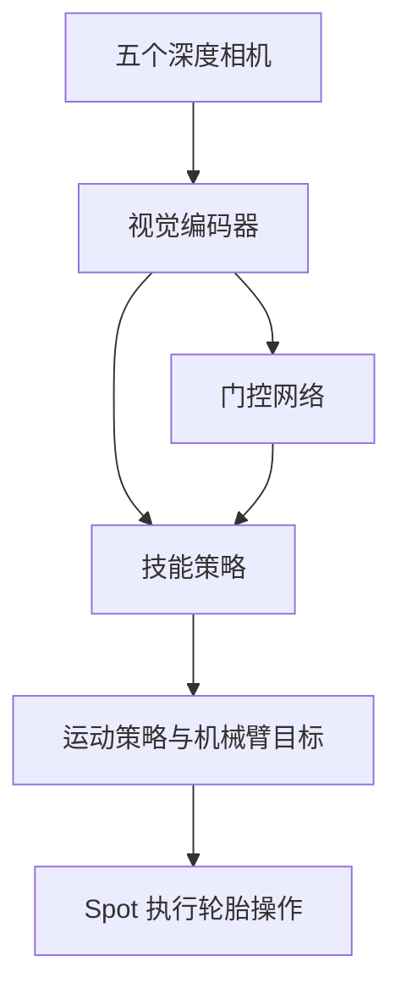

# Spot 机载感知全身操作

RAI Institute 将轮胎全身操作从依赖外部动捕和桌面计算的实验室系统，迁移到机载深度感知、计算与技能切换，展示在未见过的场地自主执行轮胎任务。

## 英文缩写速查

| 缩写 | 英文全称 | 简要说明 |
| --- | --- | --- |
| RL | Reinforcement Learning | 基于交互回报训练策略 |
| MPC | Model Predictive Control | 用模型预测和优化动作 |
| WBC | Whole-Body Control | 协调身体、腿和机械臂 |

## 系统与训练

低层运动策略维持行走和平衡，技能策略以 50 Hz 输出 3 个基座速度调整量与 7 个机械臂关节目标调整量。机载 Mac Mini 运行门控网络、技能和运动策略；前方两个深度相机读取频率为 20 Hz，侧面和后方为 7 Hz，图像直接输入网络。目标位置通过视觉里程计在全局参考系跟踪。

**Crossfade RL** 先用仿真精确位姿训练，再通过蒸馏逐步接入只在可见时提供位姿的编码器，最后接入深度图编码器；整个过程中策略继续强化学习。深度策略学会保持轮胎在视野内并做较小修正，文章指出这些行为并非奖励直接要求。

## 验证与边界

- 在四种实验室外场地展示同一个 15 kg 轮胎的扶起、滚动、拖拽；滚动途中轮胎倒下时，门控可切换到扶起技能。文章未报告成功率。
- 测试限于单轮胎和平地；深度图中的行人或其他物体可能被误认为轮胎，策略并未针对避障训练。
- 货车拉出、托盘堆叠是单独技能，尚未接入门控；新增技能仍需单独训练和调整奖励。
- 截至 2026-10-29，官方文章未提供本系统代码或权重链接。已有 [Sumo](../methods/sumo.md) 是相关的采样规划与 RL 系统，不应将其开放代码视为本系统实现。

## 关联页面

- [RAI Institute](./rai-institute.md)
- [Sumo](../methods/sumo.md)
- [移动操作](../tasks/loco-manipulation.md)

## 参考来源

- [RAI Institute 官方博客归档](../../sources/blogs/rai-spot-whole-body-manipulation.md)

## 推荐继续阅读

- [Whole-Body Manipulation Outside the Lab](https://rai-inst.com/resources/blog/whole-body-manipulation-outside-the-lab/)
