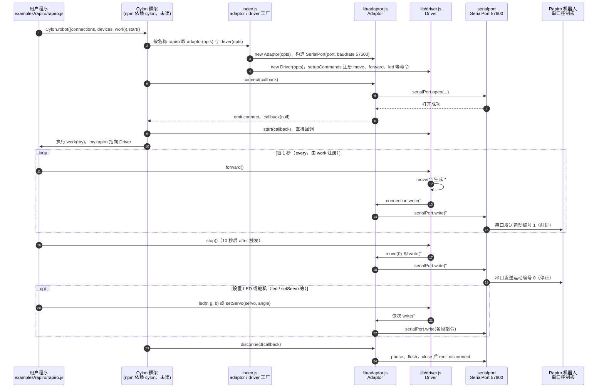

# Rapiro

**Rapiro**（[官网/页面](https://www.rapiro.com/)，[相关链接](https://github.com/hybridgroup/cylon-rapiro)）是 [GitHubStore《19 款能自己造的开源人形机器人》](https://mp.weixin.qq.com/s/UUwUAcKdVrlo-N60Oar3Xg) 的第 9 项，文章标价 约 $390。

## 一句话定义

**Rapiro 是日本设计师 Shota Ishiwatari 设计的小型人形机器人套件：12 个舵机、Arduino 兼容主板，可加装 Raspberry Pi 扩展视觉与网络（文章说法）。**

## 英文缩写速查

| 缩写 | 英文全称 | 简要说明 |
|------|----------|----------|
| Cylon.js | Cylon.js | JavaScript 机器人框架（仓库名所指） |

## 为什么重要

- 属于文章按成本从低到高排列的「能自己造」清单；横向对比见 [能自己造的开源人形机器人 19 款：按成本与形态排序的阅读坐标](../overview/open-source-buildable-humanoids-19-technology-map.md)。
- 价格为文章标价（约 $390），入库日未核实。

## 核心信息

| 项 | 内容 |
|----|------|
| **链接** | [官网/页面](https://www.rapiro.com/)，[相关链接](https://github.com/hybridgroup/cylon-rapiro) |
| **许可（核查）** | 未核实 |
| **最近提交** | 未核实 |

## 文章说法核对

- **文章：** 文章称 3D 模型公开（Thingiverse 搜索 Rapiro），社区驱动示例见 hybridgroup/cylon-rapiro。
- **README / 核查：** 官方站点 rapiro.com 与 Thingiverse 模型未访问，**官方硬件是否开源未核实**；社区仓库 hybridgroup/cylon-rapiro 经 git ls-remote 可达，最近提交 2015-07-15（Cylon.js 驱动示例，README 未读）。
- **差异与保留：** 本节点主要是文章表述；开源范围与许可均未核实。

## 源码运行时序图

入口：用户程序通过 Cylon.js 启动，例如 `node examples/rapiro/rapiro.js`（配置串口 `/dev/ttyUSB0`，README 示例同理；Cylon 框架本身为 npm 依赖 `cylon ~1.1.0`，未读）

图依据：hybridgroup/cylon-rapiro@a7e4bb5，实际读过 `README.md`、`index.js`、`lib/adaptor.js`、`lib/driver.js`（构造、forward / move / stop、led / setServo、pad 段）、`examples/rapiro/rapiro.js`（前段）、`package.json`（依赖声明）；Cylon 框架的 connect、start、work 调度与 `connection` 注入未读（图中为推断，已标注）；未运行代码。

## 关联页面

- [humanoid-robot](../entities/humanoid-robot.md)
- [open-source-humanoid-hardware](../entities/open-source-humanoid-hardware.md)
- [open-source-buildable-humanoids-19-technology-map](../overview/open-source-buildable-humanoids-19-technology-map.md)

## 参考来源

- [rapiro.md](../../sources/repos/rapiro.md)
- [wechat_githubstore_19_buildable_open_source_humanoids_2026-11-02.md](../../sources/blogs/wechat_githubstore_19_buildable_open_source_humanoids_2026-11-02.md)
- [原文（微信公众号）](https://mp.weixin.qq.com/s/UUwUAcKdVrlo-N60Oar3Xg)
- 源码核对（2026-11-02）：hybridgroup/cylon-rapiro@a7e4bb5，读过 README.md、index.js、lib/adaptor.js、lib/driver.js、examples/rapiro/rapiro.js（前段）、package.json；时序图依据以上文件，未运行代码。
