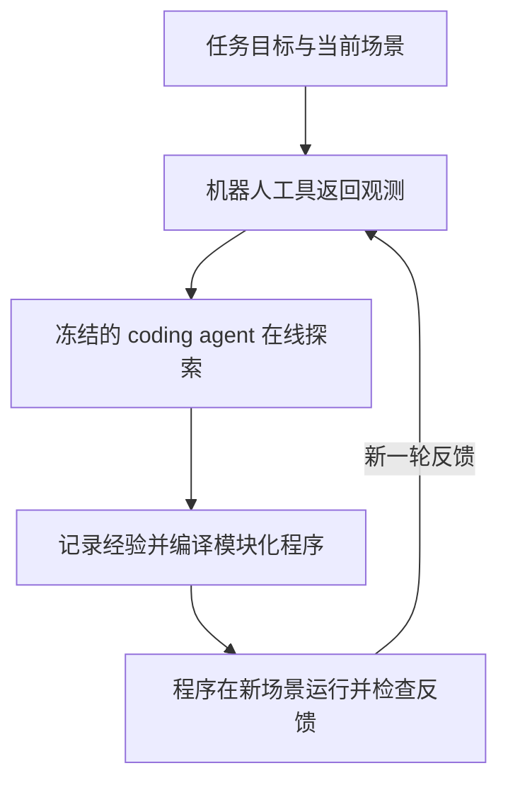
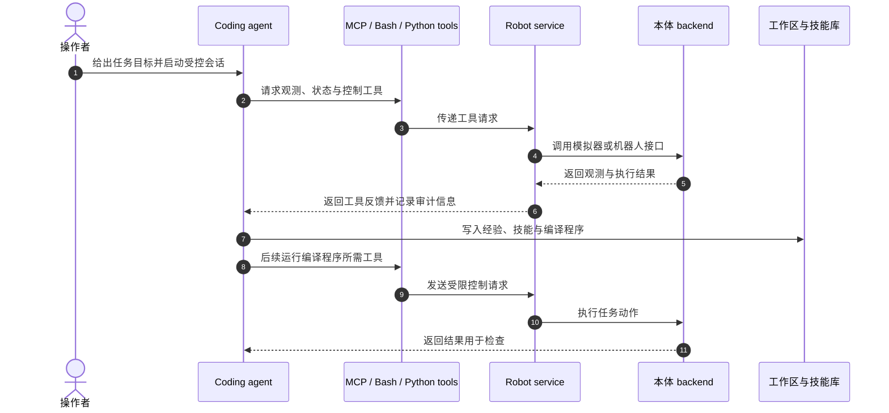

# RAX：把机器人在线探索编译成可复用程序

**RAX**（[论文 PDF](https://robot-agent-exploration.com/rax.pdf)、[项目页](https://robot-agent-exploration.com/)、[代码](https://github.com/robot-agent-exploration/rax)）将通用 coding agent 接入机器人感知和控制 API。冻结的模型在在线交互中尝试任务、记录反馈并编写程序；后续运行由验证过的程序执行，经验与技能留在工作区供复用。

## 英文缩写速查

| 缩写 | 英文全称 | 简要说明 |
| --- | --- | --- |
| RAX | Robot Agent eXploration | 通过扩展在线探索来提升机器人 agent 的框架。 |
| MCP | Model Context Protocol | agent 与机器人服务交换工具调用的接口之一。 |
| LLM | Large Language Model | coding agent 使用的冻结语言模型；论文方法不在线更新其权重。 |
| API | Application Programming Interface | 新机器人接入 RAX 的感知、规划与控制接口边界。 |

## 核心信息

| 字段 | 内容 |
| --- | --- |
| **论文** | [Scaling Online Exploration for Robot Agents](https://arxiv.org/abs/2610.22496)；项目站同时提供 [PDF](https://robot-agent-exploration.com/rax.pdf)。 |
| **机构** | 哈佛大学、NVIDIA、加州大学伯克利分校、麻省理工、斯坦福大学。 |
| **代码 / 许可** | [robot-agent-exploration/rax](https://github.com/robot-agent-exploration/rax)；`main/LICENSE` 为 Apache License 2.0。 |
| **实现形态** | `main` 为索引；实现分支覆盖 RoboDojo / BEHAVIOR-1K、HumanoidArena（G1 + Dex3）、DexJoCo（Franka + Allegro）、LIBERO / LIBERO-PRO（Franka Panda）、Franka FR3 与 Rainbow RB-Y1。LIBERO 系列分支于 2026-10-24 发布。 |
| **经验载体** | agent 工作区中的任务说明、记忆、技能及编译后的控制程序；模型保持冻结。真机技能按本体保存在 [skills-lib](../../sources/repos/skills-lib.md)，并可参考 [公开 session logs](../../sources/datasets/rax-robot-session-logs.md)。 |

## 为什么重要

- **扩展的是交互经验：** 系统增加在线探索 episode，让 agent 从实际反馈中积累任务相关的决策知识，而不依赖动作示范集或针对该任务的策略训练。
- **让推理结果变成可执行资产：** agent 将成功的决策序列编译为分步检查和执行的程序；后续运行可减少反复调用大模型的开销。
- **把本体接口与 agent 流程解耦：** 各模拟器和机器人作为 backend 接到统一工具接口，项目页称新本体可通过 API 适配。
- **技能能够跨会话累积：** companion skills-lib 按本体保存可执行技能及验证证据，后续 agent 可读取、组合并改进已有技能。

## 工作流程

探索回合中，agent 逐步调用工具并记录有效操作及其前置条件、效果。随后它将成功步骤整理成程序并进行无人值守测试。仿真使用未见布局评估；真机测试由操作者复位场景后运行程序。在线探索 agent 与编译程序是两个运行阶段，报告速度提升时需保留这一区别。

## 系统与本体覆盖

- **仿真：** RoboDojo / BEHAVIOR-1K、HumanoidArena（Unitree G1 + Dex3 手、冻结 SONIC 控制器）、DexJoCo（Franka + Allegro 手）及 LIBERO / LIBERO-PRO（robosuite / MuJoCo 中的 Franka Panda 并行夹爪）均提供 container / native 分支；LIBERO-PRO 可对 LIBERO 初始状态施加扰动。官方模拟分支还列出 Codex CLI、Claude Code、DeepSeek Harness 与 Kimi Code。
- **真机：** 官方仓库 README 列出 Franka FR3 单臂和 Rainbow RB-Y1 轮式双臂平台。
- **接口：** harness 不直接依赖具体机器人或模拟器包；后端通过共同工具接口暴露状态、观测、控制及任务能力。
- **技能复用：** harness 将相应本体的技能库带入工作区，技能携带适用前提、检查、失败模式和运行记录。README 描述连续两次无人值守成功后才标记 verified。

## 结果与评测

| 评测口径 | 项目页报告 | 解读 |
| --- | --- | --- |
| 未见仿真场景 | 探索预算从 4 增至 128 episode 时，平均成功率 25%→79%；项目页对比中的此前最佳基线为 41.2%。 | 反映探索量与 held-out 场景泛化的关系。 |
| 仿真基线对比 | 相对顶级 baseline 平均高 37.4%。 | 这是跨仿真任务的汇总，不能视作每个任务均提升同一幅度。 |
| 编译执行耗时 | Air fryer：72 分钟→18 秒（241×）；Bandu tower：17 分钟→10 秒（103×）。 | 比较 agent 完成任务与编译程序执行；不是控制环频率或端到端系统加速指标。 |
| 真机任务 | 项目页报告记忆依赖、关节结构、高精度、可变形物体和长时程移动操作任务。 | 证明任务覆盖面；不替代多场景成功率与运行可靠性统计。 |

## 工程实践与局限

- **适配时先界定 API：** 将观测、控制、规划和安全检查封装为本体 backend；沿用厂商控制栈，避免让通用 agent 直接接触未约束的底层命令。
- **在线探索有物理成本：** 真机需要操作员管理会话和场景复位；安全性依赖物理急停、厂商控制器限制、机器人服务与 agent 沙箱等层次。
- **代码许可证：** 官方仓库 `main/LICENSE` 为 Apache License 2.0，另含 `NOTICE`；配套技能库许可需另行核查。
- **泛化结论需对应任务集：** 扩大探索后未见仿真场景成绩提升，不等于任何新本体、新任务或真实环境都会自动泛化。
- **技能复用需保留证据：** 使用已有技能时应检查前提与验证记录；相同技能名称不保证其对新环境、物体或硬件配置仍适用。
- **日志再利用需审查内容：** 数据集含操作者指令、agent transcript、机器人状态和相机片段；数据卡标注 CC BY 4.0，公开署名并不免除对个人信息及第三方内容的检查。

## 源码运行时序图

主分支将各 backend 的细节放在独立实现分支，图概括 README 所述公共工具接口和服务边界；具体启动命令、硬件约束与环境依赖应以所选分支 README 为准。

## 与相近路线的区别

| 路线 | 主要演进对象 | 经验来源 |
| --- | --- | --- |
| RAX | 编译后的模块化机器人程序与按本体共享的技能 | coding agent 在线探索、工具反馈和无人值守验证。 |
| [ASENA](./paper-asena-self-evolving-agents.md) | 具身任务程序、笔记与导航等可选策略工具 | robot harness 执行记录、MCAP 回放与工作区迭代。 |
| [EmbodiedEvo](./paper-embodied-evo-coding-agent.md) | coding agent 的 skills / lessons 与可复用解决流程 | 在 Playground 中验证的交互经验。 |
| [Harness VLA](./paper-harness-vla.md) | VLA 执行能力及其在 harness 中的使用 | 其论文设定中的任务执行与重试。 |

RAX、ASENA 与 EmbodiedEvo 都将经验保留在权重之外，但机器人接口、验证协议和改进对象不同；各自 benchmark 结果不可横向排序。

## 结论

**RAX 提供了一种用在线交互扩展 agent 经验、再将经验编译成低延迟可执行程序的机器人系统路径。**

- 读“学习”结果时，区分冻结基础模型下的工作区 / 程序演进与模型参数训练。
- 将探索 agent 的交互成本和编译程序运行成本分开报告；241× 与 103× 对应具体任务，不是普适部署加速比。
- 迁移到新本体时，首先验证观测、控制、安全与复位接口，再评估技能适用条件。
- 仿真未见场景与真机演示分别回答泛化与可行性问题，不可互相替代。
- 复用技能时检查它记录的前提、失败模式与连续运行验证结果。
- 项目页公开 session logs 和技能库入口；是否可用于具体实验或再分发还需核对其数据与代码条款。

## 参考来源

- [RAX 官方论文摘录](../../sources/papers/rax_scaling_online_exploration.md)
- [RAX 官方项目页核查](../../sources/sites/rax-project.md)
- [RAX 官方代码仓核查](../../sources/repos/rax.md)
- [RAX Skill Library](../../sources/repos/skills-lib.md)
- [RAX robot session logs 数据集](../../sources/datasets/rax-robot-session-logs.md)

## 关联页面

- [ASENA：让具身 Agent 编写、验证并复用机器人程序](./paper-asena-self-evolving-agents.md)
- [EmbodiedEvo：coding agent 技能演进](./paper-embodied-evo-coding-agent.md)
- [Harness VLA](./paper-harness-vla.md)

## 推荐继续阅读

- [RAX 官方项目页](https://robot-agent-exploration.com/)
- [官方仿真实现](https://github.com/robot-agent-exploration/rax/tree/robodojo-behavior/container)
- [Franka FR3 真机实现](https://github.com/robot-agent-exploration/rax/tree/real/franka)
- [RAX 技能库](https://github.com/robot-agent-exploration/skills-lib)
