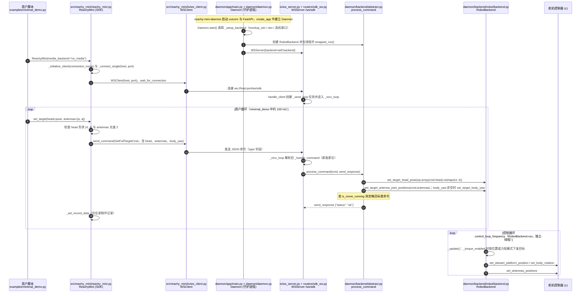

# Reachy Mini

**Reachy Mini**（[GitHub](https://github.com/pollen-robotics/reachy_mini)，[官网/页面](https://pollen-robotics.com/reachy-mini/)）是 [GitHubStore《19 款能自己造的开源人形机器人》](https://mp.weixin.qq.com/s/UUwUAcKdVrlo-N60Oar3Xg) 的第 11 项，文章标价 约 $399。

## 一句话定义

**Reachy Mini 是 Pollen Robotics 的开源、富表现力桌面机器人，面向 hacker 与 AI 开发者；README 提供 Wireless、Lite 与 MuJoCo 仿真三种平台入口。**

## 英文缩写速查

| 缩写 | 英文全称 | 简要说明 |
|------|----------|----------|
| SDK | Software Development Kit | 软件开发包 |
| CM4 | Raspberry Pi Compute Module 4 | 树莓派计算模块 4 |

## 为什么重要

- 属于文章按成本从低到高排列的「能自己造」清单；横向对比见 [能自己造的开源人形机器人 19 款：按成本与形态排序的阅读坐标](../overview/open-source-buildable-humanoids-19-technology-map.md)。
- 价格为文章标价（约 $399），入库日未核实。

## 核心信息

| 项 | 内容 |
|----|------|
| **链接** | [GitHub](https://github.com/pollen-robotics/reachy_mini)，[官网/页面](https://pollen-robotics.com/reachy-mini/) |
| **许可（核查）** | Apache-2.0（LICENSE 文件） |
| **最近提交** | 2026-10-30 |

## 文章说法核对

- **文章：** 文章称它由 Pollen 与 Hugging Face 合作，支持 Python、LLM 对话、表情动作与社区应用，Lite 版连接外部电脑，硬件设计与 SDK 均开放。
- **README / 核查：** README：Wireless 版为 Raspberry Pi CM4 + 电池 + WiFi 的全自主版；Lite 版为 USB 连接电脑的开发者版；Simulation 在 MuJoCo 中原型开发；LICENSE 为 Apache-2.0。
- **差异与保留：** **文章归入人形机器人清单；README 称「expressive robot」，未称人形**。库内 `painode-169-reachymini` 只是策展索引条目，不是项目节点，故新建本节点。「与 Hugging Face 合作」「硬件设计开放」来自文章，已读 README 段落未逐项核对。

## 源码运行时序图

入口：两个进程。守护进程：`reachy-mini-daemon`（`pyproject.toml` 的 console script，指向 `reachy_mini.daemon.app.main:main`）；用户脚本：`python3 examples/minimal_demo.py`（`ReachyMini(media_backend="no_media")` 后循环 `set_target`，约 100 Hz）。下图以真机 `RobotBackend` 为主；`MujocoBackend` 与 `MockupSimBackend` 分支未画。

图依据：pollen-robotics/reachy_mini@25756e7，实际读过 `README.md`、`pyproject.toml`（`[project.scripts]`）、`examples/minimal_demo.py`、`src/reachy_mini/reachy_mini.py`（`__init__` 签名、`_initialize_client`、`_connect_single`、`set_target`）、`src/reachy_mini/io/ws_client.py`（连接 URI、`send_command`）、`src/reachy_mini/io/ws_server.py`（`handle_client`、`_handle_command`）、`src/reachy_mini/daemon/app/routers/sdk_ws.py`（`/ws/sdk`）、`src/reachy_mini/daemon/app/main.py`（`create_app` 片段）、`src/reachy_mini/daemon/daemon.py`（`start`、`_setup_backend` 分支条件）、`src/reachy_mini/daemon/backend/abstract.py`（`process_command` 中 `SetFullTargetCmd` 分支）、`src/reachy_mini/daemon/backend/robot/backend.py`（`run`、`_update`）；`goto_target` 的插值与 `wake_up` 未画；未运行代码。

## 关联页面

- [humanoid-robot](../entities/humanoid-robot.md)
- [open-source-humanoid-hardware](../entities/open-source-humanoid-hardware.md)
- [open-source-buildable-humanoids-19-technology-map](../overview/open-source-buildable-humanoids-19-technology-map.md)

## 参考来源

- [reachy_mini.md](../../sources/repos/reachy_mini.md)
- [wechat_githubstore_19_buildable_open_source_humanoids_2026-11-02.md](../../sources/blogs/wechat_githubstore_19_buildable_open_source_humanoids_2026-11-02.md)
- [原文（微信公众号）](https://mp.weixin.qq.com/s/UUwUAcKdVrlo-N60Oar3Xg)
- 源码核对（2026-11-02）：pollen-robotics/reachy_mini@25756e7，读过 README.md、pyproject.toml、examples/minimal_demo.py、src/reachy_mini/reachy_mini.py、src/reachy_mini/io/ws_client.py、src/reachy_mini/io/ws_server.py、src/reachy_mini/daemon/app/routers/sdk_ws.py、src/reachy_mini/daemon/app/main.py、src/reachy_mini/daemon/daemon.py、src/reachy_mini/daemon/backend/abstract.py、src/reachy_mini/daemon/backend/robot/backend.py；时序图依据以上文件，未运行代码。
