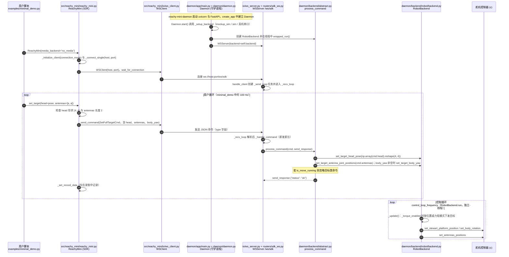

# Reachy Mini

**Reachy Mini**（[GitHub](https://github.com/pollen-robotics/reachy_mini)，[官网/页面](https://pollen-robotics.com/reachy-mini/)，[Hugging Face 博客发布介绍](https://huggingface.co/blog/reachy-mini)）是 Pollen Robotics 推出的开源桌面级机器人，同时收录于 [GitHubStore《19 款能自己造的开源人形机器人》](https://mp.weixin.qq.com/s/UUwUAcKdVrlo-N60Oar3Xg)（第 11 项，文章标价约 $399）与 awesome-physical-ai（natnew **第 169/384** 条，Hardware Platforms 分组，简述标价 `$299` 起）。

## 一句话定义

**Reachy Mini 是 Pollen Robotics 面向 AI 实验与开发的开源富表现力桌面机器人（Apache-2.0），通过守护进程与 WebSocket SDK 提供 Wireless（CM4）、Lite（USB）与 MuJoCo 仿真三种运行入口。**

## 英文缩写速查

| 缩写 | 英文全称 | 简要说明 |
|------|----------|----------|
| SDK | Software Development Kit | 软件开发包 |
| CM4 | Raspberry Pi Compute Module 4 | 树莓派计算模块 4 |
| PAI | Physical AI | 具身/物理智能策展主题 |
| DoF | Degrees of Freedom | 臂/桌面机器人的自由度口径 |
| ROS | Robot Operating System | 常用机器人驱动与中间件生态 |

## 为什么重要

- 属于开源低成本桌面交互机器人的代表平台：既有 GitHubStore 清单按成本与形态排序的阅读坐标（见 [能自己造的开源人形机器人 19 款](../overview/open-source-buildable-humanoids-19-technology-map.md)），也位于 [Physical AI 技术地图](../overview/awesome-physical-ai-technology-map.md) 的 Hardware Platforms 硬件分组。
- 将头部 Stewart 平台、天线表情运动与 Python / LLM 对话应用接进统一 WebSocket 守护进程架构，并原生附带 MuJoCo 仿真开发后端。
- 说明：文章标价（约 $399）与 awesome-physical-ai 条目简述（`from $299`）反映不同时间与配置/文章引用口径，实际价格与发售配置以官方页面为准。

## 核心信息

| 项 | 内容 |
|----|------|
| **代码仓库** | <https://github.com/pollen-robotics/reachy_mini> |
| **官网 / 博客入口** | [pollen-robotics.com/reachy-mini](https://pollen-robotics.com/reachy-mini/) · [huggingface.co/blog/reachy-mini](https://huggingface.co/blog/reachy-mini) |
| **策展编号** | awesome-physical-ai（natnew #169/384 · Hardware Platforms）；GitHubStore 19 款开源清单 #11 |
| **许可（核查）** | Apache-2.0（LICENSE 文件） |
| **最近提交** | 2026-10-30 |

## 文章说法核对

- **文章：** 文章称它由 Pollen 与 Hugging Face 合作，支持 Python、LLM 对话、表情动作与社区应用，Lite 版连接外部电脑，硬件设计与 SDK 均开放。
- **README / 核查：** README：Wireless 版为 Raspberry Pi CM4 + 电池 + WiFi 的全自主版；Lite 版为 USB 连接电脑的开发者版；Simulation 在 MuJoCo 中原型开发；LICENSE 为 Apache-2.0。
- **差异与保留：** **文章归入人形机器人清单；README 称「expressive robot」，未称人形**。原 awesome-physical-ai 策展索引条目 `painode-169-reachymini` 已并入本权威项目节点。「与 Hugging Face 合作」「硬件设计开放」来自文章与博客入口，已读 README 段落未逐项核对全部硬件设计文件明细。

## 源码运行时序图

入口：两个进程。守护进程：`reachy-mini-daemon`（`pyproject.toml` 的 console script，指向 `reachy_mini.daemon.app.main:main`）；用户脚本：`python3 examples/minimal_demo.py`（`ReachyMini(media_backend="no_media")` 后循环 `set_target`，约 100 Hz）。下图以真机 `RobotBackend` 为主；`MujocoBackend` 与 `MockupSimBackend` 分支未画。

图依据：pollen-robotics/reachy_mini@25756e7，实际读过 `README.md`、`pyproject.toml`（`[project.scripts]`）、`examples/minimal_demo.py`、`src/reachy_mini/reachy_mini.py`（`__init__` 签名、`_initialize_client`、`_connect_single`、`set_target`）、`src/reachy_mini/io/ws_client.py`（连接 URI、`send_command`）、`src/reachy_mini/io/ws_server.py`（`handle_client`、`_handle_command`）、`src/reachy_mini/daemon/app/routers/sdk_ws.py`（`/ws/sdk`）、`src/reachy_mini/daemon/app/main.py`（`create_app` 片段）、`src/reachy_mini/daemon/daemon.py`（`start`、`_setup_backend` 分支条件）、`src/reachy_mini/daemon/backend/abstract.py`（`process_command` 中 `SetFullTargetCmd` 分支）、`src/reachy_mini/daemon/backend/robot/backend.py`（`run`、`_update`）；`goto_target` 的插值与 `wake_up` 未画；未运行代码。

## 局限与风险

- 不要把策展清单摘要当成硬件采购或合规结论；价格、供货与各版本（Lite / Wireless）硬件差异以官方页面为准。
- 命名差异：策展文章将其归类在「开源人形」清单，但本体形态主要是桌面级头部与躯干旋转表现平台，不含双足行走与双臂操作能力。

## 关联页面

- [humanoid-robot](../entities/humanoid-robot.md)
- [open-source-humanoid-hardware](../entities/open-source-humanoid-hardware.md)
- [open-source-buildable-humanoids-19-technology-map](../overview/open-source-buildable-humanoids-19-technology-map.md)
- [awesome-physical-ai（natnew）](../entities/awesome-physical-ai-natnew.md)
- [awesome-physical-ai（aichr）](../entities/awesome-physical-ai-aichr.md)
- [Physical AI 技术地图](../overview/awesome-physical-ai-technology-map.md)
- [Physical AI 策展清单对比](../comparisons/awesome-physical-ai-curated-lists.md)
- [VLA](../methods/vla.md)
- [Sim2Real](../concepts/sim2real.md)

## 参考来源

- [reachy_mini.md](../../sources/repos/reachy_mini.md)
- [wechat_githubstore_19_buildable_open_source_humanoids_2026-11-02.md](../../sources/blogs/wechat_githubstore_19_buildable_open_source_humanoids_2026-11-02.md)
- [`sources/repos/pai_awesome_hardware_169_reachy-mini.md`](../../sources/repos/pai_awesome_hardware_169_reachy-mini.md) — awesome-physical-ai 条目策展摘录
- [`sources/repos/awesome-physical-ai-union-catalog.md`](../../sources/repos/awesome-physical-ai-union-catalog.md) — 双清单并集目录
- [sources/repos/awesome-physical-ai-natnew.md](../../sources/repos/awesome-physical-ai-natnew.md)
- [sources/repos/awesome-physical-ai-aichr.md](../../sources/repos/awesome-physical-ai-aichr.md)
- [原文（微信公众号）](https://mp.weixin.qq.com/s/UUwUAcKdVrlo-N60Oar3Xg) · [Hugging Face 博客介绍](https://huggingface.co/blog/reachy-mini)
- 源码核对（2026-11-02）：pollen-robotics/reachy_mini@25756e7，读过 README.md、pyproject.toml、examples/minimal_demo.py、src/reachy_mini/reachy_mini.py、src/reachy_mini/io/ws_client.py、src/reachy_mini/io/ws_server.py、src/reachy_mini/daemon/app/routers/sdk_ws.py、src/reachy_mini/daemon/app/main.py、src/reachy_mini/daemon/daemon.py、src/reachy_mini/daemon/backend/abstract.py、src/reachy_mini/daemon/backend/robot/backend.py；时序图依据以上文件，未运行代码。

## 推荐继续阅读

- [Reachy Mini 官方 GitHub](https://github.com/pollen-robotics/reachy_mini)
- [Hugging Face Blog: Reachy Mini](https://huggingface.co/blog/reachy-mini)
- [natnew/awesome-physical-ai](https://github.com/natnew/awesome-physical-ai) · [aichr/awesome-physical-ai](https://github.com/aichr/awesome-physical-ai)
