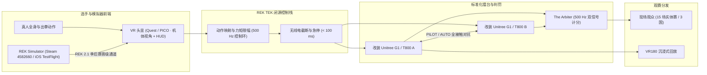

# REK（Robot Embodied Kombat · 人形格斗联赛）

**REK** 是旧金山公司 **Robot Embodied Kombat** 运营的 **全接触人形机器人格斗体育联赛与模拟器生态**：主力现场赛由选手戴 **VR 头显** 通过自研 **REK TEK** 将动作实时映射到改装 **Unitree G1**（及 **EngineAI T800**、Unitree H1-2 等）进行对打，同时官网 `/rules` 在竞赛规范上并设 **PILOT（遥操作）** 与 **AUTO（封装自主策略）** 双分组，并以 [REK Simulator](https://rek.com/sim) 作为线上选拔与多端训练入口。

## 一句话定义

**把高冲击人形硬件（改装 Unitree G1 / EngineAI T800）、VR 全身遥操作、500 Hz 传感器计分与多端物理格斗模拟器组合成商业赛事联赛，同时在规则上兼设人类 PILOT 与自主 AUTO 双赛道。**

## 英文缩写速查

| 缩写 | 英文全称 | 简要说明 |
|------|----------|----------|
| REK | Robot Embodied Kombat | 品牌、格斗联赛及同名多平台模拟器 |
| VR | Virtual Reality | 选手端第一视角图传与全身动作采集界面（Quest / PICO） |
| DoF | Degrees of Freedom | 官网 `/rules` 基准机台与 G1 U2 租赁均标注 29 关节自由度 |
| WBC | Whole-Body Control | 抗冲击下盘自平衡与出拳全身协调控制 |
| SDK | Software Development Kit | REK 租赁的 Unitree G1 U2 面向开发与教学提供完整接口 |
| KO / TKO / STKO | Knockout / Technical KO / Structural KO | `/rules` 定义的击倒、技术击倒与结构损毁判负终点 |

## 为什么重要

- **人形硬件的极限抗冲击试验场：** 在 [Unitree G1](./unitree-g1.md) 主要承担科研步行与桌面操作基准的语境下，REK 以 **全接触、故意碰撞与高速出拳** 验证轻量电驱人形的结构耐受、急停安全与商业观赛可变现性。
- **VR 遥操作的竞技极值点：** 与精细插拔类数采不同，REK 要求低延迟全身动作映射、力矩限幅与 **< 100 ms** 无线电/急停截断，代表 [Teleoperation](../tasks/teleoperation.md) 谱系中的高动态竞技端。
- **连接「线上模拟器」与「线下真机 pilot 选拔」：** 通过 Steam（App ID `4582660`）、Meta Quest 与 iOS TestFlight 分发与真机同源的自平衡/战斗物理模拟环境，使 **30,000+ 场** 线上模拟器对战（覆盖 **65 个国家**）直接向 REK 2.1 现场季后赛输送人类选手。
- **产业双轨对照轴：** 与深圳 [URKL](./urkl.md)（EngineAI T800 标准化自主算法联赛）以及学术多智能体工作 [RoboStriker](./paper-notebook-robostriker.md) 并列，REK 现场商业化优先验证了 VR 真人 pilot 的强娱乐观赏性，同时在规则中预留了密封策略 `AUTO division`。

## 核心原理

### 赛事规范、机型与计分（`/rules` & `/fights` 全文核对）

| 维度 | 官方前端源码核对事实 |
|---|---|
| **基准机型参数** | `/rules` 基准机台：**1.32 m** 身高、**35 kg** 整备体重、**29 关节**、**500 Hz** 控制频率、**120 N·m** 峰值力矩；真机与模拟器兼含改装 **Unitree G1** 与 **EngineAI T800**（历史报道亦见 H1-2） |
| **双赛道划分** | **PILOT division**（VR 人类遥操驾驶）与 **AUTO division**（提交封闭自主策略参赛，无真人实时干预） |
| **自动计分系统** | **The Arbiter** 以 **500 Hz** 双路信号采集与冲击加速度分级判定得分，终点裁决涵盖 `KO / TKO / STKO / DEC / DQ` |
| **安全硬件约束** | 现场明确强制 **< 100 ms** 物理急停与无线电失联截断机制 |
| **规模与里程碑** | `/fights` 披露累计 **15 场真实人形格斗**（覆盖 **3 个国家**）与 **30,000+ 场模拟器对战**（覆盖 **65 个国家**）；含 REK0、REK America 五城巡演（2025-11）、REK1（2026-02-07）与 REK 2.1（10/30–31 与 11/6–7 季后赛，胜者 `Suslike`、`CoffeeCactus417`、`scabnft2` 晋级 11/20 现场总决赛；已知真机冠军包括 `Andy`、`Osone`、`Suslike`） |

### 多平台 REK Simulator 分布

| 平台 | 验证入口与定位 |
|---|---|
| **Steam 桌面端** | App ID `4582660`（<https://store.steampowered.com/app/4582660/REK/>），支持 **PC / macOS / Linux**，列出明确最低硬件配置要求 |
| **Meta Quest** | 官方商店/体验入口 <https://www.meta.com/s/aXbdiAyt0>，支持直接佩戴 VR 头显进行第一视角格斗练习与季后赛排位 |
| **iOS 移动端** | Apple TestFlight 测试通道 <https://testflight.apple.com/join/kEMR9Y6k>（测试分发，尚未作为 App Store 正式商业上架核实，且未披露本地与云端推理分工） |

### 与科研遥操作的差异

| 维度 | 实验室 VR 全身遥操作 | REK 格斗与模拟器体系 |
|---|---|---|
| **目标函数** | 采集一致演示轨迹 / 部署 [全身运动控制](../tasks/loco-manipulation.md) 策略 | 竞技观赏、冲击耐久验证与选拔顶级 pilot |
| **接触边界** | 受控抓放与严格力矩抑制 | **故意全接触、高冲击击打** 与 `STKO` 结构容错 |
| **策略归属** | 下层接 [BeyondMimic](../methods/beyondmimic.md) / RL 跟踪或 VLA | 现役主力现场为人类实时决策（`PILOT`），规则另设封闭 `AUTO` 分组 |

## 源码运行时序图

**不适用** — 经全文核查官网 SPA 源码（`rek_main.js`，含 `/sim` 与 `/terms#simulator`）及 Steam 产品页（App ID `4582660`），**REK** 联赛控制软件 **REK TEK**、**The Arbiter** 计分后台（基于 Supabase / GCP / Stripe）及 **REK Simulator** 均为**完全闭源商业专有软件**。`/terms#simulator` 条款明确禁止对二进制包进行反编译、逆向工程或提取神经网络策略权重，因此不存在可验证源码运行入口。

## 工程实践

- **系统封闭性与商业服务：** 软件栈全面闭源；商业运作依赖 ① 现场巡演售票 ② 线上商城与硬件租赁（`/shop` 列出 **8 款在售人形机器人**及价格，含 29 DoF / 约 2 h 续航 / Full SDK 的 Unitree G1 U2 租赁） ③ REK Simulator 赛事选拔闭环。官方 `/careers` 招募 **RL Researcher** 与 **VP of Events** 印证了其「底层平衡对抗策略研究 + 商业体育巡演」双轮驱动。
- **物理仿真的防作弊动画约束：** Steam 产品页强调格斗动作由物理与自平衡神经网络驱动而非预制罐头动画，用于保障线上选拔赛与线下真机操纵的手感迁移一致性。
- **与本体厂商分离：** 虽然主力采用 [Unitree G1](./unitree-g1.md)（并兼容 T800），但其护甲改造、VR 界面、REK TEK 与计分系统均为 REK 独立第三方工程，不代表原厂默认出厂固件行为。

## 局限与风险

- **核心技术栈闭源且不可审计：** REK TEK 延迟指标、The Arbiter 加速度计标定细节、自平衡神经网络训练架构及移动端推理位置（本地 vs 云端）均未公开论文或仓库，学术界难以直接复现或作为开源基准引用。
- **现场主力仍由真人 Pilot 驱动：** 尽管官网 `/rules` 已同时定义 `AUTO division` 自主赛道，现阶段已验证出圈的巡演与主力现场赛仍依赖真人穿戴 VR 实时控制，与 [URKL](./urkl.md) 或 [RoboStriker](./paper-notebook-robostriker.md) 的全自主 AI 对抗存在本质控制链路区别。
- **轻量电驱人形态物理上限：** 35 kg 级电驱人形的关节齿轮箱、散热与结构件在高冲击格斗中面临频繁维修与 `STKO` 结构损毁风险，对赛事备机与现场维修后勤要求极高。

## 与其他页面的关联

- [Unitree G1](./unitree-g1.md) — REK 主力现场与租赁硬件底盘
- [Unitree](./unitree.md) — 核心硬件供应链与原厂 SDK 生态
- [URKL](./urkl.md) — EngineAI 标准化 T800 格斗联赛对照
- [Teleoperation](../tasks/teleoperation.md) — VR 全身动作映射的极限竞技场景
- [Humanoid Locomotion](../tasks/humanoid-locomotion.md) — 高冲击格斗中的双足抗扰与动态平衡基础
- [Loco-Manipulation](../tasks/loco-manipulation.md) — 移动、格挡与出拳耦合的全身协调问题
- [BeyondMimic](../methods/beyondmimic.md) — 高动态全身动作跟踪与控制方法对照
- [RoboStriker](./paper-notebook-robostriker.md) — 自主人形拳击多智能体 RL 研究锚点
- [Open Duck Mini](./open-duck-mini.md) — 另一条开源低成本娱乐双足路线

## 参考来源

- [REK 官网与前端 SPA 全路由核对归档（rek-com.md）](../../sources/sites/rek-com.md)
- [REK Simulator 多平台与条款核对归档（rek-simulator.md）](../../sources/sites/rek-simulator.md)

## 推荐继续阅读

- REK 官网与规则页：<https://rek.com/>
- REK Simulator Steam 官方产品页：<https://store.steampowered.com/app/4582660/REK/>
- [RoboStriker 论文（arXiv:2601.22517）](https://arxiv.org/abs/2601.22517)
- [Unitree G1 实体页](./unitree-g1.md)
