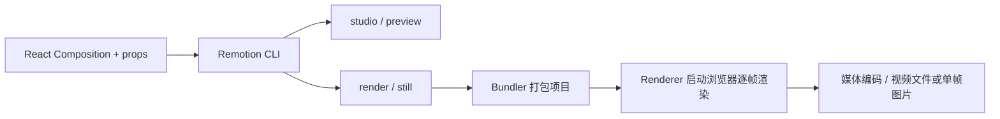
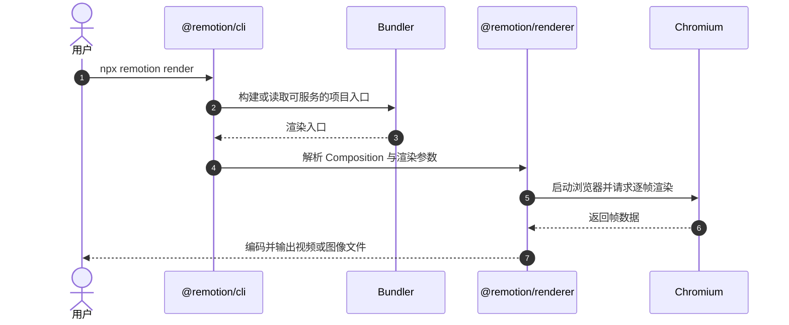

# Remotion

**Remotion**（[remotion-dev/remotion](https://github.com/remotion-dev/remotion)）是用 **React + TypeScript** 描述时间轴、动效与合成的 **programmatic video** 框架：代码即成片规格，可在 **agent 生成、拖拽交互、数据驱动批量渲染** 之间切换而不丢源真值。

## 一句话定义

把 **UI 组件思维** 搬到视频：用 React props/组合表达镜头，用 `@remotion/renderer` 等管线导出 mp4/webm，并可选 Lambda/Vercel 做 **规模化渲染**。

## 英文缩写速查

| 缩写 | 英文全称 | 简要说明 |
|------|----------|----------|
| SSR | Server-Side Rendering | Remotion 服务端逐帧渲染视频 |
| GUI | Graphical User Interface | Remotion Studio 交互时间轴 |
| API | Application Programming Interface | Node/Lambda/Player 等编程接口 |
| CLI | Command-Line Interface | `npx remotion` 系列命令 |

## 为什么重要（对本知识库读者）

- **Agent 时代视频栈：** README 定位 *Video tools for the agent era*；官方提供 [Agent Skills 文档](https://www.remotion.dev/docs/ai/skills) 与 [Prompts](https://www.remotion.dev/prompts)，与 [video-shotcraft](video-shotcraft.md) 的 Remotion 样片库、[claude-api](../entities/anthropic-claude-api-skill.md) 类 API 技能形成 **「规约 + 参考实现 + 渲染 CLI」** 链。
- **机器人路线素材：** [motion-control 路线](../../roadmap/motion-control.md) 汇总了可进一步转为解说视频的章节内容；视频资产不在本仓库中发布。
- **与 Manim / GSAP 分工：** [Manim](manim.md) 偏数学动画；[GSAP Skills](gsap-skills.md) 偏 Web 动效技能；Remotion 偏 **产品/路线/marketing 级成片与 batch**。

## 核心机制与结构

| 模式 | 说明 |
|------|------|
| Agentic | Coding agent 写/改 Composition 与 `src/` 场景 |
| Interactive | Remotion Studio 拖拽与时间轴 |
| Programmatic | 数据绑定、模板化批量出片 |
| 渲染 | Node SSR、Lambda、Vercel Sandbox、客户端导出 |
| 嵌入 | Player、Editor Starter、Mediabunny 等 |

### 流程总览（本地渲染）

按官方 `@remotion/cli` 命令路由及渲染流程区分**预览**和**实际出片**，两条路径不互为依赖。

## 工程实践

| 主题 | 结论 |
|------|------|
| 开源 | **GitHub monorepo 已开源**；**商业使用** 须读 [Remotion License](https://www.remotion.dev/license)（非单一 OSI  SPDX） |
| 入门 | `npx create-video@latest`，创建 React/TypeScript 项目 |
| 预览 | 项目内 `npx remotion studio`；仅用于交互式查看，不是 `render` 的前置动作 |
| 导出 | 项目内 `npx remotion render` 出片；`npx remotion still` 截取单帧 |
| 安装一致性 | `remotion` 与 `@remotion/*` 包应使用相同的精确版本（见官方 CLI README） |
| 验收 | [video-shotcraft](video-shotcraft.md) 推荐镜头级 `npx remotion still` + 审美规则 subagent |
| 与本站 CI | 视频为 **可选媒体产物**；不参与 `make ci-preflight` 默认门禁 |

## 源码运行时序图

本图仅刻画官方 CLI **本地 render** 路径：已核对 `packages/cli/src/index.ts` 的 `render` 分发和 `packages/cli/src/render-flows/render.ts` 中的浏览器准备、渲染与编码逻辑；不把 Lambda/Studio 流程误画为同一路径。

复现入口：[`packages/cli/src/index.ts`](https://github.com/remotion-dev/remotion/blob/main/packages/cli/src/index.ts) → [`render-flows/render.ts`](https://github.com/remotion-dev/remotion/blob/main/packages/cli/src/render-flows/render.ts)。

## 与 HyperFrames 对比

| 选型维度 | Remotion | [HyperFrames](hyperframes.md) |
|---|---|---|
| 主源文件 | React / JSX Composition | 原生 HTML/CSS + 可 seek 动画 |
| 构建路径 | React 项目依赖打包/渲染器 | HTML 可直接预览，CLI 负责渲染 |
| Agent 协作 | 适合已有 React 组件、数据模板与成熟云渲染 | 适合较轻量 HTML 工件与可安装视频制作 Skills |
| 许可 | Remotion License，部分组织需商业授权 | 核心框架 Apache-2.0；Studio Pro 属附加服务 |

两者生成的演示视频**不是机器人仿真或策略执行本身**，评测结果应引用原始运行日志与实验记录。

## 局限与风险

- **许可：** 以 2026-11-19 所核对 `LICENSE.md` 为准，免费许可覆盖个人、员工不超过 3 人的营利组织、非营利组织与非商业评估；超出范围需要 Company License。官方已提示 5.0 条款将有调整，务必在实际部署时复核。  
- **依赖 Node/React 栈：** 与 Python 仿真主栈正交，适合 **展示层** 而非控制环。  
- **渲染成本：** 长片高分辨率 batch 需预算 CPU/GPU 或 Lambda 费用。

## 关联页面

- [Wise Motion](wise-motion.md) — 动效参考匹配与源码导出技能。
- [HyperFrames](hyperframes.md) — HTML/CSS 视频渲染框架与 Agent 技能包，便于对照选型。

- [video-shotcraft](video-shotcraft.md) — Agent Skill 级 Remotion 镜头库  
- [Karpathy LLM Wiki](../concepts/llm-wiki-karpathy.md) — 知识编译与多媒体导出并列  

## 推荐继续阅读

- 文档首页：<https://www.remotion.dev/docs>  
- GitHub：<https://github.com/remotion-dev/remotion>
- [CLI 官方源码](https://github.com/remotion-dev/remotion/tree/main/packages/cli/src)
- [Remotion License](https://github.com/remotion-dev/remotion/blob/main/LICENSE.md)  

## 参考来源

- [Remotion 仓库归档](../../sources/repos/remotion.md)
