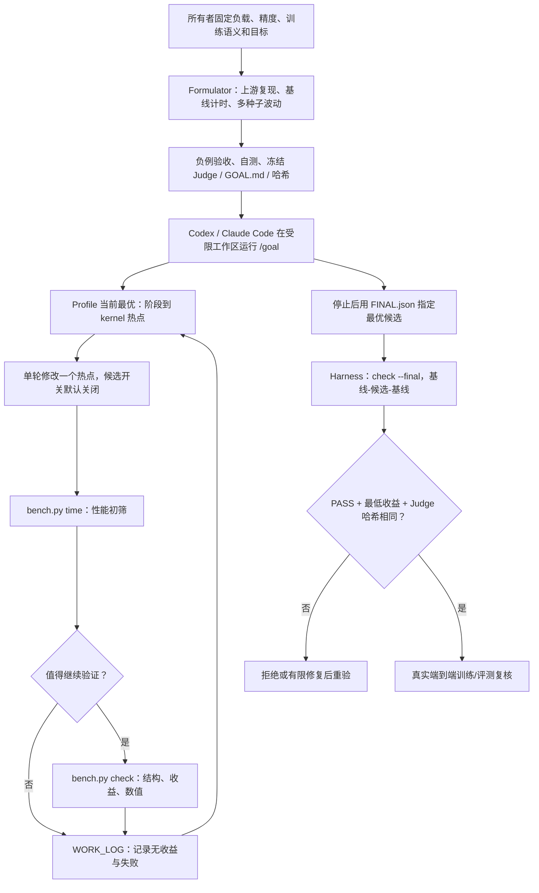
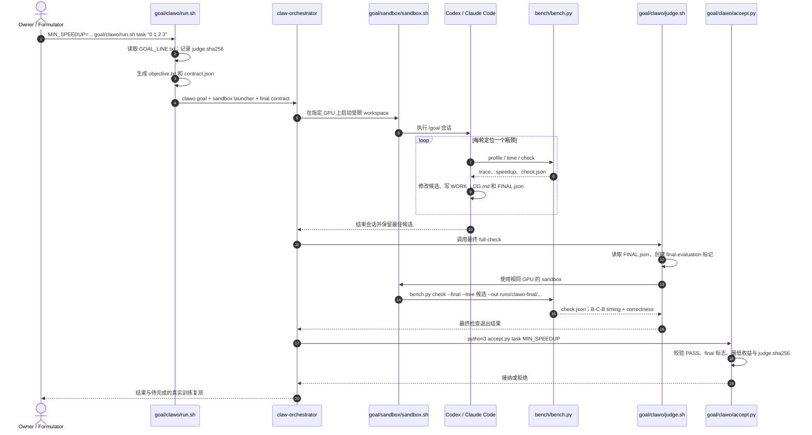

# ResearchBoost-Agent — Autonomous AI Training Optimization / 基于冻结判官的 Agent 自主训练加速

## 一句话定义

**ResearchBoost-Agent（RBA）** 是一套让 Codex 或 Claude Code **自动分析研究训练代码、按热点逐轮改进并接受冻结评测器（Judge）约束**的开源可见工程框架：只有实测性能有益且训练语义按预设规则通过**逐比特或统计等效**检查的候选，才有机会被接纳。

## 英文缩写速查

| 缩写 | 英文全称 | 简要说明 |
|---|---|---|
| RBA | ResearchBoost-Agent | 本项目的训练系统优化智能体 |
| RSI | Recursive Self-Improvement | 作者将研究 Infra 自动改进视为 AI4AI / RSI 的一个有界切入点，不代表已实现完整 RSI |
| AI4AI | AI for AI | 用 AI 工具改善 AI 训练与研发工作 |
| AST | Abstract Syntax Tree | Judge 比较训练入口结构，防止静默更改训练流程 |
| RNG | Random Number Generator | 固定并审计训练随机流，避免“优化”改变数据/步骤 |
| GPU | Graphics Processing Unit | 训练、性能分析和判官评测的计算设备 |
| N0/N1 | Numerical equivalence tier 0/1 | N0 逐比特一致；N1 浮点轨迹统计等效 |
| B-C-B | Baseline–Candidate–Baseline | 最终判官的两段基线夹一段候选的独立进程计时 |

## 为什么重要

很多机器人策略、视频生成、扩散模型或 LLM 的研究实现为了正确性先行，训练中存在未命中的快速路径、重复通信或不合适的算子粒度。简单要求 coding agent “优化 CUDA”往往会得到**看起来更快，却漏算梯度、改变采样或切断反向图**的错误候选。

ResearchBoost 的价值不在“自动产生 9 倍魔法”，而在 **把性能收益、训练数值语义和可重复实验绑定到同一验收协议**。对机器人策略训练可借鉴这种机制，但必须为 Isaac Lab / MJLab、AMP/PPO/VLA 等具体工作负载另外构造真正覆盖其 rollout、随机化与控制性能的评测器。

## 核心原理

### 先定不可改变的训练目标

所有者事先确定**上游 commit、工作负载、每 GPU 批大小、原始精度、随机流与训练语义、最低收益**；Formulator（可由另一个 Agent 承担）在优化开始前独立完成以下工作：

1. 基准负载运行两次，确保短程 deterministic baseline 本身逐比特可复现；记录环境、硬件和时间窗口。
2. 为任务构建 `bench/` 的 `profile`、`time`、`check` 与 `numerics/` 适配；冻结多随机种子估计的基线波动 σ。
3. 用已知错误样本和扰动学习率的 control arm 验证 Judge 不是“坏了也能通过”；哈希冻结 Judge 代码、阈值、输入及基线记录。
4. 把优化目标写入 `GOAL.md`；优化 Agent 不能修改冻结判官或自行降低正确性阈值。

### Judge 的四道门

以下是 **2026-11-08 当前官方 `docs/judge.md`** 的规则；`tasks/` 里部分早期存档示例有旧版 2σ/多种子协议，不能用旧代码反证新规则。

| Gate | 当前检查 | 不通过 |
|---|---|---|
| 0 Structure | 入口 AST、数据 batch 逐比特、RNG fingerprints、训练阶段/forward 次数/学习率/跨卡同步等 | ERROR / INCORRECT |
| 1 Benefit | `check` 用冻结基线 vs 候选单次计时；**最终 `--final` 用 B-C-B 三次独立进程**；收益需超过 `max(1.02, 1+2×baseline spread)` | 无收益 → UNAVAILABLE |
| 2 Bitwise | 短 deterministic 轨迹中 loss、输出、梯度、优化器状态等逐比特一致 | 不一致进入 Gate 3 |
| 3 Statistical | 在第一个冻结种子做一条短配对轨迹，各端点偏差限于预先冻结的基线 **3σ** | INCORRECT |

`check --quick` 不等同完整 PASS；**最终验收只认 harness 运行的 `check --final`、最低 speedup、Judge 文件 SHA-256 未改变**。短轨迹的 PASS 仍需要长程真实训练补证。

## 流程总览

以下是通读[作者技术原文](../../sources/blogs/researchboost-rsi-starts-with-infra-2026.md)和[现行 Methodology/Judge](../../sources/repos/researchboost-agent.md)后的工作流抽象。注意 Formulator 和 Optimizer **不是同一个具备任意修改裁判权限的 Agent**。

以上 LOG → PROF 是目标模式的循环；最终评测在 Session 结束后由 **外部 harness** 触发，而不是 Agent 自报“达标”便立即接受。

## 源码运行时序图

已静态核对官方 `goal/clawo/run.sh`、`judge.sh`、`accept.py`、`docs/run-a-task.md` 和 `tasks/dmd2/bench/bench.py` 的可识别入口；图中展示**准备完毕后的 /goal 执行与最终验收**，不冒充实际 GPU trace。

复现入口见[官方 Run a task](https://github.com/DAGroup-PKU/ResearchBoost-Agent/blob/main/docs/run-a-task.md)。`FORMULATOR_BRIEF.md` 决定任务构造和用户确认范围；GPU 数据、缓存与生成工件必须与冻结负载匹配。

## 实验与评测

**均为作者 / 社区提供的原始仓库结果，非本库独立复测。** 截至 2026-11-08 主仓 README 汇总**七个领域、20 个项目**；各自相对各自的 baseline，**不是跨硬件加速排行，也不能作为均值比较**。

| 项目与工作负载 | 硬件 | 报告的收益 | 验证范围 |
|---|---|---|---|
| **Faster-Motus**：RoboTwin 2.0、27,244 episodes 微调 | 8 × B200 | **9.59×**；7.468 → 0.779 s/iteration | 1,100 次迭代跨两个 epoch 边界，8 ranks loss、参数、optimizer 等逐比特相同；**迭代时间** |
| Faster-NanoChat：D24 ≈1.384B、Tensorwise FP8 | 8 × H20 | **1.0744×**；3358.4 → 3126.0 ms/update | N1 短轨迹统计等效；未包含完整训练时长 |
| Faster-RAE：Stage-1 decoder + GAN | 2 × H200 优化环境 | **5.32× step time** | 另有 8 × H20 的 16 epoch 与 rFID 复核；两环境不应混为一条测速 |
| Faster-RoboTwin：π0.5 策略评测 | 8 × H20 | **4.38×（估算）** | 从局部任务运行外推整体 73.5 → 16.8 h，不是完整重跑 |
| Faster-FastWAM：LIBERO 训练配置 | 8 × B200 | **3.46×**；1541.4 → 445.7 ms/iteration | 有 LIBERO 任务结果；不能代替所有训练任务的等价性 |
| OpenWAM-α：七项 SFT | 4 × H200 | **2.54–2.77×** | 包含 checkpointing 选择的影响，官方已有上游 PR |

原始记录：[Embodied AI 分类报告](https://github.com/DAGroup-PKU/ResearchBoost-Agent/blob/main/docs/results/embodied-ai.md)、[LLM 分类报告](https://github.com/DAGroup-PKU/ResearchBoost-Agent/blob/main/docs/results/llm.md)、[Motus 全数据验证](https://github.com/AI4AI-for-Anything/Faster-Motus/blob/main/docs/full-data-results.md)。

## 结论

**最值得复用的是“先冻结正确性判官，再让 Agent 有界地优化真实瓶颈”，而不是把 Motus 的 9.59× 直接迁移为机器人训练的通用收益。**

1. 用原始项目固定版本和**每卡工作负载**定义基线，不能为追求更大加速比偷偷缩小 batch 或放宽精度。
2. 将 profiler 与最终计时分开；性能变化先排除数据加载、RNG、autograd、跨卡同步与缓存副作用。
3. Judge 挡住部分漏算错误，但其短程统计等价**不证明完整收敛、sim2real 或真机任务结果**。
4. 报告必须标明 step/update/throughput/end-to-end 哪个指标、GPU 型号和显存配置；预估值标记 estimated。
5. Agent 优化训练 Infra **不等于**已能自主决定研究方向、训练下一代基础模型的完全 RSI。

## 工程实践

如果迁移到机器人强化学习 / 模仿学习：

- **选一个可重复训练入口**：固定 URDF/MJCF、仿真版本、策略配置、环境并行数、随机种子、每卡 rollout/horizon、CUDA 和编译选项；并保留原策略参数更新规则。
- **构建额外 Judge**：除了 loss、grad、optimizer 与 step time，检查 rollout 采样序列、reward term、episode termination/reset、接触事件和分布随机化；PPO 还应比较 advantage、clip、KL 等训练路径。
- **分拆资源消耗**：例如策略推理、物理仿真 step、通信/同步、GPU↔CPU 拷贝、日志写盘和 checkpoint；把 kernel 局部加速和真实迭代时间分开。
- **独立复现实验**：固定训练预算做足够多随机种子收敛和任务成功率评测，必要时做 Sim2Real 或真机安全回归；公开仓库未提供“任意 Isaac Lab/PPO 项目可直接调用即达 9.59×”的保证。
- **开始方式**：在拥有合法可用 GPU / Codex 或 Claude Code 的 Linux 训练仓库内，按 README Quick start 让 Agent 阅读 `goal/templates/FORMULATOR_BRIEF.md`；参数和权限由项目所有者确认，而非直接在真实生产集群上无审查试错。

## 局限与风险

- **收益不是泛化定律**：20 项案例基准异构、计时口径与硬件不同。Motus 的 9.59× 是单步迭代，NanoChat 的 1.0744× 同样只反映特定 FP8 工作负载。
- **短程 Judge ≠ 完整训练质量保证**：统计门只有被选择的端点/种子；未覆盖的晚期漂移、checkpoint、形状分支、吞吐抢占等仍须端到端测量。
- **权限与隔离**：`SANDBOX_MODE=auto` 在无法使用 bubblewrap 时可回退 direct mode，此时宿主其他路径并不自动被隐藏；最终文件哈希只能检测判官变化，不能当作安全沙箱。
- **代码开放与许可**：项目主要代码公开可读；截至本次核查仓库根目录未见明确 `LICENSE`，用户在商业环境二次使用前需确认授权条件，不能默认公开即具宽松开源许可。
- **核验层级**：本次通读官方主文档、博客与核心运行链源码，未执行 GPU 训练、静态前端展示或任何 Bench 复测。

## 关联页面

- [递归自改进 RSI](../concepts/recursive-self-improvement.md)：AI4AI 的有界研发提效与完整 RSI 的严格区别。
- [AI Auto-Research](../concepts/ai-auto-research.md)：Agent 在人设目标下自主研究与实验。
- [真机策略 Autoresearch Harness](../queries/real-robot-policy-autoresearch-harness.md)：机器人领域如何建立可靠 benchmark 与外部裁判。
- [Karpathy Autoresearch](./karpathy-autoresearch.md)：相似的固定预算优化闭环，但目标和验收口径不同。
- [具身大模型评测基准选型闭环](../queries/embodied-eval-benchmark-selection-loop.md)：RBA 的冻结 Judge 只验证训练迭代加速与数值等价，不替代该闭环中的 ③ 策略任务成功率与 ④ sim↔real 校准评测。

## 参考来源

- [ResearchBoost 作者技术博客全文核验归档](../../sources/blogs/researchboost-rsi-starts-with-infra-2026.md)
- [ResearchBoost-Agent 官方源码、判官和结果归档](../../sources/repos/researchboost-agent.md)
- [官方 README](https://github.com/DAGroup-PKU/ResearchBoost-Agent)
- [官方 Judge 规则](https://github.com/DAGroup-PKU/ResearchBoost-Agent/blob/main/docs/judge.md)

## 推荐继续阅读

- [ResearchBoost: RSI starts with Infra（作者全文）](https://ydove0324.github.io/hx_resume/blog/researchboost/)
- [Methodology — 一次优化任务从制订到真实验收](https://github.com/DAGroup-PKU/ResearchBoost-Agent/blob/main/docs/methodology.md)
- [Goal mode — claw-orchestrator /goal 与受限运行](https://github.com/DAGroup-PKU/ResearchBoost-Agent/blob/main/docs/goal-mode.md)
- [Embodied AI 加速结果和验证细节](https://github.com/DAGroup-PKU/ResearchBoost-Agent/blob/main/docs/results/embodied-ai.md)
