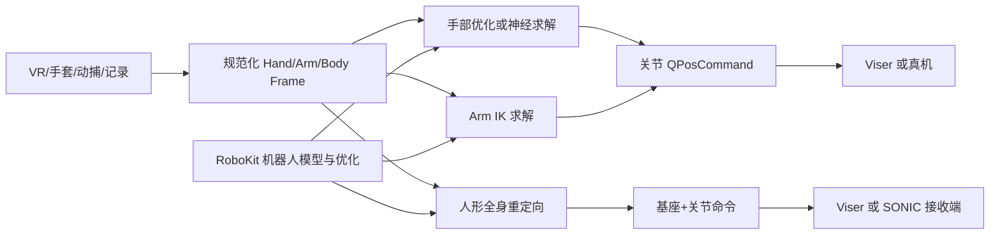
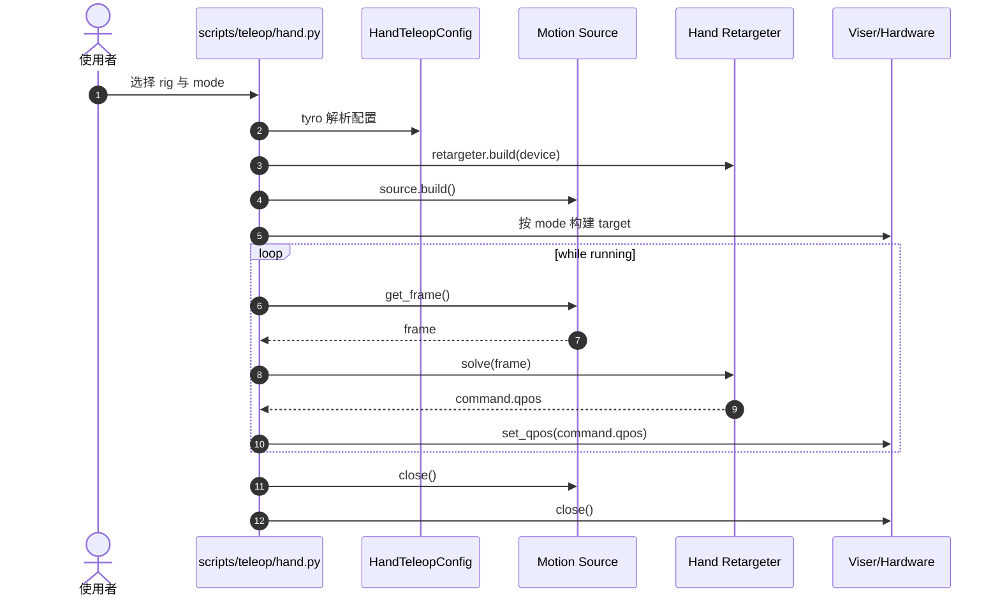

# RetargetingKit：机器人动作重定向与遥操作工具包

## 一句话定义

RetargetingKit 将实时或录制的人体动作整理成规范帧，通过优化式或神经式求解映射为灵巧手、机械臂或人形机器人的关节命令。

## 英文缩写速查

| 缩写 | 英文全称 | 简要说明 |
|---|---|---|
| VR | Virtual Reality | Vision Pro 等人体动作数据源 |
| MANO | hand Model with Articulated and Non-rigid defOrmations | 手部 21 关键点规范帧 |
| IK | Inverse Kinematics | 机械臂末端姿态对应关节求解 |
| SONIC | SONIC robot-control transport | 人形动作下发至独立控制端的接口（仓库名称） |

## 为什么重要

遥操作流水线需要隔离硬件采集、人体帧规范化、目标机器人约束求解和命令输出。RetargetingKit 将三者明确解耦，可按 rig 更换源设备和目标机器人，也可在真实硬件接入前使用 Viser 检查坐标映射。

## 核心原理

官方 `docs/concepts/pipeline.md` 区分 Source、Retargeter 和 Target：手部接收 wrist-local MANO-21 点；手臂接收世界系腕部位姿；全身使用命名关节姿态。手/臂输出 `QPosCommand`，人形输出可包含基座位姿的命令。手部优化与神经手两种求解路径并列，不应混为同一算法。

### 流程总览

## 源码运行时序图

依据 `scripts/teleop/hand.py` 的 `main` 与 `run`，注意只有 `real` 或 `both` 才构建真实设备 target：

## 工程实践

- 官方手部入口：`uv run --extra manus --extra vis scripts/teleop/hand.py manus_xhand --mode both`。需满足实际设备插件依赖。
- 录像测试可使用 Vision Pro recording + `--mode viser`；先检查左右手、坐标原点和单位。
- 关键指标包括采样频率、映射延迟、关节限位、自碰撞、低置信度帧处理；示例 `config.rate` 控制循环节拍。
- 人形 SONIC 通路有独立接收器，不等同于手部 `set_qpos` 直接连接。

## 局限与风险

可运行代码和 MIT 许可证已确认，但并未现场连设备或执行 benchmark。机械手配置、末端坐标、驱动安全、丢帧处理需根据机器人专用 target 再验证；公开仓库不保证 PNP 整机现成可用。

## 关联页面

- [RoboKit 核心优化层](./robokit-openrobokit.md)
- [GraspKit 抓取流程](./graspkit.md)
- [OpenRoboKit 总览](../overview/openrobokit-toolkit.md)
- [Motion Retargeting](../concepts/motion-retargeting.md)

## 参考来源

- [官方源码与原文阅读范围](../../sources/repos/retargetingkit.md)
- [官方 pipeline](https://github.com/openrobokit/retargetingkit/blob/main/docs/concepts/pipeline.md)

## 推荐继续阅读

- [Teleoperation 官方教程](https://github.com/openrobokit/retargetingkit/blob/main/docs/guide/teleoperation.md)
