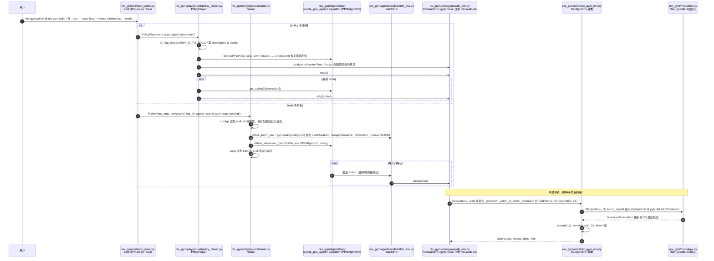

# Rex-Gym

**Rex-Gym**（[GitHub](https://github.com/nicrusso7/rex-gym)）来自 [古月居转载的四足机器人开源项目综述](https://mp.weixin.qq.com/s/pRGoPm41qYCNyHPWR6Dl6A)，属「强化学习」组。

## 一句话定义

**Rex-Gym 是 3D 打印开源四足机器人 Rex 的 OpenAI Gym 训练环境集合：含 Rex URDF、PPO 学习智能体与训练 / 回放脚本，目标是仿真学到的策略无需再手调即可迁移到真机。**

## 英文缩写速查

| 缩写 | 英文全称 | 简要说明 |
|------|----------|----------|
| PPO | Proximal Policy Optimization | 近端策略优化 |
| URDF | Unified Robot Description Format | 机器人描述格式 |

## 为什么重要

- 综述把它放在「强化学习」这条技术路线下，作为可读源码的参照项目；横向对比见 [四足机器人开源项目技术地图：从极简运动学到研究级硬件（36 个 GitHub 项目）](../overview/quadruped-open-source-projects-technology-map.md)。
- 文中星标：1089（文章表述，入库日未复核）。

## 核心信息

| 项 | 内容 |
|----|------|
| **仓库** | [nicrusso7/rex-gym](https://github.com/nicrusso7/rex-gym) |
| **最近提交** | 2021-05-15 |
| **可达性** | `git ls-remote` 可达（2026-11-01） |
| **文章归类** | 强化学习 |

## 文章说法核对

- **文章：** 文章称其提供多个训练任务与精心设计的奖励函数（前进速度、能量、冲击力、姿态偏差、关节速度等惩罚），并使用课程学习。
- **README / 核查：** README 称仓库包含用于训练 Rex 的 Gym 环境、Rex URDF 模型、PPO 学习智能体与批量训练 / 策略回放 CLI；相关仓库 rexctl（控制 CLI）、rex-models（URDF 可视化）。
- **差异与保留：** 奖励函数项与课程学习在 README 前段未见，来自文章，未核实。

## 源码运行时序图

入口：`rex-gym`（`setup.py` 的 console script，指向 `rex_gym.cli.entry_point:cli`）。两个主要子命令：`rex-gym policy --env walk`（播放预训练策略）与 `rex-gym train --env walk --log-dir LOG_DIR`（PPO 批量训练）。`--open-loop` / `--inverse-kinematics` 决定信号类型，未指定时取 `flag_mapper.DEFAULT_SIGNAL`。

图依据：nicrusso7/rex-gym@2666304，实际读过 `README.md`、`setup.py`（`entry_points`）、`rex_gym/cli/entry_point.py`（`policy`、`train`、`_parse_input`）、`rex_gym/playground/policy_player.py`（`play`）、`rex_gym/playground/trainer.py`（`start_training`、`_create_environment`、`_train` 片段）、`rex_gym/playground/__init__.py`（`gym` 注册 `RexWalk-v0` 等环境）、`rex_gym/agents/scripts/configs.py`（前段）、`rex_gym/agents/ppo/simple_ppo_agent.py`（构造与 get_action 签名）、`rex_gym/agents/tools/batch_env.py`（`step` 签名）、`rex_gym/agents/ppo/algorithm.py`（类与方法列表）、`rex_gym/envs/rex_gym_env.py`（`step`）、`rex_gym/envs/gym/walk_env.py`（`reset`、`_transform_action_to_motor_command` 签名）、`rex_gym/model/rex.py`（`Step`）、`rex_gym/util/flag_mapper.py`；训练循环 `Loop` 的内部与 `PPOAlgorithm` 的更新细节未逐行核对；未运行代码。

## 关联页面

- [reinforcement-learning](../methods/reinforcement-learning.md)
- [quadruped-robot](../entities/quadruped-robot.md)
- [locomotion](../tasks/locomotion.md)
- [reward-design](../concepts/reward-design.md)
- [quadruped-open-source-projects-technology-map](../overview/quadruped-open-source-projects-technology-map.md)

## 参考来源

- [rex_gym.md](../../sources/repos/rex_gym.md)
- [wechat_guyueju_quadruped_opensource_deep_dive_2026-11-01.md](../../sources/blogs/wechat_guyueju_quadruped_opensource_deep_dive_2026-11-01.md)
- [原文（微信公众号）](https://mp.weixin.qq.com/s/pRGoPm41qYCNyHPWR6Dl6A)
- 源码核对（2026-11-02）：nicrusso7/rex-gym@2666304，读过 README.md、setup.py、rex_gym/cli/entry_point.py、rex_gym/playground/policy_player.py、rex_gym/playground/trainer.py、rex_gym/playground/__init__.py、rex_gym/agents/scripts/configs.py（前段）、rex_gym/agents/ppo/simple_ppo_agent.py、rex_gym/agents/ppo/algorithm.py、rex_gym/agents/tools/batch_env.py、rex_gym/envs/rex_gym_env.py、rex_gym/envs/gym/walk_env.py、rex_gym/model/rex.py、rex_gym/util/flag_mapper.py；时序图依据以上文件，未运行代码。
