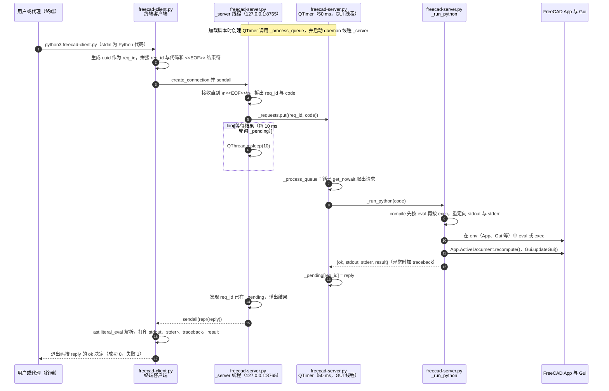

# FreeCAD AI Skill（reyk）（reyk/freecad-ai-skill）

## 一句话定义

FreeCAD AI Skill（reyk）（reyk/freecad-ai-skill）是以“FreeCAD AI skill”作为项目身份，是文章提到的两条 FreeCAD AI Skill 路线之一。

## 英文缩写速查

| 缩写 | 英文全称 | 简要说明 |
|------|----------|----------|
| CAD | Computer-Aided Design | 计算机辅助设计与几何建模 |
| MCP | Model Context Protocol | 代理调用 CAD/可视化工具的协议 |
| FEM | Finite Element Method | 结构有限元分析方法 |

## 为什么重要

对 CAE 自动化而言，代理能否稳定完成任务，取决于工程步骤是否清楚、工具边界是否明确、结果是否保留可审查证据。以“FreeCAD AI skill”作为项目身份，是文章提到的两条 FreeCAD AI Skill 路线之一；与 shanputaoye 同名仓库分开记录。

## 核心原理

**项目自身范围：** AI agent skill for FreeCAD.

**工作流：** 代理读取技能指导后在 FreeCAD 里执行建模任务；具体工具和操作能力按仓库当前内容核验。

**仓库映射说明：** 文章未给出该项目完整的 owner/repository URL；此处按文章中的项目名/描述与公开 GitHub 仓库匹配。引用时请以本页链接的仓库 README 为准。

## 工程实践

1. 从目标问题识别所需的 Skill、MCP、CLI 或软件接口，不把指导文件当成求解器。
2. 依照仓库 README 检查安装前提、软件/许可证、输入文件和输出证据。
3. 小规模运行并逐项核对几何、网格、边界、求解状态和物理量，再决定是否扩大任务。

文章所述的项目特征：以“FreeCAD AI skill”作为项目身份，是文章提到的两条 FreeCAD AI Skill 路线之一；与 shanputaoye 同名仓库分开记录。

## 局限与风险

文章未描述特定建模流程或测试指标，使用前须查看仓库示例、工具依赖和版本兼容。

源码状态核验：该 GitHub 仓库于 2026-10-07 可公开访问。仓库 API 报告许可证为 ISC。 

## 源码运行时序图

入口：先在 FreeCAD 的 Python 控制台中加载 `freecad-server.py`（监听 `127.0.0.1:8765`），再在终端运行 `python3 freecad-client.py <<'PY' ... PY`，将代码送入正在运行的 FreeCAD GUI 会话执行。

图依据：reyk/freecad-ai-skill@fa793cd，实际读过 `README.md`（启动步骤与文件说明）、`freecad-server.py`（全文：`_run_python`、`_process_queue`、`_server`、QTimer 与线程启动）、`freecad-client.py`（全文）、`LICENSE`（ISC 式授权文本）；`skills/freecad-ai/SKILL.md` 为代理技能指导，未用于时序图；未运行代码，也未连接 FreeCAD 实例验证。

## 关联页面

- [CAE / CFD 代理工具项目总览](../overview/cae-cfd-agent-skills-landscape.md)
- [FreeCAD AI Skill（shanputaoye）](./shanputaoye-freecad-ai-skill.md)

## 参考来源

- [公众号文章原始资料归档](../../sources/blogs/wechat_cae_cfd_agent_skills_2026-10-07.md)
- [GitHub 仓库资料归档](../../sources/repos/reyk-freecad-ai-skill.md)
- [reyk/freecad-ai-skill 官方仓库](<https://github.com/reyk/freecad-ai-skill>)
- 源码核对（2026-11-02）：reyk/freecad-ai-skill@fa793cd，读过 README.md、freecad-server.py、freecad-client.py、LICENSE；时序图依据以上文件，未运行代码。

## 推荐继续阅读

- [项目 README](<https://github.com/reyk/freecad-ai-skill/blob/main/README.md>)