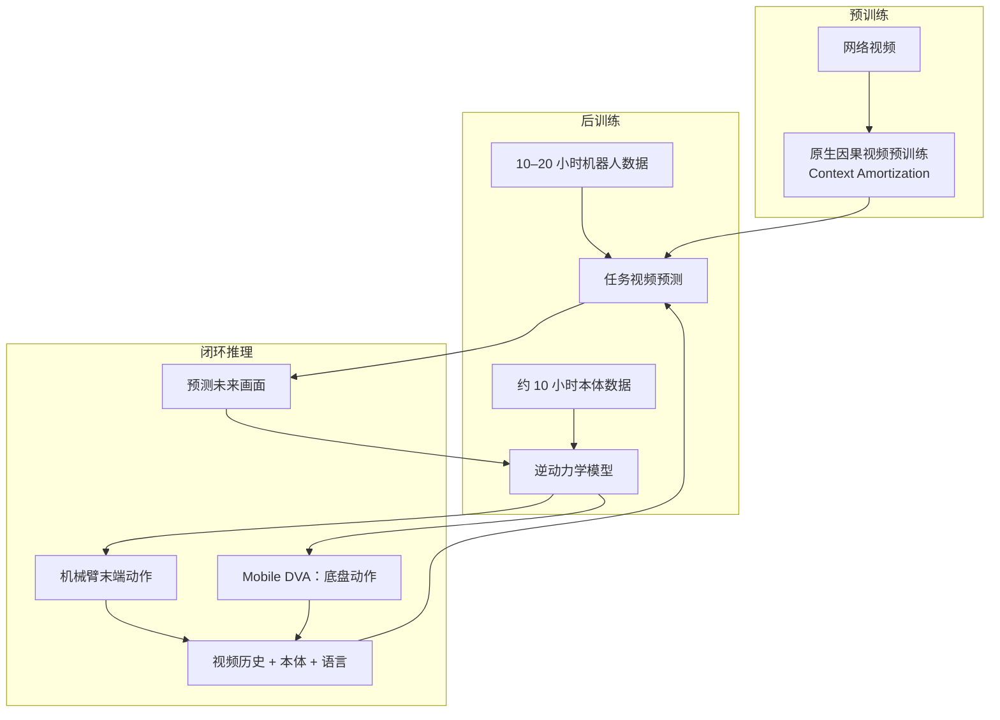
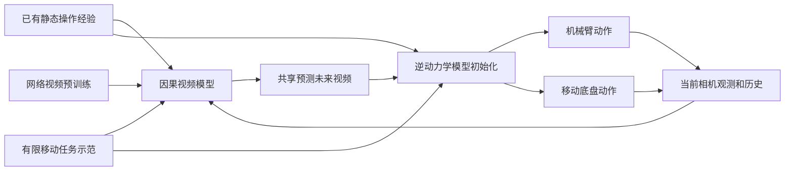

# Rhoda DVA：因果视频策略及移动操作扩展

| 字段 | 内容 |
|------|------|
| **机构** | Rhoda AI |
| **类型** | 产业官方博客（非 peer-reviewed 论文，无 arXiv） |
| **模型** | Direct Video-Action Model（DVA） |
| **发布** | 2026-03-10（与结束隐身新闻稿同日） |
| **最新扩展** | Mobile DVA：单策略协调机械臂与移动底盘（2026-11-03） |
| **开源** | **未见官方公开代码 / 权重 / 数据集链接**（2026-11-17 复核） |

## 一句话定义

**DVA** 把机器人策略重述为**视频生成**：因果视频模型以视频历史、本体感知与语言为条件预测短时未来画面，独立的逆动力学模型把预测画面转成末端执行器动作，每秒多次闭环运行。

## 英文缩写速查

| 缩写 | 英文全称 | 简要说明 |
|------|----------|----------|
| DVA | Direct Video-Action Model | 视频模型直接决定策略行为；动作由逆动力学模型从预测画面解出 |
| IDM | Inverse Dynamics Model | 逆动力学模型；约 10 小时本体数据可训练，随机运动数据也可用 |
| KV cache | Key-Value cache | 推理时复用上下文编码，避免对长历史重复计算 |
| PoC | Proof of Concept | 概念验证；两个工业案例被称为客户 PoC |
| SLAM | Simultaneous Localization and Mapping | 同时定位与建图；Mobile DVA 声称不需要单独 SLAM / 地图导航栈 |

## 为什么重要

- **数据效率叙事：** 与以遥操作轨迹为主要预训练数据的 VLA 不同，策略的运动先验来自**无动作标注的网络视频**，机器人数据只负责后训练；自报约 **10–20 小时**即可学会长程工业任务。
- **闭环视频预测：** 与开环生成计划不同，每一步都用最新观测重新预测，见 [世界动作模型](../concepts/world-action-models.md) 中「推理时是否真的运行预测」的追问。
- **长上下文记忆与一次示范：** 把「记住做到哪一步」和「看一次示范模仿」都放进视频上下文，而不是单独设计记忆模块。

## 流程总览

## 核心原理

### 1. 因果视频模型即策略

- 预测对象是**短时间段内的未来画面**，视频模型直接决定行为。
- **原生因果预训练：** 从零做因果视频预训练，而不是从双向模型蒸馏。
- **Context Amortization：** 在长段无噪声上下文上同时预测每个位置的未来帧，提高训练效率。

### 2. 逆动力学模型

- 把预测画面转成末端执行器动作，小模型即可；约 10 小时按本体类型采集的数据，甚至随机运动数据，就能训练。
- 需要**按本体类型**采集；训练后可在同类型机器人与多种任务间复用，不必每个任务重训。

### 3. 推理工程

- **KV-cache 复用**上下文编码。
- **Leapfrog Inference：** 预测向前多覆盖一段，盖住下一次推理的延迟；当前执行的动作作为条件传入，保证轨迹连续。

## 实验与案例（均为博客自报）

| 案例 | 机器人数据 | 自报结果 |
|------|-----------|----------|
| Decanting：拆箱、倒轴承、分拣包装（箱重 10 kg） | 11 小时 | 单次未剪辑运行 **1.5 小时** |
| Container Breakdown：拆解约 50 磅 Contico 周转箱并清杂物 | 17 小时 | 连续 **160 分钟**无干预 |
| 退货处理（长上下文记忆） | — | 只保留最近 8 帧时会重复已完成步骤；长上下文可端到端完成 |
| 一次人类示范跟随（上下文学习，不更新权重） | — | 训练只用单张桌面上的一打左右物体，推广到新物体、新容器与办公室环境；另展示按笔画顺序复现图形 |

页面**没有**成功率百分比，也**没有**与其他方法的定量基线对比；视频对比仅为定性。

## Mobile DVA：2026-11-03 统一移动与操作扩展

Rhoda 官方明确将 Mobile DVA 定义为同一 DVA 的**底盘动作模态扩展**，不是新论文，也不是独立的另一种基础模型。因果视频模型仍预测共享的未来场景；逆动力学模型在静态操作训练的基础上微调，同时输出机械臂与底盘动作。视频历史和新相机观测为控制闭环提供上下文；官方描述**不需要地图、SLAM 或单独导航规划器**，但不表示不依赖视觉反馈。

### 官方任务评测（仅公司自报）

| 任务与条件 | 数据 / 试验协议 | 结果 |
|------|------|------|
| 工业瓶分拣 + 运输料箱 + 取回空箱 | 含任务特定示范，其中底盘移动部分仅 30 分钟；比较视频模型是否先经过静态操作后训练，IDM 初始化相同；官方报告 5 次 evaluation trials | **95.1% vs 88.5%**（+6.6 个百分点），全流程耗时缩短 2.2% |
| 托盘搬运到目标桌：新实验室 / 陌生障碍 | 15 / 30 / 60 分钟移动数据；每条件 3 布局 × 20 次 = 60 次试验 | **15 分钟 88.3%；60 分钟 91.7%** |
| 托盘搬运：模拟工厂视觉布局 | 工厂背景墙和新地毯，仍在实验室搭建；每条件 60 次 | **15 分钟 76.7%；60 分钟 88.3%** |

这里的 95.1% 是官方报告的流程指标，不能把 5 次评估理解为 5 个二项成功样本；也不能把「模拟工厂背景」说成工厂真实部署。动态障碍及目的桌移动的案例为视频演示，**主要失败模式**是两张桌外观相同时，机器人把托盘放回了起始桌，说明目的地的长时空间记忆仍有挑战。

### 部署与复现边界

- 相比原始 DVA 的固定工位操作，Mobile DVA 将动作接口扩到机械臂 + 移动底盘，并用原有操作经验初始化，验证有限新增数据的迁移收益。
- 真机视频和公司内部成功率是官方的一手发布，但**没有独立基线复现**，未公布完整代码、模型权重或控制接口。
- **源码运行时序图：不适用**。官网只公开技术架构和示范视频，没有可审计的训练/推理源码入口；上面的 Mermaid 仅为官方披露的**模块数据流**，不冒充真实程序调用时序。
- 原文与核查边界：[DVA 与 Mobile DVA 官方原文归档](../../sources/sites/rhoda-dva-and-mobile-dva-2026.md)。

## 与其他工作对比

| 维度 | DVA（本页） | [mimic-video](../methods/mimic-video.md) | [LingBot-VA](./paper-sa-2601-21998-lingbot-va-causal-video-action-world-model-for-g.md) / [DreamZero](./paper-notebook-dreamzero-world-action-models-are-zero-shot-poli.md) |
|------|-------------|------------|------------|
| 证据 | 公司博客 + 客户 PoC 视频 | 论文 | 论文 |
| 动作接口 | 独立逆动力学模型 | 流匹配动作解码器作逆动力学 | 视各自论文 |
| 可复现 | 否 | 视仓库而定 | 视仓库而定 |

DVA 博文把上述同类工作列入参考文献（以页面外链为据）；本页不判断谁更好，各家任务、本体与评测不同。

## 工程实践

| 项 | 实践要点 |
|----|----------|
| 数据预算 | 任务数据按 10–20 小时规划（自报，可数日采完）；逆动力学模型另需约 10 小时本体数据 |
| 延迟 | 用 Leapfrog 式「预测覆盖下一次推理延迟」把慢视频模型接入快控制回路 |
| 记忆 | 长程多阶段任务（如退货处理）需要数百帧视觉上下文，短上下文会重复步骤 |
| 开源状态 | **不适用源码运行时序图**——官网未提供可运行训练/推理代码；2026-11-17 复核 |
| 移动底盘 | Mobile DVA 将原有 IDM 拓展到移动底盘；需同时审视跨场景性能和目的桌误判，勿只看 95.1% |

## 局限与风险

- **无量化指标：** 无成功率、无基线对比、无参数量与算力说明；时长数字来自单次演示视频。
- **本体绑定：** 逆动力学模型的数据按本体类型采集（页面表述）；跨本体类型是否可直接复用，页面未写。
- **可视化不等于执行：** 视频生成的可视化未做动作条件，仅用于调试评估，不能替代真机结果。
- **原始 DVA 的未来方向：** 2026-03 博文提出稳健规划、交互自改进、移动操作与灵巧控制尚待突破；2026-11 Mobile DVA 已展示部分移动操作能力，但不能据此认定所有长程导航和跨场景问题解决。

## 关联页面

- [Rhoda AI（公司入口）](./rhoda-ai.md)
- [网络视频预训练 scaling](./rhoda-scaling-web-video-pretraining.md) — 同一框架下的规模与算力研究
- [触觉 + DVA](./rhoda-dva-tactile-sensing.md) — 把触觉并入 DVA
- [世界动作模型](../concepts/world-action-models.md)
- [WAM 纵深路线](../../roadmap/depth-wam.md) — Cascaded 视频未来 → 动作的代表
- [移动操作纵深路线](../../roadmap/depth-loco-manipulation.md) — 单策略底盘与操作融合
- [逆动力学模型](../concepts/inverse-dynamics-model.md)
- [mimic-video](../methods/mimic-video.md) — 视频扩散骨干 + 动作解码器的开源对照

## 参考来源

- [Rhoda AI 官网研究页、新闻稿与团队页核查](../../sources/sites/rhoda-ai.md)
- [DVA 与 Mobile DVA 两篇官方技术文章通读归档（2026-11-17）](../../sources/sites/rhoda-dva-and-mobile-dva-2026.md)
- 原文：<https://www.rhoda.ai/research/direct-video-action>

## 推荐继续阅读

- [Causal Video Models Are Data-Efficient Robot Policy Learners](https://www.rhoda.ai/research/direct-video-action) — 官方博文，含长视频演示
- [Mobile DVA: A Single Video-Action Policy for Manipulation and Mobility](https://www.rhoda.ai/research/mobile-dva) — 机械臂/底盘统一控制及跨场景评测
- [Rhoda AI 新闻稿](https://www.rhoda.ai/news/press-release) — FutureVision 与融资背景
