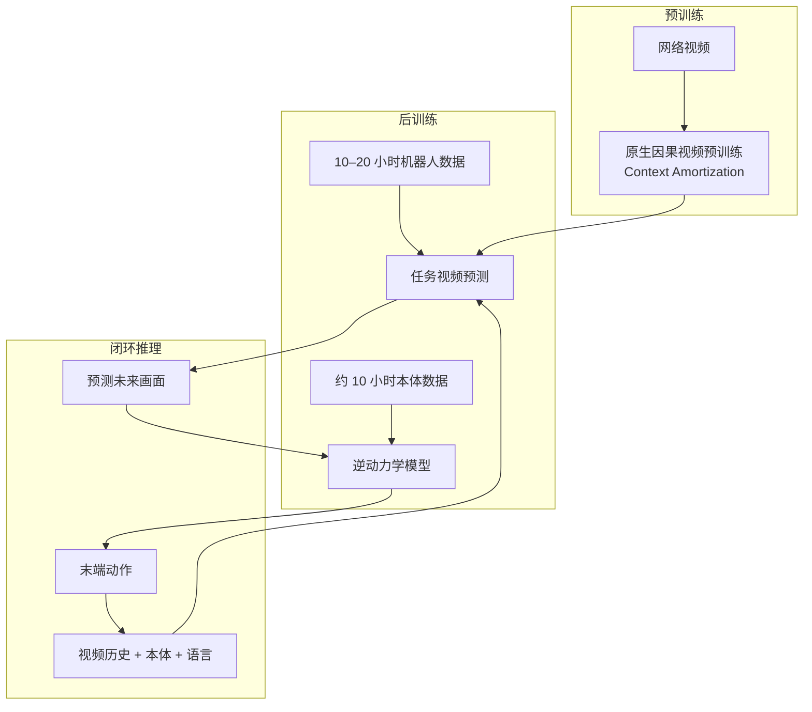

# Rhoda DVA：因果视频模型作机器人策略

| 字段 | 内容 |
|------|------|
| **机构** | Rhoda AI |
| **类型** | 产业官方博客（非 peer-reviewed 论文，无 arXiv） |
| **模型** | Direct Video-Action Model（DVA） |
| **发布** | 2026-03-10（与结束隐身新闻稿同日） |
| **开源** | **确认未开源**（2026-10-16 核查：页面无代码 / 权重 / 数据集链接） |

## 一句话定义

**DVA** 把机器人策略重述为**视频生成**：因果视频模型以视频历史、本体感知与语言为条件预测短时未来画面，独立的逆动力学模型把预测画面转成末端执行器动作，每秒多次闭环运行。

## 英文缩写速查

| 缩写 | 英文全称 | 简要说明 |
|------|----------|----------|
| DVA | Direct Video-Action Model | 视频模型直接决定策略行为；动作由逆动力学模型从预测画面解出 |
| IDM | Inverse Dynamics Model | 逆动力学模型；约 10 小时本体数据可训练，随机运动数据也可用 |
| KV cache | Key-Value cache | 推理时复用上下文编码，避免对长历史重复计算 |
| PoC | Proof of Concept | 概念验证；两个工业案例被称为客户 PoC |

## 为什么重要

- **数据效率叙事：** 与以遥操作轨迹为主要预训练数据的 VLA 不同，策略的运动先验来自**无动作标注的网络视频**，机器人数据只负责后训练；自报约 **10–20 小时**即可学会长程工业任务。
- **闭环视频预测：** 与开环生成计划不同，每一步都用最新观测重新预测，见 [世界动作模型](../concepts/world-action-models.md) 中「推理时是否真的运行预测」的追问。
- **长上下文记忆与一次示范：** 把「记住做到哪一步」和「看一次示范模仿」都放进视频上下文，而不是单独设计记忆模块。

## 流程总览

## 核心原理

### 1. 因果视频模型即策略

- 预测对象是**短时间段内的未来画面**，视频模型直接决定行为。
- **原生因果预训练：** 从零做因果视频预训练，而不是从双向模型蒸馏。
- **Context Amortization：** 在长段无噪声上下文上同时预测每个位置的未来帧，提高训练效率。

### 2. 逆动力学模型

- 把预测画面转成末端执行器动作，小模型即可；约 10 小时按本体类型采集的数据，甚至随机运动数据，就能训练。
- 需要**按本体类型**采集；训练后可在同类型机器人与多种任务间复用，不必每个任务重训。

### 3. 推理工程

- **KV-cache 复用**上下文编码。
- **Leapfrog Inference：** 预测向前多覆盖一段，盖住下一次推理的延迟；当前执行的动作作为条件传入，保证轨迹连续。

## 实验与案例（均为博客自报）

| 案例 | 机器人数据 | 自报结果 |
|------|-----------|----------|
| Decanting：拆箱、倒轴承、分拣包装（箱重 10 kg） | 11 小时 | 单次未剪辑运行 **1.5 小时** |
| Container Breakdown：拆解约 50 磅 Contico 周转箱并清杂物 | 17 小时 | 连续 **160 分钟**无干预 |
| 退货处理（长上下文记忆） | — | 只保留最近 8 帧时会重复已完成步骤；长上下文可端到端完成 |
| 一次人类示范跟随（上下文学习，不更新权重） | — | 训练只用单张桌面上的一打左右物体，推广到新物体、新容器与办公室环境；另展示按笔画顺序复现图形 |

页面**没有**成功率百分比，也**没有**与其他方法的定量基线对比；视频对比仅为定性。

## 与其他工作对比

| 维度 | DVA（本页） | [mimic-video](../methods/mimic-video.md) | [LingBot-VA](./paper-sa-2601-21998-lingbot-va-causal-video-action-world-model-for-g.md) / [DreamZero](./paper-notebook-dreamzero-world-action-models-are-zero-shot-poli.md) |
|------|-------------|------------|------------|
| 证据 | 公司博客 + 客户 PoC 视频 | 论文 | 论文 |
| 动作接口 | 独立逆动力学模型 | 流匹配动作解码器作逆动力学 | 视各自论文 |
| 可复现 | 否 | 视仓库而定 | 视仓库而定 |

DVA 博文把上述同类工作列入参考文献（以页面外链为据）；本页不判断谁更好，各家任务、本体与评测不同。

## 工程实践

| 项 | 实践要点 |
|----|----------|
| 数据预算 | 任务数据按 10–20 小时规划（自报，可数日采完）；逆动力学模型另需约 10 小时本体数据 |
| 延迟 | 用 Leapfrog 式「预测覆盖下一次推理延迟」把慢视频模型接入快控制回路 |
| 记忆 | 长程多阶段任务（如退货处理）需要数百帧视觉上下文，短上下文会重复步骤 |
| 开源状态 | **不适用源码运行时序图**——确认未开源 |

## 局限与风险

- **无量化指标：** 无成功率、无基线对比、无参数量与算力说明；时长数字来自单次演示视频。
- **本体绑定：** 逆动力学模型的数据按本体类型采集（页面表述）；跨本体类型是否可直接复用，页面未写。
- **可视化不等于执行：** 视频生成的可视化未做动作条件，仅用于调试评估，不能替代真机结果。
- **作者自述的未解问题：** 稳健规划与推理、通过交互自我改进、长时程移动操作、高自由度灵巧控制。

## 关联页面

- [Rhoda AI（公司入口）](./rhoda-ai.md)
- [网络视频预训练 scaling](./rhoda-scaling-web-video-pretraining.md) — 同一框架下的规模与算力研究
- [触觉 + DVA](./rhoda-dva-tactile-sensing.md) — 把触觉并入 DVA
- [世界动作模型](../concepts/world-action-models.md)
- [逆动力学模型](../concepts/inverse-dynamics-model.md)
- [mimic-video](../methods/mimic-video.md) — 视频扩散骨干 + 动作解码器的开源对照

## 参考来源

- [Rhoda AI 官网研究页、新闻稿与团队页核查（2026-10-16）](../../sources/sites/rhoda-ai.md)
- 原文：<https://www.rhoda.ai/research/direct-video-action>

## 推荐继续阅读

- [Causal Video Models Are Data-Efficient Robot Policy Learners](https://www.rhoda.ai/research/direct-video-action) — 官方博文，含长视频演示
- [Rhoda AI 新闻稿](https://www.rhoda.ai/news/press-release) — FutureVision 与融资背景
