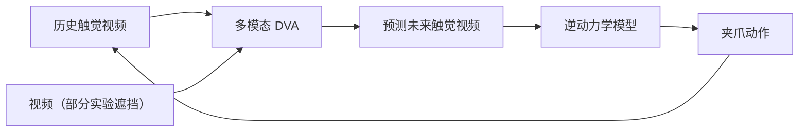

# Rhoda：触觉传感器 + 多模态 DVA

| 字段 | 内容 |
|------|------|
| **机构** | Rhoda AI |
| **类型** | 产业官方博客（非 peer-reviewed 论文，无 arXiv） |
| **发布** | 2026-10-13（列表页只写 Oct 13，年份据文末引用块与页脚 © 2026 判定） |
| **贡献者** | Andrew Xie（实习期间完成）、Leo Dong、David B. Lindell |
| **开源** | **确认未开源**（2026-10-16 核查：无代码 / 权重 / 数据集 / 传感器设计文件链接） |

## 一句话定义

Rhoda 自研一款可装在机器人夹爪上的**薄型触觉传感器**，并把它的测量接入多模态 [DVA](./rhoda-direct-video-action.md)：模型把**触觉当作视频**，从历史触觉视频预测未来触觉视频，再由逆动力学模型转成动作。

## 英文缩写速查

| 缩写 | 英文全称 | 简要说明 |
|------|----------|----------|
| DVA | Direct Video-Action | 视频模型直接作策略；本篇扩展为多模态（视频 + 触觉视频） |
| IDM | Inverse Dynamics Model | 逆动力学模型；把预测的触觉视频转成动作 |
| UMI | Universal Manipulation Interface | 手持式示教夹爪；Rhoda 把自家传感器装进指尖，记录人示教时的法向 / 剪切力 |
| mN | Millinewton | 毫牛，1 N 的千分之一；人指尖可感知低于 1 mN 的力（页面引用的人体研究） |

## 为什么重要

- **补视觉的盲区：** 页面主张触觉在视觉受遮挡或不可用时提升操作鲁棒性，盲操作实验正是这一叙事的演示。
- **沿用同一管线：** 不为触觉另造策略头，而是把触觉视频放进已有「预测—逆动力学」闭环；视触觉融合的一般做法见 [视触觉融合](../concepts/visuo-tactile-fusion.md)。
- **传感器指标公开较具体：** 给出灵敏度、量程与采样率的数量级，可对照 [触觉感知](../concepts/tactile-sensing.md) 的选型维度。

## 传感器（博客自报）

| 项 | 内容 |
|----|------|
| 形态 | 薄型封装，白色硅胶接触垫 + 电路板，图示高度 8 mm，可装夹爪 |
| 感知量 | 法向力、剪切力、压力、纹理、振动、温度；脉搏波形（贴腕） |
| 轻触灵敏度 | 羽毛刷过只有几毫牛，仍有可测响应；同条件下所测现成光学与磁性传感器**无可辨别响应** |
| 量程 | 几毫牛到 **40 N 以上**（哑铃）；重载后仍对轻触敏感 |
| 时间分辨率 | 接触振动采样约 **500 Hz**，可区分螺旋装订、棱纹塑料管、帆布袋 / 拉链等纹理 |
| 算法 | 与硬件共同设计，简化标定，抑制漂移与迟滞 |
| 成本 | 称「compact, low-cost」，**未给价格** |
| 未披露 | 传感单元数量、空间分辨率、材料细节、供电与接口 |

Table 1 对光学、电容、磁性、电阻类传感器的评级引用综述文献，「在所有指标上表现一致」是作者自评。

## 接入 DVA

每执行一步，新的触觉观测用于下一轮预测。页面未给模型规模、训练数据量、推理延迟。

## 盲操作实验

- **任务：** 遮挡腕部与头部相机，在盒中凭触觉找到纹理球并放到盒旁。
- **训练：** 1 个光滑蓝球 + 1 个绿色纹理球。
- **泛化测试：** 4 个光滑球 + 3 个纹理球，其中 2 个纹理球在直径、硬度、纹理上不同于训练球；作者称模型仍识别并取回所有纹理球。
- **证据形式：** 两段长时间自主运行视频，**无成功率、无试验次数、无失败案例**。

## 与其他工作对比

| 维度 | 本篇（Rhoda） | [VT-WM](./paper-sa-2602-06001-visuo-tactile-world-models-vt-wm.md) |
|------|---------------|------|
| 证据 | 公司博客 + 演示视频 | 论文（摘要报告物体恒存性、运动规律遵从等指标） |
| 触觉表示 | 触觉视频，与视觉同构生成 | 视触觉世界模型 |
| 可复现 | 否 | 视论文资源而定 |

两者任务与指标不同，不能直接比较数字。

## 工程实践

| 项 | 实践要点 |
|----|----------|
| 选型 | 看灵敏度与量程时，注意博客只与「所测试的现成光学与磁性传感器」比较，未覆盖其他类型 |
| 数据采集 | 页面展示把传感器装进手持 UMI 指尖，保留示教中的法向 / 剪切力（Fig. 9）；盲操作实验本身的数据采集方式页面未写 |
| 复现 | 传感器硬件、模型、数据均未公开，无法复现 |
| 开源状态 | **不适用源码运行时序图**——确认未开源 |

## 局限与风险

- **缺定量：** 盲操作无成功率与试验次数；温度、脉搏以定性展示为主。
- **任务窄：** 单一任务（辨别并取回纹理球），单一夹爪平台。
- **自评：** 评级表依据综述文献，结论为作者自评，无独立量化对比。
- **规格不全：** 空间分辨率、单元数、价格缺失，难以评估能否替代现有传感器。

## 关联页面

- [Rhoda AI（公司入口）](./rhoda-ai.md)
- [DVA：因果视频模型作机器人策略](./rhoda-direct-video-action.md)
- [网络视频预训练 scaling](./rhoda-scaling-web-video-pretraining.md)
- [触觉感知](../concepts/tactile-sensing.md)
- [视触觉融合](../concepts/visuo-tactile-fusion.md)
- [VT-WM：视触觉世界模型](./paper-sa-2602-06001-visuo-tactile-world-models-vt-wm.md)
- [Manipulation](../tasks/manipulation.md)

## 参考来源

- [Rhoda AI 官网研究页、新闻稿与团队页核查（2026-10-16）](../../sources/sites/rhoda-ai.md)
- 原文：<https://www.rhoda.ai/research/giving-robots-a-sense-of-touch>

## 推荐继续阅读

- [Giving Robots a Sense of Touch](https://www.rhoda.ai/research/giving-robots-a-sense-of-touch) — 官方博文，含传感器测试与盲操作视频
- Choi, H., et al. (2026). *In-the-Wild Compliant Manipulation with UMI-FT* — <https://arxiv.org/abs/2601.09988>，页面用来说明示教中记录力的重要性（引用 [12]）
