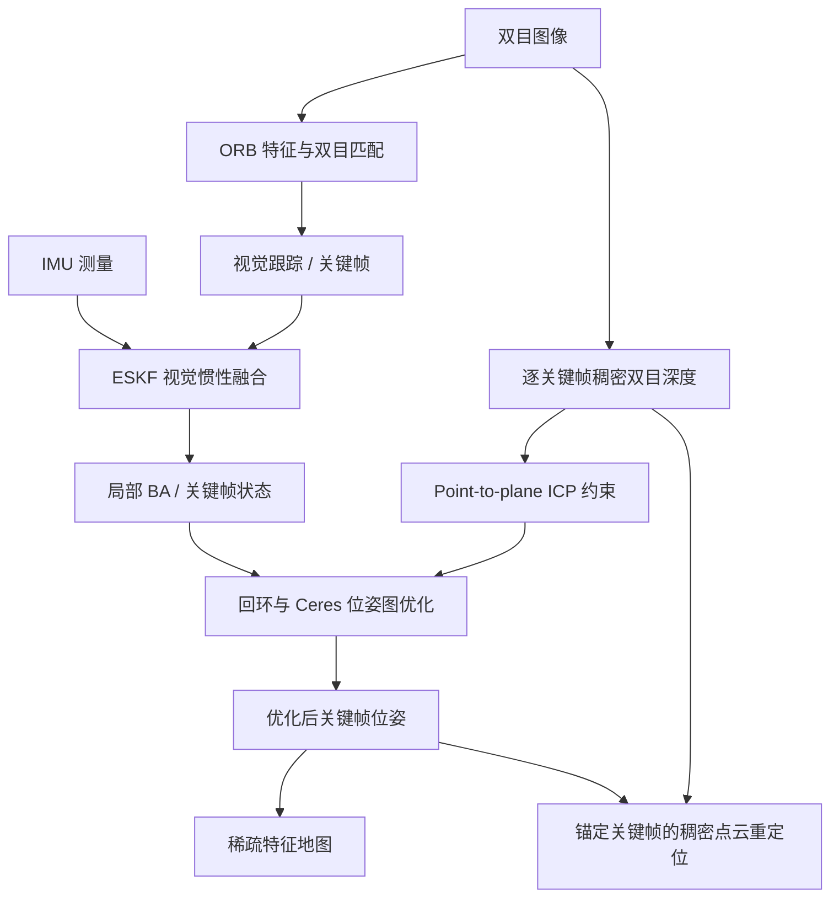

# RigVis：双目惯性 SLAM 与可校正稠密点云（Stereo-Inertial SLAM）

## 一句话定义

**RigVis** 是 Ekrem Öztürk 公开介绍的 C++ 双目惯性 SLAM 实验项目：以双目 ORB 特征辅助跟踪，结合 IMU 的 ESKF 状态融合、关键帧优化及稠密双目深度，在回环和位姿修正后同步维护稀疏与稠密地图。**本页为待源码复核的项目记录，不代表已经完成代码审计。**

## 英文缩写速查

| 缩写 | 英文全称 | 简要说明 |
|------|----------|----------|
| SLAM | Simultaneous Localization and Mapping | 同时估计平台位姿并维护地图 |
| IMU | Inertial Measurement Unit | 提供角速度和加速度的惯性传感器 |
| ESKF | Error-State Kalman Filter | 以误差状态对标称惯性状态进行校正的滤波器 |
| ORB | Oriented FAST and Rotated BRIEF | 稀疏视觉特征检测与描述方法 |
| BA | Bundle Adjustment | 联合优化相机位姿和三维结构的非线性最小二乘方法 |
| ICP | Iterative Closest Point | 用点云对应关系约束两片三维几何结构 |
| SGBM | Semi-Global Block Matching | 一类双目视差估计算法，RigVis 是否采用仍待源码确认 |
| ATE | Absolute Trajectory Error | 绝对轨迹误差；作者的 2.8 m 是否采用该定义待核验 |

## 为什么重要

典型稀疏特征 SLAM 可以给出定位轨迹，却不必然生成可用于障碍判断的稠密几何。RigVis 的公开技术说明重点在于：**让稠密深度点云随关键帧位姿优化一起更新**，并进一步把关键帧之间的 point-to-plane ICP 几何约束加入 Ceres 图优化，而不只依赖稀疏特征点。

这给自主导航工程提供了一个值得研究的设计问题：如何让定位优化与重建地图保持一致，而不是在回环后仅修正轨迹、稠密点云仍留在旧坐标位置。

## 核心原理

| 子模块 | 已公开的描述 | 仍需核实 |
|--------|----------------|----------|
| 双目前端 | ORB 特征、双目对应匹配与相机跟踪 | 匹配筛选、PnP + RANSAC 的实际代码入口与触发条件 |
| 惯性融合 | IMU 与 ESKF 误差状态融合 | 状态维度、噪声模型、时延/外参、是否与 BA 形成真正紧耦合 |
| 稀疏优化 | 局部 BA、回环修正与 Ceres SE(3) 位姿图 | 回环候选生成、位姿约束、全局 BA 是否执行及执行时机 |
| 稠密建图 | 每关键帧生成双目稠密深度；点云锚定关键帧位姿 | SGBM 参数、滤波/降采样规则、全局融合结构 |
| 几何补充约束 | 关键帧点云之间 point-to-plane ICP，额外因子进入 Ceres 图 | 对应点关联、鲁棒核、权重、ICP 失败回退 |

### 流程总览（基于作者技术说明的模块级示意）

图中只表示公开提到的模块与**概念层数据流**；ESKF、关键帧跟踪和 Ceres 求解器的真实调用顺序需以源码确认为准。

以上示意**不能被解读为已核对的源码流程图**；它只汇总作者所述设计意图，待官方实现可访问后修订。

## 评测与数据证据

| 维度 | 当前可说明的内容 |
|------|----------------|
| 数据集 | KITTI Odometry Sequence 00，约 3.7 km（作者公开说明） |
| 漂移 | **1.2%**（作者报告，原帖描述为 *drift*；精确 RPE/平移误差定义待核验） |
| 全局误差 | **2.8 m**（作者报告，原帖描述为 *global error*；是否为 ATE RMSE 待核验） |
| 回环与点云规模 | **8 次回环、1 m 阈值、约 570 万点**来自用户提供的摘要，暂未从公开实验表或源码复核 |
| 可比性 | 缺运行参数、估计轨迹、评测脚本、IMU 数据源及对齐方式；**不应直接与 ORB-SLAM3 / VINS-Fusion 的论文数字排名** |

## 工程实践

- **可借鉴的系统分层**：双目图像提供稀疏跟踪和稠密深度两条信息流；IMU 增强运动估计；Ceres 优化维护关键帧间的全局约束。
- **地图一致性**：稠密数据绑定关键帧坐标，优化更新位姿时重投影地图；点云 ICP 可以补充仅基于稀疏特征的几何约束。
- **复现前必查**：项目是否有公开、可运行的 KITTI 00 入口；双目/IMU 的时间同步；Ceres 优化变量与因子；实时帧率和地图内存占用；可重复运行的 ATE/RPE 评测脚本。
- **可能应用**：室内、隧道、城市峡谷等 GNSS 不可靠区域的机器人定位与三维重建；要接入真实避障/路径规划仍需可用占据表示、动态障碍处理与规划接口，不能从点云规模推断导航系统已完整实现。

## 源码运行时序图

**暂不适用（待核实）**：作者公开动态指向“Code, plots and the 3D map”的短链，但当前无法解析为可访问的官方仓库，未读取源文件或运行入口。因此不编造 `sequenceDiagram`；补全源码后按真实 `main`、视觉前端、ESKF、后端优化与地图更新调用链绘制。

## 局限与风险

1. **来源阅读尚未完成**：目前依据作者公开动态的可检索引用文本，并非完整官方 README/源码核验。对应 [来源归档](../../sources/blogs/rigvis_ekrem_ozturk_2026_11.md) 标为“通读：未完成”。
2. **开源状态待核实**：公开短链 <https://lnkd.in/dFMwckqB> 的最终目标和许可证无法验证；C++17、无 ROS、SGBM、PnP/RANSAC、8 回环与 1 m 阈值等仅是用户提供的待验证线索。
3. **视觉惯性适用边界**：弱纹理、强曝光变化、运动模糊和标定或时间同步误差都会影响视觉估计；惯性融合并不意味着完全无漂移。
4. **评测不等于实机交付**：KITTI 单序列自报轨迹指标不证明高速无人机或灾后现场的系统鲁棒性；稠密地图还需要内存预算、障碍语义/动态性和导航集成验证。

## 结论

**RigVis 最值得追踪的是“稠密点云随关键帧优化重定位 + ICP 反馈图优化”这条工程设计，而非未经复现的 KITTI 数字。**

- 优先取得真正的官方仓库、README、许可证和可运行入口。
- 验证 ICP 是否确实构成 Ceres 图的独立几何因子，及其回环前后的收益。
- 核查 ESKF 与稀疏视觉优化的耦合方式，避免把“融合 IMU”误写为联合优化。
- 用同一数据和对齐设置复测 1.2% / 2.8 m，再与 ORB-SLAM3 比较。
- 将轨迹、稀疏图和稠密图分别验收，避免用轨迹精度代替地图质量。

## 关联页面

- [ORB-SLAM3](orb-slam3.md) — 成熟多地图视觉惯性 SLAM 的架构与基准参照。
- [LiDAR / LIO / VIO 选型](../comparisons/lidar-slam-lio-vio-selection.md) — 双目惯性方案与激光/其他 VIO 的适用边界。
- [导航·SLAM·自动驾驶开源栈](../overview/navigation-slam-autonomy-stack.md) — 连接定位建图与规划执行。
- [导航纵深路线 Stage 1](../../roadmap/depth-navigation.md) — 在 SLAM 与状态估计阶段学习和验证。
- [Gauss-Newton 非线性最小二乘方法](../methods/gauss-newton.md) — 理解 BA 和 Ceres 位姿图中的残差、Jacobian 与优化收敛。
- [机器人自主探索](../tasks/autonomous-exploration.md) — 理解 SLAM 稠密建图如何向探索、障碍感知与规划提供空间信息。

## 参考来源

- [RigVis 作者公开技术说明（来源归档，待源码核实）](../../sources/blogs/rigvis_ekrem_ozturk_2026_11.md)
- [作者提及的代码/图表/地图入口短链（尚未核实目标）](https://lnkd.in/dFMwckqB)

## 推荐继续阅读

- [ORB-SLAM3：Visual, Visual-Inertial and Multi-Map SLAM（arXiv:2007.11898）](https://arxiv.org/abs/2007.11898)
- [KITTI Vision Benchmark Suite — Odometry](https://www.cvlibs.net/datasets/kitti/eval_odometry.php)
