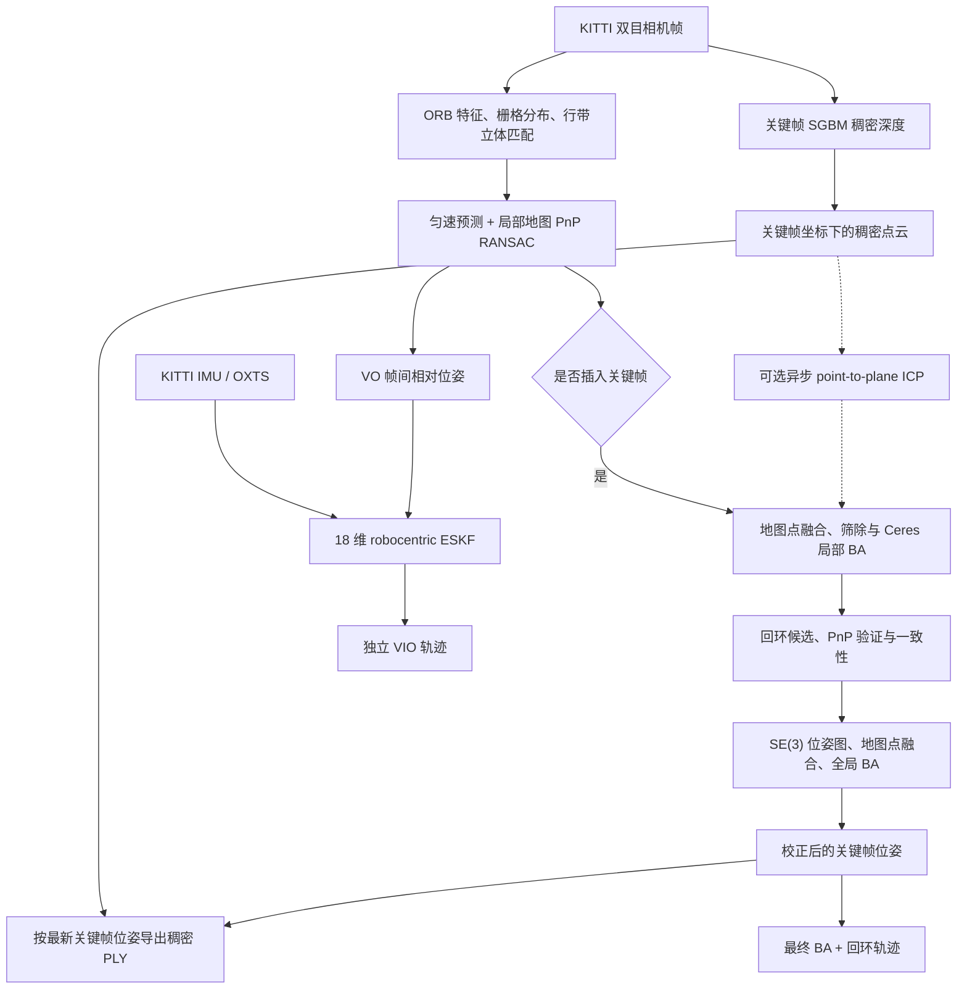
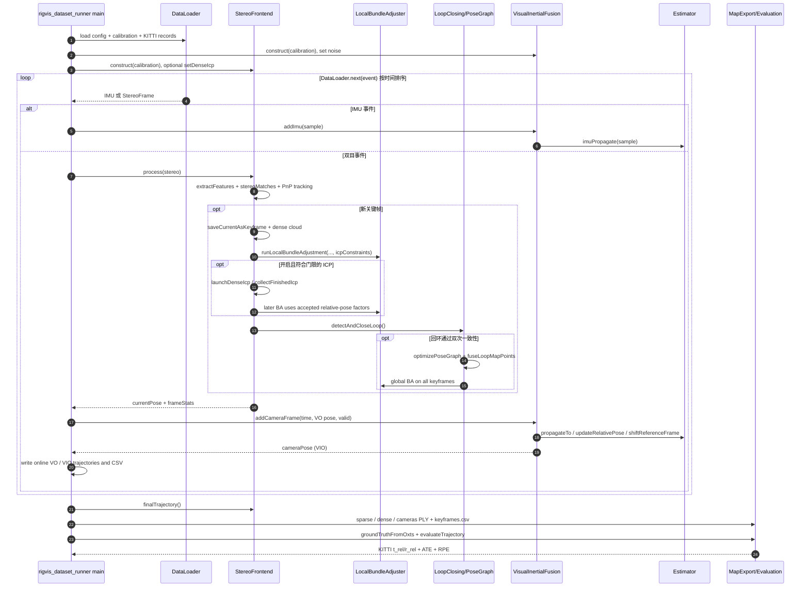

# RigVis：双目惯性 SLAM 与关键帧锚定稠密地图（Stereo-Inertial SLAM）

## 一句话定义

**RigVis**（Ekrem Serdar Öztürk，[官方源码](https://github.com/ekrrems/Stereo-inertial-slam)）是 C++17 双目视觉 SLAM 系统：ORB/PnP 跟踪与 Ceres 局部 BA、回环位姿图和全局 BA 构成地图主线，SGBM 生成随关键帧位姿修正的稠密点云；另以 **松耦合 ESKF** 将 IMU 和逐帧 VO 相对位姿融合成独立 VIO 轨迹。

## 英文缩写速查

| 缩写 | 英文全称 | 简要说明 |
|------|----------|----------|
| SLAM | Simultaneous Localization and Mapping | 同步定位与建图 |
| VIO | Visual-Inertial Odometry | 视觉惯性里程计，本项目独立融合输出轨迹 |
| IMU | Inertial Measurement Unit | 惯性测量单元，提供加速度与角速度 |
| ESKF | Error-State Kalman Filter | 18 维误差状态、随相机帧更新参考系的滤波器 |
| ORB | Oriented FAST and Rotated BRIEF | 稀疏特征检测、匹配与数据关联 |
| PnP | Perspective-n-Point | 由 3D 地标与 2D 特征估计相机位姿 |
| BA | Bundle Adjustment | Ceres 局部及全局联合优化相机位姿与地图点 |
| SGBM | Semi-Global Block Matching | OpenCV 半全局立体匹配，生成稠密视差 |
| ICP | Iterative Closest Point | 关键帧稠密点云匹配，本项目默认关闭 |
| ATE | Absolute Trajectory Error | 对齐后绝对轨迹 RMSE |

## 为什么重要

本项目把**稀疏定位主线、关键帧稠密几何、松耦合惯性融合**清楚分开，是阅读 SLAM 工程实现、研究地图回环一致性和认识“松耦合 vs 紧耦合”的案例。

尤其应区分：作者 README 描述的 **IMU 预积分因子进入 BA 是未来规划**；当前 `VisualInertialFusion` 不向视觉前端反馈预测，也未在 BA 中加入惯性残差。

## 核心原理与流程总览

以下流程由官方 `README.md`、`src/main.cpp`、`src/StereoFrontend.cpp`、`src/VisualInertialFusion.cpp`、`src/LoopClosing.cpp` 等实际源码核对；实线表示相应数据流，虚线表示可选 ICP 约束。

- **前端**：双目 ORB 特征沿矫正图像行带匹配；运动模型和局部共视图投影搜索，PnP RANSAC 失败时回退上一帧双目跟踪。
- **稀疏后端**：关键帧触发 Ceres BA（mono/stereo 重投影、Huber、卡方剔除）；回环先搜索近邻旧关键帧，再以 PnP ≥60 内点、相邻关键帧候选一致性判断，通过后执行 SE(3) 位姿图、地图点融合和全局 BA。
- **惯性融合**：`VisualInertialFusion::addImu` 调用 ESKF IMU 传播；`addCameraFrame` 把前端帧间 VO 位姿作为观测进行更新，按 IMU 帧间运动累计 **单独的 VIO 轨迹**，不是紧耦合滑窗优化。
- **稠密输出**：`DenseMapper.cpp` 的 OpenCV StereoSGBM 生成 1–20 m 视差深度（README）；`MapExport.cpp` 用优化后关键帧位姿放置点云并执行 10 cm 体素聚合。
- **可选 ICP**：`dense_icp: 0` 为官方示例默认值；打开后，邻近关键帧点云 point-to-plane ICP 在工作线程计算，在弱特征跟踪、质量门限通过时，作为**局部 BA 的相对位姿因子**加入 Ceres，不是无条件写进回环位姿图。

## 源码运行时序图

官方实际入口：`src/main.cpp::main` 对应 `./rigvis_dataset_runner [config.yaml]`，由 `CMakeLists.txt` 构建；无需 ROS。图中同步处理顺序与选项依据上述代码核查。

该图依据 `ekrrems/Stereo-inertial-slam@3dee4bc` 的官方运行入口与函数调用。**未实际编译或用 KITTI 数据运行**；ICP 为默认关闭的实验分支。

## 实验与评测

以下是**作者官方 README 报告的 KITTI 00 结果，不是本仓库独立复现实测**。

| 项目 | 作者报告 |
|------|----------|
| 测试数据 | KITTI raw `2011_10_03_drive_0027`（KITTI odometry 00），4544 帧，约 3.7 km |
| 相对平移漂移 `t_rel` | **1.20%**（KITTI 100–800 m 子轨迹） |
| 相对旋转误差 `r_rel` | **0.50°/100 m** |
| ATE（RMSE） | **2.81 m**（Umeyama 刚体、**不调整尺度**） |
| 单帧 RPE | **0.057 m，0.100°** |
| 回环次数 / 稠密点数 | 用户提供了“8 次、约 570 万点”，但 README 未将其列为统一实验结果，仍待对应日志或 PLY 验证 |

评测路径 `src/Evaluation.cpp::evaluateTrajectory` 使用 KITTI OXTS 真值；主程序分别记录**在线 VO、松耦合 VIO、BA+回环最终轨迹**，不能混为一个输出。官方 README 中 ORB-SLAM2 论文指标只作参照，不能据此证明相同设置下公平优劣。

## 工程实践

- **构建**：CMake ≥3.30、C++17、Eigen3、OpenCV、Ceres；官方 MIT 开源。`README.md` 提示 OpenCV 5 的 CMake 模块名，使用 OpenCV 4 时需自行改 `features2d/calib3d` 组件。
- **准备数据**：KITTI raw `2011_10_03_drive_0027_sync` 与日期标定文件；可选 `*_extract` 的 100 Hz OXTS IMU。若不提供 `imu_path`，取 sync 的 10 Hz 数据。`imu_time_offset_s` 示例为 −0.05 s。
- **运行**：`cp config/rigvis.example.yaml config/rigvis.yaml`，设置 `dataset_path`，`cd build && ./rigvis_dataset_runner`。
- **结果**：`trajectory_kitti.txt`、`trajectory_vio.txt`、`trajectory_final.txt`；`map_dense.ply`、`map_sparse.ply`、`keyframes.csv`、`frame_stats.csv`、`fusion_stats.csv`。
- **离线再评测**：`./rigvis_evaluate trajectory_final.txt /path/to/2011_10_03_drive_0027_sync`，不需再次跑 SLAM。
- **规划接口**：目前是 KITTI 离线运行与 PLY/CSV 导出；实时 ROS 2、飞控或避障规划接口在作者未来 Roadmap，不应误称当前已提供。

## 局限与风险

1. **默认并非紧耦合视觉惯性**：前端从视觉结果获得 VO，ESKF 是之后单独融合；IMU 预积分进入 BA 尚待作者后续实现。
2. **参数与数字应以代码为准**：回环候选搜索 `loopSearchRadiusMeters_=50.0` m，不是早期摘要的“1 m 阈值”；回环接受还需 PnP 内点等约束。
3. **稠密 ICP 默认不启用**：`config/rigvis.example.yaml` 为 `dense_icp: 0`。因此“默认所有点云 ICP 直接反馈图优化”不成立。
4. **实测尚未复现**：README 的 KITTI 指标可追溯到源码定义，但缺可直接比对的本次运行日志；未核对 8 次回环与约 570 万点。
5. **导航能力需另集成**：稠密 PLY 不能直接等同实时动态障碍物检测、占据栅格和路径规划能力。

## 结论

**RigVis 是研究双目稀疏 SLAM、关键帧稠密地图与松耦合 IMU 融合的可读 C++ 项目；最重要的是区分三个独立输出和实验性 ICP 的真实开关。**

- 看地图质量先跟 `map_dense.ply`、关键帧位姿、稀疏重投影误差走，而不是只看 ATE。
- 想验证惯性贡献，分别评估在线 VO 与 `trajectory_vio.txt`。
- 想评估回环贡献，用 `trajectory_final.txt` 与在线 VO 对比。
- 想验证 ICP 收益，先打开 `dense_icp: 1`，记录 BA 中的 ICP edges、RMSE 与误差变化，再进行 ablation。
- 复现 KITTI 结果时保留 OXTS 数据源、时间偏置、100–800 m 子路径及 ATE 对齐方式。

## 关联页面

- [ORB-SLAM3](orb-slam3.md) — 正式视觉惯性联合优化、多地图与闭环算法对照。
- [LiDAR / LIO / VIO 选型](../comparisons/lidar-slam-lio-vio-selection.md) — 各传感器和估计路线的边界。
- [Gauss-Newton](../methods/gauss-newton.md) — 理解 Ceres BA 的残差和二阶曲率近似。
- [机器人自主探索](../tasks/autonomous-exploration.md) — 将定位与建图对接探索任务。
- [导航纵深路线 Stage 1](../../roadmap/depth-navigation.md) — SLAM 与状态估计练习阶段。
- [导航·SLAM·自动驾驶开源栈](../overview/navigation-slam-autonomy-stack.md) — 与规划执行对接的位置。

## 参考来源

- [RigVis 官方源码与通读记录](../../sources/repos/rigvis.md) — `ekrrems/Stereo-inertial-slam@3dee4bc` 的 README、关键实现与运行时序核对。
- [作者公开技术说明与早期线索](../../sources/blogs/rigvis_ekrem_ozturk_2026_11.md) — 二手引用及此前待核验事项。
- [RigVis 官方 README](https://github.com/ekrrems/Stereo-inertial-slam/blob/main/README.md)

## 推荐继续阅读

- [ORB-SLAM3: An Accurate Open-Source Library for Visual, Visual-Inertial, and Multi-Map SLAM](https://arxiv.org/abs/2007.11898)
- [KITTI Visual Odometry / SLAM Benchmark](https://www.cvlibs.net/datasets/kitti/eval_odometry.php)
