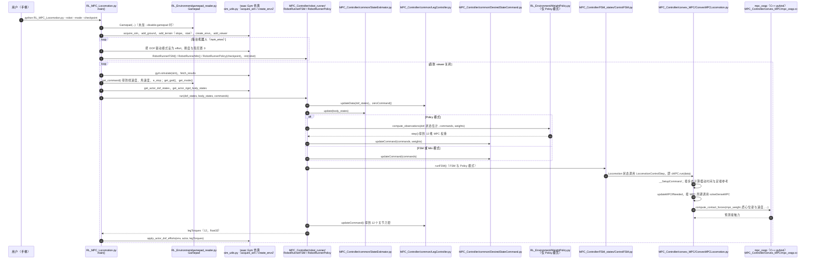

# rl-mpc-locomotion

**rl-mpc-locomotion**（[GitHub](https://github.com/silvery107/rl-mpc-locomotion)）来自 [古月居转载的四足机器人开源项目综述](https://mp.weixin.qq.com/s/pRGoPm41qYCNyHPWR6Dl6A)，属「强化学习」组。

## 一句话定义

**rl-mpc-locomotion 提供快速仿真与 RL 训练框架：高层策略网络动态预测 MPC 控制器的权重参数，低层是参考 MIT Cheetah Software、用 Python 重写的 MPC。**

## 英文缩写速查

| 缩写 | 英文全称 | 简要说明 |
|------|----------|----------|
| RL | Reinforcement Learning | 强化学习 |
| MPC | Model Predictive Control | 模型预测控制 |

## 为什么重要

- 综述把它放在「强化学习」这条技术路线下，作为可读源码的参照项目；横向对比见 [四足机器人开源项目技术地图：从极简运动学到研究级硬件（36 个 GitHub 项目）](../overview/quadruped-open-source-projects-technology-map.md)。
- 文中星标：946（文章表述，入库日未复核）。

## 核心信息

| 项 | 内容 |
|----|------|
| **仓库** | [silvery107/rl-mpc-locomotion](https://github.com/silvery107/rl-mpc-locomotion) |
| **最近提交** | 2026-04-26 |
| **可达性** | `git ls-remote` 可达（2026-11-01） |
| **文章归类** | 强化学习 |

## 文章说法核对

- **文章：** 文章称它是完整教学框架（配套 UG-Thesis-EN 教学 PPT），实现凸 MPC、WBC，并用 PPO 学习 MPC 权重，基于 Isaac Gym 并行训练。
- **README / 核查：** README 称 RL 训练使用 NVIDIA Isaac Gym 并行、使用 Unitree Aliengo 模型，并在真实 Aliengo 上实现 sim2real（**sim2real 不在本代码库内**）；依赖 Python 3.8、PyTorch 1.10、Isaac Gym Preview 4。
- **差异与保留：** 文章提到的 WBC 与教学 PPT 细节未在 README 前段核对。

## 源码运行时序图

入口：`python RL_MPC_Locomotion.py --robot=Aliengo`（默认 `--mode=Fsm`；`--mode=Min` 为无 FSM 的最小 MPC；`--mode=Policy --checkpoint=...` 使用 RL 权重策略生成 MPC 权重）。依赖 Isaac Gym 仿真器，`gymapi` 与 `isaacgym` 为外部依赖，未读。

图依据：silvery107/rl-mpc-locomotion@df944ef，实际读过 `README.md`、`RL_MPC_Locomotion.py`（参数与主循环）、`MPC_Controller/robot_runner/RobotRunnerFSM.py`（`run`）、`MPC_Controller/robot_runner/RobotRunnerPolicy.py`（`run`）、`MPC_Controller/FSM_states/ControlFSM.py`（`runFSM` 的状态切换结构）、`MPC_Controller/FSM_states/FSM_State_Locomotion.py`（`LocomotionControlStep`）、`MPC_Controller/convex_MPC/ConvexMPCLocomotion.py`（`solveDenseMPC`、`run` 中 `updateMPCIfNeeded` 调用）、`MPC_Controller/common/DesiredStateCommand.py`（`updateCommand`）、`RL_Environment/WeightPolicy.py`（构造与加载）、`setup.py`（`mpc_osqp` 扩展源文件）、`MPC_Controller/convex_MPC/mpc_osqp.cc`（求解器相关函数，未核对 pybind 导出列表）；未读 `RobotRunnerMin.py`（图中 Min 仅按 `RL_MPC_Locomotion.py` 的分派示意）；`FSM_State_Locomotion.run` 到 `LocomotionControlStep` 的完整调用链、`sim_utils.py` 与 `train.py` 训练流程未逐行核对；未运行代码。

## 关联页面

- [reinforcement-learning](../methods/reinforcement-learning.md)
- [model-predictive-control](../methods/model-predictive-control.md)
- [isaac-gym](../entities/isaac-gym.md)
- [locomotion](../tasks/locomotion.md)
- [quadruped-open-source-projects-technology-map](../overview/quadruped-open-source-projects-technology-map.md)

## 参考来源

- [rl_mpc_locomotion.md](../../sources/repos/rl_mpc_locomotion.md)
- [wechat_guyueju_quadruped_opensource_deep_dive_2026-11-01.md](../../sources/blogs/wechat_guyueju_quadruped_opensource_deep_dive_2026-11-01.md)
- [原文（微信公众号）](https://mp.weixin.qq.com/s/pRGoPm41qYCNyHPWR6Dl6A)
- 源码核对（2026-11-02）：silvery107/rl-mpc-locomotion@df944ef，读过 README.md、RL_MPC_Locomotion.py、MPC_Controller/robot_runner/RobotRunnerFSM.py、MPC_Controller/robot_runner/RobotRunnerPolicy.py、MPC_Controller/FSM_states/ControlFSM.py、MPC_Controller/FSM_states/FSM_State_Locomotion.py、MPC_Controller/convex_MPC/ConvexMPCLocomotion.py、MPC_Controller/common/DesiredStateCommand.py、RL_Environment/WeightPolicy.py、setup.py、MPC_Controller/convex_MPC/mpc_osqp.cc；时序图依据以上文件，未运行代码。
