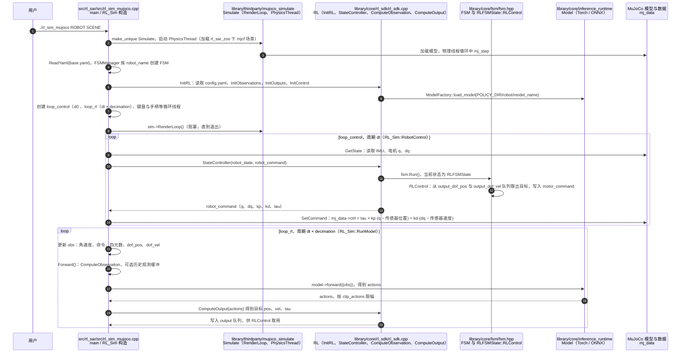

# rl_sar

**rl_sar**（[GitHub](https://github.com/fan-ziqi/rl_sar)）来自 [古月居转载的四足机器人开源项目综述](https://mp.weixin.qq.com/s/pRGoPm41qYCNyHPWR6Dl6A)，属「强化学习」组。

## 一句话定义

**rl_sar（sar = simulation and real）是机器人强化学习算法的仿真验证与实物部署框架，适用于四足、轮式与人形机器人，同时支持 IsaacGym / IsaacSim、ROS1 / ROS2、libtorch / onnxruntime、Gazebo / MuJoCo。**

## 英文缩写速查

| 缩写 | 英文全称 | 简要说明 |
|------|----------|----------|
| SAR | Simulation And Real | 仿真与实机 |
| ONNX | Open Neural Network Exchange | 神经网络交换格式 |

## 为什么重要

- 综述把它放在「强化学习」这条技术路线下，作为可读源码的参照项目；横向对比见 [四足机器人开源项目技术地图：从极简运动学到研究级硬件（36 个 GitHub 项目）](../overview/quadruped-open-source-projects-technology-map.md)。
- 文中星标：1230（文章表述，入库日未复核）。

## 核心信息

| 项 | 内容 |
|----|------|
| **仓库** | [fan-ziqi/rl_sar](https://github.com/fan-ziqi/rl_sar) |
| **最近提交** | 2026-08-16 |
| **可达性** | `git ls-remote` 可达（2026-11-01） |
| **文章归类** | 强化学习 |

## 文章说法核对

- **文章：** 文章把它作为「国产轮足机器人强化学习实践」，称支持宇树 Go2、B2、Aliengo 等轮足平台，高层 MLP + 低层 PD，轮腿协同奖励，零样本迁移。
- **README / 核查：** README 称框架面向四足、轮式、人形机器人，覆盖 locomotion 与 dance，并列出支持机器人、预训练策略与 Gazebo / MuJoCo / 实机状态表（Apache-2.0 徽章）。
- **差异与保留：** README 把它定位为通用 RL 仿真到实机部署框架；文章把它归入「轮足」并称支持 Go2/B2/Aliengo 轮足平台，该归类与具体机型列表未逐项核对（以 README 支持列表为准）。库内 `robot-lab` 是另一个项目。

## 源码运行时序图

入口：`./cmake_build/bin/rl_sim_mujoco <ROBOT> <SCENE>`（README 示例 `./cmake_build/bin/rl_sim_mujoco g1 scene_29dof`；`src/rl_sar/src/rl_sim_mujoco.cpp` 的 `main()`，不依赖 ROS）。ROS 版 `rl_sim`（Gazebo）与真机 `rl_real_<robot>` 未画。

图依据：fan-ziqi/rl_sar@376d42c，实际读过 `README.md`（运行命令）、`src/rl_sar/src/rl_sim_mujoco.cpp`（`main`、构造函数中的线程与循环创建、`RobotControl`、`SetCommand`、`RunModel`、`Forward`）、`src/rl_sar/library/core/rl_sdk/rl_sdk.cpp`（`StateController` 开头、`InitRL` 的模型加载段、`RLFSMState::RLControl` 开头）、`src/rl_sar/library/core/fsm/fsm.hpp`（`FSMState` 接口与 `FSM::Run`）、`src/rl_sar/library/core/inference_runtime/inference_runtime.hpp`（`Model` 接口）、`src/rl_sar/library/thirdparty/mujoco_simulate/simulate.cc`（`mj_step` 与 `RenderLoop` 位置）；`GetState`、`ComputeObservation`、`ComputeOutput` 的函数体、PhysicsThread 具体实现与各机器人 FSM 的状态切换未逐行核对；未运行代码。

## 关联页面

- [sim2real](../concepts/sim2real.md)
- [reinforcement-learning](../methods/reinforcement-learning.md)
- [locomotion](../tasks/locomotion.md)
- [robot-lab](../entities/robot-lab.md)
- [quadruped-open-source-projects-technology-map](../overview/quadruped-open-source-projects-technology-map.md)

## 参考来源

- [rl_sar.md](../../sources/repos/rl_sar.md)
- [wechat_guyueju_quadruped_opensource_deep_dive_2026-11-01.md](../../sources/blogs/wechat_guyueju_quadruped_opensource_deep_dive_2026-11-01.md)
- [原文（微信公众号）](https://mp.weixin.qq.com/s/pRGoPm41qYCNyHPWR6Dl6A)
- 源码核对（2026-11-02）：fan-ziqi/rl_sar@376d42c，读过 README.md、src/rl_sar/src/rl_sim_mujoco.cpp、src/rl_sar/library/core/rl_sdk/rl_sdk.cpp（局部）、src/rl_sar/library/core/fsm/fsm.hpp、src/rl_sar/library/core/inference_runtime/inference_runtime.hpp、src/rl_sar/library/thirdparty/mujoco_simulate/simulate.cc（局部）；时序图依据以上文件，未运行代码。
