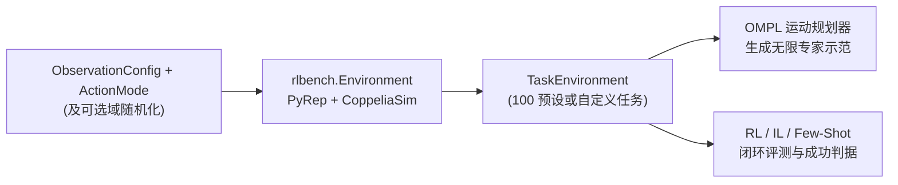
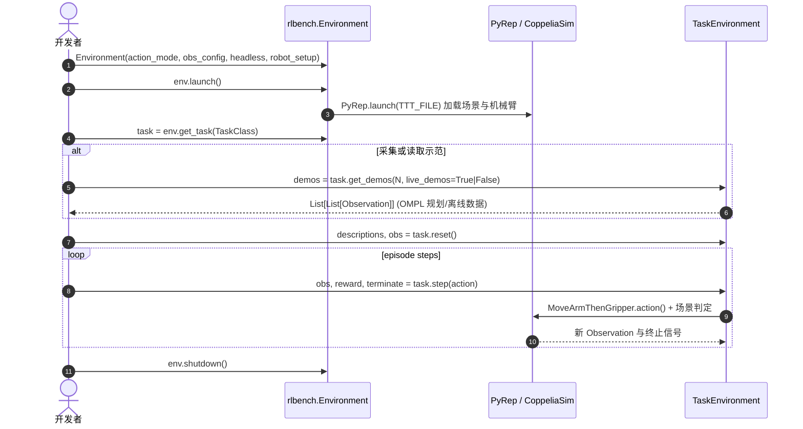

# RLBench

[RLBench](https://github.com/stepjam/RLBench) 收录于具身智能研究室 [开源项目主表](https://github.com/RealXiaoze/humanoid-motion-intelligence/blob/main/%E8%AE%BA%E6%96%87%E4%B8%8E%E9%A1%B9%E7%9B%AE/%E5%BC%80%E6%BA%90%E9%A1%B9%E7%9B%AE%E4%B8%BB%E8%A1%A8.md) 的「工程与实机部署」分组，是本库为该入口建立的独立详情节点。

## 一句话定义

在CoppeliaSim中封装多类视觉操作任务、动作模式和示范生成接口，可用于强化学习、模仿学习与少样本研究；任务构建API便于新增对象流程，并保持统一观测与成功判据。

## 英文缩写速查

| 缩写 | 英文全称 | 简要说明 |
|------|----------|----------|
| RLBench | Robot Learning Benchmark | 视觉操作多任务/少样本/模仿学习基准（arXiv:1909.12271） |
| PyRep | Python CoppeliaSim Wrapper | 底层 V-REP / CoppeliaSim 物理与渲染 Python 封装 |
| OMPL | Open Motion Planning Library | `π*` 自动生成无限专家示范的采样运动规划后端 |
| FS10–95 | Few-Shot Challenge V1 (`FS10/25/50/95_V1`) | 官方少样本训练/未见任务测试切分协议 |

## 为什么重要

- **大规模任务多样性 + 无限示范生成**：内建 **100 个独特视觉操作任务**（各有多种空间/物体/文本变体），并通过 OMPL 运动规划器按路径点自动生成 **无限专家示范**，无需人工遥操作即可测试 IL/RL。
- **传感器与动作模式解耦**：同时提供肩部双目与腕部单目相机（RGB / Depth / 分割 Mask）及多样 `ActionMode`（如 `MoveArmThenGripper(JointVelocity(), Discrete())`），方便单独消融视觉表征或末端控制空间。
- **可替换机械臂与域随机化**：`Environment` 原生支持 `robot_setup` 换臂及 `VisualRandomizationConfig` / `DynamicsRandomizationConfig`。

## 核心原理

### 系统结构与基准规格

| 维度 | 规格（arXiv:1909.12271v1 & `stepjam/RLBench@02720bb`） |
|------|---------------------------------------------------------|
| **仿真栈** | CoppeliaSim v4.1.0 + PyRep |
| **默认本体与任务** | 7-DoF Franka Panda（支持换臂）；**100** 独特任务（从简单 Reach 到倒水、插拔等） |
| **多模态观测** | 肩部立体 + 腕部单目（RGB、深度、分割掩码）+ 本体关节/力矩/夹爪；`ObservationConfig` 开关 |
| **少样本挑战** | `FS10/25/50/95_V1` 等任务集切分；测试集固定占未见 **10%**（原论文 10 任务）+ K=1/5/20-shot |

## 源码运行时序图

对齐 [`stepjam/RLBench@02720bb`](https://github.com/stepjam/RLBench) 实际读过的 `rlbench/environment.py`、`examples/imitation_learning.py` 与 `README.md`（Few-Shot / RL / IL 共用入口）：

## 工程实践

1. **严格对齐 CoppeliaSim 版本与 headless 配置**：官方 README 钉定 CoppeliaSim **v4.1.0** 与 `PyRep`；无显示器的云容器需配置 `COPPELIASIM_ROOT`、`QT_QPA_PLATFORM_PLUGIN_PATH` 与虚拟 X Server（`X :99`）。
2. **用 `ObservationConfig` 裁掉不需要的渲染**：默认全开 RGB/Depth/Mask 会显著拖慢仿真吞吐，实验只开所需相机与模态。
3. **版本差异**：v1.2.0 起重构了 `rlbench.action_modes`（`MoveArmThenGripper` 组合臂/手模式），复现早期论文需核对提交历史或分支。

## 局限与风险

- **仿真后端生态老化**：CoppeliaSim v4.1.0 + X11 无头渲染依赖链较重，近年多被 ManiSkill / LIBERO / Isaac Lab 等并行 GPU 仿真替代。
- **刚体与简单接触偏多**：OMPL 预设路径点适合运动规划可达任务，难覆盖软体或复杂力控插入。
- **少样本/IL 实验需自备训练器**：`examples/` 仅含占位接口示例，完整基线（如 C2FARM/PerAct/RVT）多托管在下游仓库。

## 关联页面

- [sim2real](../concepts/sim2real.md)
- [isaac-lab](../entities/isaac-lab.md)
- [Humanoid Motion Intelligence](./humanoid-motion-intelligence.md)
- [开源主表覆盖索引](../queries/hmi-opensource-projects-coverage.md)

- 列表实体：[AwesomeSim2Real](../entities/awesome-sim2real.md)
- 技术地图：[AwesomeSim2Real 技术地图](../overview/lc-awesome-sim2real-technology-map.md)
- 方法/任务：[sim2real.md](../concepts/sim2real.md)、[locomotion.md](../tasks/locomotion.md)

- [humanoid-motion-intelligence](../entities/humanoid-motion-intelligence.md)
- [reinforcement-learning](../methods/reinforcement-learning.md)
- [manipulation](../tasks/manipulation.md)

## 参考来源

- [RLBench 来源归档](../../sources/repos/rlbench.md)
- [Humanoid Motion Intelligence 仓库归档](../../sources/repos/humanoid-motion-intelligence.md)
- [开源项目主表（上游）](https://github.com/RealXiaoze/humanoid-motion-intelligence/blob/main/%E8%AE%BA%E6%96%87%E4%B8%8E%E9%A1%B9%E7%9B%AE/%E5%BC%80%E6%BA%90%E9%A1%B9%E7%9B%AE%E4%B8%BB%E8%A1%A8.md)

- [`sources/papers/lc_awesome_sim2real_1909_12271_rlbench-the-robot-learning-benchmark-lea.md`](../../sources/papers/lc_awesome_sim2real_1909_12271_rlbench-the-robot-learning-benchmark-lea.md) — 本条目策展摘录
- [`sources/papers/lc_awesome_sim2real_catalog.md`](../../sources/papers/lc_awesome_sim2real_catalog.md) — 列表总表
- [`sources/repos/awesome-sim2real.md`](../../sources/repos/awesome-sim2real.md)
- 论文：<https://arxiv.org/abs/1909.12271>

## 推荐继续阅读

- [官方入口](https://github.com/stepjam/RLBench)
- [Humanoid Motion Intelligence 知识库实体页](./humanoid-motion-intelligence.md)

- [AwesomeSim2Real 仓库](https://github.com/LongchaoDa/AwesomeSim2Real)
- [原文](https://arxiv.org/abs/1909.12271)
