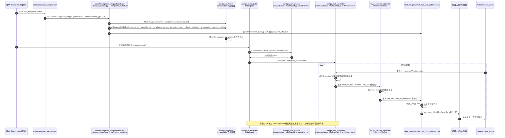

# RoamerX（智身四足导航栈）

**RoamerX**（社区开源版 **RoamerX Lite**）是智身科技（GENISOM AI）面向四足机器人的 **ROS 2 导航栈**：在 **Nav2** 基础上增强 **SLAM、全局/局部规划、行为树与代价地图**，支持与 **RL 运动策略** 及 [MATRiX](./matrix-simulation-platform.md) 仿真联合调试。课程第 7 章与 Final Project 以其为 **中层导航模块**。

## 一句话定义

> 四足机上的 **「感知建图 → 全局路径 → 局部跟踪 → 速度指令」** 开源栈，输出平面速度/航向给底层 RL 或 PD 运动控制器。

## 英文缩写速查

| 缩写 | 英文全称 | 简要说明 |
|------|----------|----------|
| SLAM | Simultaneous Localization and Mapping | 同步定位与建图 |
| Nav2 | Navigation 2 | ROS 2 标准导航框架 |
| MPPI | Model Predictive Path Integral | 基于采样的模型预测路径积分局部控制器 |
| BT | Behavior Tree | 行为树，任务编排与状态机 |
| LiDAR | Light Detection and Ranging | 激光雷达，2D/3D 建图主传感器 |
| ROS2 | Robot Operating System 2 | 机器人中间件与消息生态 |
| LCM | Lightweight Communications and Marshalling | 部分机型可选的低延迟总线协议 |
| costmap | 2D Costmap | 障碍物栅格代价地图 |

## 为什么重要

1. **四足导航 ≠ 轮式 Nav2 直搬**：足式平台需要把 Nav2 输出的 **cmd_vel** 交给 **姿态自适应的 RL/PD 跟踪层**（见 [分层导航栈](../concepts/hierarchical-quadruped-navigation-stack.md)）。
2. **与 MATRiX 同厂商闭环**：仿真中验证 SLAM + 规划 + RL loco，再迁移到 **ZSL-1 / 钢镚** 等实机。
3. **开源可复现**：[`zsibot/genisom_roamerx_open`](https://github.com/zsibot/genisom_roamerx_open) 提供 Gazebo/UE 仿真与 NX/3588 硬件支持。

## 核心模块（开源仓库）

| 模块 | 功能 |
|------|------|
| `robot_slam` | LiDAR SLAM；2D 栅格图 + 3D 点云图 |
| `navigo_bt_navigator` | 行为树导航编排 |
| `navigo_mppi_controller` | MPPI 局部路径跟踪 |
| `navigo_costmap_2d` | 实时障碍代价地图 |
| `navigo_navfn_planner` | 全局路径规划 |

典型流程：`ros2 launch robot_slam slam.launch.py` → 建图/定位服务 → Nav2 跟踪目标点 → 底层 RL 执行步态。

## 与其他页面的关系

- 上游仿真：[MATRiX](./matrix-simulation-platform.md)
- 任务：[Vision-Language Navigation](../tasks/vision-language-navigation.md) — 自然语言目标可接在导航栈之上
- 对比：[LiDAR SLAM 选型](../comparisons/lidar-slam-lio-vio-selection.md)
- 通用人形/移动栈：[Navigation2](./navigation2.md)、[Navigation SLAM Overview](../overview/navigation-slam-autonomy-stack.md)

## 常见误区

- **误区：「有 RoamerX 就不需要 RL loco」。** 导航栈解决 **去哪里**；崎岖地形上的 **怎么站稳走** 仍靠 RL/PD 运动层。
- **误区：「3D 点云图够就不用 2D costmap」。** 局部规划与 Nav2 生态仍以 **2D 投影代价图** 为主力接口。

## 推荐继续阅读

- GitHub：[genisom_roamerx_open](https://github.com/zsibot/genisom_roamerx_open)
- [Quadruped Control Curriculum](./quadruped-control-curriculum.md) — Project 4 集成说明

## 源码运行时序图

入口：`bash script/bash/start_navigation.sh nav`，其中执行 `ros2 launch robot_navigo navigation_bringup.launch.py platform:=UE mc_controller_type:=RL_TRACK_VELOCITY communication_type:=UDP map:=<map.yaml>`；RViz2 通过 nav2 插件发送导航目标。下图为 UE 仿真 + UDP 下发的路径，Gazebo 与 LCM 分支未画。

图依据：zsibot/genisom_roamerx_open@51d1e9d，实际读过 `README.md`（启动命令）、`script/bash/start_navigation.sh`（`start_nav` 与参数）、`src/navigation/src/robot_navigo/launch/navigation_bringup.launch.py`（参数与 `bringup_dir`）、`src/navigation/src/robot_navigo/launch/bringup_launch.py`（容器与 `navigation_launch.py` 的 include）、`src/navigation/src/robot_navigo/launch/navigation_launch.py`（节点与 `LoadComposableNodes` 列表、cmd_vel 重映射、UDP 条件）、`src/navigation/src/robot_navigo/params/navigo_params.yaml`（planner、controller 插件与 odom_topic）、`src/navigation/src/navigo_bt_navigator/behavior_trees/*.xml`（ComputePathToPose、FollowPath 节点）、`src/navigation/src/navigo_velocity_optimizer/src/velocity_smoother.cpp`（订阅 `cmd_vel`、发布 `cmd_vel_smoothed`）、`src/navigation/src/robot_navigo/src/vel_cmd_udp_publisher.cpp`（订阅 `/cmd_vel`、UDP 发送线程、第一条指令接管逻辑）；MPPI 内部采样、速度平滑的限幅实现、RecoveryNode 具体分支、UDP 协议细节与 BT 默认树的选择未逐行核对；未运行代码。

## 参考来源

- [genisom_roamerx_open 源码归档](../../sources/repos/genisom_roamerx_open.md)（<https://github.com/zsibot/genisom_roamerx_open>）

- [sources/courses/quadruped_control_simulation_rl_curriculum.md](../../sources/courses/quadruped_control_simulation_rl_curriculum.md) — 课程第 7 章与 Final Project
- 源码核对（2026-11-02）：zsibot/genisom_roamerx_open@51d1e9d，读过 README.md、script/bash/start_navigation.sh、src/navigation/src/robot_navigo/launch/navigation_bringup.launch.py、src/navigation/src/robot_navigo/launch/bringup_launch.py、src/navigation/src/robot_navigo/launch/navigation_launch.py、src/navigation/src/robot_navigo/params/navigo_params.yaml、src/navigation/src/navigo_bt_navigator/behavior_trees/ 下行为树 XML、src/navigation/src/navigo_velocity_optimizer/src/velocity_smoother.cpp、src/navigation/src/robot_navigo/src/vel_cmd_udp_publisher.cpp；时序图依据以上文件，未运行代码。
