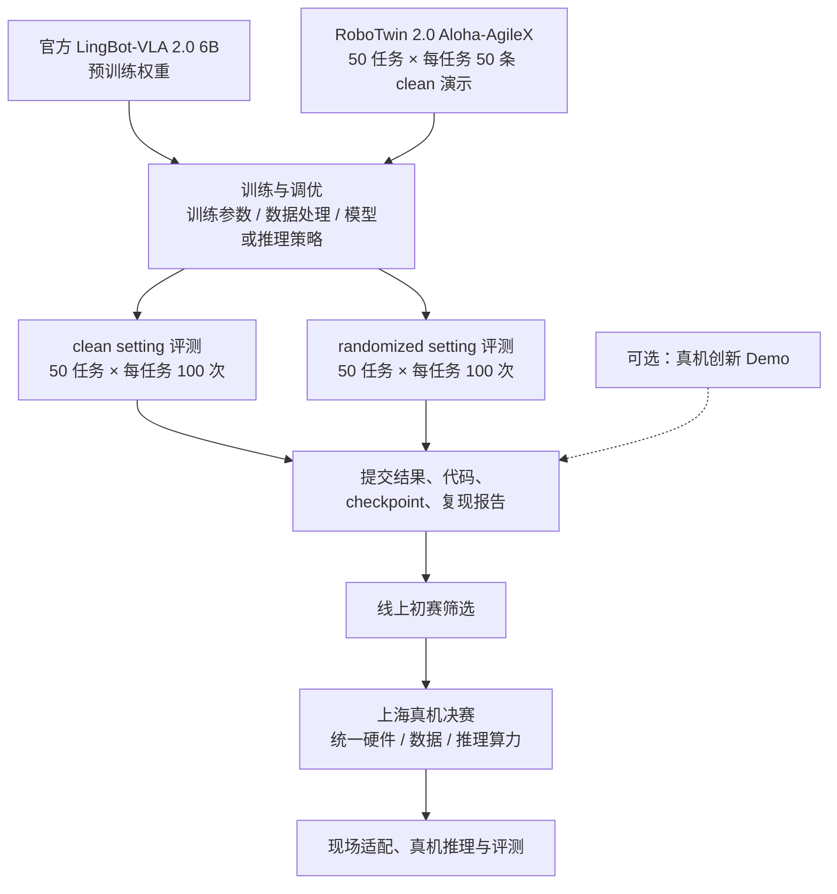

# 首届蚂蚁灵波具身大模型挑战赛（Robbyant Embodied AI Challenge，2026）

## 一句话定义

**首届蚂蚁灵波具身大模型挑战赛**是蚂蚁灵波科技、魔搭社区与阿里云天池共同组织的**统一 VLA 基座、仿真筛选、真机决赛**赛事，用明确的数据隔离协议考察 [LingBot-VLA 2.0](./lingbot-vla-v2.md) 的调优与部署能力。

## 英文缩写速查

| 缩写 | 英文全称 | 简要说明 |
|------|----------|----------|
| VLA | Vision-Language-Action | 统一使用的视觉–语言–动作预训练模型类别 |
| AI | Artificial Intelligence | 本赛事所面向的具身智能应用领域 |
| GPU | Graphics Processing Unit | 后训练与现场推理所需计算资源 |
| Demo | Demonstration | 线上可选的真机能力验证演示 |

## 为什么重要

- **可复现的竞赛约束：** 指定同一 6B 预训练权重、同一 Aloha-AgileX 双臂仿真本体、50 任务与训练数据准入规则；比泛泛比较不同论文的单一平均成功率更容易解释差异。
- **主动区分训练与测试分布：** 只用 clean 演示训练，却要求同时给出 clean 和 randomized 测试结果，直接暴露视觉/场景扰动下的泛化差距。
- **仿真到真机分层：** 初赛成绩用于筛选，决赛另在统一线下硬件进行现场调优与真机评测；仿真高分不自动成为最终真机成绩。

## 核心原理：赛事任务与数据闭环

| 项目 | 官方赛事协议（2026） |
|------|--------------------|
| 基座 | [LingBot-VLA 2.0 6B 预训练权重](https://huggingface.co/robbyant/lingbot-vla-v2-6b/tree/main) |
| 线上必做 | [RoboTwin 2.0](./robotwin.md) Aloha-AgileX 的 **50 项双臂任务** |
| 训练准入 | 每任务 **50 条 clean 示范**；**randomized 数据不能用于训练** |
| 线上评测 | **clean / randomized** 两种 setting；每任务每种 setting 测试 **100 次**，提交成功/测试次数 |
| 线上可选 | 独立真机创新 Demo；无固定评分，仅作晋级参考 |
| 线下决赛 | 上海统一场地与硬件；现场任务、数据采集（按需）、模型适配、真机推理与评测 |
| 评审口径 | 初赛成绩不累加到决赛；最终奖项按真机评测和官方评审 |

### 流程总览（依据官方赛题规则）

这张图描述**赛事协议**，不是一个新发布的神经网络架构或软件运行调用图。线上训练中不允许把 randomized 仿真样本混入训练集；它仅是规定的测试设置之一。

## 工程实践

1. 先读 [赛事赛题与数据](https://tianchi.aliyun.com/competition/entrance/532514/information)，锁定指定 checkpoint 和训练数据范围；归档数据版本、任务列表和本体配置。
2. 用 [LingBot-VLA 2.0 官方代码](https://github.com/Robbyant/lingbot-vla-v2) 准备特征槽位映射、归一化统计、训练脚本和 checkpoint；不要把官方 README 的通用实验配置等同于赛事限制。
3. 用 clean 数据后训练，分别运行 clean 与 randomized 两组 50 任务评测，按任务保留测试次数、成功次数和失败模式。
4. 提交 `results.json`、训练与评测代码、对应 checkpoint、复现报告；若有可选真机 Demo，另附完整执行视频与任务说明。
5. 在真机部署阶段核对相机/动作接口、推理时延、任务物料和现场硬件偏差；把真机评测与线上仿真分数分别报告。

## 源码运行时序图

**不适用（赛事实体）**：天池公布的是评测与提交协议，未在核对范围内公开独立的赛事统一执行程序入口。所链接的 [LingBot-VLA 2.0](./lingbot-vla-v2.md) 具有模型训练、推理和部署代码；[RoboTwin 2.0](./robotwin.md) 具有仿真评测代码，应在对应软件实体研究实际调用关系，不能拼装不存在的「比赛源码运行时序」。

## 局限与风险

- **数据泄漏：** clean 训练与 randomized 测试有明确边界；若采用不合规训练数据，评测结果不能称为本赛题可比结果。
- **训练协议不等于模型仓库默认示例：** 公开 LingBot-VLA 2.0 README 的 RoboTwin 通用后训练范例允许使用 clean 与 randomized 数据组合；赛事专属赛题**明确禁止**这种组合。
- **仿真与真机不同口径：** 线上 clean / randomized 成功率只作为入围依据，不能据此推断线下任务成功率。
- **开源边界：** 指定模型、权重与 RoboTwin 2.0 仿真资源已公开，但赛事材料、选手作品和决赛场地评测环境**不等于全部独立开源**；部分天池附件下载需要登录。
- **结果口径：** 官方赛事介绍与赛题没有完整决赛获奖成绩表；本页不将媒体分数当作官方已核验记录。

## 关联页面

- [LingBot-VLA 2.0](./lingbot-vla-v2.md) — 指定 6B 模型与可运行训练、推理实现
- [RoboTwin 2.0](./robotwin.md) — Aloha-AgileX 任务数据与双设置评测环境
- [Robbyant（蚂蚁灵波）](./robbyant.md) — 发起方与 LingBot 技术栈
- [VLA](../methods/vla.md) — 模型后训练、动作预测与跨本体接口
- [Manipulation](../tasks/manipulation.md) — 双臂操纵成功率、任务执行与真机失效模式
- [具身模型测评纵深路线 Stage 3](../../roadmap/depth-embodied-eval.md) — 从标准化仿真任务协议到真机评估的读法

## 参考来源

- [赛事官网介绍与赛题原文通读归档](../../sources/sites/robbyant-embodied-ai-challenge-2026.md)
- [阿里云天池·赛事介绍](https://tianchi.aliyun.com/competition/entrance/532514/introduction)
- [阿里云天池·赛题与数据](https://tianchi.aliyun.com/competition/entrance/532514/information)
- [LingBot-VLA 2.0 官方代码归档](../../sources/repos/lingbot-vla-v2.md)
- [RoboTwin 2.0 官方代码归档](../../sources/repos/robotwin-2.md)

## 推荐继续阅读

- [LingBot-VLA 2.0 官方 README](https://github.com/Robbyant/lingbot-vla-v2) — 实际后训练/部署入口和资源区别
- [RoboTwin 2.0 项目主页](https://robotwin-platform.github.io/) — 50 项双臂基准及数据生成方法
- [赛事指定预训练权重](https://huggingface.co/robbyant/lingbot-vla-v2-6b/tree/main) — 复现时先核对权重版本
