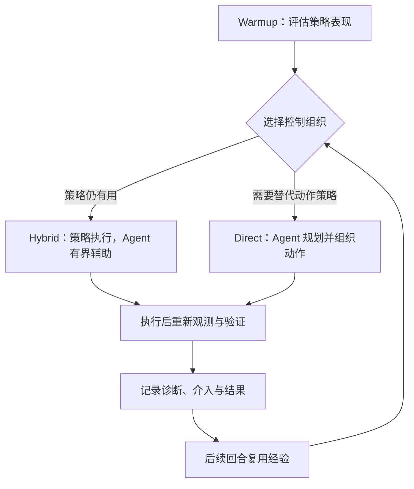

# RoboDoctor

## 一句话定义

RoboDoctor 是一种面向机器人操作的训练免费自我改进框架：冻结低层机器人策略，通过 Agent 诊断、修正和验证执行过程，并依据任务表现调整控制组织与可复用经验。

## 英文缩写速查

| 缩写 | 英文全称 | 简要说明 |
|------|----------|----------|
| RSI | Recursive Self-Improvement | 根据执行反馈迭代更新系统决策或记忆的过程 |
| WAM | Whole-Arm Manipulation | 全臂操作策略；项目页将其作为连续低层动作来源之一 |
| VLA | Vision-Language-Action | 视觉、语言到动作的策略模型类别 |
| EEF | End Effector | 末端执行器；项目页中的一种空间目标控制接口 |
| qpos | Joint Position | 关节位置向量；用于指定机器人关节构型 |

## 为什么重要

机器人策略可能知道要做什么，却会因接触、几何定位或执行误差而失败。RoboDoctor 尝试把“策略本身不适合任务”和“当前动作需要局部修正”分开处理：保留有效的策略技能，在失效模式出现时让 Agent 介入，并用新观测确认介入是否真的奏效。

这里的“训练免费”指方法侧重在冻结策略之外调整控制流程与经验，不代表机器人策略能在任何新任务上零成本泛化，也不等同于无需评测或数据。

## 核心原理

### 流程总览

### 两层决策

1. **控制结构选择**：Warmup 先观察低层策略是否能提供有用动作。Hybrid 保留策略主导的连续控制，Agent 负责诊断并在需要时辅助；Direct 由 Agent 直接规划与组织动作。
2. **动作介入与操作**：所选结构内，Agent 可检查策略动作片段，基于相机/深度几何定位目标，以 EEF 或关节位置命令作局部调整；动作完成后重新观察并核验物体状态和任务进度。
3. **经验复用**：记录故障诊断、采取的介入、场景 grounding、操作方式及执行结果。复用时重新定位当前场景，不能直接照搬旧坐标。

这个闭环对外部策略权重不做更新；系统改进的对象是控制组织、介入判断和可复用经验。因而它与以重新训练模型权重为核心的改进路径不同。

## 官网实验结果

RoboDoctor 项目页的 `data/task-results.json` 标注更新日期为 **2026-10-21**。其 RoboDojo 汇总结果如下：

| 阶段 | 平均分 / 100 | 成功率 | 有效 episode | 任务覆盖 |
|------|---------------:|-------:|-------------:|----------:|
| Warmup | 49.74 | 40.83% | 162 / 162 | 54 / 54 |
| RSI | 57.10 | 49.44% | 301 / 324 | 54 项均有分数；46 项达到完整 episode 数 |

项目页同时按 Generalization、Precision、Long Horizon、Memory、Open 五个维度展示分数。上述为团队自报结果。页面中的其他方法使用 RoboDojo 已发表分数；评测覆盖和数据来源不完全一致，因此不能将柱状图直接理解为严格同条件排名。截图中 **57.10** 的分数与官网当前结果文件一致，但它不表示 54 个任务的 RSI 都有完整 episode 覆盖。

## 工程实践

- 复现时先核对项目页的阶段定义、有效 episode 规则和按任务汇总方式；不可将不完整尝试或无效运行默认为零分。
- Hybrid 与 Direct 是任务适配的控制组织选择：若有用的策略动作需要少量修正，优先评估 Hybrid；若任务依赖另一套语义动作策略，再评估 Direct。具体选择仍需以任务实测为准。
- 每次 Agent 介入之后都应再次观测并验证效果；“发出了修正命令”不能当作成功恢复。
- 当前项目页开放了方法说明、部分 rollout/经验记录和评测结果；官网链接的 `RoboDoctor-Preview` 仓库截至 2026-10-22 为空，尚无可运行代码。因此现有材料可用于理解方案与审阅自报结果，尚不能据此复现实验。

## 局限与风险

- 项目页尚未提供论文/arXiv 文稿，方法细节和实验设置目前主要来自项目团队网站。
- 运行时实现未开放，无法独立核实执行开销、错误处理细节或完整数据生成流程。
- RSI 阶段有 23 个计划 episode 未出现在有效计数中，且只有 46/54 个任务达到完整 episode 数；跨方法比较需保留此覆盖差异。
- 介入过多可能打断有用的连续策略动作；空间 grounding、重规划和验证也会增加时延。
- 视觉上看似完成并不总能证明任务成功，需用任务本身的状态或结果信号核验。

## 关联页面

- [递归自我改进（RSI）](../concepts/recursive-self-improvement.md)
- [Awesome RSI 精选集](./awesome-rsi.md)

## 参考来源

- [RoboDoctor 官方项目页与官网结果归档](../../sources/sites/robodoctor-rsi-github-io.md)
- [RoboDoctor-Preview 官方代码入口核查](../../sources/repos/thusi-lab-robodoctor-preview.md)
- [官网 task-results.json（数据更新于 2026-10-21）](https://github.com/RoboDoctor-RSI/robodoctor-rsi.github.io/blob/main/data/task-results.json)

## 推荐继续阅读

- [RoboDojo 项目页与基准说明](https://robodojo-benchmark.com/)
- [RoboDoctor 官方项目页](https://robodoctor-rsi.github.io/)
