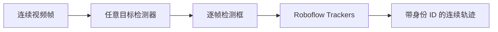

# Roboflow Trackers：检测器无关的多目标跟踪库

## 一句话定义

**Roboflow Trackers** 是一组统一 Python 接口的多目标跟踪算法实现：检测器提供逐帧边界框，跟踪器负责跨帧关联目标并维护身份 ID。

## 英文缩写速查

| 缩写 | 英文全称 | 简要说明 |
|------|----------|----------|
| MOT | Multi-Object Tracking | 在视频中跨帧跟踪多个目标 |
| HOTA | Higher Order Tracking Accuracy | 综合衡量检测与身份关联的跟踪指标 |
| CMC | Camera Motion Compensation | 补偿相机运动对目标关联的影响 |
| Re-ID | Re-identification | 将重新出现的目标与既有身份匹配 |

## 为什么重要

- **可替换跟踪算法：** 多种论文方法使用一致的 API，便于在相同检测结果上做工程比较。
- **不绑定检测器：** 可将已有检测模型接到关联阶段，避免为试用跟踪算法重建整个感知管线。
- **覆盖常见运动挑战：** 方法包括低置信度检测关联、观测驱动恢复、相机运动补偿，以及 McByte 的掩码线索。
- **带有统一评测入口：** 官方文档给出 MOT17、SportsMOT、SoccerNet 与 DanceTrack 的 HOTA 对比和评测命令。

## 核心原理

### 在 tracking-by-detection 管线中的位置

跟踪器不负责识别图像里的类别。它接收检测器逐帧产生的边界框与置信度，再用运动状态和数据关联在相邻帧之间延续轨迹：

官方 Python 接口使用 `supervision.Detections` 作为检测结果对象，并以 `update(detections, frame=None)` 推进跟踪状态。不同算法共享相似调用方式，因此可在检测结果固定时比较关联策略的影响。

### 算法覆盖

| 跟踪器 | 核心特点（官方文档概括） | 适用观察点 |
|--------|--------------------------|------------|
| SORT | Kalman filter 与 Hungarian matching 基线 | 作为轻量基准 |
| ByteTrack | 同时关联高、低置信度检测 | 观察低置信度框对轨迹连续性的作用 |
| OC-SORT | 对丢失轨迹进行 observation-centric 恢复 | 关注遮挡或运动预测偏差 |
| BoT-SORT | 支持相机运动补偿 | 适合画面整体移动的场景 |
| C-BIoU | 级联 buffered IoU 匹配 | 关注快速或不规则运动 |
| McByte | 利用传播的 SAM/Cutie 掩码线索 | 评估掩码辅助关联及额外依赖成本 |

这些实现适合作为可复现的工程基线。不同数据集上的结果会受检测框质量、参数、帧率与相机运动影响；README 的基准表采用默认参数，不能直接代替目标场景的验证。

## 工程实践

- **安装：** `pip install trackers`；官方 README 标明 Python ≥ 3.10。
- **接入：** 将检测模型输出转换为 `supervision.Detections`，调用选定 tracker 的 `update()`，再使用返回的检测结果与 tracker ID。
- **切换算法：** 固定检测器、输入视频与评测指标，一次只替换 tracker；这样能把检测质量变化与关联策略变化区分开。
- **相机移动：** 优先检查 BoT-SORT 或 McByte 的相机运动补偿能力，并用实际镜头验证 ID 连续性。
- **评测：** 官方提供 MOT17、SportsMOT、SoccerNet、DanceTrack 的 HOTA 对比；部署前还应按自己的检测器、视频帧率与场景做验证。
- **许可：** 仓库声明 Apache-2.0；使用时仍应单独核对可选模型、权重及其依赖的许可。

## 局限与风险

- 跟踪质量受上游检测遗漏、误检和框抖动影响；检测器无关不代表所有检测输出都能达到同等效果。
- 默认参数的公开基准不能保证在新场景中最优；应关注身份切换、轨迹中断和端到端延迟。
- McByte 使用掩码线索并需要额外依赖；其安装与权重准备和基础库不同。
- 本项目包含名为 McByte 的跟踪器；它与独立研究项目 McByte++ 有关联但不是同一个代码库或实体，详见 [McByte++](./mcbyte-plus-plus.md)。

## 关联页面

- [目标检测（方法）](../methods/object-detection.md) — tracking-by-detection 的上游检测环节
- [机器人感知栈选型闭环](../queries/robot-perception-stack-selection-loop.md) — 在感知系统选型中定位检测与跟踪模块
- [TrackerLab](./trackerlab.md) — 多目标跟踪方法与评测入口
- [McByte++](./mcbyte-plus-plus.md) — 面向体育视频长时身份恢复的独立实现
- [Roboflow Sports](./roboflow-sports.md) — Roboflow 的体育视觉工具与示例

## 参考来源

- [Roboflow Trackers 来源归档](../../sources/repos/roboflow-trackers.md)
- [Roboflow Trackers 官方文档](https://trackers.roboflow.com/latest/)
- [Roboflow Trackers GitHub 仓库](https://github.com/roboflow/trackers)

## 推荐继续阅读

- [官方 Quickstart 与算法对比](https://trackers.roboflow.com/latest/)
- [官方跟踪指南](https://trackers.roboflow.com/latest/learn/track/)
- [官方安装指南](https://trackers.roboflow.com/latest/learn/install/)
