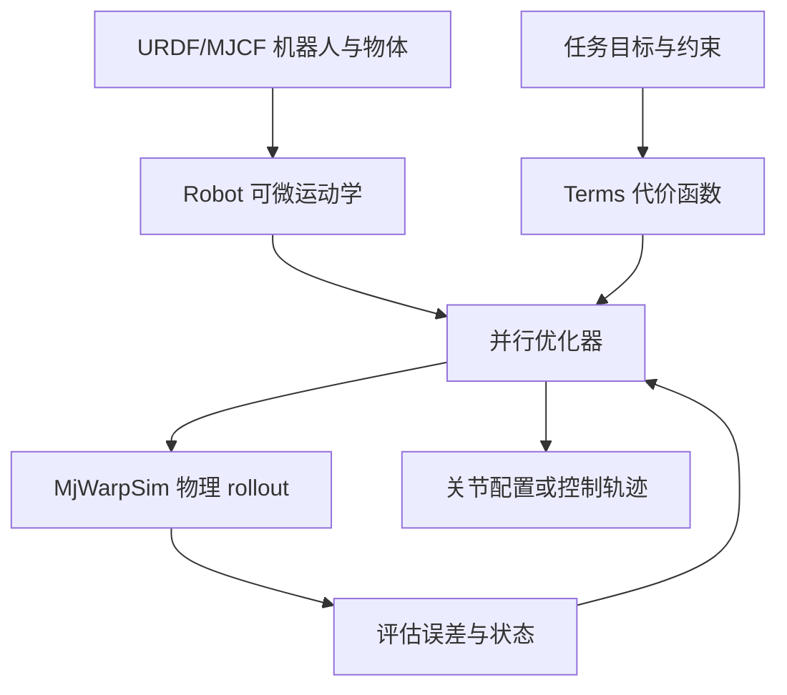
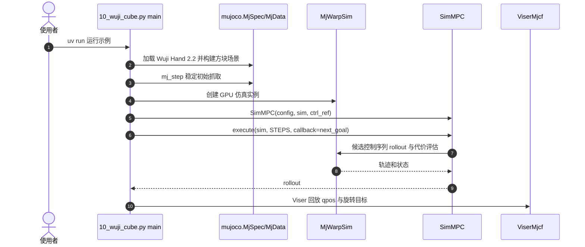

# RoboKit：并行可微机器人优化与仿真

## 一句话定义

RoboKit 把机器人 URDF/MJCF 模型、可微运动学、任务代价与并行优化连接起来，既能求解析约束问题，也能在物理仿真中做 MPC 与机器人学习。

## 英文缩写速查

| 缩写 | 英文全称 | 简要说明 |
|---|---|---|
| IK | Inverse Kinematics | 反向求机器人关节配置 |
| MPC | Model Predictive Control | 重复规划并执行短控制时域 |
| MJCF | MuJoCo XML Format | 机器人与场景模型表示 |
| URDF | Unified Robot Description Format | ROS 生态常用机器人描述格式 |
| RL | Reinforcement Learning | 借助仿真奖励学习策略 |

## 为什么重要

相同的机器人模型和代价表示可复用于多候选 IK、路径规划、灵巧手操控与重定向；研究者可以先在显式优化层定位约束与碰撞问题，再把优化产物用于策略学习。官方源码确实覆盖 G1、Go1/Go2、Franka、Wuji Hand 等示例，但案例是不同任务，不意味着一致的跨平台性能。

## 核心原理

- **Robot**：读取 URDF/MJCF，提供批量正运动学与可微几何。
- **Terms**：构造末端、物体位姿、关节限位、碰撞/接触等误差。
- **Optimizer**：采样或梯度法并行寻找代价较低的机器人配置/控制序列。
- **Simulation**：需要动力学时使用 MuJoCo/MjWarpSim 对候选控制 rollout；闭环将目标更新反馈给下一轮优化。
- **Policy distillation**：官方概览列为可选路径，当前未完整追查其训练脚本，不能默认所有示例都使用蒸馏。

### 流程总览

## 源码运行时序图

以下依据官方 `src/robokit/examples/sim_mpc/10_wuji_cube.py` 的真实入口绘制：

示例用 5 ms 仿真步长、优化阶段的 0.9 s 规划窗和回放可视化；这是 **仿真** 闭环，非 Wuji 实机控制证明。

## 工程实践

安装方式：`uv add robokit` 或 `pip install robokit`。基础可用 `uv run src/robokit/examples/ik/01_basic.py`；Wuji 示例依赖 MuJoCo/Warp/MjWarpSim 和 Viser。建议记录 GPU、并行候选数、收敛、碰撞穿透与任务成功率，勿直接将 README 图片中的倍数当成复现实验结论。

## 局限与风险

**CoRL 2026 Spotlight：** 官方 README 给出论文引用 *RoboKit: Accelerating Parallel Differentiable Optimization for Robot Learning*；第三方论文索引标注 Spotlight。但 OpenReview PDF 全文暂不可读，实验硬件、基线公平性、方差、附录未核实，故节点保留 draft。开源许可不自动覆盖所有机器人资产、模型与上游依赖。

## 结论

**当前可采纳的工程结论是 RoboKit 具备真实的可运行并行优化/仿真入口；论文量化优势尚需阅读原文后逐项判断。**

1. 从 IK 示例验证模型/代价，再上仿真 MPC。
2. 追踪任务成本与 GPU 环境，不混用不同 benchmark 倍数。
3. 部署时需另评估时延、接触稳定性和硬件安全边界。

## 关联页面

- [OpenRoboKit 工具集](../overview/openrobokit-toolkit.md)
- [RetargetingKit](./retargetingkit.md)
- [GraspKit](./graspkit.md)
- [Motion Retargeting](../concepts/motion-retargeting.md)

## 参考来源

- [RoboKit 官方源码归档](../../sources/repos/robokit-openrobokit.md)
- [CoRL 2026 论文核验归档](../../sources/papers/robokit_corl2026_spotlight.md)

## 推荐继续阅读

- [官方文档](https://github.com/openrobokit/robokit/blob/main/docs/guide/overview.md)
- [Wuji Hand 2.2 可运行示例](https://github.com/openrobokit/robokit/blob/main/src/robokit/examples/sim_mpc/10_wuji_cube.py)
