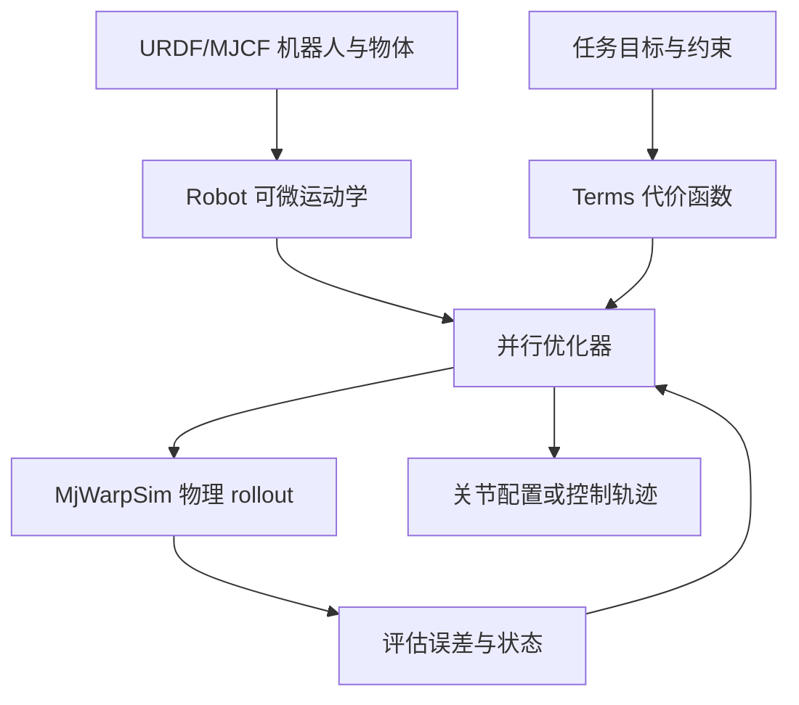
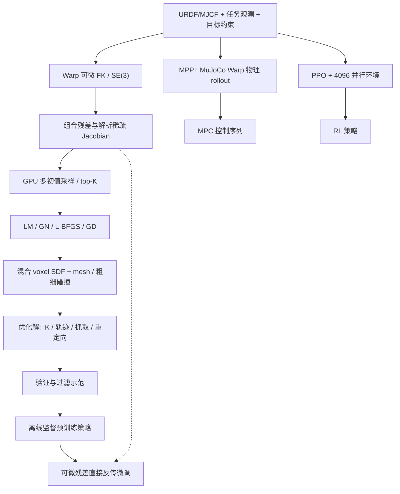
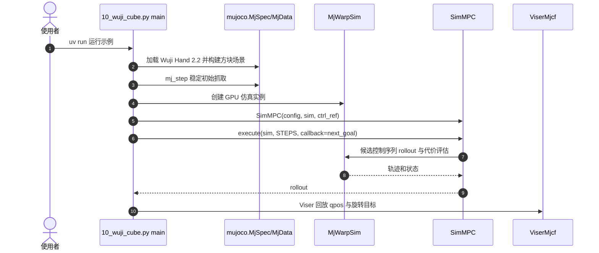

# RoboKit：并行可微机器人优化与仿真（RoboKit: Accelerating Parallel Differentiable Optimization for Robot Learning）

## 一句话定义

RoboKit 把机器人 URDF/MJCF 模型、可微运动学、任务代价与并行优化连接起来，既能求解析约束问题，也能在物理仿真中做 MPC 与机器人学习。

## 英文缩写速查

| 缩写 | 英文全称 | 简要说明 |
|---|---|---|
| IK | Inverse Kinematics | 反向求机器人关节配置 |
| MPC | Model Predictive Control | 重复规划并执行短控制时域 |
| MJCF | MuJoCo XML Format | 机器人与场景模型表示 |
| URDF | Unified Robot Description Format | ROS 生态常用机器人描述格式 |
| RL | Reinforcement Learning | 借助仿真奖励学习策略 |

## 为什么重要

相同的机器人模型和代价表示可复用于多候选 IK、路径规划、灵巧手操控与重定向；研究者可以先在显式优化层定位约束与碰撞问题，再把优化产物用于策略学习。官方源码确实覆盖 G1、Go1/Go2、Franka、Wuji Hand 等示例，但案例是不同任务，不意味着一致的跨平台性能。

## 核心原理

- **Robot**：读取 URDF/MJCF，提供批量正运动学与可微几何。
- **Terms**：构造末端、物体位姿、关节限位、碰撞/接触等误差。
- **Optimizer**：采样或梯度法并行寻找代价较低的机器人配置/控制序列。
- **Simulation**：需要动力学时使用 MuJoCo/MjWarpSim 对候选控制 rollout；闭环将目标更新反馈给下一轮优化。
- **Policy learning**：论文 §3.3 将经筛选优化解的离线监督蒸馏、直接反传可微目标的在线训练及两者混合结合；算法细节已由论文通读核实，**具体训练脚本仍未逐一执行**。

### 流程总览

### 论文全文核实的关键机制（§3；附录 C）

- **多种子 Warp solver**：并行初始化 particles，按残差代价选择 top-K / 重采样；可选择 Adam、L-BFGS、Gauss-Newton / Levenberg–Marquardt、MPPI 等，解析 Jacobian 使用 COO sparse 表达。
- **混合几何**：对象 voxel SDF 提供廉价距离查询，在距表面约 4 个体素的近表面区域启用 mesh refinement；link 粗碰撞球先筛选，再对附近目标检查详细 collision spheres。
- **多分辨率渲染及物理**：手眼标定从低分辨率/多种子/模糊 mask 逐步细化；采样 MPC 从简化物理迭代转入高保真。
- **可微性边界**：可微目标 residual 能直接给神经网络梯度（online distillation），但论文对 MuJoCo Warp 物理 rollout 使用**不经仿真反传的 MPPI 采样优化**；不能笼统称全部仿真可微求解。
- **蒸馏过程**：优化器生成候选解 → 筛除不可行示范 → offline supervised warm-up → 对可微 task objective 做 online direct-gradient fine-tuning。后一步不通过 unroll solver 反传。

### 论文方法流程（与源码示例分开）

## 源码运行时序图

以下依据官方 `src/robokit/examples/sim_mpc/10_wuji_cube.py` 的真实入口绘制：

示例用 5 ms 仿真步长、优化阶段的 0.9 s 规划窗和回放可视化；这是 **仿真** 闭环，非 Wuji 实机控制证明。

## 论文实验与评测（作者报告，非独立复现）

论文表 2 的优化基准主要运行于 **1× NVIDIA RTX 4090 + Intel Xeon Gold 5120 CPU**；预热后通常平均 5 次（例外见论文附录），不同任务不可直接混算倍数。

| 任务/对照 | RoboKit | 基线 | 说明 |
|---|---:|---:|---|
| Franka Panda / PyRoKi，2000 个 IK 整批 | **7.12 ms** | 86.20 ms | 约 12.1×；两者成功率均约 99.9% |
| Franka 路径规划 / cuRobo，平均 planning | **16.3 ms** | 56.6 ms | 成功率 99.65% vs 99.57%，但运动时间略长 |
| Shadow Hand 重定向 / PyRoKi，每帧 | **1.25 ms** | 33.19 ms | fingertip 位置误差 6.05 vs 10.76 mm |
| G1 全身重定向 / GMR，每帧 | **2.00 ms** | 7.91 ms | MPJPE 8.08 vs 9.26 cm |
| 4096 grasps / Dex1B | **2.97 s** | 178.45 s | 成功率 46.83% vs 23.63%；Q1 质量指标低于 Dex1B |
| OakInk 物理重定向 / SPIDER，每帧 | **109 ms** | 610 ms | ADD-AUC 65.8 vs 51.3 |

**不同实验协议**：EasyHEC 的大初始误差测试中基线未正常收敛，不能把时间比视作同精度加速；easy split 为 1.23 vs 70.4 s。论文**表 3 的蒸馏**在 RTX A5000 上按另一套协议测：轨迹优化 150.61 ms/frame → 策略推理 0.63 ms/frame（239×），但成功率 96.72% → 95.90%。**表 4 的 PPO** 用 4096 并行环境、5 seeds 中位数和 mjlab 同物理/任务，Go1 Flat 达到基线终分 95% 时间为 3.2 vs 7.6 min；这不是对所有 RL 任务的固定加速比。

**消融（表 5–6）**：grasp 离线示范筛选使成功率 23.83% → 57.91%，结合在线微调为 65.48%；voxel SDF 相对 mesh 在同一 LM 求解器下 2.97 vs 16.61 s，但成功率/穿透略差；Franka IK 去除 Warp 使 1.82 → 139.59 ms，去除多种子将成功率 100% → 72.6%。

**附录要点**：A 列出硬件、任务、基线及统计口径；B 含批量 scaling、GeoRT/DIAL-MPC、CPU IK 及抓取消融；C 为 20+ cost、解析 Jacobian 和算法 1–4；D 为可视化。详细整理见[论文全文归档](../../sources/papers/robokit_corl2026_spotlight.md)。

## 与其他工作对比

- **PyRoKi**：JAX 上批量运动学优化；RoboKit 强调 Warp、多优化器、几何/渲染/物理及策略接口，表 2 的 IK / 手重定向为任务特定对照。
- **cuRobo**：以 GPU 碰撞感知路径规划见长；RoboKit 轨迹优化在使用盒状障碍的 benchmark 加速主要来自 solver 与工程实现，不代表混合 SDF 在该表中被验证。
- **SPIDER / DIAL-MPC**：都采用物理中的采样优化；对比要固定机器人、任务、控制参数和 rollout 数据，不能将 MPC 时延直接当作真机控制频率。

## 工程实践

安装方式：`uv add robokit` 或 `pip install robokit`。基础可用 `uv run src/robokit/examples/ik/01_basic.py`；Wuji 示例依赖 MuJoCo/Warp/MjWarpSim 和 Viser。建议记录 GPU、并行候选数、收敛、碰撞穿透与任务成功率，勿直接将 README 图片中的倍数当成复现实验结论。

## 局限与风险

**CoRL 2026 Spotlight：** 已打开作者官方 [26 页 PDF（含附录 A–D）](https://openrobokit.com/robokit/paper.pdf) 并核对实验硬件、表 1–13、算法 1–4、基线和限制。**尚未独立复现实验**，也未宣称所有机器人模型/资产、上游依赖与硬件兼容性由 MIT 许可覆盖。作者明确指出单个 CPU IK 的 GPU 启动开销、无图搜索轨迹优化与缺少 inverse dynamics 等限制。

## 结论

**当前可采纳的工程结论：** RoboKit 有公开可运行的批量优化/仿真入口，官方论文给出了可复核的测试设置和具体数值；各加速数字属于作者报告，**没有在本次独立复测**。

1. 从 IK 示例验证模型/代价，再上仿真 MPC。
2. 追踪任务成本与 GPU 环境，不混用不同 benchmark 倍数。
3. 部署时需另评估时延、接触稳定性和硬件安全边界。

## 关联页面

- [OpenRoboKit 工具集](../overview/openrobokit-toolkit.md)
- [RetargetingKit](./retargetingkit.md)
- [GraspKit](./graspkit.md)
- [Motion Retargeting](../concepts/motion-retargeting.md)

## 参考来源

- [RoboKit 官方源码归档](../../sources/repos/robokit-openrobokit.md)
- [CoRL 2026 官方 26 页 PDF 全文核验归档](../../sources/papers/robokit_corl2026_spotlight.md)

## 推荐继续阅读

- [作者官方论文 PDF（含附录）](https://openrobokit.com/robokit/paper.pdf)
- [官方文档](https://github.com/openrobokit/robokit/blob/main/docs/guide/overview.md)
- [Wuji Hand 2.2 可运行示例](https://github.com/openrobokit/robokit/blob/main/src/robokit/examples/sim_mpc/10_wuji_cube.py)
