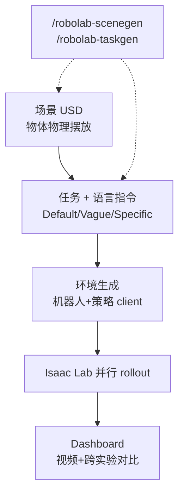
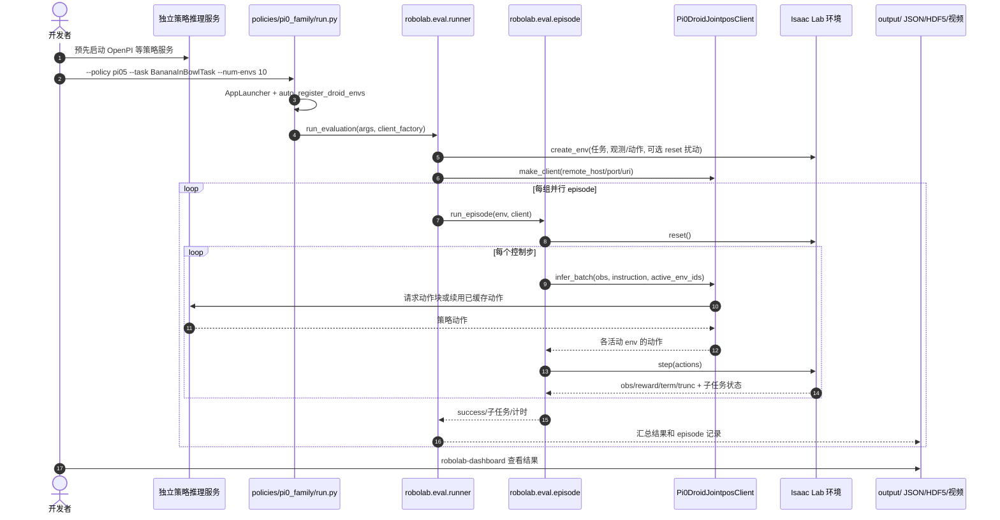

# RoboLab（通用策略高保真仿真评测）

**RoboLab**（*RoboLab: A High-Fidelity Simulation Benchmark for Analysis of Task Generalist Policies*，arXiv:[2604.09860](https://arxiv.org/abs/2604.09860)，RSS 2026，[项目页](https://research.nvidia.com/labs/srl/projects/robolab/)，[代码](https://github.com/NVLabs/RoboLab)，[Leaderboard](https://research.nvidia.com/labs/srl/projects/robolab/leaderboard.html)）是 NVIDIA SRL 提出的 **机器人–策略无关** 仿真评测平台：面向**仅用真机数据训练、不在仿真数据上共训**的通用操纵策略，测试任务泛化、语言理解与鲁棒性，并提供可扩展的场景/任务生成工具链。

## 一句话定义

用 **Isaac Lab 高保真仿真 + RoboLab-120 新任务库 + server-client 策略接口 + NPE 敏感性分析**，在刻意降低与 DROID 训练重叠的前提下评测真机策略的仿真行为，且整体排名与 RoboArena 真机 Elo **Spearman ρ=0.94**。

## 英文缩写速查

| 缩写 | 英文全称 | 简要说明 |
|------|----------|----------|
| VLA | Vision-Language-Action | 视觉–语言–动作通用策略；榜单主要评测对象 |
| WAM | World Action Model | 视频/世界模型类策略（如 Cosmos3-Nano-Policy） |
| NPE | Neural Posterior Estimation | 环境参数敏感性后验估计方法 |
| SR | Success Rate | 任务成功率 |
| DROID | Distributed Robot Interaction Dataset | 大规模真机数据集；RoboLab 刻意与之拉开物体词表重叠 |
| EGO | Ego-centric | 自中心相机视角配置 |
| RSS | Robotics: Science and Systems | 2026 悉尼会议发表 venue |

## 为什么重要

- **反饱和设计：** 120 个全新任务、三能力轴×三难度；仅 **68.7%** 基准物体出现在 DROID 训练词表，缓解「训练–评测同域」导致的虚高成功率。
- **真机策略零样本进仿真：** 不与仿真数据共训即可评测，直接服务「仿真能否预测真机策略表现」这一核心问题（亦被 [Hydra-0](./paper-hydra-0.md) 用作开环 replay 代理，r=0.96）。
- **可扩展生成：** 分钟级手搓或 LLM agent（`/robolab-scenegen`、`/robolab-taskgen`）生成场景与任务，任务库与机器人/策略解耦。
- **sim–real 校准证据：** 与 RoboArena 真机排名 **ρ=0.94**，比单纯 sim 榜更具外推可信度。
- **工程完备：** Apache-2.0 开源、并行 `--num-envs`、自包含 Dashboard、内置 π0.5 客户端。
- **细粒度评测：** 不止报告 episode 成功率，还汇报可配置权重的子任务进度分数、错误抓取/掉落/碰撞事件与末端 SPARC、速度；避免「最终达成但过程有错」被成功率掩盖。

## 核心信息

| 字段 | 内容 |
|------|------|
| 机构 | 英伟达（NVIDIA）等；合作多伦多大学、悉尼大学 |
| 仿真栈 | Isaac Sim 5.0/5.1 + Isaac Lab 2.2/2.3；v0.3.3 可选 Isaac Sim 6.0.1 + Isaac Lab 3.0 beta（默认仍为 Isaac Sim 5.0） |
| 任务规模 | **RoboLab-120**（简单 64、中等 39、复杂 17；平均 2.02 子任务/任务，9.0 物体/任务） |
| 默认本体 | DROID 形态单臂 Franka（可换任意 Isaac Lab 机器人） |
| 开源状态 | **已开源** Apache-2.0 评测框架与任务资产 |

## 核心原理

### 三阶段框架

| 阶段 | 机制 |
|------|------|
| **Scene Generation** | 仿真中物理摆放物体；支持光照/相机/背景/纹理/阴影扰动 |
| **Task Generation** | 为场景添加语言指令（Default / Vague / Specific 三档） |
| **Environment Generation** | 绑定机器人、策略 server、观测/动作配置 → 可运行环境 |

### 三能力轴（Competency Axes）

| 轴 | 测什么 |
|----|--------|
| **Visual** | 颜色、语义、尺寸识别 |
| **Relational** | 多物体时序、数量、空间关系 |
| **Procedural** | Affordance、重定向、堆叠等动作推理 |

### 流程总览

## 源码运行时序图

节点对齐 [`sources/repos/robolab.md`](../../sources/repos/robolab.md) 与 `policies/pi0_family/run.py`。

源码核对：`run.py` 初始化 Isaac Lab 并注册任务，`robolab/eval/runner.py` 创建环境与 client，`robolab/eval/episode.py` 调用 `client.infer_batch`、`env.step`；**策略服务需单独启动**，该 runner 只负责连接，不能把 CLI 运行等同于启动 OpenPI 服务。

## 评测

### 原始论文基线（arXiv v4，2026-08-14）

| 策略 | 论文 RoboLab-120 SR% | 归一化子任务 Score |
|------|-----------------------|--------------------|
| π0.5 | **28.0** | **0.43** |
| π0-FAST | 15.5 | 0.27 |
| GR00T N1.6 | 7.2 | 0.17 |
| π0 | 5.0 | 0.12 |
| PaliGemma | 3.4 | 0.10 |

论文表 I / IV 中的 Score 为 **0–1** 比例；官方 Leaderboard 用 **0–100** 展示（例如 π0.5 的 0.43 约等于 43 分），两者量纲需统一。论文结果是固定实验设置，不能当成持续更新的当前排名。

### 官方在线榜单（网页读取快照：2026-11-17）

| 页面显示顺位 | 策略 | 类别 | 页面 SR% | 已测 episode / 计划 |
|---|---|---|---|---|
| 1 | AMP1（Apple） | Agentic LM | 86.0 | 2579 / 3000 |
| 2 | SenseNova-RoboRSI | Agentic LM | 57.1 | 685 / 1200 |
| 3 | Lakeside | LWM | 51.0 | 1531 / 3000 |
| 4 | BiMind v0.5 | VLA | 49.2 | 590 / 1200 |
| 5 | Praxis-1 | WAM | 46.2 | 555 / 1200 |

本表只保留当日 [官方实时榜](https://research.nvidia.com/labs/srl/projects/robolab/leaderboard.html) 页面可核对的部分条目，**不是**重新跑出的实验，也不代表全部策略已完成相同数量任务/episode。不同条目的 N、输入模态、训练是否使用仿真数据、语言指令档位可能不同；重做比较前必须锁定官网过滤条件、代码与模拟器版本，不能仅按百分比断言优劣。

### 统计与诊断指标的正确读法

- **SR 与子任务 Score 不等价：** 达到部分子目标但未完成全任务时，SR 为 0 而 Score 仍可能大于 0；论文中 π0.5 复杂任务 SR 13.5%，Score 0.44。
- **N=10 每任务的置信区间很宽：** 附录 A-A 估计单任务 SR 接近 50% 时，95% 置信区间半宽约 ±30 个百分点；研究者建议细粒度对比或小于 10 个百分点的差距使用至少 100 episodes/任务。
- **轨迹质量：** SPARC（速度频谱弧长）越接近 0 越平滑，同时报告末端速度、路径长度和额外碰撞/误抓事件；这些不是 SR 的替代品。
- **语言变体：** Vague / Default / Specific 使用同一目标状态，改变表达具体度可分离语言理解瓶颈。

### 与相关基准定位

| 基准 | 侧重点 | 与 RoboLab |
|------|--------|------------|
| **RoboLab** | 真机策略零样本进高保真 sim；120 新任务 | 本页 |
| [RoboDojo](./robodojo.md) | sim+real 统一协议；42 sim + 18 real | 互补；RoboDojo 强调真机 RealEval 与公益榜 |
| [Hydra-0 开环 replay](./paper-hydra-0.md) | WM 预测保真度 → 策略 SR 代理 | 用 RoboLab 五策略得 r=0.96 |
| [GPT 6 Astra 评测](./paper-gpt-6-astra-embodied-policy.md) | 独立十任务子集对照 | 非官方全榜复现 |
| [Manda 五策略横评](./manda-robotics-open-policy-evaluation.md) | **全 RoboLab-120** 开源策略 head-to-head + 行为审计 | Isaac Sim 6 fork；aggregate 对齐官方榜 |

## 结论

**总判：** RoboLab 是当前少数同时提供**可扩展任务生成**、**细粒度能力轴**与**sim–real 排名校准**的通用操纵仿真基准，适合评估真机 VLA/WAM 的泛化上限而非刷饱和短任务。

- **选型：** 需要测语言模糊度、多步关系推理或环境扰动敏感性时优先 RoboLab；需要官方真机闭环与公益上榜看 RoboDojo。
- **π0.5 读法：** Default 约 **28%** SR，relational 轴相对强于 visual——与「开放世界 VLA」叙事一致但远未饱和。
- **敏感性：** 腕部相机扰动影响大；评测报告相机配置与 DROID 默认对齐。
- **版本注意：** Isaac Sim 5.0 vs 5.1 PhysX 差异会影响接触动力学；对比应固定栈版本。
- **扩展：** [RoboVoLo](https://github.com/NVlabs/RoboVoLo) 增加长程推理任务。

## 工程实践

| 项 | 内容 |
|----|------|
| 安装 | `uv sync --extra isaac50`（默认）或 `isaac51`；Isaac Sim 6.0.1 则以 Python 3.12 执行 `uv sync --python 3.12 --extra isaac60`；不同版本必须独立虚拟环境；`apt install ffmpeg` |
| 验证 | `uv run pytest tests/` |
| 快速跑 | `uv run python policies/pi0_family/run.py --policy pi05 --task BananaInBowlTask` |
| Dashboard | `uv run robolab-dashboard` 打开本地结果 Web 面板（默认 http://localhost:8080），使用 `output/` 记录 |
| 上榜 | Leaderboard 表单提交；标注训练数据是否含 RoboLab/Isaac 仿真 |

### v0.3.3 工程新功能（2026-11-15 官方 Changelog）

- **可复现的初始物体位姿扰动：** `--init-pose-noise 0.1` 在每个 episode 做碰撞检测后重排物体；按 seed、任务名与 episode 编号确定布局，固定的 `--num-envs` 拆分或恢复运行可重现同一 episode 的初始布局。任务可用 `object_groups` 保持相对位置、`fixed_objects` 锁定关键物体。
- **九套可选灯光预设：** `lighting_selection=` 通过 Python 注册 API 指定，不改变默认 DROID 灯光；用于隔离照明扰动的鲁棒性实验。
- **仿真版本选择：** `isaac60` 是可选的 Isaac Sim 6.0.1 / Isaac Lab 3.0 beta 兼容路径；上榜前应做 `scripts/preflight_tasks.py` 接触任务预检，且 PhysX 版本不同不保证 HDF5 回放轨迹相同。
- **任务包演进：** RoboLab-120 仍是原始 120 任务；另有 RoboVoLo 与 LADDER 的 RoboLab-Long 44 项扩展，**不能混作同一排行榜的任务分母**。

参考 [官方 Changelog](https://github.com/NVlabs/RoboLab/blob/main/CHANGELOG.md)、[位姿扰动说明](https://github.com/NVlabs/RoboLab/blob/main/docs/init_pose_randomization.md)、[灯光文档](https://github.com/NVlabs/RoboLab/blob/main/docs/lighting.md)。

## 局限与风险

- **仿真专属：** 主榜为 sim rollout；ρ=0.94 是排名相关而非逐任务成功率等价。
- **完成度不均：** Leaderboard N/1200 因策略/算力而异，低完成度条目需谨慎横比。
- **闭源权重：** 多条 SOTA 策略权重未公开，复现依赖官方 client 或自适配。
- **DROID 形态默认：** 榜单默认 DROID 相机与关节空间；换本体需自行适配。
- **论文明确的能力盲区：** 主要是刚体桌面任务，布料/线缆/袋等可变形物体、精细力控和接触丰富技能覆盖不足；开放式歧义长程任务仍可能需要人工判分。
- **设备资源：** 官方建议 RTX GPU 及 48GB+ 显存，任务和模型都运行时的小显存设备未必能直接复现全套评测。

- [具身模型测评纵深路线 Stage 3](../../roadmap/depth-embodied-eval.md) — RoboLab-120 的 SR、过程指标与榜单治理落在此阶段，sim↔real 的排名外推再衔接 Stage 5。

## 关联页面

- [Astranomy：GPT-6 Astra 原生机器人策略研究](./astranomy.md) — RoboLab-120 上的一项通用模型策略研究。

- [RoboDojo](./robodojo.md) — 另一套 sim+real 通用操纵评测与公益榜。
- [π0.5](./paper-pi05-open-world-vla.md) — 榜单核心 VLA 基线之一。
- [Hydra-0](./paper-hydra-0.md) — 用 RoboLab 开环评估 WM 预测质量。
- [Manda 开源策略横评](./manda-robotics-open-policy-evaluation.md) — 全 RoboLab-120 五策略行为审计（2026-09）。
- [具身评测选型闭环](../queries/embodied-eval-benchmark-selection-loop.md) — 第三层策略成功率选型。
- [Isaac Lab](./isaac-gym-isaac-lab.md) — 仿真底座。

## 推荐继续阅读

- [RoboLab Leaderboard](https://research.nvidia.com/labs/srl/projects/robolab/leaderboard.html)
- [RoboVoLo 扩展任务库](https://github.com/NVlabs/RoboVoLo)
- [RoboArena 真机基准](https://roboarena.ai/) — sim–real 相关对照来源

## 参考来源

- [论文摘录 robolab_arxiv_2604_09860](../../sources/papers/robolab_arxiv_2604_09860.md)
- [NVIDIA 项目页归档](../../sources/sites/robolab-nvidia.md)
- [NVLabs/RoboLab 仓库](../../sources/repos/robolab.md)
- [arXiv v4 HTML 原文](https://arxiv.org/html/2604.09860v4)、[benchmark 官方规范](https://github.com/NVlabs/RoboLab/blob/main/docs/benchmark.md)、[2026-11-15 Changelog](https://github.com/NVlabs/RoboLab/blob/main/CHANGELOG.md)
