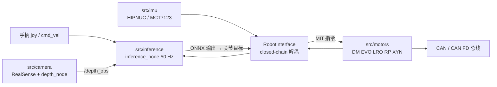

# roboparty_deploy（RPO / RP1 ROS 2 部署框架，原 atom01_deploy）

**roboparty_deploy** 是 RoboParty 把训练好的 ONNX 策略送上真机的 **ROS 2（Humble / Jazzy）C++17 部署框架**：主仓库只有文档、脚本与资源文件，运行时代码全部来自 5 个 Git 子模块。旧名 `atom01_deploy` 已更名为本仓（2026-10-27 `git ls-remote` 核对 HEAD 同为 `c4d8b87`），本页为其唯一详情节点。

## 英文缩写速查

| 缩写 | 英文全称 | 简要说明 |
|------|----------|----------|
| ROS 2 | Robot Operating System 2 | 部署层使用的通信与启动中间件，支持 Humble / Jazzy |
| ONNX | Open Neural Network Exchange | 策略模型格式，推理子仓内置 ONNX Runtime 1.21.0（x64 / aarch64） |
| CAN FD | Controller Area Network Flexible Data-rate | RP1 电机总线，`motor_interface_type` 为 `canfd`，见 [CAN FD](../concepts/can-fd.md) |
| MIT | MIT mini-cheetah 阻抗指令 | `robot.kp/kd` 与 `motor_mit_cmd` 使用的 位置-速度-刚度-阻尼-前馈 指令 |
| LRO / DM | 电机驱动类型 | 驱动子仓中的 `lro` / `dm` 驱动；RP1 用 LRO，RPO 用 DM |
| AP | Access Point | 控制器自建 Wi-Fi 热点（`tools/create_ap`）用于无线调试 |

## 为什么重要

- **训练到真机的最后一段**：[roboparty_train](./roboparty-train.md) 导出的策略在这里变成 50 Hz 推理 + 2 ms 级电机指令；RP1 的踝关节闭链解耦（`decouple_rp1`）也在此处实现。
- **同一框架覆盖两款本体**：`robots/rpo`（23 电机，DM / CAN）与 `robots/rp1_24dof`（24 电机，LRO / CAN FD）、`robots/rp1`（28 电机）共用接口，换机器人只换 `--robot` 目录。
- **README 与代码状态有出入，值得单独记录**：见下文「RP1 开放状态」。

## 核心结构

| 路径 | 子模块 / 角色 |
|------|------|
| `src/inference` | `Roboparty/roboparty_inference`：`inference_node`、`obs_manager`、`robot_interface`、`ros_interface`、pybind 模块，`utils/` 含 `decouple_rp1`、`decouple_rpo`、`latent_loader`、`motion_loader`；`robots/{rpo,rp1,rp1_24dof}` 存放 `robot.yaml`、`configs/`、`models/`、`motions/`、`latents/` |
| `src/motors` | `roboparty_motors`：`drivers/{dm,evo,lro,rp,xyn}`；`firmware/` 带一个 LRO 电机固件二进制（`*.lsepbin`）与 `scripts/motor_ota.py` |
| `src/imu` | `roboparty_imu`：`drivers/{hipnuc,mct7123}`；`firmware/` 含 HIPNUC / MD7123 固件与 DBC，`scripts/imu_ota.py` |
| `src/camera` | `roboparty_camera`：`depth_node`，`configs/parkour.yaml`（深度 480×270 → 64×36，50 Hz，历史 taps `[35,30,25,20,15,10,5,0]`）与随仓 `models/encoder.onnx`（128 维输出） |
| `tools/create_ap` | BSD-2-Clause 热点工具子模块 |
| `scripts/` | `set_zero.py` 与 `set_zero_{rpo,rp1,rp1_24dof}.yaml`；`imu_py_example.py`、`motors_py_example.py` |
| `assets/` | RK3588 实时内核 `.deb` ×3（`1.2.0`）、`99-auto-up-devs-{orangepi,sunrise}.rules`、`rt_fastdds_profile.xml` |

### RP1 配置要点（子仓 `roboparty_inference`，`7a11782`，2026-10-23）

| 项 | `rp1_24dof` | `rp1`（28 电机） |
|------|------|------|
| 电机分组 | `motor_num [7,7,5,5]`，全部 LRO / `canfd`，接口 `can1,can2,can0,can3` | `[7,7,7,7]`，同样 LRO |
| IMU | HIPNUC，经 CAN（`can_hipnuc`，1 Mbps，`imu_id 8`） | 同左 |
| 闭链电机 | `close_chain_motor_idx [4,5,11,12]`（左右踝各一对） | 同类字段 |
| 控制节拍 | `dt 0.002`、`decimation 10` → 50 Hz | `dt 0.004`、`decimation 5` → 50 Hz |
| 策略配置 | `default`、`beyondmimic`、`amp`、`interrupt`、`rough`、`ufo`；`models/` 含 6 个 ONNX（`policy_ufo.onnx` 约 33.8 MB，其余约 0.9–1.2 MB） | 仅 `configs/default.yaml`，**目录内没有 `models/`** |
| 观测 | 默认 3 帧历史；UFO 为稀疏 5 帧 + 256 维 latent（`latents/dance1_subject2.npz`），`action_rescale 8.0` | 10 帧 `frame_major` |

## 工程实践

1. **构建**：`colcon build --symlink-install`（官方文档仅确认 Humble 构建通过）；`start_robot.sh` 按 `ROS_DISTRO` 或 `/opt/ros/{humble,jazzy}` 自动选发行版。
2. **启动 RP1**：`bash tools/start_robot.sh rp1_24dof default`（亦可 `beyondmimic` / `amp` / `interrupt`）；它会在 `screen` 中建 `inference_session` 与 `joy_session`。`beyondmimic` 默认走 Flat 策略，LB 在行走与挥手（`policy_wave.onnx` + `motions/wave.npz`）间切换。
3. **归零**：`ros2 service call /set_zeros std_srvs/srv/Trigger`（需电机已初始化、推理已停）或 `python3 scripts/set_zero.py --config scripts/config/set_zero_rp1_24dof.yaml`，完成后须给电机重新上电。
4. **服务与手柄**：`/init_motors`、`/deinit_motors`、`/start_inference`、`/stop_inference`、`/clear_errors`、`/set_zeros`、`/reset_joints`、`/refresh_joints`、`/read_joints`、`/read_imu` 均为 `Trigger`；X 初始化 / 关闭电机，B 开始 / 暂停推理，A 回默认位姿。关机顺序：停推理 → 关电机 → 结束 screen 会话。
5. **Python SDK**：`imu_py`、`motors_py`、`robot_py`；`robot_py` 可读 `rpo/robot.yaml` 与 `rp1_24dof/robot.yaml`，但 `imu_py_example` / `motors_py_example` 仍按 RPO（HIPNUC 串口 / DM-CAN）写死，RP1 需自行改参。
6. **RPO 硬件基线**（`docs/rpo_deploy.md`）：Orange Pi 5 Plus（Ubuntu 22.04，内核 5.10，`rtprio 98`）或 RDK X5（内核 6.1.83）；udev 规则把 `can0` 绑左腿、`can1` 右腿 + 腰、`can2/can3` 左右手。RP1 无对应的接线 / 控制器文档。
7. **开源状态核查**：代码已开源（GPL-3.0-only，子模块多为 GPL-3.0，`create_ap` 为 BSD-2-Clause）；`assets/` 内核包与固件二进制不因仓库许可而自动可再分发。

### RP1 开放状态：README 与代码不一致

- `README.md` 文档表：「RP1 Deployment — Coming soon」。
- 但 `docs/operation.md` 已给出 `rp1_24dof` 的 4 条启动命令，`docs/configuration.md` 的机器人表登记 `rp1_24dof`（24 电机，LRO / CAN FD，HIPNUC CAN）。
- `configuration.md` 把 `rp1_24dof` 的策略列为 `default`、`beyondmimic`、`ufo`，而 `operation.md` 与子仓目录还有 `amp`、`interrupt`（`rough` 仅在目录中出现）——文档彼此滞后。
- 28 电机 `rp1` 只有一份 `default.yaml`、无模型，不能开箱运行（以子仓快照为准）。

## 局限与风险

- **安全**：官方文档要求 SDK / 推理前备好承重保护架与急停；首次归零与推理可能突然输出力矩。`/set_zeros` 误用会写入错误的硬件零点。
- **子模块多、版本漂移快**：主仓最近一次提交只是「update motors submodule for LRO and RP protocol fixes」；换子模块版本即改变电机协议行为，复现须记录子模块提交。
- **RP1 缺独立部署手册**：控制器选型、接线、实时内核对 RP1 是否沿用 RPO 方案，仓库未写明（推测沿用 Orange Pi 类 RK3588 控制器，见 [RP1_firmware](./rp1-firmware.md) 的 `robopi2` 板型）。
- **性能无数字**：仓库不提供推理延迟、控制抖动或掉帧统计。

## 关联页面

- [RP1 总览（roboparty-rp1）](./roboparty-rp1.md)
- [RoboParty（公司）](./roboparty.md)
- [roboparty_train（训练工作区）](./roboparty-train.md)
- [RP1_description（本体模型）](./rp1-description.md)
- [RP1_firmware（BSP 与 CAN 桥）](./rp1-firmware.md)
- [Roboto Origin（RPO）](./roboto-origin.md)
- [UFO 无监督 RL 框架](./roboparty-ufo.md)（`ufo` 策略的训练来源，对应关系为按名称的推测）
- [Sim2Real](../concepts/sim2real.md)、[ROS 2 基础](../concepts/ros2-basics.md)、[CAN FD](../concepts/can-fd.md)、[人形并联关节运动学](../concepts/humanoid-parallel-joint-kinematics.md)

## 参考来源

- [roboparty_deploy 仓库归档](../../sources/repos/roboparty_deploy.md)
- [atom01_deploy 旧名归档](../../sources/repos/atom01_deploy.md)
- [Roboparty/roboparty_deploy](https://github.com/Roboparty/roboparty_deploy)
- [Roboparty/roboparty_inference](https://github.com/Roboparty/roboparty_inference)

## 推荐继续阅读

- [ROS 2 Humble 安装指南](https://docs.ros.org/en/humble/Installation.html)
- [机器人策略部署开发板选型对比](../comparisons/robot-policy-deployment-dev-board-selection.md)
