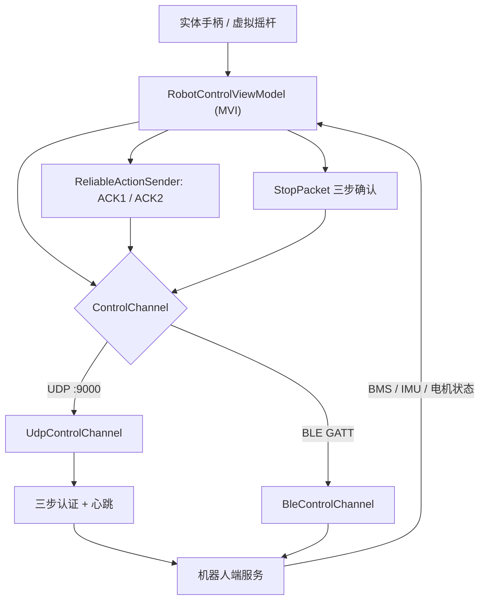

# Roboparty Joystick（安卓手柄 / 控制 App）

## 一句话定义

**Roboparty Joystick** 是 RoboParty 机器人的 Android 控制台应用：把实体手柄或屏幕双虚拟摇杆的输入以 50 Hz 控制包经 UDP 或 BLE 发给机器人，同时显示电池、IMU、电机状态，并提供技能动作库和带三步确认的急停按钮。

## 英文缩写速查

| 缩写 | 英文全称 | 简要说明 |
|------|----------|----------|
| BLE | Bluetooth Low Energy | 近距离控制通道，GATT 服务 UUID `0000fff0-…` |
| UDP | User Datagram Protocol | 低时延主通道，默认控制端口 9000 |
| HMAC | Hash-based Message Authentication Code | HMAC-SHA256 对 `deviceId:challengeCode` 签名 |
| MVI | Model-View-Intent | App 架构：`UiState` / `UiIntent` 单向数据流 |
| BMS | Battery Management System | App 数据面板显示电压、电流、SOC、温度 |
| OTA | Over-The-Air | App 自更新：UDP 查询版本、HTTP 下载、MD5 校验、系统安装器 |

## 为什么重要

- 对 RP1 这类开源整机，**人手操作入口**（行走、姿态、技能、急停）往往是闭源的；这里给出可读的完整客户端，可直接了解一个人形遥控 App 的链路设计（认证、心跳、失效保护、可靠动作）。
- 协议字段清晰（见下文报文），可作为自研机器人侧服务的对接参考，也是 [遥操作任务](../tasks/teleoperation.md) 里“低带宽手柄式操控”一类的开源实例（与动作捕捉/XR 全身遥操不同）。
- 它是 [RP1](./roboparty-rp1.md) 总览“硬件与工具”表中唯一的操作终端类子项目。

## 核心结构

### 分层（`app/src/main/java/com/gamepad/controller/`）

| 层 | 内容 |
|----|------|
| `data/model/packet` | `ControlPacket`、`AuthPacket`、`SkillActionPacket`、`StopPacket`、`OtaPacket` |
| `data/service` | `UdpControlChannel`（664 行）、`BleControlChannel`（615 行）、`BleConnectionManager`、`CryptoHelper`、`ReliableActionSender`、`GamepadInputManager`、`OtaManager` |
| `domain` | `ControlChannel` / `GamepadInputService` 接口，`UiState` / `UiIntent` |
| `presentation` | Compose 界面：`JoystickDisc`、`PostureSwitcher`、`SkillLibraryPanel`、BMS/IMU/电机卡片、设置面板 |

### 协议要点（README 与客户端源码）

- **控制包**：JSON，含 `token`、`timestamp`、`sequence`、双摇杆四轴（`left_stick_x/y`、`right_stick_x/y`）和 A/B/X/Y、LB/RB/LT/RT、方向键；`controlParams` 默认最大线速度 1.5、最大角速度 3.0、发送频率 50 Hz（20 ms/帧）。
- **认证**：`auth_request` → `challenge` → `challenge_response`（HMAC-SHA256）→ `auth_result` 带 `token`；到期自动重连；默认心跳 500 ms、超时 5000 ms、认证超时 5000 ms 重试 3 次、最多重连 5 次。
- **失效保护**：`failSafe.gamepad_timeout_ms = 500`、`stale_packet_ms = 300`。
- **技能动作**：`ReliableActionSender` 先等 ACK1（收到，500 ms）、再等 ACK2（执行完成，5000 ms 加预计时长），最多重试 3 次，退避系数 1.5；同一时刻只允许一个动作；预置握手、鞠躬、挥手、点头、舞蹈等，分 expression / action / talent 三类。
- **急停**：`stop:request` → 服务端 `accepted` → 客户端 `received`；UI 显示发送中 / 等待确认 / 已确认 / 失败，客户端等待确认的超时为 5 秒（`UdpControlChannel.kt`）。

## 工程实践

1. **构建**：Android Studio Hedgehog+、JDK 17、SDK 34；`./gradlew assembleDebug`（debug 包带 `.debug` 后缀）。`versionName` 1.0.1，minSdk 28 / targetSdk 34。
2. **配置**：改 `app/src/main/assets/connection_config.json` 的 `control.host`（默认示例 `10.43.21.32`）与 `ota` 地址；BLE 用 `fff0`/`fff1`(TX)/`fff2`(RX)，MTU 512。
3. **分发**：打 tag 的 CI（`build-apk.yml`）校验 tag 与 `versionName` 一致，用持久 keystore（`KEYSTORE_BASE64`）签名后发布 `app-release.apk` 与 SHA-256；可经 Obtainium 订阅更新。
4. **开源状态核查（2026-10-27）**：App 全部源码公开（GPL-3.0-or-later）；**机器人侧服务（UDP 9000 / OTA 9001）不在本仓**，需自行实现或另找 RoboParty 部署仓库（本次未确认哪一个仓库提供服务端）。
5. **权限**：网络、Wi-Fi、BLE 扫描/连接、定位（BLE 扫描兼容）、振动、`REQUEST_INSTALL_PACKAGES`（OTA 安装）。

## 局限与风险

- **硬编码占位密钥**：`CryptoHelper.kt` 中 `SECRET_KEY = "your-pre-shared-secret-key"`，带 TODO（应改为 BuildConfig 注入或 Android Keystore）。按现状编译的 App 与服务端若沿用占位值，认证等于形同虚设；设置面板的“授权密码”页（`AuthPasswordSettings.kt`）目前只是界面桩：确认按钮处写着 `// TODO: 保存新密码`，不会改写该常量，因此密钥现状只能靠改源码重新编译。
- **UDP 明文 JSON**：全部源码里 `CryptoHelper.computeSignature` 只在 UDP / BLE 两个认证流程中被调用，未检索到 AES / 加密调用，控制包本身应为明文（据代码检索推断）；局域网内可被嗅探。
- **软件急停不是硬件急停**：三步确认依赖网络可达，链路断开时不能保证立即停机；机器人端应有独立失效保护和物理急停（参见 [机器人安全状态机](../concepts/robot-safety-state-machine.md)）。
- **示例 IP 为内网**：默认地址 `10.43.21.32` 仅为示例，部署必须改。
- **单仓只含客户端**：协议兼容性无服务端测试佐证；关节 / 步态能否响应 1.5 m/s 之类上限由机器人决定，不能把 App 默认值当作机器人能力。
- **App 内技能列表是静态注册表**（`SkillActionRegistry`），新技能需改客户端代码。

## 关联页面

- [RP1 总览（RoboParty RP1）](./roboparty-rp1.md)
- [RoboParty（公司）](./roboparty.md)
- [RP1 Test](./rp1-test.md) — 台架侧另一套 PLC/CAN HMI，不要混淆
- [RP Hand](./rp-hand.md) — 末端设备，控制路径独立
- [遥操作任务](../tasks/teleoperation.md)
- [机器人安全状态机](../concepts/robot-safety-state-machine.md)

## 参考来源

- [roboparty_joystick 仓库归档](../../sources/repos/roboparty_joystick.md)
- [RP1 官方仓库体系归档](../../sources/repos/roboparty_rp1.md)

## 推荐继续阅读

- [roboparty_joystick GitHub](https://github.com/Roboparty/roboparty_joystick)
- [Jetpack Compose 文档](https://developer.android.com/compose)
- [Android BLE 概览](https://developer.android.com/develop/connectivity/bluetooth/ble/ble-overview)
