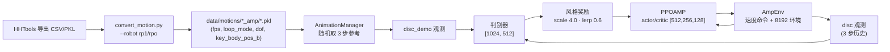

# robolab · AMP（RP1 / RPO 对抗运动先验行走）

**一句话定义：** `Roboparty/robolab` 里 `robolab/tasks/manager_based/amp` 这一组 Isaac Lab 任务，用对抗运动先验（AMP）让 RP1 和 RPO 人形在速度命令下行走，风格由 `data/motions/` 的人类动作片段通过判别器施加。

## 英文缩写速查

| 缩写 | 英文全称 | 简要说明 |
|------|----------|----------|
| AMP | Adversarial Motion Priors | 用判别器区分“策略动作”与“参考动作”，其输出作为风格奖励 |
| PPO | Proximal Policy Optimization | 本任务的策略优化算法，类名 `PPOAMP` 在其上加判别器 |
| LSGAN | Least-Squares GAN | 判别器损失，`loss_type="LSGAN"` |
| RPO | RoboParty Origin（Roboto Origin） | RoboParty 的另一台人形，23 个驱动关节；详见 [Roboto Origin](./roboto-origin.md) |
| DoF | Degrees of Freedom | RP1 的 `RP1_24DOF_CFG` 为 24 自由度 |
| PLAY | Play 配置 | 单环境回放用配置，如 `RP1-AMP-Play` |

## 为什么重要

- 它是 RP1 总览里 Demo 表的第一项，也是 RP1 上最早可用的官方学习式行走任务之一：`RP1-AMP` 在仓库 HEAD（2026-10-26）已注册，而固定提交 `6b1c3d9` 中只有 `RPO-AMP`（[归档](../../sources/repos/roboparty_robolab.md)）。
- 与纯奖励塑形相比，AMP 把“走得像人”交给动作库，任务奖励只需覆盖速度跟踪、能耗和接触约束；通用方法见 [AMP 奖励](../methods/amp-reward.md)，其他开源实现见 [AMP-RSL-RL](./amp-rsl-rl.md)、[AMP-MJLab](./amp-mjlab.md)。

## 流程总览



## 核心原理

### 1. 观测分组（`amp_env_cfg.py`）

| 组 | 内容 | 备注 |
|----|------|------|
| `policy`（actor） | 基座角速度、重力投影、速度命令、关节位置/速度（相对）、上一动作；历史长度 3；带均匀噪声 | RP1 将角速度噪声改为 ±0.2、关节位置 ±0.01、关节速度 ±0.5 |
| `critic` | 基座线速度（特权）、角速度、重力投影、命令、绝对关节位置/速度、上一动作；无噪声 | 历史长度 3 |
| `disc` | 基座角速度、关节位置、关节速度、`key_body_pos_b` | `AMP_NUM_STEPS = 3` 步历史 |
| `disc_demo` | 参考的 `ref_root_ang_vel_b`、`ref_joint_pos`、`ref_joint_vel`、`ref_key_body_pos_b` | 与 `disc` 同字段，来自动画项 `animation` |

动作是相对默认关节姿态的关节位置目标（`JointPositionActionCfg`，`scale=0.25`），`decimation=4`、`sim.dt=0.005`（即 50 Hz 控制），回合 20 s。

### 2. 关键体与动作库

- RP1 关键体：左右 `ankle_roll_link` 与 `wrist_link`（4 个）；RPO 关键体：左右踝、膝、`elbow_yaw_link`（6 个）。
- 动作文件是 `.pkl`，加载器要求含 `fps`、`loop_mode` 等字段（`managers/motion_data_manager.py`），并按 `motion_data_weights` 加权采样。
- RP1 动作库 8 个片段：`neutral_walk_ff_180_R_002__A534`（及镜像 `_M`，权重各 3）、`move_back`（3）、`move_l`/`move_r`/`turn_l`/`turn_r`（各 2）、`stand_still`（1）。RPO 动作库有 30 个 pkl（含 A1/B*/C* 行走、跑步与转向片段）。

### 3. RP1 与 RPO 的奖励差异（同一基类，不同权重）

| 项 | RP1 | RPO |
|----|-----|-----|
| 速度跟踪（线/角） | 1.5 / 1.25（偏航系 / 世界系 exp） | 1.25 / 1.25 |
| 存活 | 0.15 | 0.15 |
| 姿态 `flat_orientation_l2` | −1.0 | −1.2 |
| 关节限位 | −10 | −1 |
| 动作变化率 | −0.2，另有 `action_jerk_l2` −0.02 | −0.01 |
| 抬脚 / 脚高 | `feet_air_time` 0.25、`feet_height` 0.2 | 不使用 |
| 腰部偏离 | −1.0 | 无（用 `arm_pitch_mean_offset` −0.1） |
| 非期望接触 | 自碰撞传感器 −0.5 | 非踝接触 −10 |
| 速度命令范围 | x∈[−0.6, 1.0]，y∈±0.6，ωz∈±1.57 | x∈[−0.5, 2.5]，y∈±0.5，ωz∈±1.5 |

### 4. 算法配置（`agents/`）

| 项 | RP1 | RPO |
|----|-----|-----|
| 类 | `RP1AmpAgentCfg` | `RslRlOnPolicyRunnerAmpCfg` |
| 算法 | `rsl_rl.algorithms.ppo_amp:PPOAMP` | 同左 |
| actor/critic | MLP [512, 256, 128]，ELU，观测归一化 | 同左 |
| 判别器 | [1024, 512]，`style_reward_scale=4.0`，`task_style_lerp=0.6` | [1024, 512]，`style_reward_scale=1.5`，`task_style_lerp=0.6` |
| 对称性 | 数据增强 + 镜像损失（系数 0.2） | 同左 |
| 迭代 | `max_iterations=5000`，`save_interval=500` | `max_iterations=5000` |
| 实验名 | `rp1_24dof_amp` | `rpo_amp` |

判别器学习率 1e-4、梯度惩罚 10、缓冲区 100（RP1 配置，`RslRlAmpCfg`）。

## 工程实践

**开源状态核查（2026-10-27）：** 已开源。任务、动作库和训练入口都在仓库内；但仓库无 README，机器人 URDF/MJCF 在未初始化的子模块里（`rp1_description`、`rpo_description`），需自行拉取，细节见[归档](../../sources/repos/roboparty_robolab.md)。

```bash
# 1) 转换 HHTools 导出的动作（仓库内脚本，参数见 convert_motion.py）
python scripts/tools/hhtools/convert_motion.py --robot rp1 \
  -f <hhtools_export.pkl> -o data/motions/rp1_amp/<name>.pkl --loop clamp

# 2) 训练 / 回放：入口脚本为 scripts/rsl_rl/{train,play}.py，任务 ID 来自 gym.register
python scripts/rsl_rl/train.py --task RP1-AMP
python scripts/rsl_rl/play.py  --task RP1-AMP-Play
```

- 第 2 步里 `--task` 之外的参数（无头、环境数、检查点等）由 Isaac Lab 的 `isaaclab_rl.entrypoints` 解析，**本仓库内没有说明文档，具体选项以所装 Isaac Lab 版本为准（未在本次核查中运行）**。
- 新增动作后，在对应 `rp1_amp_env_cfg.py` 的 `motion_data_weights` 里登记片段名；片段名必须与 `.pkl` 文件名一致。
- 回放时 `play.py` 会把策略导出到所加载检查点所在目录的 `exported/`（`policy.pt`、`policy.onnx`）。

## 局限与风险

- **固定提交与 HEAD 不同**：README 链接的 `6b1c3d9` 没有 `RP1-AMP`；本页参数以 HEAD `fcf925c` 为准，之后仓库仍在迁移（Isaac Lab 3、RP1 执行器包络参数刚在 2026-10-26 更新）。
- **没有仓库内的效果评测**：未见成功率、速度跟踪误差或真机视频的数据文件，本页不对步态质量或 Sim2Real 表现下结论。
- **RP1 真机部署路径不在本仓库**：部署参见 [RP1 总览](./roboparty-rp1.md)，其中指出部署仓库 README 与官方文档之间存在差异。
- **依赖外部 AMP 版 RSL-RL**：`PPOAMP` 在仓库外，版本兼容性未核实（推测需与 Isaac Lab 3 一侧的 `isaaclab_rl` 配套）。
- **动作库偏小**：RP1 仅 8 个片段，主要是行走、转向、后退和站立（推测难以覆盖跑跳等动态技能）。

## 关联页面

- [RoboParty RP1（总览）](./roboparty-rp1.md)
- [RoboParty（公司）](./roboparty.md)
- [robolab · BeyondMimic](./roboparty-robolab-beyondmimic.md)：同仓的逐帧动作跟踪任务
- [robolab · Parkour](./roboparty-robolab-parkour.md)：同仓的深度感知地形任务，复用 AMP 判别器
- [AMP 奖励](../methods/amp-reward.md)
- [AMP-RSL-RL](./amp-rsl-rl.md)
- [Isaac Lab](./isaac-lab.md)
- [RSL-RL](./rsl-rl.md)
- [human-humanoid-tools](./human-humanoid-tools.md)：动作重定向与导出工具
- [NVLabs RoboLab（评测基准，同名不同项目）](./robolab.md)

## 参考来源

- [robolab 仓库归档（Roboparty）](../../sources/repos/roboparty_robolab.md)
- [RP1 总览仓库归档](../../sources/repos/roboparty_rp1.md)

## 推荐继续阅读

- [Roboparty/robolab 的 AMP 目录（README 固定提交）](https://github.com/Roboparty/robolab/tree/6b1c3d9988497c8961dcba77892de32edc1770e1/robolab/tasks/manager_based/amp)
- [Roboparty/robolab 当前主分支](https://github.com/Roboparty/robolab)
- [AMP: Adversarial Motion Priors for Stylized Physics-Based Character Control](https://arxiv.org/abs/2104.02180)
