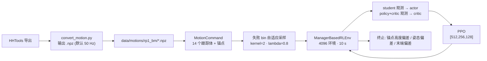

# robolab · BeyondMimic（RP1 / RPO 参考动作跟踪）

**一句话定义：** `Roboparty/robolab` 中 `robolab/tasks/manager_based/beyondmimic` 这组 Isaac Lab 任务，按 [BeyondMimic](../methods/beyondmimic.md) 的思路训练 RP1/RPO 人形逐帧跟踪一段 `.npz` 参考动作（舞蹈、挥手、起身等），不依赖判别器。

## 英文缩写速查

| 缩写 | 英文全称 | 简要说明 |
|------|----------|----------|
| BM | BeyondMimic | 目录/数据名里的缩写，如 `rp1_bm`、`rpo_bm` |
| PPO | Proximal Policy Optimization | 训练算法，标准 `RslRlPpoAlgorithmCfg`（无 AMP） |
| MDP | Markov Decision Process | Isaac Lab manager 式任务描述（观测/奖励/终止/事件） |
| NPZ | NumPy zipped archive | 参考动作格式，由 `convert_motion.py` 生成 |
| HHTools | Human-Humanoid Tools | 动作重定向与导出工具，见 [human-humanoid-tools](./human-humanoid-tools.md) |
| Anchor | 锚点体 | 全局位姿对齐的参考体：RP1 为 `waist_yaw_link`，RPO 为 `torso_link`，起身任务为 `base_link` |

## 为什么重要

- 与同仓的 [AMP](./roboparty-robolab-amp.md) 不同，这一组任务追求**对给定动作的复现精度**，是 RP1 上做舞蹈/表演类动作的官方训练入口；RP1 总览 README 把它描述为“跟踪参考动作复现全身表现力动作”。
- 它同时给出一套 RoboParty 自己的实现细节（观测不对称设计、失败 bin 采样、RP1 的执行器约束奖励），可与 [MimicLite](./mimiclite.md)（监督式跟踪基础设施）对照读。

## 流程总览



## 核心原理

### 1. 参考动作与采样（`mdp/commands.py`）

- `MotionLoader` 读取 `.npz`，按配置里的 `body_names` 取出关键体位姿与速度；若文件内含 `quaternion_order` 元数据则按其转换，否则回退到配置值（RP1 配置为 `xyzw`）。
- `MotionCommand` 把动作按步长切成 bin，**记录每个 bin 的失败次数**，重采样时用“失败计数 + 均匀项”卷积平滑后做多项式采样，使训练集中在难段；默认 `adaptive_lambda=0.8`、`adaptive_uniform_ratio=0.1`、`adaptive_alpha=0.001`，RP1 把卷积核大小设为 2。
- 重置时给基座加位姿/速度扰动（位置 ±0.05 m、偏航 ±0.2 rad 等）并对关节加 ±0.1 rad 偏置；`reset_on_motion_end=True` 时动作播完即重置。

### 2. RP1-BeyondMimic 的观测不对称

| 组 | 给谁 | 内容 |
|----|------|------|
| `student` | **actor** | 命令、角速度、重力投影、关节位置/速度（相对）、上一动作 |
| `policy` | critic | 在 student 基础上加 `motion_preview`（未来 1/2/5/10/20 帧的关节位置误差）、锚点位置/朝向误差、基座线速度 |
| `critic` | critic | 命令、锚点误差、`robot_body_pos_b` / `robot_body_ori_b`、线/角速度、关节、上一动作 |

`obs_groups = {"actor": ["student"], "critic": ["policy", "critic"]}`。actor 不用基座线速度和锚点位置，更接近真机可得信息；这是对 `rp1_beyondmimic_agent_cfg.py` 的直接读取，**其是否带来更好的真机表现，仓库内没有对照数据**。

### 3. 奖励与终止

- 跟踪项（`beyondmimic_env_cfg.py`，指数核）：全局锚点位置 0.5（std 0.3）、锚点朝向 0.5（std 0.4）、相对体位置 1.0（0.3）、体朝向 1.0（0.4）、体线速度 1.0（1.0）、体角速度 1.0（3.14）。
- 正则项：`joint_acc_l2` −2.5e-7、`joint_torques_l2` −1e-5、`action_rate_l2`（基类 −0.1，RP1 改为 −0.2）、`joint_pos_limits` −10。
- RP1 追加：`action_jerk_l2` −0.02、角动量变化率、偏航角动量、关节速度/能耗、`joint_rated_velocity` −0.05、`joint_rated_effort` −0.04、`feet_slide` −0.3、`contact_force`（阈值 600）、自碰撞 `undesired_contacts` −0.5。
- 终止：超时、锚点高度偏差 >0.25 m（`bad_anchor_pos_z_only`）、锚点朝向偏差阈值 0.8（`bad_anchor_ori`）；RP1 另加踝/肘四个末端体高度偏差 >0.25 m。

### 4. 任务矩阵

| 任务 ID | 机器人 | 动作文件 | 锚点 | 回合 | 迭代 |
|---------|--------|---------|------|------|------|
| `RP1-BeyondMimic` | RP1 24DOF | `rp1_bm/dance1_subject2_smooth6hz.npz`（另有 `wave_R_001__A428.npz`） | `waist_yaw_link` | 10 s | 8000 |
| `RPO-BeyondMimic` | RPO | `rpo_bm/yundong1.npz`（另有 `yundong0.npz`） | `torso_link` | 20 s | 15000 |
| `RPO-Getup-Mimic` | RPO | `rpo_bm/getup_supin2prone.npz`（另有 csv 原稿） | `base_link` | 5 s | 30000 |

`RPO-Getup-Mimic` 把 `motion_body_pos` 权重提到 2.0，并新增 `stand_still_after_motion`（−0.2，仅动作结束后生效、按重力投影缩放），推送间隔 0–5 s；文件名读作“仰卧到俯卧”的起身序列（**据文件名推测**，未核对动作内容）。

## 工程实践

**开源状态核查（2026-10-27）：** 已开源，示例动作（`.npz`）随仓库提供；机器人资产在未初始化的子模块里，需自行拉取；仓库无 README（[归档](../../sources/repos/roboparty_robolab.md)）。

```bash
# 把 HHTools 导出转成 BeyondMimic .npz（--output_fps 默认 50 Hz）
python scripts/tools/hhtools/convert_motion.py --robot rp1 \
  -f <hhtools_export.csv> -o data/motions/rp1_bm/<name>.npz

# 训练 / 回放（--task 之外的参数由 Isaac Lab 入口解析，未在本次核查中运行）
python scripts/rsl_rl/train.py --task RP1-BeyondMimic
python scripts/rsl_rl/play.py  --task RP1-BeyondMimic
```

- 换动作时同时检查：`commands.motion.motion_file`、`body_names`（须是转换时使用的机器人体）、`anchor_body_name` 与 `quaternion_order`。
- CSV 转换要求 HHTools 导出时带注释头与列名；PKL 要求 `hhtools_export` 为 `retarget_v1` 或 `r2r_v1`（`convert_motion.py` 内校验）。
- 训练指标里有 `sampling_entropy`、`sampling_top1_prob`、`sampling_top1_bin`，可用来观察自适应采样是否塌缩到少数 bin。

## 局限与风险

- **固定提交与 HEAD 不同**：`6b1c3d9` 里只有 RPO 的两个任务；`RP1-BeyondMimic` 是 2026-10-24 至 26 的新增，之后配置仍在变（含 RP1 执行器包络参数）。
- **仅单段动作训练**：每个任务一次绑定一个 `motion_file`；仓库未提供多动作混合训练或通用跟踪策略（对比 [MimicLite](./mimiclite.md) 的统一数据格式与跨 codebase 评测）。
- **没有评测结果**：仓库无跟踪误差、成功率或真机记录，本页不对 RP1 真机复现效果下结论。
- **Sim2Real 需自查**：RP1 配置里加入了额定速度/力矩惩罚与延迟 PD 执行器，说明考虑了执行器限制，但真机部署链路在 [RP1 总览](./roboparty-rp1.md) 提到的部署仓库，而非本仓库。
- **舞蹈类动作质量取决于重定向**：转换脚本只做重采样与前向运动学，不修脚滑或穿模，重定向质量见 [动作重定向](../concepts/motion-retargeting.md)。

## 关联页面

- [RoboParty RP1（总览）](./roboparty-rp1.md)
- [RoboParty（公司）](./roboparty.md)
- [robolab · AMP](./roboparty-robolab-amp.md)
- [robolab · Parkour](./roboparty-robolab-parkour.md)
- [BeyondMimic（方法）](../methods/beyondmimic.md)
- [MimicLite](./mimiclite.md)
- [Mini Pi+ BeyondMimic](./cn-os-mini-pi-plus-beyondmimic.md)
- [全身跟踪流水线](../concepts/whole-body-tracking-pipeline.md)
- [Isaac Lab](./isaac-lab.md)
- [NVLabs RoboLab（评测基准，同名不同项目）](./robolab.md)

## 参考来源

- [robolab 仓库归档（Roboparty）](../../sources/repos/roboparty_robolab.md)
- [RP1 总览仓库归档](../../sources/repos/roboparty_rp1.md)

## 推荐继续阅读

- [Roboparty/robolab 的 BeyondMimic 目录（README 固定提交）](https://github.com/Roboparty/robolab/tree/6b1c3d9988497c8961dcba77892de32edc1770e1/robolab/tasks/manager_based/beyondmimic)
- [BeyondMimic: From Motion Tracking to Versatile Humanoid Control（arXiv:2508.08241）](https://arxiv.org/abs/2508.08241)
