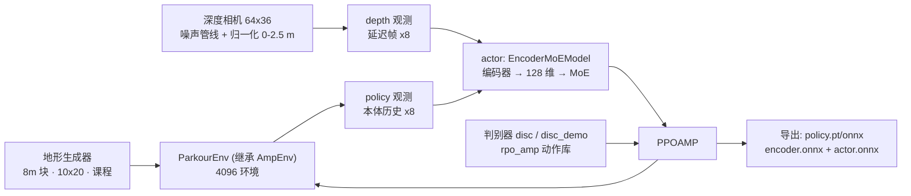

# robolab · Parkour（深度感知地形穿越，当前仅 RPO）

**一句话定义：** `Roboparty/robolab` 里 `robolab/tasks/manager_based/parkour` 这组 Isaac Lab 任务，用深度图像加本体历史训练人形在台阶、缺口与斜坡等地形上穿越，同时借 AMP 判别器保持步态风格；RP1 总览 README 将其标为 *RP1 support coming soon*，HEAD 里确实只注册了 `RPO-Parkour`。

## 英文缩写速查

| 缩写 | 英文全称 | 简要说明 |
|------|----------|----------|
| MoE | Mixture of Experts | actor/critic 配置为 `EncoderMoEModel`，`num_moe_experts=5` |
| AMP | Adversarial Motion Priors | Parkour 继承 AMP 环境，用判别器提供风格奖励，见 [robolab · AMP](./roboparty-robolab-amp.md) |
| ONNX | Open Neural Network Exchange | 导出格式；Parkour 另导出编码器与 actor 两张图 |
| FOV | Field of View | 深度相机配置水平约 89.5°、垂直约 58.3° |
| RPO | RoboParty Origin（Roboto Origin） | 当前唯一支持的本体，见 [Roboto Origin](./roboto-origin.md) |

## 为什么重要

- 它是 RP1 总览里唯一的感知式（视觉）Demo；其他两项（AMP、BeyondMimic）都是盲策略。
- 工程上有几处与常见 legged-gym 式 parkour 不同的取舍：把腿部**体积点**与地形的穿透作为带课程的惩罚、用“多组奖励管理器”按环境调权重、把相机编码器与 actor 拆成独立 ONNX 以便部署——可与 [MJLab 版 Parkour](./parkour-mjlab.md) 及 [人形感知跑酷论文](./paper-hrl-stack-22-perceptive_humanoid_parkour.md) 对照。

## 流程总览



## 核心原理

### 1. 观测（`parkour_env_cfg.py`）

| 组 | 内容 |
|----|------|
| `policy` | 基座角速度、重力投影、速度/位姿命令、关节位置/速度、上一动作，**每项 8 步历史**并展平；带均匀噪声 |
| `depth` | `distance_to_image_plane_noised_history` 取 8 帧（间隔 5 帧、延迟帧范围 0–1），单独成组以便 RSL-RL 当作 4D 张量编码 |
| `critic` | 在 policy 项上加基座线速度（特权）与 `height_scan`（2.0×1.0 m 网格、分辨率 0.1），无噪声 |
| `disc` / `disc_demo` | AMP 判别器的当前/参考特征（历史 10，配置里 RPO 改为 3 步） |

actor 的输入组为 `["policy", "depth"]`，critic 为 `["critic", "depth"]`。

### 2. 深度相机与噪声管线

相机挂在 `torso_link`，64×36 针孔模型，50 Hz 更新，最小距离 0.1 m。噪声管线依次包含：尺度随机化（0.97–1.03）、立体融合空洞、随机卷积、Perlin 噪声、坏点/饱和点、裁剪缩放（`crop_region=(18, 0, 16, 16)`）、高斯模糊，最后把 0–2.5 m 归一化到 [0, 1]。相机位姿还会在事件 `randomize_camera_offset` 中随机化。

### 3. 网络与算法（`agents/rpo_parkour_agent_cfg.py`）

- `RslRlEncoderMoEModelCfg`：编码器（单层卷积 + 全连接，输出 128 维）→ 5 专家 MoE，MLP 隐层 [256, 128, 64]。
- `PPOAMP`：熵系数 0.006、镜像损失系数 0.15；判别器 [1024, 512]、ReLU，`style_reward_scale=2.0`、`task_style_lerp=0.3`、梯度惩罚 5。
- `max_iterations=30000`，`num_steps_per_env=24`，实验名 `rpo_parkour`。AMP 动作库借用 `rpo_amp` 的 12 个片段（行走转向与站立）。

### 4. 地形与课程

- `ROUGH_TERRAINS_CFG`：8 m × 8 m 块，10 行 × 20 列，`curriculum=True`；子地形比例为 4 种 Perlin 粗糙地（各 5%，含 `perlin_rough_stand` 站立区）、方形缺口 `square_gaps`（10%）、正金字塔台阶 `pyramid_stairs_32/30/28` 与倒金字塔 `pyramid_stairs_inv_32/30/28`（各 10%）、倒斜坡 `hf_pyramid_slope_inv`（10%）。数字后缀的含义仓库内未说明（推测为难度档位）；踏石与盒障子地形在配置中被注释掉。
- 速度命令按地形类型取不同范围（如缺口/台阶 0.4–0.8 m/s，粗糙地 0.4–1.0 m/s），站立地形速度为 0。
- 课程：`terrain_levels`（`tracking_exp_vel`）按速度跟踪得分升降地形等级（线速度得分 >0.9 升、<0.7 降）；`volume_points_penetration_*` 权重从 −1 逐步加到 −100，`feet_stumble` 与 `undesired_contacts` 从 −1 加到 −10，步长 0.03，由 `ParkourEnv` 的逐环境权重接口实现。

### 5. 奖励（单组 `rewards`）

主要项：线/角速度跟踪各 5.0、存活 3.0、`heading_error` −1、`dont_wait` −0.5、`lin_vel_z_l2` −5、`stand_still` −1、脚/膝体积点穿透 −1（课程到 −100）、`feet_slide` −1、`freeze_upper_torso` −0.8、`flat_orientation_l2` −3、`pelvis_orientation` −3、`feet_flat_ori` −0.4、`feet_at_plane` −0.1、关节限位/速度限位 −1、力矩限位 −0.01。其中 `rpo_thigh_yaw_joint_sign_penalty`（−10）以 RPO 关节命名，是移植到 RP1 时需要重写的项（推测）。

终止：超时、出地形边界（按超时处理）、`torso_link` 非法接触、倾角超过 1.0 rad、根高度低于环境原点下限 0.5 m。

## 工程实践

**开源状态核查（2026-10-27）：** 已开源（训练配置、地形、传感器、导出器均在仓库内）；机器人资产在未初始化的 `rpo_description` 子模块；**RP1 版本未发布**：HEAD 与 README 固定提交 `6b1c3d9` 都只有 `RPO-Parkour` / `RPO-Parkour-Play`，且固定提交到 HEAD 之间 Parkour 目录有观测迁移与配置改动（[归档](../../sources/repos/roboparty_robolab.md)）。

```bash
python scripts/rsl_rl/train.py --task RPO-Parkour
python scripts/rsl_rl/play.py  --task RPO-Parkour-Play
```

- `--task` 之外的参数由 Isaac Lab 入口解析，本次未运行。
- 回放时 `play.py` 读取 `agent_cfg.export_policy_func`，调用 `agents/exporter.py` 的 `export_policy`，在所加载检查点所在目录的 `exported/` 子目录下生成 `policy.pt`、`policy.onnx`、`<i>-depth_encoder.onnx` 与 `actor.onnx`。
- 配置里 `ShoeConfigMixin` 为 RPO 穿鞋版本调整体积点高度（`z_min=-0.063`、`z_max=-0.023`）和 `feet_at_plane` 高度偏置 0.058，换足部几何时要同步改。
- 显存紧张时可先看 PLAY 配置的做法：只保留 1×1 地形块、10 个环境。

## 局限与风险

- **没有 RP1 任务**：不能把 `RPO-Parkour` 的策略或奖励直接当作 RP1 的属性；README 的 coming soon 目前与代码一致。
- **仓库内没有效果数据**：无通过率、最大台阶高度或真机视频的数据文件，本页不判断越障能力。
- **仿真深度到真机的差距**：噪声管线是对双目/ToF 深度缺陷的建模，实际相机型号和安装与仿真是否一致，仓库内没有说明（推测需要在部署侧复核）。
- **配置在变**：固定提交之后 Parkour 的观测、终止和 RPO 对称性文件均有修改，引用时应注明所依据的提交。
- **依赖外部 RSL-RL 变体**：`PPOAMP`、`EncoderMoEModel` 位于仓库之外，版本兼容性未核实。

## 关联页面

- [RoboParty RP1（总览）](./roboparty-rp1.md)
- [RoboParty（公司）](./roboparty.md)
- [robolab · AMP](./roboparty-robolab-amp.md)
- [robolab · BeyondMimic](./roboparty-robolab-beyondmimic.md)
- [Roboto Origin（RPO）](./roboto-origin.md)
- [Parkour-MJLab](./parkour-mjlab.md)
- [人形感知跑酷（论文实体）](./paper-hrl-stack-22-perceptive_humanoid_parkour.md)
- [Deep Whole-Body Parkour](./paper-deep-whole-body-parkour.md)
- [地形适应](../concepts/terrain-adaptation.md)
- [课程学习](../concepts/curriculum-learning.md)
- [混合专家](../concepts/mixture-of-experts.md)
- [NVLabs RoboLab（评测基准，同名不同项目）](./robolab.md)

## 参考来源

- [robolab 仓库归档（Roboparty）](../../sources/repos/roboparty_robolab.md)
- [RP1 总览仓库归档](../../sources/repos/roboparty_rp1.md)

## 推荐继续阅读

- [Roboparty/robolab 的 Parkour 目录（README 固定提交）](https://github.com/Roboparty/robolab/tree/6b1c3d9988497c8961dcba77892de32edc1770e1/robolab/tasks/manager_based/parkour)
- [Roboparty/robolab 当前主分支](https://github.com/Roboparty/robolab)
