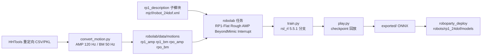

# roboparty_train（RoboParty 训练工作区，原 atom01_train）

**roboparty_train** 是 RoboParty 面向 RPO 与 RP1 两款人形机器人的 **Isaac Lab 3.0 + RSL-RL 5.5.1 训练工作区**：根仓库只负责依赖锁定与入口说明，真正的任务、资产和算法在两个子模块 `robolab` 与 `rsl_rl` 中。旧名 `atom01_train` 已重定向到本仓（2026-10-27 `git ls-remote` 核对两者 HEAD 同为 `e24472e`），本页即该仓库的唯一详情节点。

## 英文缩写速查

| 缩写 | 英文全称 | 简要说明 |
|------|----------|----------|
| AMP | Adversarial Motion Priors | 用判别器从参考动作学习风格先验；任务名 `*-AMP` |
| BM | BeyondMimic | 参考动作跟踪训练流程；任务名 `*-BeyondMimic`，数据目录 `*_bm` |
| MJWarp | MuJoCo Warp | 默认物理后端（Newton 1.6.1），`physics=newton_mjwarp` |
| PhysX | NVIDIA PhysX | 备选后端，需 Isaac Sim 6.2 与独立 `.venv-physx` 环境 |
| MoE | Mixture of Experts | `rsl_rl` 分支中的 `modules/moe.py` 与 Encoder MoE 模型 |
| HHTools | human-humanoid-tools | 动作重定向与导出工具，见 [human-humanoid-tools](./human-humanoid-tools.md) |

## 为什么重要

- **RP1 训练入口公开**：[RP1 总览仓库](./roboparty-rp1.md)的「Software & Systems」把它列为训练仓，但总览文字只写 RPO locomotion；核对当前仓库后，`robolab` 已注册 `RP1-Flat`、`RP1-Rough`、`RP1-AMP`、`RP1-AMP-Play`、`RP1-BeyondMimic`、`RP1-Interrupt` 六个任务。
- **与部署仓名称对齐**：[roboparty_deploy](./roboparty-deploy.md) 的 `rp1_24dof` 策略配置名为 `default`、`amp`、`beyondmimic`、`interrupt`、`rough`，与上述任务一一同名（对应关系为按名称的**推测**，仓库未写明哪个 checkpoint 导出了哪个 ONNX）。
- **后端可换**：同一任务可在 MJWarp（默认）与 PhysX 上运行，便于做 Sim2Sim 交叉检查（参见 [mjlab](./mjlab.md) 的同类思路）。

## 核心结构

| 组件 | 事实（快照 `e24472e`，2026-10-26） |
|------|------|
| 根仓库 | 仅 `pyproject.toml`、`uv.lock`、`.gitmodules`、两份 README；`requires-python >=3.12,<3.13` |
| `robolab` 子模块（固定 `fcf925c`） | Isaac Lab 扩展：`robolab/assets/robots/roboparty.py` 定义 `RPO_CFG` 与 `RP1_24DOF_CFG`；`rp1_actuators.py` 的 `RP1Actuator` 在延迟 PD 上叠加电机转矩-速度包络（`dc_motor_envelope`、`rated_effort`、`rated_velocity`）；任务目录 `tasks/manager_based/{amp,beyondmimic,parkour}` |
| `rsl_rl` 子模块（固定 `ac30c1e`） | RSL-RL 分支，含 `algorithms/ppo_amp.py`、`modules/amp.py`、`modules/moe.py`、`models/encoder_model.py`；最近提交「Port Encoder MoE models to RSL-RL 5.5.1」 |
| 依赖锁 | `torch==2.11.0`（cu128）、`newton[sim]==1.6.1`、`mujoco-warp~=3.12.0`，Isaac Lab 以 `../IsaacLab-3.0.0` 源码路径依赖；平台限定 Linux x86_64 |

### 任务矩阵（`robolab` 中 `gym` 注册 id）

| 任务族 | RPO | RP1 |
|------|------|------|
| Flat / Rough | `RPO-Flat`、`RPO-Rough` | `RP1-Flat`、`RP1-Rough` |
| AMP | `RPO-AMP`、`RPO-AMP-Play` | `RP1-AMP`、`RP1-AMP-Play` |
| BeyondMimic | `RPO-BeyondMimic`、`RPO-Getup-Mimic` | `RP1-BeyondMimic` |
| Interrupt | `RPO-Interrupt` | `RP1-Interrupt` |
| Parkour | `RPO-Parkour`、`RPO-Parkour-Play` | 未注册（与总览「RP1 support coming soon」一致） |

## 工程实践

1. **环境**：Ubuntu 22.04 x64；Isaac Lab v3.0.0 源码与本仓并列放置（`../IsaacLab-3.0.0`）；`uv sync --locked` 建默认 MJWarp 环境，PhysX 另用 `UV_PROJECT_ENVIRONMENT=.venv-physx uv sync --locked --no-default-groups --extra physx --no-install-package usd-exchange`。`isaaclab list_envs --keyword RP` 应同时列出 `RPO-` 与 `RP1-` 任务。
2. **训练 / 回放**：`python robolab/scripts/rsl_rl/train.py --task=RP1-Flat --viz=none --logger=tensorboard --num_envs=4096`；`play.py --checkpoint=latest` 回放并导出到该 run 的 `exported/`。Parkour 额外导出 `0-depth_encoder.onnx` 与 `actor.onnx`，需连同 `.onnx.data` 一起部署。
3. **动作数据**：仓库自带 `rp1_amp`（8 个 `.pkl`，含 `move_back`、`turn_l`、`stand_still` 等）、`rp1_bm`（`dance1_subject2_smooth6hz.npz`、`wave_R_001__A428.npz`）；自备数据用 HHTools 按对应 URDF 重定向，再 `convert_motion.py --robot rp1 --output_fps 120`（AMP）或 `50`（BeyondMimic）转换。
4. **开源状态核查**：代码已开源，根仓库未跟踪 `LICENSE`，README 徽章为 BSD-3，`robolab` 与 `rsl_rl` 子模块各带 BSD-3 条款的 LICENSE；`robolab/data/robots/roboparty/rp1` 子模块指向 [RP1_description](./rp1-description.md)。

## 局限与风险

- **只有 24 DoF**：`robolab` 里只见 `RP1_24DOF_CFG`，未见 28 DoF `rp1.urdf` 的训练配置；总览页的 24/28/30/42 DoF 配置不能都当作可训练目标。
- **README 内部不一致**：README 的 AMP / BeyondMimic / Parkour 回放示例均用 `RPO-*` 任务；RP1 对应的 `RP1-AMP-Play` 等需从任务列表自行确认。
- **PhysX 在部分场景明显变慢**（README 故障排查原话）；Isaac Lab、Isaac Sim 与 PyTorch 版本被锁死，升级需重新验证。
- **仓库不含训练结果**：没有奖励曲线、成功率或 Sim2Real 实测指标，ONNX 与真机表现的关系需看部署仓和官方视频。
- **子模块易为空**：浅克隆后 `robolab`、`rsl_rl` 目录为空，需 `git submodule update --init --recursive`。

## 关联页面

- [RP1 总览（roboparty-rp1）](./roboparty-rp1.md)
- [RoboParty（公司）](./roboparty.md)
- [roboparty_deploy（部署框架）](./roboparty-deploy.md)
- [RP1_description（本体模型）](./rp1-description.md)
- [human-humanoid-tools](./human-humanoid-tools.md)
- [robot_lab（同源 Isaac Lab 扩展思路）](./robot-lab.md)
- [AMP 奖励](../methods/amp-reward.md)、[BeyondMimic](../methods/beyondmimic.md)
- [Roboto Origin（RPO）](./roboto-origin.md)

## 参考来源

- [roboparty_train 仓库归档](../../sources/repos/roboparty_train.md)
- [atom01_train 旧名归档](../../sources/repos/atom01_train.md)
- [Roboparty/roboparty_train](https://github.com/Roboparty/roboparty_train)

## 推荐继续阅读

- [Isaac Lab 安装指南（3.0）](https://docs.nvidia.com/isaaclab/3.0/isaac-lab/installation)
- [RSL-RL 上游](https://github.com/leggedrobotics/rsl_rl)
- [Reinforcement Learning](../methods/reinforcement-learning.md)
