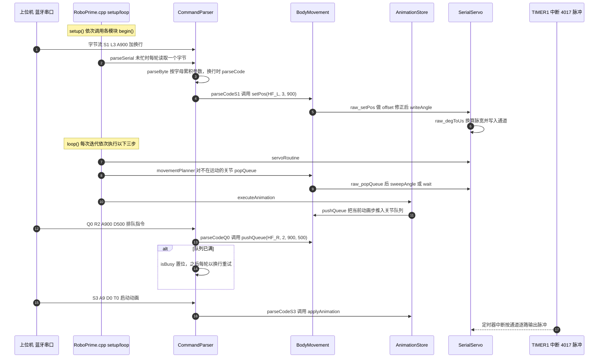

# RoboPrime

**RoboPrime**（[GitHub](https://github.com/simonepri/roboprime)）是 [GitHubStore《19 款能自己造的开源人形机器人》](https://mp.weixin.qq.com/s/UUwUAcKdVrlo-N60Oar3Xg) 的第 1 项，文章标价 约 $60–100。

## 一句话定义

**RoboPrime 是 simonepri 设计的 21 自由度全 3D 打印人形机器人，主控 ATmega328P（Arduino Pro Micro），搭配 21 个 MG90S 舵机与 HC-05 蓝牙，整机成本约 $60–100。**

## 英文缩写速查

| 缩写 | 英文全称 | 简要说明 |
|------|----------|----------|
| DOF | Degrees of Freedom | 自由度 |
| MG90S | MG90S micro servo | 9 g 级微型舵机 |

## 为什么重要

- 属于文章按成本从低到高排列的「能自己造」清单；横向对比见 [能自己造的开源人形机器人 19 款：按成本与形态排序的阅读坐标](../overview/open-source-buildable-humanoids-19-technology-map.md)。
- 价格为文章标价（约 $60–100），入库日未核实。

## 核心信息

| 项 | 内容 |
|----|------|
| **链接** | [GitHub](https://github.com/simonepri/roboprime) |
| **许可（核查）** | GPL-3.0（LICENSE 文件） |
| **最近提交** | 2017-10-19 |

## 文章说法核对

- **文章：** 文章称项目含完整硬件清单、接线说明和固件，支持基本动作与蓝牙控制，是入门级桌面人形代表。
- **README / 核查：** README 副标题「Full featured 21 DOF 3D Printed Humanoid Robot based on ATmega328P chip」，硬件清单列出 Arduino Pro Micro、HC-05、2 个 74HC4017、MPU-6050（标注未使用）、21 个 MG90S、2 个 5A DC-DC，总成本 $60–$100，另有约 $15 螺丝；README 自带「Description coming soon」占位。
- **差异与保留：** 文章「完整固件、支持基本动作」未在已读 README 段落逐项核对；仓库最近提交 2017-10-19，已多年无更新。

## 源码运行时序图

入口：Arduino IDE 编译上传 `firmware/RoboPrime/`（板上运行 `RoboPrime.cpp` 的 `setup()`，随后循环执行 `loop()`）；指令经串口（HC-05 蓝牙透传，波特率 115200）输入，如 `S1 L3 A900`。

图依据：simonepri/roboprime@e2f3e4f，读过 `README.md`、`LICENSE`（开头）、`firmware/RoboPrime/RoboPrime.ino`（仅注释头）、`firmware/RoboPrime/RoboPrime.cpp`、`commandParser.cpp`、`commandParser.h`、`bodyMovement.cpp`、`bodyMovement.h`、`serialServo.cpp`（`writeAngle`、`servoRoutine`、`raw_interrupt` 宏与 ISR 定义）、`serialServo.h`、`animationStore.cpp`（`applyAnimation`、`executeAnimation`）；未运行代码，未在实物上验证。

## 关联页面

- [humanoid-robot](../entities/humanoid-robot.md)
- [open-source-humanoid-hardware](../entities/open-source-humanoid-hardware.md)
- [open-source-buildable-humanoids-19-technology-map](../overview/open-source-buildable-humanoids-19-technology-map.md)

## 参考来源

- [roboprime.md](../../sources/repos/roboprime.md)
- [wechat_githubstore_19_buildable_open_source_humanoids_2026-11-02.md](../../sources/blogs/wechat_githubstore_19_buildable_open_source_humanoids_2026-11-02.md)
- [原文（微信公众号）](https://mp.weixin.qq.com/s/UUwUAcKdVrlo-N60Oar3Xg)
- 源码核对（2026-11-02）：simonepri/roboprime@e2f3e4f，读过 `README.md`、`LICENSE`（开头）、`firmware/RoboPrime/RoboPrime.ino`、`RoboPrime.cpp`、`commandParser.cpp/.h`、`bodyMovement.cpp/.h`、`serialServo.cpp/.h`、`animationStore.cpp`；时序图依据以上文件，未运行代码。
