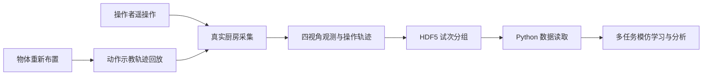

# RoboSet：真实世界多任务操作数据集 / RoboSet Dataset

## 一句话定义

**RoboSet** 是面向真实世界厨房多任务机器人操作的数据集，结合远程遥操作与动作示教回放轨迹，提供四路相机观测与按试次组织的 HDF5 数据。其官方主页报告 **28,500 条轨迹**。

## 英文缩写速查

| 缩写 | 英文全称 | 简要说明 |
|---|---|---|
| HDF5 | Hierarchical Data Format version 5 | 官方数据读取示例使用的分层存储格式 |
| RGB | Red, Green, Blue | 每帧多机位视觉观测的常见图像表示 |
| VR | Virtual Reality | Oculus Quest 2 遥操作控制器对应的交互设备类别 |
| IL | Imitation Learning | 使用动作演示数据训练策略的下游用途 |

## 为什么重要

- 真实数据采集具有实际厨房中的物体重排与场景变化，不应当和仿真基准的 episode 成功率混为一谈。
- 同时包含 **9,500 条遥操作**与 **19,000 条动作示教回放**，可分采集来源检查策略泛化，而不是把两类样本视作同质分布。
- 每帧四个相机视角，适合研究视觉表示对机位扰动的敏感性。

## 核心原理

### 采集方式与数据结构

官方将厨房活动分成包含 **4–6 个子任务**的语义活动，任务有自然语言指令。遥操作使用 Oculus Quest 2 控制器；动作示教回放会在每次执行前改变场景物体布局。官网提供 HDF5 分组的最小示例：试次键下有 `data`、`derived`、`config` 等组；字段细节以实际文件为准。

## 流程总览

图中采集方式、四视角与 HDF5 结构据官方数据页；末端的策略学习是**预期下游用途**，并非官网提供完整训练管线的声明。

## 工程实践

1. 从[官方数据页](https://robopen.github.io/roboset/)明确需要的 Teleoperation / Kinesthetic 子集，并阅读相关数据说明；官网还展示 Autonomous 导航入口，**不得额外假定轨迹数量**。
2. 以 Python `h5py` 查看文件键：`list(h5.keys())`；确认 `Trial0` 等试次及 `data / derived / config` 分组。
3. 在数据训练前逐项核实观测形状、相机内外参、动作单位、样本时间戳和采集类型；这些不能从项目主页直接推断。
4. 比较基准时记录真实采集 / 仿真来源、训练测试拆分与任务定义，避免把数据集规模当作模型成功率。

## 源码运行时序图

**不适用**：本次核对的官方项目页只给出 HDF5 读取示例，未核实完整可运行训练/推理/部署源码及调用入口；不以通用伪时序图代替代码分析。

## 局限与风险

- 官方主页提供了规模与采集方式，但本次**未下载并遍历完整数据**；数据质量、有效轨迹数、动作频率以及是否适用于特定机器人仍须样本级核对。
- 项目页链接 MIT License，但实际数据再分发和商用要求应检查下载包条款。
- **重定向就绪度：待样本级核实**：官网未声明采集机器人本体、关节/末端动作空间与控制频率，本次也未读取 HDF5 样本，因此不能把数据直接当作其他形态机器人的策略输入；跨本体使用前须先从 `data`/`config` 组确认动作定义，再做动作空间对齐或重定向。
- 四机位并不等同于经过标准化的跨机器人控制空间；与 [BridgeData V2](./painode-085-bridgedatav2.md)、[RH20T](./painode-092-rh20t.md) 混合时要先对齐 schema 与动作定义。

## 关联页面

- [机器人操作任务](../tasks/manipulation.md)
- [BridgeData V2](./painode-085-bridgedatav2.md)
- [RH20T](./painode-092-rh20t.md)
- [机器人操作数据与基准选型](../comparisons/robot-manipulation-data-benchmark-selection.md)

## 参考来源

- [RoboSet 官网通读归档](../../sources/sites/roboset-dataset.md)
- [十类机器人数据与基准的一手来源核验](../../sources/datasets/robot-manipulation-primary-sources-2026-11-07.md)
- [官方项目与下载入口](https://robopen.github.io/roboset/)

## 推荐继续阅读

- [RoboSet 官方页面：Data composition、Schema 与 Python 示例](https://robopen.github.io/roboset/)
