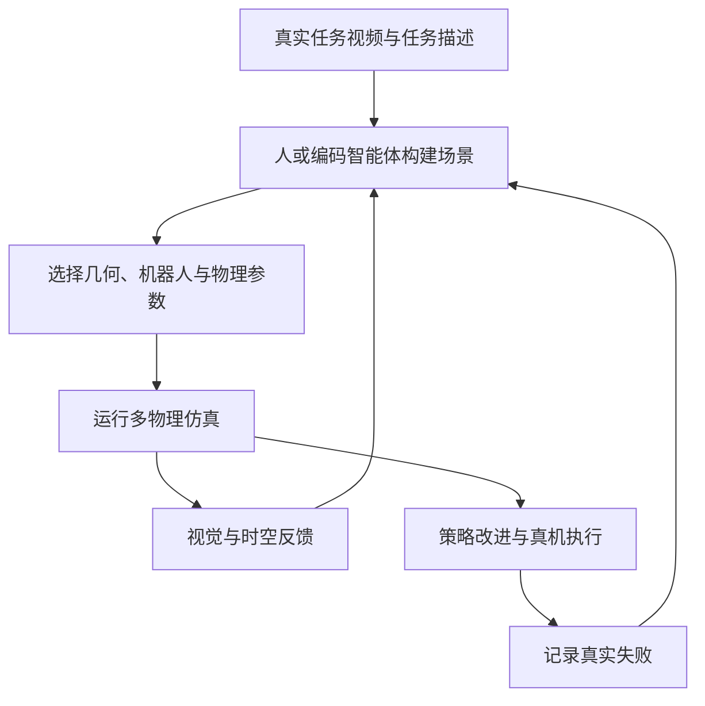
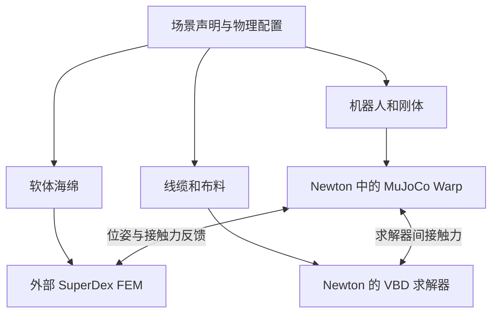
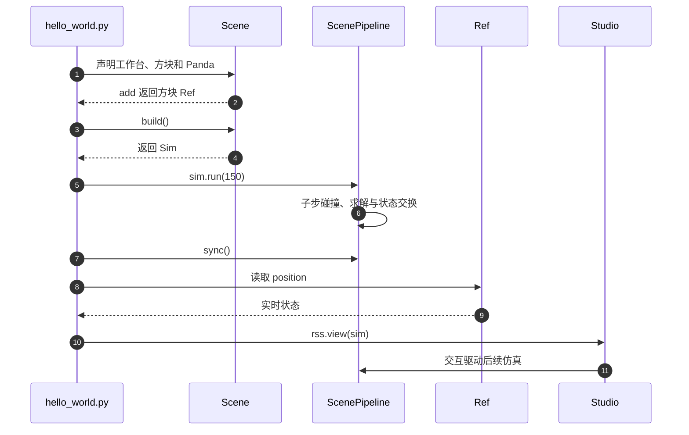
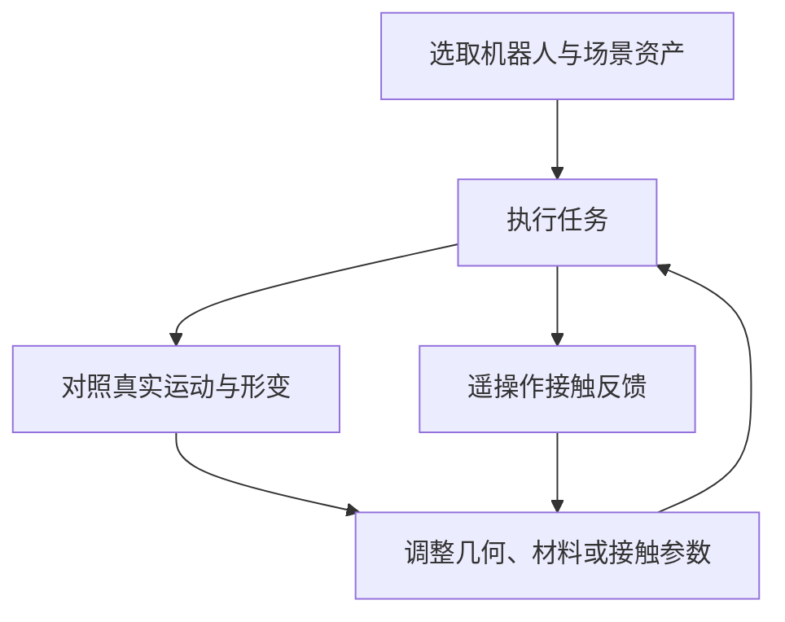
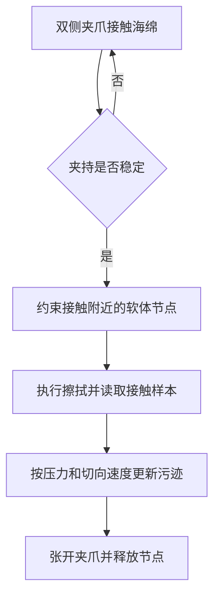

# RoboSimStudio（机器人操作 Real2Sim 工具包）

**RoboSimStudio** 是面向机器人操作任务的开放交互式仿真工具包，让人或编码 Agent 根据真实场景观察构建、检查和调整物理仿真；当前仓库也提供 CPU 路径。

## 英文缩写速查

| 缩写 | 英文全称 | 简要说明 |
|------|----------|----------|
| Real2Sim | Real-to-Simulation | 从真实场景或任务视频重建仿真环境的流程 |
| GPU | Graphics Processing Unit | 并行仿真的计算平台 |
| FEM | Finite Element Method | SuperDex 用于模拟海绵软体形变的有限元方法 |
| MuJoCo | Multi-Joint dynamics with Contact | Newton 生态中用于刚体与关节体仿真的组件 |

## 为什么重要？

操作任务的仿真准备往往需要工程师手工搭场景、选求解器、调接触和物理参数。RoboSimStudio 把这些选择做成可编辑对象，并让人和编码 Agent 在同一套交互工具中观察、修改和复跑。它关注的关键问题是如何让 Real2Sim 建模过程更快、更容易检查和迭代。

## 核心原理

1. 输入机器人操作任务的视频和文字任务说明。
2. 人或编码 Agent 搭建机器人、物体、相机与接触场景，显式选择求解器和物理参数。
3. 在交互式 Studio 中观察仿真行为；人可以直接检查和调整，Agent 可以利用空间—时间反馈继续迭代。
4. 将仿真用于策略改进，并在具体任务上检查仿真与真机表现是否一致。

项目页展示的代表案例是双臂擦拭：Claude 或 Codex 根据手机视频与一行提示搭建场景，论文报告一个案例约 56 分钟形成可运行仿真。这个时间是具体演示结果，不是所有任务的固定建模时长。

## 多物理组成与实验范围

项目建立在 Newton 及其 GPU 仿真组件上。论文中的擦拭场景由 Newton 内的 MuJoCo Warp 处理机械臂和刚体，并耦合 SuperDex FEM 来模拟海绵形变；官方仓库同时列出 Warp、MuJoCo Warp 等依赖。其价值在于在一场景中表达机械臂、刚体接触和柔性海绵，而非单一刚体求解器覆盖所有对象。

论文报告 18 项接触丰富的操作任务仿真，范围包括刚体、关节机构、线缆、布料和软体对象。这是论文展示的任务仿真集合，不能直接等同于统一评价协议下的 benchmark 分数。

## Real2Sim2Real 案例

在双臂海绵擦拭案例中，Graph-as-Policy 利用仿真中的空间—时间反馈经过 14 次迭代，将论文定义的模拟擦拭面积指标从 0% 提高到 100%；随后改进策略部署到真机并完成擦拭。真机运行还暴露一个模型不匹配：仿真将支撑杆固定，但实物中支撑杆会移动。团队据此调整约束，仿真随后能表现支撑杆移动和倾倒。

这说明在该任务中，真机结果能反过来指导仿真模型修订；它不构成跨任务仿真精度或 Sim2Real 成功率的普遍证明。

## 流程总览

这是论文描述的工作流，视频不是物理参数的唯一来源；人类判断与真实反馈仍参与建模。擦拭案例还生成了 30 个不同位置布局并改变海绵刚度，但论文没有给出跨布局的真机成功率。

## 多物理架构与耦合

论文将机器人与刚体默认分配给 MuJoCo Warp，线缆、布料分配给 VBD；海绵案例使用外部 SuperDex。不同求解器之间的耦合方式取决于具体场景，不应认为上图的所有分支在每个任务中同时启用。外部耦合有计算成本，力反馈的稳定性也依赖步长、接触参数及反馈限制。

## 源码运行时序图

以下对应官方仓库 `examples/00_getting_started/00_hello_world.py`，源码版本及定位见[仓库归档](../../sources/repos/robosimstudio.md)。

`Scene` 保存声明，`build()` 生成拥有状态的 `Sim`，`Ref` 读取实时状态。示例使用 `MUJOCO_500HZ`：控制频率 50 Hz，150 控制步为 3 秒；这不是所有场景的默认频率。GPU 状态读取前执行 `sync()`。源码的 `ScenePipeline` 将碰撞、求解和读回组织在统一步骤中，具体 solver 由场景配置决定。

## 人机反馈与真实校准

力反馈案例中，Gello 主臂关节角驱动仿真机器人；当接触阻碍跟随时，指令与实际仿真构型的差异产生反馈信号。系统使用随速度变化的死区，并在暂停或仿真落后时释放反馈，以免把普通延迟误当接触。论文展示的是交互式评估与示范采集，并未给出力反馈相对真机的定量标定误差。

## 擦拭示例的实现细节

当前源码的 `examples/08_demos/wipe_the_bar/` 将场景、擦拭程序和交互入口分在 `bar.py`、`routine.py` 和 `wipe_the_bar.py`。场景配置 60 Hz 控制、16 个物理子步，MuJoCo 处理机械臂与刚体，SuperDex 处理海绵；其反馈速度上限设置为 5 m/s。参数是该示例配置，不是推荐的通用默认值。

源码以夹爪宽度稳定、两侧法向力均至少 2 N 和压缩量等条件触发 latch；张开时解除约束。仓库说明纯摩擦下海绵在擦拭中容易滑脱，因而采用该辅助约束。污迹模型按 Preston 关系使用压力和切向滑动速度更新，清洁比例是满足剩余墨量阈值的网格比例，属于仿真内部指标。当前示例的固定支撑与 latch 不应误读为论文中真机失败后已修正的自由支撑场景；也不能据此将论文 100% 模拟清洁率解释为实物清洁率。

## 结论

RoboSimStudio 的主要价值是把场景构建、物理建模和人机反馈连成可迭代流程，论文的真实迁移证据仍限于单项试验。

- 先对齐几何与坐标系，再辨识摩擦、刚度、阻尼和接触参数；外观一致不代表动力学一致。
- 选择匹配材料的求解器，并检查求解器之间的力反馈、时间步与数值稳定性。
- 检查代码中的固定约束、抓取辅助和任务评分定义，避免将便利性假设当作真实物理。
- 用真实轨迹、接触力和重复试验校验，记录失效后修改模型，再重新验证策略。

## 工程实践

| 项 | 说明 |
|----|------|
| **底层仿真** | 基于 [Newton](./newton-physics.md)；仓库还列出 Warp 与 [MuJoCo Warp](./mujoco-warp.md) |
| **柔性对象** | 代表性擦拭场景使用 SuperDex FEM 模拟海绵软体形变 |
| **入门入口** | `uv run examples/00_getting_started/00_hello_world.py`；擦拭案例需要 Python 3.12、GPU 与 `superdex` extra，命令见仓库归档 |
| **适用任务** | 机器人操作与接触丰富任务；论文展示刚体、关节机构、线缆、布料及软体对象 |
| **开源状态** | 已开源；官方仓库为 Apache-2.0。安装与运行细节以仓库当前 README 和 examples 为准 |

复现时从 examples 中选接近任务的场景，再逐项核对几何、机器人模型、接触参数和柔性体模型。视频能给出外观和运动线索，但不能唯一确定质量、摩擦、材料参数等隐藏物理量，因此训练或部署前仍需单独校准仿真与真实机器人。

## 局限与风险

- 项目展示的视频驱动建模不意味着视频本身能唯一确定物体质量、摩擦、柔顺性或接触参数；这些物理量仍需测量或迭代辨识。
- 18 项任务仿真展示了工具的覆盖范围，不是跨任务统一基准上的精度结论。
- 真机迁移评估是单一操作任务的 pilot study，作者主要通过定性观察评估仿真与实物表现；跨任务精度、接触力、轨迹、建模时间和真机成功率的系统定量评估仍待后续工作。
- 能力受现有机器人资产、材料模型与受支持求解器限制；外部物理引擎协同仿真还会产生计算开销。
- 不能把擦拭案例外推为任意机器人、物体或操作任务都能一小时建模或稳定 Sim2Real。

## 关联页面

- [Newton Physics](./newton-physics.md)：RoboSimStudio 的主要仿真基础。
- [Sim2Real](../concepts/sim2real.md)：仿真如何服务于真实机器人策略。
- [MuJoCo Warp](./mujoco-warp.md)：Newton 中的 GPU 刚体仿真组件。
- [NVIDIA Warp](./nvidia-warp.md)：GPU 计算与内核基础。

## 参考来源

- [RoboSimStudio 项目主页归档](../../sources/sites/robosimstudio-github-io.md)
- [RoboSimStudio 官方仓库归档](../../sources/repos/robosimstudio.md)
- [RoboSimStudio 技术报告（arXiv:2610.18835）](../../sources/papers/robosimstudio_arxiv_2610_18835.md)

## 推荐继续阅读

- [RoboSimStudio 官方项目页](https://robosimstudio.github.io/)
- [RoboSimStudio 官方 GitHub 仓库](https://github.com/robosimstudio/robosimstudio)
- [Newton Physics](./newton-physics.md)
