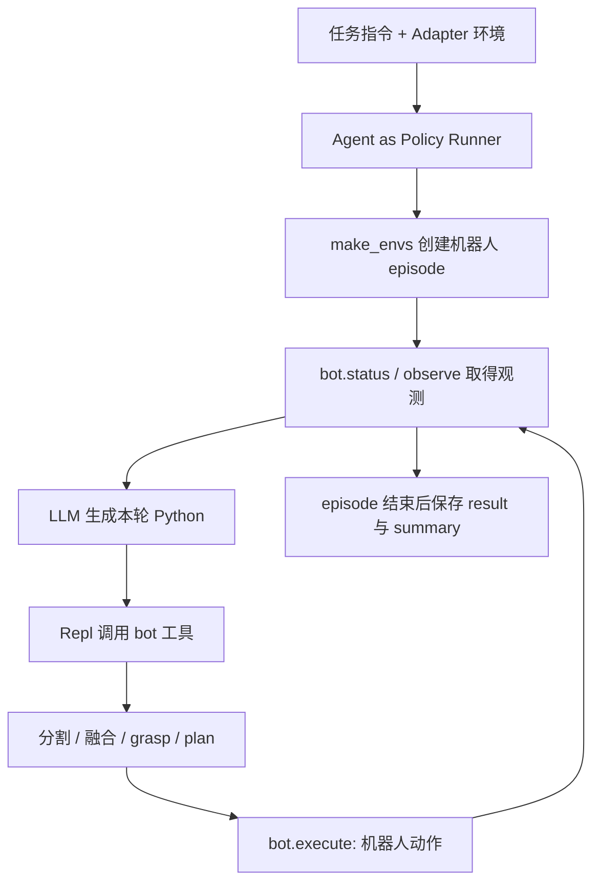
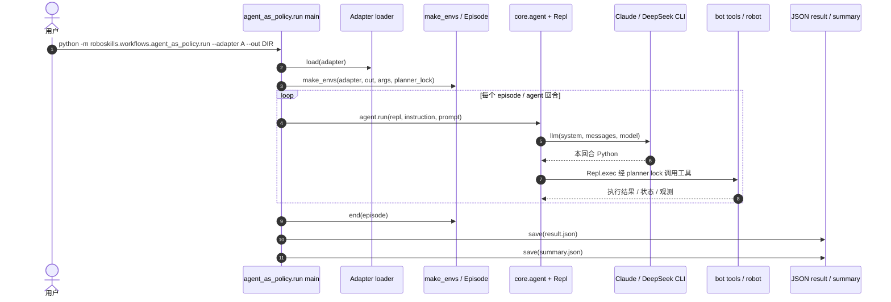

# RoboSkills：机器人 Agent 工作流（RoboSkills: Agent Workflows for Robotics）

## 一句话定义

RoboSkills 是 OpenRoboKit 的独立开源项目，以轻量 Agent 工作流与工具适配器组合机器人仿真、动作决策、场景重建和运动生成，**不是** RoboKit 的另一套物理求解器。

## 英文缩写速查

| 缩写 | 英文全称 | 简要说明 |
|---|---|---|
| LLM | Large Language Model | 在 Agent as Policy 中生成下一回合可执行 Python |
| IK | Inverse Kinematics | RoboKit 工具层求解机械臂目标位姿 |
| MPC | Model Predictive Control | Real2Sim 物理回放中用于修正接触片段 |
| RGB | Red Green Blue | 视频与相机观测中的彩色图像 |

## 为什么重要

机器人 Agent 的复杂性不仅在「让模型输出动作」，还在观察、分割、目标与场景几何、求解器、仿真器、回合日志之间可复现的接口。RoboSkills 的价值是将这些分成可独立调用的工具与工作流，便于与 [RoboKit](./robokit-openrobokit.md)、[GraspKit](./graspkit.md) 衔接，且不把 Demo 成功直接等同真机泛化。

## 核心原理

官方 README（2026-11-16 核查）列出 **五类工作流**，每类输入与权限假设不同：

| 工作流 | 输入 / 目标 | 关键边界 |
|---|---|---|
| **Agent as Policy** | 当前 episode 观测 → LLM Python → `bot` 工具规划与执行 | Agent 不直接读取 benchmark 隐藏成功分数 |
| **Auto Research** | 反复仿真、测试与迭代策略/技能 | 与逐步控制的 Agent as Policy 不同 |
| **Agentic Simulation** | 自然语言任务 → 仿真求解 | README 明确可用特权仿真信息 |
| **Real2Sim** | 图像/视频/示范 → 交互式仿真资产与回放 | 重建与物理阶段分离，按 `--tools` 选择模块 |
| **Motion Generation** | 文本/图像/视频 → 运动视频 | 文档标为运动学+渲染，非物理模拟 |

### 流程总览

以下以官方 **Agent as Policy** 为例，流程和源代码调用边界与 [原文归档](../../sources/repos/roboskills.md) 对齐：

## 源码运行时序图

已阅读 `src/roboskills/workflows/agent_as_policy/run.py`、该工作流的 README 与 SKILL。下图限定为该 CLI 的实际控制流（不是未经运行的五种工作流总执行路径）：

- **运行入口**：`python -m roboskills.workflows.agent_as_policy.run --adapter roboskills.eval.robodojo.launch --out runs/agent_as_policy/stack_blocks -- task=stack_blocks layouts=0,1,2,3,4 gpu=0 mode=eval suite=full5`（官方示例，不是本次已执行的 benchmark）。
- **锁与统计口径**：多 episode 由线程池调度，planner lock 保护关键 GPU 调用；LLM 异常 episode 标成 `void` 并排除该工作流成功率分母，不能把 `void` 直接视作失败或成功。

## 工程实践

1. 先阅读 [工作流 README](https://github.com/openrobokit/roboskills/blob/main/src/roboskills/workflows/agent_as_policy/README.md)，从 RoboDojo 的 adapter 和虚拟环境开始；确认 Python >=3.10 与依赖锁文件。
2. 检查 `--adapter` 是否实现 `make_vector(out=..., **kw)` 或 `make(**kw)`，并提供与机器人一致的工具接口；`--out` 应使用新的空目录。
3. 面向视频转仿真时选 [Real2Sim](https://github.com/openrobokit/roboskills/blob/main/src/roboskills/workflows/real2sim/README.md)，核对 SAM/MoGe/HaWoR/网格/碰撞与 MuJoCo 依赖，按需求使用 `--tools`，并验证仿真可接触性。
4. 对接真机前另补单位、坐标系、权限控制、急停与控制频率等验收，不应将仿真成功率或低 token 成本等同安全部署。

## 局限与风险

- 官网项目页在本次访问环境下未能完整读取；工作流与源码入口的结论以**公开的官方 GitHub README、说明与运行代码**为准。
- 官方成本展示只属于特定案例，依赖 LLM 服务、硬件和测试集；未独立复测成本、成功率、GPU 速度或真机部署。
- 本次源码深读范围为 Agent as Policy Runner，另外核对 Real2Sim 官方文档；**没有**审计全部 workspaces、模型权重、五类工作流所有实现与第三方许可。

## 关联页面

- [OpenRoboKit 工具集总览](../overview/openrobokit-toolkit.md)
- [RoboKit：GPU 优化与仿真](./robokit-openrobokit.md)
- [GraspKit：端到端抓取](./graspkit.md)
- [RetargetingKit：遥操作与重定向](./retargetingkit.md)
- [Real2Sim 纵深路线](../../roadmap/depth-real2sim.md)

## 参考来源

- [RoboSkills 源码及原文核对范围](../../sources/repos/roboskills.md)
- [官方 GitHub 组织介绍](https://github.com/openrobokit/.github/blob/main/profile/README.md)
- [官方 Agent as Policy 入口](https://github.com/openrobokit/roboskills/blob/main/src/roboskills/workflows/agent_as_policy/run.py)

## 推荐继续阅读

- [五类官方工作流及工具总览](https://github.com/openrobokit/roboskills)
- [Real2Sim 复现指令](https://github.com/openrobokit/roboskills/blob/main/src/roboskills/workflows/real2sim/README.md)
- [Agent as Policy SKILL](https://github.com/openrobokit/roboskills/blob/main/src/roboskills/workflows/agent_as_policy/SKILL.md)
