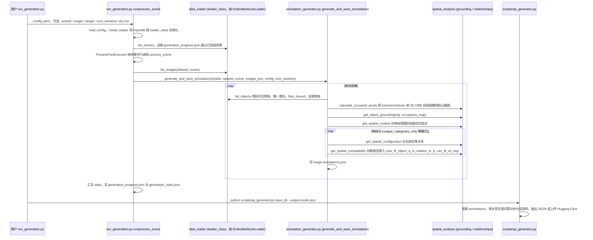

# RoboSpatial

**RoboSpatial**（[arXiv:2411.16537](https://arxiv.org/abs/2411.16537)，[项目页](https://chanh.ee/RoboSpatial/)，**CVPR 2025 Oral**）教 **2D/3D VLM** 机器人 **空间理解**：从 3D scan 自动生成 grounding、空间上下文、配置与兼容性 QA；**RoboSpatial-Home** 成为产业 VLM 空间评测核心基准之一。

## 一句话定义

**RoboSpatial 把 3D 场景变成可规模化空间 QA——并给出 RoboSpatial-Home 这条「机器人空间理解」公共标尺。**

## 英文缩写速查

| 缩写 | 英文全称 | 简要说明 |
|------|----------|----------|
| VLM | Vision-Language Model | 2D/3D 视觉-语言模型 |
| POI | Point of Interest | LightNav-ER 评测子项之一 |
| VQA | Visual Question Answering | 视觉问答 |
| ER | Embodied Reasoning | 具身推理；LightNav-ER 八项套件 |

## 为什么重要

- **产业采用：** Qwen3-VL、Gemini Robotics 1.5、NVIDIA GR00T N1.5 均引用 **RoboSpatial-Home**。
- **LightNav-ER 套件：** 博客脚注 [3] 列出 POI + VQA 子项计入 [LightNav-ER](./lightnav-er.md) 八项评测（见 [3 篇技术地图](../overview/lightorigins-3blogs-technology-map.md)）。
- **数据引擎可扩展：** NVlabs 发布 **标注生成 pipeline** + HF 数据集 + [RoboSpatial-Eval](https://github.com/chanhee-luke/RoboSpatial-Eval) 脚本。

## 核心信息

| 项 | 内容 |
|----|------|
| **机构** | Ohio State + NVIDIA |
| **数据集** | HF `chanhee-luke/RoboSpatial-Home` |
| **生成代码** | [NVlabs/RoboSpatial](https://github.com/NVlabs/RoboSpatial) |
| **开源** | **部分开源** pipeline + benchmark + eval；下游模型权重随 GR00T 等 |

## 结论

**RoboSpatial-Home 是 2025 机器人 VLM「空间理解」事实标准之一——POI/VQA 子项也是读 LightNav-ER 分数的入口。**

- 3D→2D 自动 QA 降低人工标注成本
- 四类空间关系（grounding/上下文/配置/兼容性）覆盖 manipulation 前置理解
- 与 [RefSpatial-Bench](./paper-roborefer.md)、[EmbSpatial](./embspatial.md) 分工：Home 偏 scan QA，RefSpatial 偏指代推理
- 开源 pipeline 可扩展到 BOP/GraspNet（官方 roadmap）

## 源码运行时序图

入口：`cd robospatial && python run_generation.py --config configs/example_dataset.yaml`（官方 README 的示例命令；产出为 JSON 标注，再由 `scripts/qa_generator.py <input_dir> --output-mode json --output-path ...` 转成 QA 对）。本仓库是**标注生成流水线**，不含 VLM 训练或评测代码（评测在另一仓库 RoboSpatial-Eval）。

图依据：NVlabs/RoboSpatial@7a1b901，读过 README.md、robospatial/run_generation.py、robospatial/annotation_generator.py、robospatial/spatial_analysis/relationships.py（仅 import 与函数签名/调用）、scripts/qa_generator.py（文件头与 argparse，未读 QA 生成细节）；spatial_analysis 各子模块与 data_loader 实现未细读，关系判定的具体几何逻辑不在图中展开。

## 关联页面

- [RoboRefer / RefSpatial-Bench](./paper-roborefer.md)
- [EmbSpatial-Bench](./embspatial.md)
- [LightNav-ER](./lightnav-er.md)
- [空间推理 benchmark 地图](../overview/spatial-reasoning-benchmarks-technology-map.md)
- [具身大模型评测基准选型闭环](../queries/embodied-eval-benchmark-selection-loop.md) — 本页归其 ① 认知评测层：机器人视角空间推理 QA，可自动打分但离真机执行最远

## 参考来源

- [robospatial_arxiv_2411_16537.md](../../sources/papers/robospatial_arxiv_2411_16537.md)
- [robospatial-home.md](../../sources/sites/robospatial-home.md)
- [nvlabs-robospatial.md](../../sources/repos/nvlabs-robospatial.md)
- [robospatial_lightnav_2026.md](../../sources/papers/robospatial_lightnav_2026.md)
- 源码核对（2026-11-02）：NVlabs/RoboSpatial@7a1b901，读过 README.md、robospatial/run_generation.py、robospatial/annotation_generator.py、robospatial/spatial_analysis/relationships.py、scripts/qa_generator.py；时序图依据以上文件，未运行代码。

## 推荐继续阅读

- [RoboSpatial 主页](https://chanh.ee/RoboSpatial/)
- [RoboSpatial-Home 数据集](https://huggingface.co/datasets/chanhee-luke/RoboSpatial-Home)
