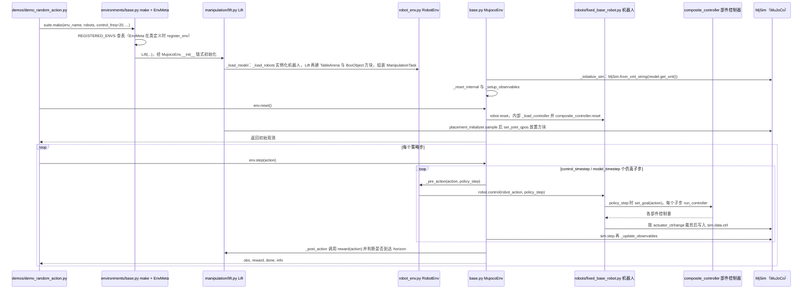

# robosuite

## 一句话定义

[robosuite](https://github.com/ARISE-Initiative/robosuite) 是一个以 MuJoCo 为后端的机器人学习仿真框架。它把机器人模型、操作场景、物体、控制器和传感器组合成可配置的任务环境，并为策略训练、评测和遥操作提供接口。

## 英文缩写速查

| 缩写 | 英文全称 | 简要说明 |
|---|---|---|
| API | Application Programming Interface | 环境交互接口 |
| MDP | Markov Decision Process | 状态、动作与转移的形式化模型 |
| MuJoCo | Multi-Joint dynamics with Contact | robosuite 使用的物理仿真引擎 |
| RL | Reinforcement Learning | 可使用仿真环境开展策略训练 |

## 核心定位

robosuite 是仿真与任务环境层，不是一个单独的学习算法或真机驱动程序。研究者可以选择机器人和控制器，构造场景与任务，再通过环境 API 执行动作并取得观测、奖励和任务完成信息。具体接口与可用组件以所选版本的官方文档为准。

```text
机器人 / 场景 / 物体配置 → robosuite 仿真环境 → 动作与观测 → 策略训练或基准评估
```

官方项目资料：

- [GitHub 源码](https://github.com/ARISE-Initiative/robosuite)
- [项目主页](https://robosuite.ai/)
- [官方文档](https://robosuite.ai/docs/)
- [项目论文](https://arxiv.org/abs/2009.12293)
- [白皮书 PDF](https://robosuite.ai/assets/whitepaper.pdf)

## 与 LIBERO 的关系

[LIBERO](./libero-benchmark.md) 是终身机器人学习操作基准。其安装文档将 robosuite 作为底层仿真环境；LIBERO 仓库的 [requirements.txt](https://github.com/Lifelong-Robot-Learning/LIBERO/blob/master/requirements.txt) 固定 robosuite 版本为 1.4.0。因此：

- **分工：** robosuite 提供仿真引擎和环境组件；LIBERO 提供语言条件任务、演示数据和知识迁移评估协议。
- **版本：** robosuite 当前官方文档对应 v1.5，而 LIBERO 依赖文件指定 v1.4.0。重跑 LIBERO 时应按其依赖文件和[安装文档](https://lifelong-robot-learning.github.io/LIBERO/html/getting_started/installation.html)使用匹配版本。
- **复现：** 不要仅因能安装最新版就替换基准依赖；版本改变可能影响环境和评估的复现性。若升级，应检查 LIBERO 任务注册、控制接口及结果是否兼容。

## 适用场景

- 在 MuJoCo 中训练和评估机器人操作策略。
- 通过替换机器人、控制器、物体或场景组件构造实验。
- 为下游基准（如 LIBERO）提供物理仿真环境。
- 对比不同策略时，固定任务定义、环境版本和评估配置。

## 使用时核对

| 检查项 | 建议 |
|---|---|
| 版本 | 以目标基准的依赖锁定为准；LIBERO 当前 requirements 固定 1.4.0 |
| 仿真后端 | 按所选 robosuite 版本的安装文档核对 MuJoCo 要求 |
| 任务定义 | 区分 robosuite 自带任务与 LIBERO 的任务套件 |
| 评估复现 | 固定环境版本、随机种子、控制器、观测模态和成功条件 |
| 真机部署 | 仿真 API 本身不等同于真机驱动；另行核对机器人接口与迁移流程 |

## 项目资源与工程补充

### 方法

- **组合环境：** 通过机器人、场景、物体和任务组件构造仿真环境。
- **机器人控制：** 可配置控制器将策略动作转换为机器人控制命令；控制器与参数会影响任务行为。
- **多模态观测：** 环境可提供状态与传感器观测，实际内容依机器人、任务和配置而定。
- **任务接口：** 环境提供交互与任务完成判定接口，供训练和评估流程调用。

这些要点概述项目设计，不替代论文对实现和算法设置的完整描述。

### 评测

论文将 robosuite 定位为仿真框架与机器人学习 benchmark，并使用若干机器人操作任务展示框架如何支持研究和评估。此知识页不摘录论文表格中的具体数值；实验任务、指标及其设定请直接对照 [论文正文](https://arxiv.org/abs/2009.12293) 和对应代码版本。

复现实验应记录 robosuite 与 MuJoCo 版本、机器人和任务配置、控制器、观测模态、随机种子及评估协议。

### 入口与复现

| 资源 | 用途 |
|---|---|
| [arXiv 论文](https://arxiv.org/abs/2009.12293) | 论文摘要、正文与引用信息 |
| [官方 GitHub](https://github.com/ARISE-Initiative/robosuite) | 源码、发布和安装信息 |
| [官方文档](https://robosuite.ai/docs/) | 当前 API 与使用指南 |
| [LIBERO 安装文档](https://lifelong-robot-learning.github.io/LIBERO/html/getting_started/installation.html) | 基准安装方式 |
| [LIBERO requirements](https://github.com/Lifelong-Robot-Learning/LIBERO/blob/master/requirements.txt) | LIBERO 声明的精确依赖版本 |

### 适用边界

- robosuite 是仿真框架，使用它不代表已有真机驱动或已验证仿真到现实迁移。
- 框架提供环境与接口，不规定唯一策略学习算法。
- 论文和当前软件版本可能不同；引用时应标明采用的论文、代码与依赖版本。

## 源码运行时序图

入口：`python robosuite/demos/demo_random_action.py`（交互选择环境与机器人后调用 `suite.make(...)`，随机动作循环 `env.step` + `env.render`）；库内通用入口为 `robosuite.make(env_name, robots=..., ...)`。下图以单臂 `Lift` 环境为例，`Lift`/`ManipulationEnv`/`RobotEnv`/`MujocoEnv` 的继承与 `FixedBaseRobot.control` 均读自源码。



图依据：ARISE-Initiative/robosuite@5ce6643，读过 `README.md`、`robosuite/__init__.py`、`robosuite/demos/demo_random_action.py`、`robosuite/environments/base.py`（`make`、`EnvMeta`、`__init__`、`_initialize_sim`、`reset`、`step`、`_post_action`）、`robosuite/environments/robot_env.py`（`_load_model`、`_reset_internal`、`_pre_action`、`_load_robots`）、`robosuite/environments/manipulation/lift.py`（`_load_model`、`_reset_internal`）、`robosuite/robots/fixed_base_robot.py`（`control`）、`robosuite/robots/robot.py`（`reset`、`_load_controller` 签名）。`composite_controller` 内部各控制器（OSC、关节控制等）、渲染器与观测传感器细节未读，未画；因克隆磁盘受限，`robosuite/models/assets` 未检出。

## 关联页面

- [LIBERO 基准实体](./libero-benchmark.md)
- [Sim2Real](../concepts/sim2real.md)
- [Isaac Lab](./isaac-lab.md)
- [Humanoid Motion Intelligence](./humanoid-motion-intelligence.md)

- 基准实体：[LIBERO](./libero-benchmark.md)（论文页：[LIBERO 2306.03310](libero-benchmark.md)）
- 评测选型：[具身大模型评测基准选型闭环](../queries/embodied-eval-benchmark-selection-loop.md) — robosuite 作为策略任务成功率评测层的仿真底座
- 策展列表：[AwesomeSim2Real](./awesome-sim2real.md)
- 技术地图：[AwesomeSim2Real 技术地图](../overview/lc-awesome-sim2real-technology-map.md)
- 方法与任务：[Sim2Real](../concepts/sim2real.md)、[强化学习](../methods/reinforcement-learning.md)、[操作](../tasks/manipulation.md)

- [libero-benchmark](../entities/libero-benchmark.md)
- [isaac-lab](../entities/isaac-lab.md)
- [humanoid-motion-intelligence](../entities/humanoid-motion-intelligence.md)
- [awesome-sim2real](../entities/awesome-sim2real.md)

## 参考来源

- [robosuite 来源归档](../../sources/repos/robosuite.md)
- [robosuite 论文来源归档](../../sources/papers/lc_awesome_sim2real_2009_12293_robosuite-a-modular-simulation-framework.md)
- [LIBERO 来源归档](../../sources/repos/libero-benchmark.md)
- [官方源码](https://github.com/ARISE-Initiative/robosuite)
- [官方文档](https://robosuite.ai/docs/)
- [LIBERO requirements](https://github.com/Lifelong-Robot-Learning/LIBERO/blob/master/requirements.txt)
- [LIBERO 安装文档](https://lifelong-robot-learning.github.io/LIBERO/html/getting_started/installation.html)

- [arXiv: 2009.12293](https://arxiv.org/abs/2009.12293)

- [lc_awesome_sim2real_catalog](../../sources/papers/lc_awesome_sim2real_catalog.md)
- 源码核对（2026-11-02）：ARISE-Initiative/robosuite@5ce6643，读过 robosuite/__init__.py、robosuite/demos/demo_random_action.py、robosuite/environments/base.py、robot_env.py、manipulation/lift.py、robosuite/robots/fixed_base_robot.py、robots/robot.py；时序图依据以上文件，未运行代码。
