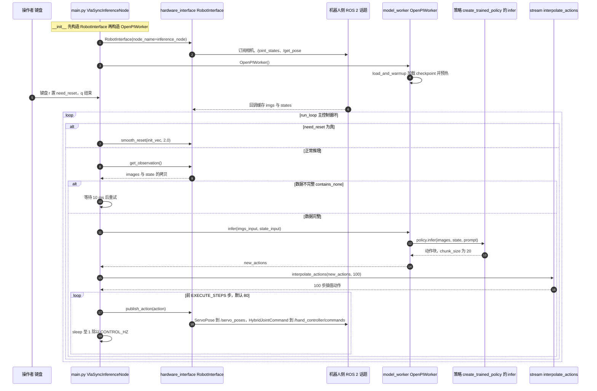

# 星动纪元（ROBOTERA）：数据、大脑与人形整机路线

## 一句话定义

星动纪元以数据、大脑、运控、灵巧手、人形整机组成软硬件全栈；研究入口能分别观察“预测未来怎样帮助动作”和“策略怎样部署到机器人”。

## 英文缩写速查

| 缩写 | 英文全称 | 简要说明 |
| --- | --- | --- |
| VLA | Vision-Language-Action | 视觉和语言条件下生成动作 |
| VPP | Video Prediction Policy | 视频预测表征条件下的动作策略 |
| RL | Reinforcement Learning | 用仿真交互训练运动技能 |
| SDK | Software Development Kit | 应用与机器人服务之间的开发接口 |
| DOF | Degrees of Freedom | 关节可独立运动的自由度 |

## 为什么重要

- [VPP](./paper-shenlan-wm-02-vpp.md)提供视频预测表征到隐式逆动力学的可研究实现；[Humanoid-Gym](./humanoid-gym.md)提供人形 RL 与 sim2sim 路径。这是两条独立研究线，不预设它们共享一个产品 checkpoint。
- 整机路线同时包含双足 L7、固定工位 M7、轮式 Q5 和 XHAND 家族，适合检查本体、数据和接口之间的约束。
- [M7 VLA 基线](./cn-os-robotera-vla.md)、[遥操作接口](./cn-os-teleop-client.md)和[控制 SDK](./cn-os-xbot-sdk-api.md)可作为工程入口，开放边界须逐层核对。

## 核心信息与事件沿革

| 事件 | 时间与阅读口径 |
| --- | --- |
| 机构 | 星动纪元（ROBOTERA），世界机器人大会展商自述为清华大学持股企业；创始人陈建宇 |
| 成立 | 2023-08，以展商介绍明确的成立月份计 |
| Humanoid-Gym | 2024-04-08 论文 v1：Isaac Gym 训练、MuJoCo sim2sim、XBot-S/L 真机验证 |
| VPP | 2024-12-19 论文 v1；ICML 2025 Spotlight 联合研究，代码与部分资产可获取 |
| ERA-42 | 2024-12-23 产品发布；发布材料强调多模态输入、世界模型与 XHAND1 灵巧操作 |
| 星动 L7 | 2025-07-22 产品发布；公开资料报告 171 cm、55 自由度，演示运动与操作 |
| 工程接口 | SDK、遥操作、M7 VLA 仓按持续维护入口阅读；首发日期尚未确认 |

ERA-42 与 L7 的日期分别取公开发布记录正文，资料页发布日期晚两天/一天。当前官网列有更新的产品家族，本页不把硬件演示、训练代码开放和模型资产发布合成同一个事件。

## 三层技术结构

| 层 | 公开入口 | 可回答的问题 |
| --- | --- | --- |
| 世界与动作 | VPP；ERA-42 产品材料 | 前者可读预测表征与动作头；后者显示产品定位，不能仅凭宣传还原训练配方 |
| 整机与数据接口 | L7 / M7 / Q5、XHAND、teleop_client、robotera_vla | 本体适配、示范采集和 VLA 部署怎样连接 |
| 运动技能与执行 | Humanoid-Gym、xbot_sdk_api | 仿真策略如何校验；应用如何初始化、读取状态和发送控制目标 |

## 开放范围与工程实践

截至 2026-10-08，Humanoid-Gym 有公开训练/仿真代码；VPP 有训练、评测、真机适配脚本与部分模型/潜数据。`robotera_vla` 是 M7 / π₀.₅ 示例链路，根 README 明确机器人侧 recorder / 遥操作服务不在仓内。SDK 与遥操作文档依赖厂商环境或授权文件。

ERA-42 官网入口及发布材料未列完整训练代码、权重和数据下载。上述研究和示例资产的开放不能代表 ERA-42 产品全部开放。复现顺序可先选 Humanoid-Gym 仿真或 VPP CALVIN，再核对真机消息、动作规范和授权环境；不直接把大模型输出接入未知机型的控制接口。

## 局限与风险

- “100+ 任务”、泛化和物流部署等属于各来源的报告，缺少统一条件，不用于跨公司排名。
- VPP 为多机构联合成果；Humanoid-Gym 的 XBot-S/L、L7 产品和 M7 示例本体不能互换实验参数。
- SDK 公共封装不证明厂商低层服务、全身策略和训练池全部公开；工程仓的 README 修改时间不作为首发日期。

## 源码运行时序图

入口：容器内执行 `python inference/examples/main.py`（README 写作 `inference/example/main.py`，与仓库实际目录 `examples/` 不一致，以实际文件为准）；该脚本是 M7 推理部署示例，机器人侧 ROS 2 服务不在仓内。

图依据：roboterax/robotera_vla@9ff7067，读过 `README.md`、`inference/README.md`、`inference/examples/main.py`、`inference/examples/model_worker.py`、`inference/examples/hardware_interface.py`（`__init__`、`get_observation`、`publish_action`、`smooth_reset` 签名）、`inference/examples/stream.py`（`interpolate_actions`）、`inference/examples/config.py`（`MODEL_CFG`、`CONTROL_HZ`）、`inference.Dockerfile`（grep 出的 CMD/WORKDIR）；策略内部 `create_trained_policy` 与 `training/` 未读，图中仅画到 `policy.infer` 调用点。未运行代码。

## 关联页面

- [公司路线对照](../comparisons/robot-foundation-model-company-paths-2026.md)
- [VPP](./paper-shenlan-wm-02-vpp.md)、[Humanoid-Gym](./humanoid-gym.md)
- [M7 VLA 基线](./cn-os-robotera-vla.md)、[控制 SDK](./cn-os-xbot-sdk-api.md)、[遥操作接口](./cn-os-teleop-client.md)

## 参考来源

- [公司、官网与日期核查](../../sources/sites/robotera.md)
- [M7 VLA 仓库补核](../../sources/repos/robotera_vla.md)
- [SDK 补核](../../sources/repos/xbot_sdk_api.md)
- [遥操作补核](../../sources/repos/teleop_client.md)
- 源码核对（2026-11-02）：roboterax/robotera_vla@9ff7067，读过 `README.md`、`inference/README.md`、`inference/examples/main.py`、`model_worker.py`、`hardware_interface.py`、`stream.py`、`config.py`、`inference.Dockerfile`；时序图依据以上文件，未运行代码。

## 推荐继续阅读

- [官网](https://www.robotera.com/)、[世界机器人大会展商介绍](https://wrc.cie.org.cn/expo/company/438.html)
- [VPP 官方项目](https://video-prediction-policy.github.io/)、[Humanoid-Gym 项目](https://sites.google.com/view/humanoid-gym/)
