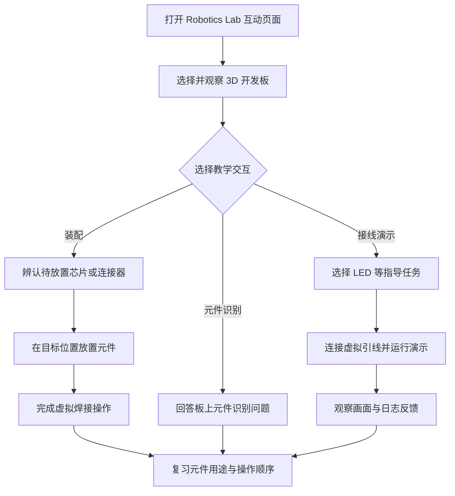

# Robotics Lab — Movez 的在线 3D 机器人工程实验室 / Interactive 3D Robotics Hardware Lab

## 一句话定义

**Robotics Lab** 是 Movez 于 **2026-11-10** 发布的浏览器端 **3D 机器人硬件学习演示**：从开发板外观和元件位置入手，通过虚拟装配、焊接与接线任务帮助初学者认识电子元件和通用 I/O；**现有证据只支持将其归类为互动教学工具，不能等同经过验证的电路级仿真器**。

## 英文缩写速查

| 缩写 | 英文全称 | 简要说明 |
|------|----------|----------|
| GPIO | General-Purpose Input/Output | 开发板用于输入或输出的通用数字引脚，是作者宣传的学习目标 |
| PCB | Printed Circuit Board | 装配交互中放置芯片、连接器与排针的电路板 |
| LED | Light-Emitting Diode | Hello, LED 教学任务观察的发光二极管 |
| MCU | Microcontroller Unit | Arduino Uno 等开发板使用的微控制器；不代表本项目已模拟 MCU 内核 |
| 3D | Three-Dimensional | 浏览器中的三维板卡、元件与操作视图 |

## 为什么重要

嵌入式与机器人硬件初学者往往先被器件外观、引脚标注、接线方向和装配顺序难住。Robotics Lab 用可交互的 3D 场景，把这些**视觉识别与操作步骤**变成可在网页中重复练习的任务，适合在实体实验前熟悉开发板。

它与 [Wokwi](./wokwi.md) 等仿真工具的重点不同：前者当前能核实的是视觉装配和教学演示；后者具备公开的 MCU/外设仿真与固件执行资料。初学时可以先看结构，再逐步过渡到固件和实物验证。

## 核心原理：已公开的交互路径

作者的 **2026-11-10 原始公告**明确主张：免费、免注册、**8 款** 3D 开发板（举例 Arduino Uno 和 Raspberry Pi 4）、逐件放置芯片/连接器/排针并模拟焊接，以及 LED、传感器、电机相关的接线演示；作者将 3D 模型制作归功于 **Fable 5.2 的纯代码生成**。这些属于**作者声明**，不能直接作为源代码分析结论。

独立体验文章 Neon Gamewall（2026-11-11）报告在 Chrome 中完成了 Arduino Uno 拆分后放回首个元件、回答元件识别问题，并运行 Hello, LED：页面闪烁 LED，串口区显示 D13 HIGH/LOW。该体验者没有测试其它七款板卡、全部课程或手机端。

| 功能维度 | 当前有据可查的范围 | 不应外推为 |
|---|---|---|
| 板卡范围 | 作者宣称 8 款，明确点名 Arduino Uno、Raspberry Pi 4 | ESP32 必然在名单里，或 Pi 4 的 Linux 运行已被模拟 |
| 元件装配 | Uno 教学任务有部件拖放和虚拟焊接操作 | 真实烙铁温度、焊料流动、焊点可靠性仿真 |
| 引脚连线 | 作者展示 LED、传感器、电机教学案例 | 所有引脚的电气约束、驱动能力和实时信号均经建模 |
| 运行反馈 | Hello, LED 有视觉反馈和 D13 HIGH/LOW 日志 | 任意用户固件可运行、CPU 周期准确或电路达到 SPICE 精度 |
| 3D 素材 | 作者称模型以代码生成、无现成 3D 文件或照片 | 已独立审计模型生成流程或全部资产来源 |

### 项目流程图（交互教学路径，非源码架构）

下图仅描述**作者公告与已公开体验共同支持**的可见交互，不表示未知的程序内部模块或电路求解器。

上述分支表示产品的学习模式，不意味着焊接过程或元件识别与运行模块在底层具有所画的程序调用关系。

## 工程实践

1. **先识别开发板：** 从 Arduino Uno 开始，认识 PCB 上的芯片、接口、排针、引脚名称；再与 [Arduino UNO R3 官方资料](https://docs.arduino.cc/hardware/uno-rev3/) 逐一对照，避免从 3D 外观误读引脚能力。
2. **再做 Hello, LED：** 在页面中走通布线与运行引导，观察 LED 状态及 D13 HIGH/LOW 日志；重点理解**输出控制与反馈**，不要把视觉闪烁当作示波器测量。
3. **继续学习电气约束：** 转到 [Wokwi](./wokwi.md) 或 [Tinkercad](./tinkercad.md) 练习基础电路与代码，再用真实板卡测量逻辑电平、电流、负载和异常情况。
4. **如需分析电机驱动：** 还要核对驱动芯片数据手册、供电、反电动势、PWM、额定电流和保护策略；“演示电机旋转”不足以验证机器人驱动硬件。

**源码运行时序图：不适用（截至 2026-11-12 没有找到可确认属于该产品的公开源码或官方运行入口）**；不得凭网页动画猜测软件调用链。

## 与 Robotics Bench、Wokwi 的区别

- [Robotics Bench](./robotics-bench.md)（robotics-engineer.vercel.app）是此前入库、与 Colorfigures 相关的交互式硬件演示，介绍过 **13** 类设备；与本条发布于 **11 月 10 日**、作者称 **Fable 5.2 + 8 款开发板**的 Robotics Lab 是**不同网址、不同公开说明**，不要混为一个项目。
- [Wokwi](./wokwi.md) 重点是固件、模拟 MCU 与电子外设的可执行测试；其可复现的技术能力比仅展示视觉效果所能证明的范围更深。
- [机器人仿真三层分工](../concepts/robot-simulation-three-layers.md) 帮助区分 3D 教学可视化、嵌入式电子仿真与机器人物理仿真，三者不能互相替代。

## 局限与风险

- **原文核对范围：** 已完整阅读作者 **2026-11-10 公告**并归档；官方交互站点在当前网页读取工具中无法取得正文，故其全部工作模式与技术实现**未完成实测**。这里的原文通读得分只代表**所引用作者原始公告**，不代表已读完未公开的代码或文档。
- **非已证实开源：** 未发现可核验的本项目 GitHub 或许可证；浏览器可免费体验不等于开源。
- **成本营销：** “省下 500 美元入门套件”是宣传对比，缺乏 BOM/实验课程和成本基准；尤其**不能替代实体焊接、电源保护、EMC、仪器测量和安全训练**。
- **电路真实性未知：** 不能据此认定真实 GPIO 时序、电流电压、热故障、电机负载和固件执行均受物理求解器支持。
- **板卡清单不完整：** 作者仅明确列出 Arduino Uno 和 Raspberry Pi 4；原始帖未逐项列出另外六款，**ESP32 是否包含尚待页面实测确认**。
- **3D 生成方式未审计：** Fable 5.2 生成资产是作者自述，未取得源文件或生成记录核验。

## 关联页面

- [Wokwi](./wokwi.md) — 已公开 MCU 固件与外设仿真能力的在线实验室。
- [Robotics Bench](./robotics-bench.md) — 同一作者另一个网址、不同 3D 创作声明的视觉教学演示。
- [Tinkercad](./tinkercad.md) — 3D 设计和入门电子电路教学平台。
- [机器人仿真三层分工](../concepts/robot-simulation-three-layers.md) — 识别可视化、电子仿真与刚体动力学边界。

## 参考来源

- [作者原始首发公告（全文核读归档，2026-11-10）](../../sources/blogs/movez-robotics-lab-2026-11-10.md)
- [Robotics Lab 项目入口与网站核查记录](../../sources/sites/robotics-lab-movez.md)
- [作者 X 账号 @0xMovez](https://x.com/0xMovez)（检索其 2026-11-10 Robotics Lab 原帖）
- [Neon Gamewall 对 Uno 装配和 LED 的独立体验，2026-11-11](https://neongamewall.com/game/robotics-lab)（第三方观察，不是作者技术说明）

## 推荐继续阅读

- [Robotics Lab 作者发布的在线体验](https://robotics-lab-app.vercel.app/)
- [Arduino UNO R3 硬件资料](https://docs.arduino.cc/hardware/uno-rev3/)
- [Wokwi 官方支持硬件](https://docs.wokwi.com/getting-started/supported-hardware)
