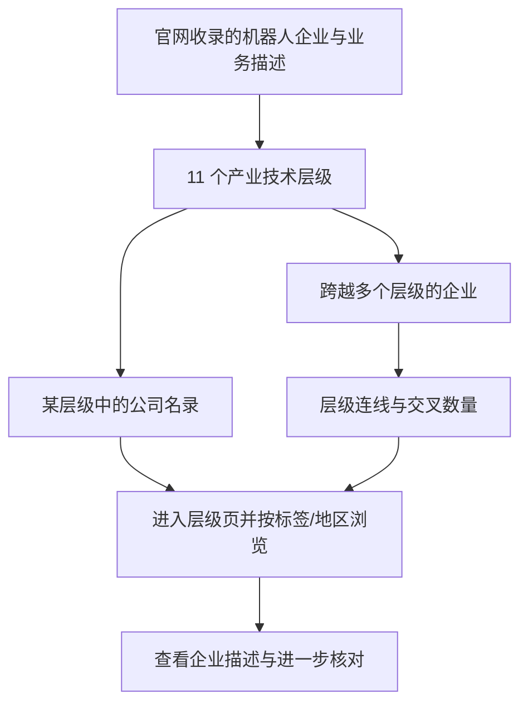

# The Robotics Map（机器人产业生态地图）

## 一句话定义

**The Robotics Map**（[roboticsmap.org](https://roboticsmap.org/)）是 Sam Padilla、Varun Nair 维护的**机器人产业链交互地图**：按数据来源、工具/部件、仿真/模型/机器人、运营/测评/部署这条价值链组织企业，以跨层连接表示同一企业进入多个技术层级。

## 英文缩写速查

| 缩写 | 英文全称 | 简要说明 |
|---|---|---|
| VLA | Vision-Language-Action | Models 层相关视觉-语言-动作策略类别 |
| API | Application Programming Interface | 用于区分企业真实提供的接口/平台与仅有研究演示 |
| ROS | Robot Operating System | Runtime & ops 层涉及的机器人软件生态 |
| RL | Reinforcement Learning | 部分模型与仿真产品支持的策略学习技术，不是地图评分指标 |

## 为什么重要

- **把论文/工具与产业位置连起来：** 研究者可从 [VLA](../methods/vla.md)、[Manipulation](../tasks/manipulation.md)、[Sim2Real](../concepts/sim2real.md) 找到对应的模型、仿真、数据和部署供给侧。
- **识别纵向集成：** 不只看某一赛道里有哪些企业，还能看它们是否横跨模型、本体、仿真、数据平台或现场部署。
- **作为供应商发现入口：** 从技术层查公司名录，再跳回各公司的官方项目与产品页做实际能力核实。

## 核心机制

### 四组、11 个层级

| 阅读方向 | 层级（2026-10 官网数量） |
|---|---|
| Sources：数据源 | Capture hardware（26）、Data producers（16） |
| Inputs：输入与基础设施 | Components（21）、Data services（53）、Data tools（19） |
| Core：核心能力 | Simulation（23）、Models（28）、Robots（67） |
| In the field：现场 | Runtime & ops（22）、Testing & safety（9）、Deployments（60） |

官网显示 **292 家公司，48 家跨两个及以上层级**，各层企业数不能直接相加得出独立企业数。最高交叉连接为 **Deployments ⇄ Robots：19**；其后有 Data services ⇄ Data tools（4）、Deployments ⇄ Models（4）等。上述均是官网 2026 年 10 月标注的策展快照，不是产业全量统计或对外部企业声明的审计。

### 流程总览（信息组织与浏览路径）

这是依据官网「How to read this map」整理的**内容组织逻辑图**，不是网站源码的实现架构图。官网解释：某层特有的企业环绕该站点，跨两层的企业显示在连接线上；跨四层或以上的企业不画连接线，而是在相应层内部出现，官网当时注明只有 NVIDIA。

## 工程实践

1. **找技术供给：** 例如要比较训练仿真平台，进入 [Simulation](https://roboticsmap.org/l/simulation) 层，先浏览 MuJoCo、Gazebo、Webots、NVIDIA 等官方地图条目，再分别验证产品功能、开源许可与支持硬件。
2. **找模型生态：** 从 [Models](https://roboticsmap.org/l/models) 切入，与本库 [VLA](../methods/vla.md) 技术页对照；区分模型研发、机器人本体和真实部署，不把被收录理解为性能合格。
3. **找交付服务：** 从 [Deployments](https://roboticsmap.org/l/deployments) 和 [Runtime & ops](https://roboticsmap.org/l/runtime) 观察现场机器人运营/集成商，再追到各公司原始商业资料核验部署规模、服务区域和条件。
4. **做动态调研：** 记录访问日期、官网层级和标签，对任何报价、融资、产品可用性或指标返回公司一手资料核对；官网提供了提交遗漏公司建议的入口。

**源码运行时序图：不适用。** 截至 2026-11-17，所读官网首页及 11 个层级页未提供这个网站本身的公开源码、训练/推理执行入口或数据仓库链接。此项目是在线产业导航，不是可复现的机器人模型/算法实现。

## 与其他工作对比

- [awesome-physical-ai（aichr）](./awesome-physical-ai-aichr.md)：面向论文、工具、硬件、教程的开源策展清单；The Robotics Map 面向**企业及其商业技术层级交叉**。
- [具身产业库（Embodied Industry DB）](./embodied-industry-db.md)：使用来源快照、事件 YAML 和可审查的时间线记录产业事实；The Robotics Map 更适合**快速发现公司与业务版图**，不应替代事实时间线。
- [海外具身智能实验室地图](../overview/overseas-embodied-ai-labs-landscape-2026.md)：以科研实验室为中心；本地图以商业主体及产品层级为中心，统计口径不同。

## 局限与风险

- **人工策展而非完整人口普查：** 企业遗漏、区域偏差和层级归类变更均会影响观察；数字有时间戳，不能当作持续实时更新的行业份额。
- **分类交叉不等于技术联调/客户合作：** 连线表示同一公司在两个层级均有实际产品，不代表两家公司互通或已完成某项交付。
- **不提供统一性能评测：** 收录公司不等于其 VLA 成功率、安全、成本和实际部署表现得到了独立确认。
- **开源状态：** 未发现地图网站本身的公开 GitHub/数据下载入口，不应误标为开源；地图中列出的 MuJoCo、ROS 等开源产品，不代表地图项目开源。

## 关联页面

- [机器人训练数据市场：2027 展望](../comparisons/robotics-training-data-market-2027.md) — 由同一位维护者发表的访谈观察，和地图名录口径分开，用于提炼采购试验。

- [awesome-physical-ai（aichr）](./awesome-physical-ai-aichr.md) — 开源资料策展，和企业地图互补
- [具身产业库](./embodied-industry-db.md) — 一手证据与事件时间线补充
- [海外具身智能实验室地图](../overview/overseas-embodied-ai-labs-landscape-2026.md) — 科研机构维度
- [VLA](../methods/vla.md) — 模型技术路线
- [Manipulation](../tasks/manipulation.md) — 操作应用场景
- [Sim2Real](../concepts/sim2real.md) — 仿真与部署之间的工程闭环

## 参考来源

- [The Robotics Map 官方网站原始资料归档](../../sources/sites/roboticsmap-org.md) — 首页及全部 11 类官方页面，核对日期 2026-11-17
- [The Robotics Map 官方首页](https://roboticsmap.org/)

## 推荐继续阅读

- [Models 企业分层](https://roboticsmap.org/l/models)
- [Simulation 企业分层](https://roboticsmap.org/l/simulation)
- [Deployments 企业分层](https://roboticsmap.org/l/deployments)
