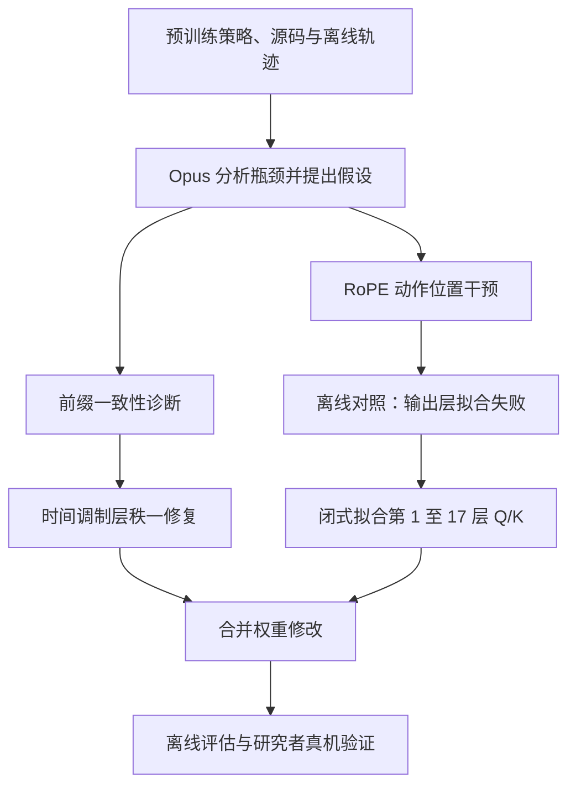

# We Asked Opus-5.5 to Edit π₀.₅'s Weights / 让 Opus 5.5 编辑机器人策略权重

## 一句话定义

研究者让 Opus 5.5 根据离线轨迹和模型机制，不经反向传播地修改 π₀.₅ Training-Time RTC 策略的权重，以探索更快执行和更平滑的动作块切换。

## 英文缩写速查

| 缩写 | 英文全称 | 简要说明 |
|------|----------|----------|
| VLA | Vision-Language-Action | 视觉、语言与动作策略 |
| RTC | Real-Time Chunking | 实时动作分块及衔接 |
| RoPE | Rotary Position Embedding | 旋转位置编码 |
| Q/K | Query / Key | 注意力中的查询与键 |
| TCP | Tool Center Point | 工具中心点 |

## 基本信息

- **作者：** Ziyang Gong 等；Shanghai Innovation Institute、上海交通大学及香港大学，2026 年博客。
- **版本：** [中文原文](https://cuzyoung.github.io/robotics-weight-editing/zh/)，网页仓库提交 `0bea69fe55b167058caeb65969c8a21c229dc6d0`；2026-11-06 通读完整博客及研究提示。
- **设置：** 提供训练好的策略、源码、历史 YAM 轨迹及 1 张 RTX 4090；Opus 通过 Claude Code 离线研究约 111 分钟，未操作真机。研究者随后实施真机验证。
- **约束：** 无反向传播、梯度优化和 LoRA；允许前向实验与闭式拟合；不改生产推理代码，保存可回滚的新 checkpoint。

## 流程总览

## 核心机制

1. **定位瓶颈：** 单次推理约 105–109 ms，短于约 1.073 s 的计划更新周期；研究重点因此转向预测动作的执行节奏，而非推理加速。
2. **RTC 前缀修复：** 最后一次 flow matching 采样更新后未重新恢复条件前缀；当实际延迟短于预留长度时，被改写的条件动作可能进入执行。编辑最终归一化层时间调制权重，使前缀更新接近零；与返回前恢复前缀的一行代码在该实验中效果接近，但实际交付的是权重修改。
3. **节奏加速：** 将动作 RoPE 位置从 `P+i` 干预为 `P+1.25i` 形成 teacher；采集隐藏特征，以正则最小二乘拟合 Q/K 投影，使原有推理位置规则近似产生额外旋转。只拟合末端输出层的方案在留出观测上路径偏差和 jerk 较大，因而被放弃。共享投影对额外旋转的拟合是近似。
4. **组合：** 前缀修复与 Q/K 编辑合并，作者报告修改全模型 1.16% 参数。拟合与留出时刻来自同一批轨迹，不能当作跨轨迹泛化验证。

## 实验与局限

| 对照 | 作者报告 | 解释 |
|------|----------|------|
| 离线联合编辑 | 35 个有效观测中，路径进度比中位数 1.214，偏差 1.071 mm，chunk 内 jerk 比 1.363 | 路径进度并非真实任务完成时间；chunk 内 jerk 增大 |
| YAM 放瓶子 | 30、35、40 Hz 同频原版对照，平均时间分别减少 4.3%、7.4%、12.0%；三档等权的平均切换步长 30.88 → 3.14 mm | 同一布局，每条件各 3 次成功执行；不能据此估计成功率变化 |
| YAM 投硬币 | 夹取后至交接放手阶段 5.849 → 4.641 s，缩短 20.7% | 是局部阶段时间，不是完整任务加速 |
| YAM 叠方块 | 排除一次原版重试后，原版 2 次与编辑版 3 次均值 19.46 → 19.28 s | 未见明显提速；样本很小且均值计算不对称 |
| 离线前缀对照 | 36 个观测的切换步长中位数：原版 19.158 mm，权重修复 1.798 mm，代码修复 1.885 mm | 比较特定输入和前缀条件；两种修复为近似等效 |

时间缩放基线在离线比较中有更低路径偏差和 jerk，但保留原始跳变；作者未比较“前缀修复 + 时间缩放”，故不能断言权重编辑优于所有后处理方案。网站仓库只公开网页、提示和代码摘录，完整实验代码、编辑权重及数据未见公开下载；不能据此复现完整流程。

## 源码运行时序图

不适用：公开仓库是网站与局部代码摘录，未发现可运行的权重编辑实验入口；不能以网页展示脚本推测策略运行时序。

## 关联页面

- [Weight-Space Programming](weight-space-programming.md)：原文的研究动机来源；本项目侧重机器人策略与真机验证。

## 参考来源

- [中文原文及开放状态归档](../../sources/sites/robotics-weight-editing.md)
- [网页仓库归档](../../sources/repos/robotics-weight-editing.md)
